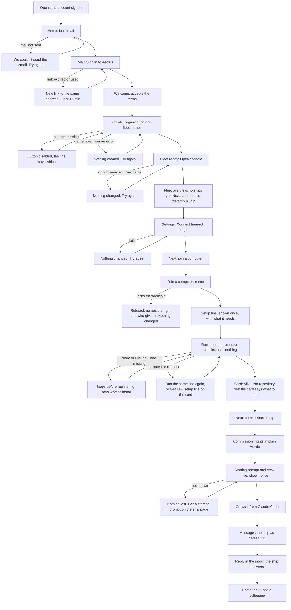
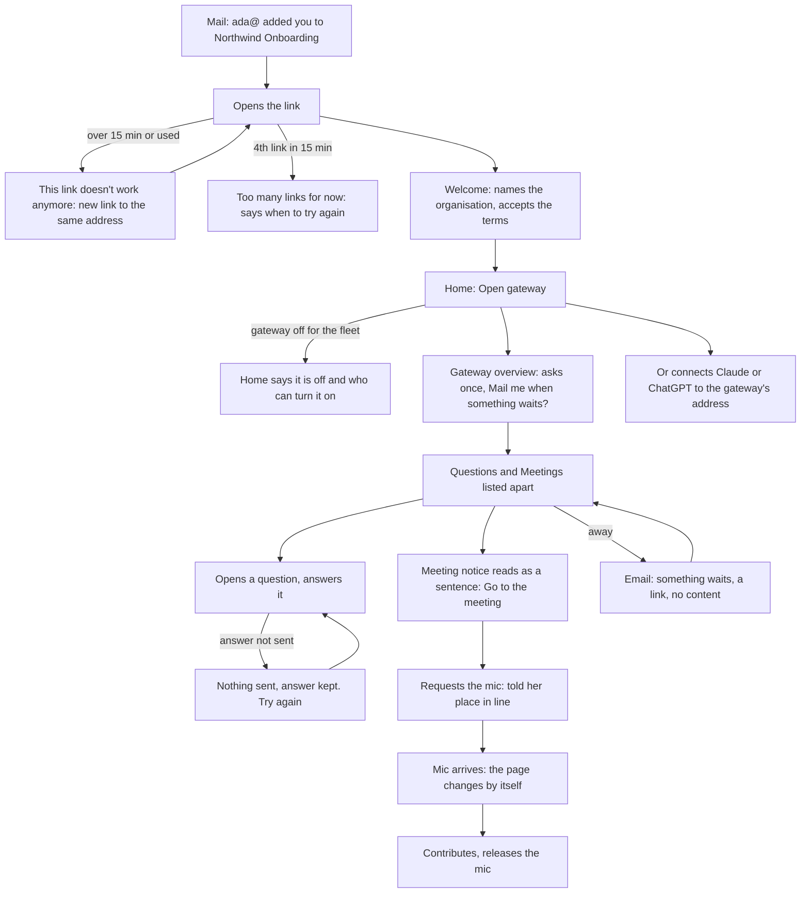

# Onboarding: getting into the fleet

Design for [#1228](https://github.com/ThomasHendrickx/aeolus-fleet/issues/1228), Aeolus 0.33.0. Docs only: nothing here is built until Thomas approves it. Stage 2: the design and its acceptance criteria.

Status (Thomas, 27 Oct): the mockups in section 6 and the screen-bound scenarios in section 8 are parked until the design system and the redesign pass. The journeys, independent of any screen, are in [journeys.md](journeys.md).

## 1. Purpose (agreed by Thomas, 27 Oct)

A new person in a company gets from "I was told to try Aeolus" to doing their part in the fleet without help, a guess, or someone who knows the insides. This is the hosted path: sign-up and sign-in by mailed link at the account app, the first fleet, the console, joining a computer, commissioning and crewing ships, and inviting colleagues who use the gateway.

Thomas (25 Oct): "Since our main advantage now against the competition we identified is our focus on connecting technical to non technical people on a company, user friendlynes to get into the fleet should be flawless". Getting in has to work for both people the product connects.

For whom:
- **The technical person** (Ada in the audit) who signs up, sets the fleet up, joins a computer and crews the first ship.
- **The non-technical colleague** (Bea) who is invited, answers ships, joins meetings and may use Claude or ChatGPT through the gateway. Bea never sees a terminal.
- **The organisation admin**, who is the first person to sign up and holds the organisation (0051).

The outcomes:
1. Ada goes from the sign-up mail to her first ship answering her message in one sitting, and at each screen sees what comes next. She never needs to know that argo, a scope or a harness exists to get there.
2. Ada invites Bea and the fleet is ready for Bea: what she was given works, with nothing Ada must ask the hosting service for.
3. Bea goes from the invite mail to her first answered question without meeting an id, JSON or a word nobody explained, and is told when something waits while she is away.
4. A step that fails or is interrupted says what happened, whether anything changed, and the next step. Nobody is stranded, and nobody needs argo's fail-safe (0012) to get past a normal step.
5. A new technical person and a new non-technical person, each walked on staging with no help, reach their first ship answering (Ada) and their first answered question (Bea).

Not the purpose (each is its own issue already, or outside the hosted path):
- A marketing site and what it says (staging has none).
- Listing Aeolus in the chat apps' directories ([#1214](https://github.com/ThomasHendrickx/aeolus-fleet/issues/1214)), ships as Slack bots ([#1227](https://github.com/ThomasHendrickx/aeolus-fleet/issues/1227)), waking a person through chat bots ([#1078](https://github.com/ThomasHendrickx/aeolus-fleet/issues/1078)), the channels research ([#1229](https://github.com/ThomasHendrickx/aeolus-fleet/issues/1229)).
- Connecting Entra or Google for a company ([company-sign-in design](../accounts/company-sign-in.md)).
- Self-hosted installs (one person, as argo).

## 2. Lessons to check against

### 2.1 What the audit found, and what still holds

Source: the onboarding audit, [PR #1232](https://github.com/ThomasHendrickx/aeolus-fleet/pull/1232), `docs/audits/onboarding-2026-10-25/README.md`, walked on staging at 0.31.0 as Ada and Bea. Its frictions are numbered there (F1 to F28). Status is read from the issues and merged work at 0.32.0 and on main, not walked again.

| Status | Frictions |
| --- | --- |
| Fixed | F3 plugin install not explained, wrong guide command ([#1235](https://github.com/ThomasHendrickx/aeolus-fleet/issues/1235), #1251). F4 an interrupted setup locks the ship ([#1236](https://github.com/ThomasHendrickx/aeolus-fleet/issues/1236)). F7 gateway Overview scrolls sideways ([#1238](https://github.com/ThomasHendrickx/aeolus-fleet/issues/1238)). F18 stuck delivery in red after joining a machine ([#1249](https://github.com/ThomasHendrickx/aeolus-fleet/issues/1249)). F19 disabled Connect buttons without a reason ([#1250](https://github.com/ThomasHendrickx/aeolus-fleet/issues/1250)) |
| Fixed in core, not proven on hosted | F2 the fleet's creator cannot join a machine ([#1234](https://github.com/ThomasHendrickx/aeolus-fleet/issues/1234), #1253). On staging at 0.32.0 pagasae still ran common 0.30.0 and the join was refused again: [#1303](https://github.com/ThomasHendrickx/aeolus-fleet/issues/1303), release order in [#1258](https://github.com/ThomasHendrickx/aeolus-fleet/issues/1258) |
| New since the audit | A trierarch upgraded to 0.32.0 does not start because the Claude Code plugin was renamed ([#1312](https://github.com/ThomasHendrickx/aeolus-fleet/issues/1312)) |
| Holds, issue open | F1 no gateway in a new fleet, nobody in the organisation can switch it on ([#1233](https://github.com/ThomasHendrickx/aeolus-fleet/issues/1233)). F6 raw JSON in meeting notices ([#1237](https://github.com/ThomasHendrickx/aeolus-fleet/issues/1237)). F8 a lost setup line cannot be got again ([#1239](https://github.com/ThomasHendrickx/aeolus-fleet/issues/1239)). F9 mic arrival not shown ([#1240](https://github.com/ThomasHendrickx/aeolus-fleet/issues/1240)). F10 list fills with notices needing no action ([#1241](https://github.com/ThomasHendrickx/aeolus-fleet/issues/1241)). F11 email alerts off ([#1242](https://github.com/ThomasHendrickx/aeolus-fleet/issues/1242)). F12 nine unexplained setup questions ([#1243](https://github.com/ThomasHendrickx/aeolus-fleet/issues/1243)). F13 setup checks neither Claude Code nor Node ([#1244](https://github.com/ThomasHendrickx/aeolus-fleet/issues/1244)). F14 17 switches and no way to add one later ([#1245](https://github.com/ThomasHendrickx/aeolus-fleet/issues/1245)). F15 empty starting prompt after Commission ([#1246](https://github.com/ThomasHendrickx/aeolus-fleet/issues/1246)). F16 invite mail names no inviter ([#1247](https://github.com/ThomasHendrickx/aeolus-fleet/issues/1247)). F17 "Can't reach the sign-in service" after sign-up ([#1248](https://github.com/ThomasHendrickx/aeolus-fleet/issues/1248)) |
| Holds, no issue | F20 to F28, the rough ones: Help goes to GitHub, unexplained words, "Only argo so far", Settings text, silent disabled Create fleet, GMT times, clipped column, Release text, internal ships in the MCP list |
| Not a block | F5 ChatGPT's connection (checked in the audit; one part unproven) |

Not walked in the audit: the site, production's plugin defaults for new fleets, Codex, a real company directory, claude.ai and ChatGPT themselves, a real laptop after setup, Claude Code interactively. These stay unknown here too.

### 2.2 Decisions and designs

| # | Lesson | Source |
| --- | --- | --- |
| L1 | Sign-up creates the organisation, its first account (organisation admin, allowed as argo) and its first fleet. The fleet manager holds every scope the fleet offers. The organisation admin's right never implies fleet scopes | 0051; accounts design, Q13 |
| L2 | pagasae signs every account in by mailed link; Home, groups and rights live in the account app, the fleet's management in the console. One sign-in for every app | 0054, 0052 |
| L3 | Adding a computer takes `trierarch:join`, checked on whoever adds it; a trierarch on a person's computer is owned by their person ship | 0055, 0030 |
| L4 | Argo is the fail-safe, never a normal path. Every argo job is a scope any actor can hold | 0012, 0053 |
| L5 | A secret (starting prompt, crew line, setup line) is shown once; a new one stops the old one. A lease is held until released, a second claim fails | 0010, `StartingPromptBlock`, `CrewLineBlock` |
| L6 | The installation sets one guide per audience (1 to 10 steps) and notices; progress is kept per account. Take the tour opens it again | 0024, 0023 |
| L7 | A person reaches the fleet through the gateway's one address; it finds the fleet from the account and crews the person ship. The gateway has basic pages of its own for a person with no chat at hand | 0054; accounts design, Q8 to Q10 |
| L8 | Waking a person: consent first, nothing on by default, email sent by pagasae, no content in the wake | wake-a-person design, W2, W4, W8 |
| L9 | Domain language: one meaning per term, defined in the blueprint; invent no synonyms | 0050; CLAUDE.md |
| L10 | Errors say what failed, whether anything changed, and what to do. An EmptyState says what is empty and what happens next, with one action only when the person can fix it from here. A disabled control shows its reason | `conventions.md`, InlineError, EmptyState |
| L11 | A mic request answers with the queue: "it returns a success message with the current queue so you see who has the mic when and your place on the queue" (Thomas, 27 Oct) | [#1240](https://github.com/ThomasHendrickx/aeolus-fleet/issues/1240) comment |
| L12 | Before 1.0.0 breaking changes are allowed; keep designs minimal | 0013 |
| L13 | A fix that crosses packages is a cross-package contract: the setup line is built by the trierarch plugin during `machines.join`, the starting prompt by core | [#1239](https://github.com/ThomasHendrickx/aeolus-fleet/issues/1239) comment; 0049 |
| L14 | A fix that passes in core can still fail on hosted when another train lags a version | [#1303](https://github.com/ThomasHendrickx/aeolus-fleet/issues/1303), [#1258](https://github.com/ThomasHendrickx/aeolus-fleet/issues/1258) |

## 3. Decisions (Thomas, 27 Oct)

Each answer was the pick. Thomas: "I made some assumptions answering the questions, but I don't want to start doing like major changes based on those assumptions. So every time that we are going to do adjustments on screens and everything like that, I do want to have a gate that goes through me to make sure that everything is approved before it goes through."

| # | Decision | Assumption it rests on |
| --- | --- | --- |
| Q1 | Scenarios per friction, tested in the console, gateway and account app, and one final walk of both people on staging as the release gate | |
| Q2 | Each page's empty state names the next step from the fleet's own state; the guide stays a short orientation | The fleet knows each state (see 4.1) |
| Q3 | The installation's default for new fleets includes the gateway; where it is off, Home tells the colleague why | Production's default (4.2) |
| Q4 | Design for the technical person first; the hand-off is named where Join a computer is refused | |
| Q5 | The setup line asks nothing and applies safe defaults; changes come later | The console can change them later (4.3); the defaults are safe (4.4) |
| Q6 | The Trierarchs page gets a new setup line for a computer whose setup has not finished | "Not finished" can be told (4.5) |
| Q7 | Each right as the sentence “Your rights” uses, grouped by what the ship does, scope name in mono beside it; a reason beside the disabled button; a Grant on the ship page | |
| Q8 | The first time a colleague opens the gateway after an invite it asks once: “Mail me when something waits?” | |
| Q9 | The invite mail names the inviter and the organisation and says what Aeolus is; the welcome page names the organisation; an expired link's page offers a new link to the same address | The expired link still knows its address (4.6) |
| Q10 | Bea's pages show fewer terms (2); Ada's console explains each term once where it first appears (1). No term is renamed | |

The gate: every screen, mail and terminal text below is a mockup first. Nothing is built until Thomas approves that mockup, each one on its own. Approval is recorded on the pull request, mockup by mockup.

## 4. What this design could not check

1. **The fleet's state for the next step (Q2).** Plugin connected, computer joined and ship commissioned are known to the console today (Trierarchs and the fleet read). Whether a colleague has joined is the count of person ships in the fleet, which I read from the ship kinds (0044) and did not test.
2. **Production's plugin defaults (Q3).** They live in pagasae's `plugin_defaults` table, set by the app admin at `/admin/settings`. No repository holds production's values. The only hint is a comment in the infrastructure repository's `walk/seed.ts`: "turns the gateway on for new fleets as production has it". Staging is reset and seeded to match. Q3 is only met if production has the switch on; Thomas or the app admin confirms it, nothing in the code does.
3. **Changing the setup choices later (Q5).** Thomas's answer says "from the console or a command". Decision 0027 says the console never carries paths or flags, so the console cannot change caps, permission flags or repositories. Today the later change is a command on the computer (`aeolus-trierarch init` again, `aeolus-trierarch add repository`, or editing `config.json`). The design uses the command and says so; see question N3.
4. **What the safe defaults do (Q5).** `init --yes` takes caps 4 and 2, Claude Code without `--dangerously-skip-permissions`, no remote control, and no repository or folder. Two effects follow that I could not check without a walk: a session that asks before every tool may wait for an answer nobody gives (N2), and a computer with no repository or folder "can crew no request", so the first ship needs one more step (the mockup of the computer card).
5. **A computer whose setup has not finished (Q6).** The plugin stores nothing per computer. A computer that registered and has not reported shows as crewed with no report. That is an inference, not a stored state. A setup stopped before registering shows as awaiting crew.
6. **The expired link's address (Q9).** The page needs the address the link was sent to. I could not tell whether the sign-in link row keeps it after expiry. The mockup masks it (`b••@northwind.example`).
7. **Her time zone (gateway).** The gateway does not know the viewer's time zone today. The browser does; the design reads it there.
8. **Which gateway tabs Bea sees.** The gateway shows Overview, Outside parties and Parties. I did not check whether Bea's missing approver right already hides the last two.
9. **Fixed since the audit, not walked.** F2, F3, F4, F7, F18, F19 (stage 1, 2.1) are held by scenarios and the final walk, not shown again.

## 5. The journeys

### 5.1 Ada, to be



### 5.2 Bea, to be



## 6. What changes

The rule: a mockup for every screen, mail or terminal text whose layout or content changes. A change that is wording only is in 6.2, with before and after text, and has no mockup. Mockups use the real tokens (`packages/common/src/header/tokens.css`, which the console, gateway and account app each carry a byte-identical copy of) and Geist, rendered at 390 and 1440 px, light and dark, in [mockups/](mockups/). Each file shows the screen before, then after, with the invented content of the Northwind Onboarding example. Where I wrote new words the new words are the copy.

### 6.1 Mockups for Thomas to approve

| # | Screen | Answer | Mockup | What it changes |
| --- | --- | --- | --- | --- |
| M1 | Invite mail | Q9 | [invite-mail](mockups/png/invite-mail-1440-light.png) | Inviter's email in subject and body; what Aeolus is and what the person does, in two sentences; the expired-link line says opening it again asks for a new link |
| M2 | Welcome page | Q9 | [account-welcome](mockups/png/account-welcome-1440-light.png) | One line: the inviter added you to the organisation |
| M3 | Expired link page | Q9 | [account-link-expired](mockups/png/account-link-expired-1440-light.png) | Offers a new link to the masked address in one press; the fourth press within 15 minutes says when to try again |
| M4 | Home of an invited colleague | Q10 | [account-home-colleague](mockups/png/account-home-colleague-1440-light.png) | No fleet-management words; "Open gateway" is the one action; ship explained once |
| M5 | Home of the first account | Q2 | [account-home-admin](mockups/png/account-home-admin-1440-light.png) | While the organisation has one account, People and groups says: add a colleague |
| M6 | Create fleet, Fleet ready | Q2 | [account-create-fleet](mockups/png/account-create-fleet-1440-light.png) | The disabled button says what is missing; Fleet ready says the console shows what to set up first |
| M7 | Fleet overview, empty | Q2 | [console-fleet-overview](mockups/png/console-fleet-overview-1440-light.png) | One next step per state (connect the plugin, join a computer, commission a ship), or who can when the viewer may not; Ada's own ship marked as hers, with no crew to get |
| M8 | Join a computer | Q4, Q6, Q10 | [console-join-computer](mockups/png/console-join-computer-1440-light.png) | Refusal names the right and who gives it; the setup line says what it needs and what happens if lost; the trierarch explained once |
| M9 | Computer card | Q5, Q6 | [console-trierarch-card](mockups/png/console-trierarch-card-1440-light.png) | Setup not finished with Get new setup line; a computer with no repository or folder says what to run |
| M10 | Setup in the terminal | Q5 | [terminal-setup](mockups/png/terminal-setup-1440-light.png) | Checks Node and Claude Code first; no questions; says what it set and the next step |
| M11 | Commission ship | Q7 | [console-commission](mockups/png/console-commission-1440-light.png) | Rights in plain sentences by group, scope name in mono; the reason next to the disabled button; the empty prompt dialog says what happened |
| M12 | Ship page, give rights | Q7 | [console-ship-grant](mockups/png/console-ship-grant-1440-light.png) | Give more rights from the ship's page, only rights the viewer holds |
| M13 | Gateway overview | Q8, Q10 | [gateway-overview](mockups/png/gateway-overview-1440-light.png) | Asks once about email; Questions and Meetings listed apart, meeting notices out of the count; times in her zone; only the tabs she may use |
| M14 | Meeting notice and mic | Q10 | [gateway-meeting](mockups/png/gateway-meeting-1440-light.png) | The notice reads as a sentence with Go to the meeting; requesting the mic says the place in line; the page changes when the mic arrives |

Files are `<name>-<390 or 1440>-<light or dark>.png` beside their `<name>.html`. The commission mockup shortens two groups to "… more in the same form"; the build shows all 17.

### 6.2 Wording only

| Friction | Where | Before | After |
| --- | --- | --- | --- |
| F6 | Console Inbox, a meeting notice | the raw message with ids | the sentence of M14, with Go to the meeting |
| F9 | MCP, `aeolus_request_mic` | `{}` | the place in line and who holds the mic (L11) |
| F23 | Console Settings | "Only argo, the operator, sees this page." | "Only people who may manage the fleet see this page." |
| F27 | Console Release | "Nothing is in flight, so no delivery moves." with a pending message | counts pending messages: "1 message is waiting for helper. It stays and goes to the next crew." |
| F28 | MCP `aeolus_ships`, `aeolus_ask_for_server` | internal ships listed; ask for a server offered with outside parties off | ships with no statement left out; the tool not offered while outside parties are off |
| 0050 | Console and plugin, every "machine" | "Join a machine", "machine" | "Join a computer", "computer" (0050: a trierarch runs on a computer, never a machine) |
| F1 | Gateway address, gateway off for the fleet | silently back to Home | the gateway's own page "The gateway is off for northwind" |
| F26 | Console fleet table at 1280 px | "Runs on" cut off | the table scrolls sideways, as `conventions.md` says; no change of rule |

### 6.3 Not changed, and why

- Gateway-off page and the colleague's Home wording when the gateway is off: Q3 pick 3's wording already exists on main ("The gateway is off for this fleet: the admin of hosted Aeolus can turn it on", and the gateway's own off page).
- F17 "Can't reach the sign-in service" once in two sign-ups: no cause is known (#1248). The page already says nothing changed and offers Try again.
- F2 on hosted ([#1303](https://github.com/ThomasHendrickx/aeolus-fleet/issues/1303), [#1258](https://github.com/ThomasHendrickx/aeolus-fleet/issues/1258)): a release order, held by the final walk.
- Help in the account menu (F20): see N4.

## 7. Parts and contracts

Only what a builder cannot read off a mockup.

- **One table of right sentences.** The sentence and group of every scope live twice today: pagasae's `scope-titles.ts` and `scope-groups.ts` for "Your rights", and `CORE_SCOPE_DESCRIPTIONS` in common for the console. M11 and M12 use the "Your rights" sentences, so they move to `@aeolus-fleet/common` and both apps read them. The console's own descriptions go.
- **Setup line for an unfinished computer (Q6).** Three parts, one contract (L13): the trierarch plugin gets a `FleetDoor` method that calls core's `fleet.getStartingPrompt` for the computer's ship; a plugin use case builds the line it builds in `machines.join`, with the plugin ship id it already holds; the Trierarchs page asks the plugin for it. Core does not learn the plugin's connection. The new secret ends the old one (L5).
- **Setup with no questions (Q5).** `init` checks Node and Claude Code before it registers, takes `--yes` behaviour by default, and ends on the next step. The setup line the plugin builds does not change.
- **Next step from state (Q2).** The Fleet overview empty state reads three facts the console already holds: plugin connected, computers joined, ships commissioned. It shows the first missing one. The action appears only when the viewer holds the right to do it; otherwise the sentence says who can.
- **Ask once about email (Q8).** The gateway keeps one flag per fleet and person ship: asked. It shows the question while the flag is unset and sets it on the first open, whatever she does. The email switch is the wake design's W8 and is unchanged.
- **Meeting notices (F6, F10).** A notice that asks nothing is shown as a sentence under Meetings, outside the count of what waits, with Go to the meeting and Done. Done reports `handled` as today.
- **The invite mail's inviter.** `addAccount` in pagasae already holds the admin's email and passes only the organisation's name on. It passes the email too. Accounts hold no name, so the mail names the email.
- **Gateway for new fleets (Q3).** No code: the app admin turns on "Gateway for new fleets" (4.2).

## 8. Acceptance criteria

Numbers marked (proposed) are mine; Thomas signs them with the scenarios.

### 8.1 Invite, sign-in and sign-up

```gherkin
Scenario: the invite mail names who invited
  Given ada@northwind.example is the admin of Northwind Onboarding
  When ada@northwind.example adds bea@northwind.example
  Then bea@northwind.example receives a mail with the subject "ada@northwind.example added you to Northwind Onboarding on Aeolus"
  And its body names ada@northwind.example and Northwind Onboarding
  And it says in two sentences what Aeolus is and what she will be asked to do
  And it holds one link that works once and expires 15 minutes after it was sent

Scenario: how big: the invite mail arrives quickly
  Given the sign-in service is up
  When ada@northwind.example adds bea@northwind.example
  Then the mail is sent within 5 seconds (proposed)

Scenario: the invite link works up to its last minute
  Given an invite link was sent at 14:00:00
  When Bea opens it at 14:14:59
  Then she is signed in

Scenario: the invite link ends at 15 minutes
  Given an invite link was sent at 14:00:00
  When Bea opens it at 14:15:01
  Then she sees "This link doesn't work anymore"
  And she is not signed in

Scenario: an expired link offers a new link to the same address
  Given Bea's invite link has expired
  When she opens it and presses "Email me a new link"
  Then a new sign-in link is mailed to bea@northwind.example
  And the page shows only "b••@northwind.example", never the full address

Scenario: what when it fails: an expired link, the mail cannot be sent
  Given Bea's invite link has expired and the mail service refuses
  When she presses "Email me a new link"
  Then she sees "We couldn't send the email" and Try again
  And no link was counted against her limit

Scenario: the limits: the third new link is sent, the fourth is refused
  Given Bea asked for 2 sign-in links in the last 15 minutes
  When she asks for a third
  Then it is sent
  When she asks for a fourth within the same 15 minutes
  Then she sees "Too many links for now" and the time to try again
  And no mail is sent

Scenario: the welcome page names the organisation
  Given Bea opened her invite link from Ada
  When the welcome page shows
  Then it says "ada@northwind.example added you to Northwind Onboarding"
  And it asks for the terms as it does today

Scenario: who may: a link signs in only the address it was sent to
  Given an invite link for bea@northwind.example
  When anyone opens it
  Then the session is bea@northwind.example's and no other account's

Scenario: Create fleet says what is missing
  Given Ada is on the create page with the organisation name empty
  Then Create fleet is disabled
  And the line beside it says "Name your organisation to create the fleet."

Scenario: Create fleet, the fleet name missing
  Given Ada typed an organisation name
  When the fleet name is empty
  Then Create fleet is disabled and the line says "Name your fleet to create it."

Scenario: how big: sign-up to a ready fleet
  Given Ada filled both names
  When she presses Create fleet
  Then "Your fleet is ready" shows within 2 seconds (proposed)

Scenario: what when it fails: the fleet cannot be created
  Given the server refuses the fleet
  When Ada presses Create fleet
  Then she sees "We couldn't create your fleet", that nothing was created, and Try again
  And the names she typed are kept

Scenario: Fleet ready says what comes first
  Given Ada's fleet was created
  Then the page says "Open the console. It shows what to set up first."
  And its one primary action is Open console
```

### 8.2 The console says what comes next

```gherkin
Scenario: no plugin: the next step is to connect it
  Given a new fleet with no plugin connected and Ada, its fleet manager
  When she opens Fleet overview
  Then the empty state reads "No ships yet" and says the trierarch plugin does the joining
  And its one action is "Open Settings"

Scenario: plugin connected, no computer: the next step is to join one
  Given the trierarch plugin is connected and no computer has joined
  When Ada opens Fleet overview
  Then the one action is "Join a computer"

Scenario: computer joined, no ship: the next step is to commission one
  Given a computer is joined and reports
  And no ship exists besides argo and Ada's own
  When Ada opens Fleet overview
  Then the one action is "Commission ship"

Scenario: who may: a viewer without the right gets no button
  Given the trierarch plugin is not connected
  And Cleo holds fleet:read only
  When Cleo opens Fleet overview
  Then the empty state says a fleet manager connects the plugin
  And it shows no action

Scenario: Ada's own ship needs nothing
  Given Ada's person ship has no crew
  When she opens Fleet overview
  Then her ship shows "Answers in the gateway" and no "Get starting prompt"
  And the page does not say "Only argo so far"

Scenario: the page reflects the state when it changes
  Given Ada has Fleet overview open at "Join a computer"
  When a computer joins and reports
  Then the empty state changes to "Commission ship" within 5 seconds (proposed)

Scenario: what when it fails: the fleet cannot be read
  Given the fleet server does not answer
  When Ada opens Fleet overview
  Then she sees "Couldn't load the fleet" and Try again, and no next step is guessed

Scenario: a colleague is the next step on Home
  Given an organisation with one account
  When Ada opens Home in the account app
  Then People and groups says "Next: add a colleague who answers your ships' questions."
  When a second account exists
  Then that line is gone

Scenario: another fleet is never read
  Given fleet A has no computer and fleet B has one
  When Ada opens Fleet overview of fleet A
  Then the next step is "Join a computer", whatever fleet B holds
```

### 8.3 Joining a computer

```gherkin
Scenario: the fleet's creator joins a computer
  Given Ada created the fleet and holds trierarch:join as its fleet manager
  When she joins "ada-laptop"
  Then the setup line shows once, with what it needs: Node 26 and Claude Code, signed in
  And it says what the trierarch is, in one sentence

Scenario: who may: refused without the right, and says who gives it
  Given Cleo does not hold trierarch:join
  When Cleo joins "cleo-laptop"
  Then she sees "Couldn't join the computer" and "Add a computer to the fleet" with trierarch:join in mono
  And it says a fleet manager or an organisation admin gives it, and a group can carry it
  And no ship was commissioned

Scenario: the name at its limit
  Given a computer name of 100 characters
  When Ada joins it
  Then it joins
  When the name has 101 characters
  Then the field says the name is too long and Join computer stays disabled

Scenario: a name already used is refused
  Given an active ship is named "ada-laptop"
  When Ada types "ada-laptop"
  Then the field says "ada-laptop is already used by an active ship."

Scenario: hosted: the join works on every train at its version (release gate)
  Given staging runs core, gateway, trierarch plugin and common at the versions of the release
  When Ada, who created the fleet, joins a computer
  Then it is accepted without signing in as argo

Scenario: a computer with no repository says what to run
  Given ada-laptop is set up and reports
  And it has no repository and no folder
  Then its card says it can crew no ship and shows "aeolus-trierarch add repository <name> <path>"
  And explains a repository and a folder in one sentence each
```

### 8.4 Setting up the computer

```gherkin
Scenario: the setup line asks no question
  Given Node 26 and a signed-in Claude Code on the computer
  When Ada runs the setup line
  Then it prints the checks, the defaults it set and the next step
  And it waits for no answer

Scenario: the safe defaults are said
  When setup ends
  Then it prints "up to 4 ships on its list, 2 sessions at once"
  And whether Claude Code asks before it runs a tool
  And how to change them: "aeolus-trierarch init" again, or the config file

Scenario: Node too old stops before the fleet is touched
  Given Node 22.11.0
  When Ada runs the setup line
  Then it prints "needs 26 or newer" and where to install Node
  And it prints "Nothing was changed: the fleet does not know this computer yet."
  And the ship is not crewed

Scenario: Claude Code missing or not signed in stops the same way
  Given Node 26 and no Claude Code
  When Ada runs the setup line
  Then it names Claude Code and where to get it
  And the ship is not crewed

Scenario: what when it fails: interrupted after it joined, run again
  Given the setup line was interrupted after the ship was crewed
  When Ada runs the same line again
  Then it goes on with the rest of the setup and registers nothing again

Scenario: what when it fails: the secret was spent, a new setup line finishes
  Given the setup was interrupted and the line is lost
  When Ada presses "Get new setup line" on ada-laptop's card and confirms
  Then a new line shows once and the old one stops working
  And running the new line finishes the setup

Scenario: how big: the checks are quick
  When the setup line runs on a computer with both installed
  Then the checks end within 10 seconds (proposed)
  And a new setup line is issued within 10 seconds (proposed)

Scenario: who may: a new setup line needs the right to join
  Given Cleo does not hold trierarch:join
  When she opens the Trierarchs page
  Then ada-laptop's card shows no "Get new setup line"

Scenario: another fleet's computer is never reached
  Given ada-laptop belongs to fleet A
  When Ada, a manager of fleet B only, asks for a new setup line for it
  Then she is refused and nothing changes in fleet A

Scenario: the card says setup is not finished only when it is
  Given a computer joined and has not reported
  Then its card shows "Setup not finished" and Get new setup line
  When the trierarch reports
  Then the card shows Alive and no Get new setup line

Scenario: a secret is shown once
  Given a setup line was shown and the dialog closed
  Then it cannot be shown again, and the card offers Get new setup line
```

### 8.5 Commissioning and giving rights

```gherkin
Scenario: the rights read as sentences, in groups
  When Ada opens Commission a ship
  Then each right shows its sentence from "Your rights" with its scope name in mono
  And the rights sit under Messaging, Seeing the fleet, Running ships and Plugins and outside tools
  And all 17 switches are there

Scenario: the disabled button says why
  Given no computer is joined and Request a crew is on
  Then "Commission and request crew" is disabled
  And a line beside it says no computer is joined and offers to switch off Request a crew

Scenario: the disabled button, a name missing
  Given the name is empty
  Then the line beside the button says "Name the ship to commission it."

Scenario: commissioning without a crew gives the starting prompt
  Given no computer is joined
  When Ada switches off Request a crew and commissions "helper"
  Then the starting prompt and the crew line show once with the secret

Scenario: what when it fails: the prompt cannot be shown
  Given "helper" was commissioned and the prompt dialog gets no secret
  Then the dialog says "Couldn't show the starting prompt" and that nothing is lost
  And Try again issues one new prompt and the old one stops

Scenario: giving a right later
  Given helper lacks meetings:open and Ada holds it
  When she gives helper "Open a meeting of ships and take part in it"
  Then helper holds it from its next call
  And the ship's page lists it

Scenario: who may: only rights the giver holds
  Given Cleo does not hold meetings:open
  When she tries to give it to helper
  Then she is refused, helper is unchanged, and the message says she does not hold it

Scenario: the limits: nothing to give
  Given helper holds every right Ada holds
  When she opens Give more rights
  Then it says helper holds every right she may give

Scenario: another fleet's ship is never reached
  Given helper belongs to fleet A and Ada manages fleet B only
  When she gives helper a right
  Then she is refused
```

### 8.6 The first ship answers

```gherkin
Scenario: Ada messages her ship as herself
  Given helper is crewed and Ada holds messages:send
  When Ada sends it "Say hello" from the console, signed in as her account
  Then the message is sent as Ada's person ship, not as argo
  And no send returns before the message is stored

Scenario: how big: the first answer
  Given helper's crew line ran in Claude Code
  When Ada sends "Say hello"
  Then the reply is in her inbox within 2 minutes of the crew line starting (proposed)

Scenario: what when it fails: the ship is not crewed yet
  Given helper awaits crew
  When Ada sends it a message
  Then it is stored and delivered when helper is crewed, and the page says it waits for crew
```

### 8.7 Bea in the gateway

```gherkin
Scenario: Home leads to the gateway
  Given the gateway is on for northwind and Bea holds the right to use it
  When she opens Home
  Then "Open gateway" is the one action
  And Home shows no fleet health and no scope names

Scenario: the gateway is off, and Home says so
  Given the gateway is off for northwind
  When Bea opens Home
  Then it says the gateway is off for this fleet and who can turn it on
  And it shows no Open gateway

Scenario: the gateway's address, gateway off, no silent redirect
  Given the gateway is off for northwind
  When Bea opens the gateway's address
  Then she sees "The gateway is off for northwind", not her Home without a word

Scenario: who may: no rights, no gateway
  Given Bea holds no right in northwind
  When she opens the gateway
  Then she sees that she has no rights there and who to ask
  And she sees no ship of the fleet

Scenario: the first open asks once about email
  Given Bea has never opened the gateway and email alerts are off
  When she opens the Overview
  Then it asks "Mail me when something waits?" with one button, Mail me
  When she opens the Overview again, without pressing it
  Then the question does not show again, and "When something waits" shows Email off

Scenario: pressing Mail me turns email on
  Given the question shows
  When Bea presses Mail me
  Then Email shows On and a mail is sent when something waits and no page of hers is in focus
  And the mail holds a link and no content

Scenario: who may: another colleague's choice is not hers
  Given Bea pressed Mail me
  When Cleo opens the gateway for the first time
  Then Cleo is asked, and Cleo's alert is off

Scenario: the gateway sends no email, the question is not asked
  Given the gateway cannot ask pagasae to send mail
  When Bea opens the Overview
  Then no email question shows

Scenario: meeting notices do not count as waiting
  Given 2 questions and 1 meeting notice wait for Bea
  When she opens the Overview
  Then "Waits on you" shows 2
  And Meetings lists the notice with Go to the meeting

Scenario: a meeting notice reads as a sentence
  Given Bea was added to the meeting "Launch week" moderated by planning-lead
  When she opens the notice
  Then it reads "You were added to the meeting “Launch week”" with who moderates and who takes part
  And it shows no id and no JSON
  And it offers Go to the meeting and Done and no Answer

Scenario: a notice that asks nothing is done by opening the meeting
  Given a notice "You hold the mic of a meeting"
  When Bea releases the mic
  Then the notice leaves the Overview

Scenario: the mic request tells her place
  Given copywriter holds the mic and Bea is first in line
  When Bea requests the mic from the page or from Claude
  Then the answer says she is number 1 in line and that copywriter holds the mic

Scenario: how big: the mic arrives on her page
  Given Bea is number 1 in line with the meeting page open
  When the moderator gives her the mic
  Then the page says "You hold the mic" within 5 seconds (proposed), with no "Read again"

Scenario: times are in her zone
  Given a message sent at 12:05 UTC and Bea's browser is in Brussels in winter
  When she opens it
  Then it shows "27 Oct, 13:05" and no "GMT"

Scenario: a phone does not scroll sideways, at the longest line
  Given a question whose first line is 200 characters
  When Bea opens the Overview at 390 px
  Then the page is 390 px wide and the line is cut with an ellipsis

Scenario: how big: the list at its maximum
  Given 10 questions wait for Bea (the list's maximum)
  When she opens the Overview
  Then it shows all 10 within 1 second (proposed)

Scenario: what when it fails: an answer is not sent
  Given the fleet does not answer
  When Bea answers a question
  Then she sees that nothing was sent, her words are kept, and Try again
  And the question still waits

Scenario: a colleague sees only the tabs she may use
  Given Bea may not approve outside parties
  When she opens the gateway
  Then the tabs are Overview only
```

### 8.8 Words

```gherkin
Scenario: each term is explained once where it first appears for Ada
  Given Ada has not seen "trierarch" before
  When she first meets it on Join a computer
  Then one plain sentence explains it on the page, not only in a tooltip
  And no page repeats the same sentence a second time

Scenario: Bea's pages hold no fleet-management word
  Given Bea manages nothing
  When she opens Home, the welcome page, the invite mail and the Overview
  Then none of them says scope, commission, crew, harness, trierarch or lease
  And "ship" is explained once on Home and once in the mail

Scenario: no term is renamed
  Then every term a screen uses is one the blueprint defines
  And the console and plugin say "computer", never "machine"
```

### 8.9 Guarantees the change touches

```gherkin
Scenario: no message is lost when a ship is not crewed yet
  Given helper awaits crew and Ada sends it a message
  When helper is crewed an hour later
  Then it receives the message once

Scenario: a send returns only after the message is stored
  When Ada sends a message and the store fails
  Then the send answers an error and no message exists

Scenario: a secret shown once is never shown again
  Given a setup line, a starting prompt or a crew line was shown
  When the page is opened again
  Then it shows no secret, only that one was issued

Scenario: a new secret ends the old one
  Given a setup line was issued for ada-laptop
  When Ada gets a new setup line
  Then the first no longer registers or crews

Scenario: every state change writes its event
  When Ada gives helper a right
  Then an event records who gave which right to which ship, in the same transaction

Scenario: every call is scoped to its fleet
  Given Ada manages fleets A and B
  When she gives a right or gets a setup line in fleet A
  Then nothing in fleet B changes

Scenario: the operator is not the fail-safe
  Given Ada holds every right she needs as fleet manager
  When she goes from sign-up to her first answered message
  Then she never signs in as argo
```

### 8.10 The release gate

```gherkin
Scenario: a walk of both people on staging, no help
  Given staging runs every train at the release's version
  And a technical person and a non-technical person, new to Aeolus, with no help
  When the technical person goes from the sign-up mail to her first ship answering
  And the non-technical person goes from the invite mail to her first answered question
  Then no step is a Block or a Hurt
  And every Rough step is listed for Thomas
```

## 9. Questions for Thomas

**N1. How does Ada send her first message?**
The console's Compose says it sends "from argo", and the audit found it only when signed in as argo. Outcome 1 ends in Ada's first answered message, and L4 says argo is never the normal path. I did not check the console as an account; scenario 8.6 assumes it.
1. Compose sends as the signed-in account's person ship when it holds `messages:send`; as argo only for argo.
2. Ada sends from the gateway's pages; Compose stays argo's.
3. Keep Compose for argo and have the first-run page say how to sign in as argo.

Pick 1. It keeps Ada in the console and off argo, with no new part.

**N2. A first ship that waits for a permission nobody gives**
Safe defaults start Claude Code without `--dangerously-skip-permissions`. A session that asks before every tool may stop at its first question, and Ada's first message gets no answer. I could not see it without a walk on a real computer.
1. Keep the safe default and tell Ada on the card and in the terminal what to do when a session waits for permission.
2. Default to skipping permissions, and say so at the end of setup.
3. Walk it first: I propose the walk, then decide.

Pick 3. The right default depends on what a session does, and the walk is already the release gate (Q1).

**N3. Changing the setup choices later**
The answer to Q5 said "from the console or a command". Decision 0027 means the console cannot set caps, permission flags or repositories; only the command on the computer can.
1. The command only, said in the terminal's last lines and on the computer card.
2. A console page for them: reopens 0027 and needs the contract of Q5 option 2.

Pick 1. It is today's rule and the mockups show it.

**N4. Where does Help go?**
Help in the account menu opens the GitHub repository, for Bea too (F20). No help page for a colleague exists, and I may not invent one.
1. Leave Help as it is.
2. Point Help at the guide for people who answer ships, written as a doc and shown by the apps.
3. Remove Help from a colleague's menu.

Pick 1. No page exists to point to, so the friction waits for a decision that a guide is wanted.

**N5. What a person who may do nothing sees on the next-step empty state**
M7's last frame names "a fleet manager" and offers no button. Core cannot tell the viewer who the managers are by name without a new read.
1. Say "a fleet manager" and no name.
2. Name the fleet's managers: a new read of who holds `fleet:manage`.

Pick 1. It needs nothing new; names are a later question if the walk shows it matters.
