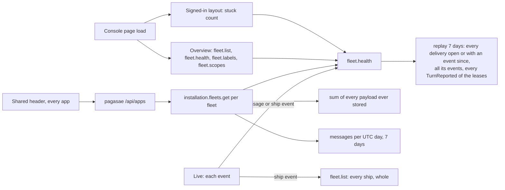

# Performance at scale

Design for [#1130](https://github.com/ThomasHendrickx/aeolus-fleet/issues/1130), from the 0.29 production slowness ([#1117](https://github.com/ThomasHendrickx/aeolus-fleet/issues/1117), measured in [#1128](https://github.com/ThomasHendrickx/aeolus-fleet/pull/1128)), with [#1126](https://github.com/ThomasHendrickx/aeolus-fleet/issues/1126), [#1127](https://github.com/ThomasHendrickx/aeolus-fleet/issues/1127) and [#1112](https://github.com/ThomasHendrickx/aeolus-fleet/issues/1112). Docs only. Purpose for Thomas to agree; no detailed decisions yet.

## 1. Purpose (proposed)

Every read a console page, the shared header or an installation caller makes costs the same at 10,000,000 messages and 3,000 ships in a fleet as it does today, and no slow part holds up the rest of a page.

The outcomes:
1. A read's cost follows what it answers, never the fleet's history: no read scans every message, event or delivery a fleet ever stored.
2. Reads are cut per resource and requirement, not per screen (Thomas). Each part of a page asks for only what it shows, and one slow part never blocks another.
3. Every list is paged (Thomas: "pagination as standard practice").
4. History that only grows (the 7 days of stuck per hour, the storage, the messages per day) is kept as snapshots with a strategy, not replayed on every call (Thomas: "a decent strategy and not a quick fix").
5. The shared header knows which apps an account may open without a call per page load; a link the account can no longer open is refused by that app.
6. Scale is proven by tests at the target size before a release, as delivery guarantees are proven by tests.

Not the purpose:
- Message retention or deleting stored messages (a product question of its own).
- A second database, a cache product or a queue (0003).
- Changing what any page shows.

## 2. Lessons

### What production showed on 22 Oct (core and console 0.29.1, one fleet, 2 vCPU at load ~3)

- `installation.fleets.get` p50 4.6 s, p90 6.4 s. It sums the UTF-8 bytes of every payload the fleet ever stored (#1126), counts messages per UTC day, and replays 7 days of health.
- pagasae's `/api/apps` called it per fleet, uncached, on every header load in every app; the console asked twice per page and again on tab focus (cut to once in #1128; pagasae's side in pagasae#122).
- `fleet.health` p50 about 2 s. The overview reads `fleet.list` and `fleet.health` twice on first load (#1127, also in 0.28.3).
- A navigation click waited on `console.session` (p90 1.3 s) before showing anything (#1128 shows it opening).
- Locally the overview loads as in 0.28.3: the cost is server load from reads, not render. This is one fleet, so it gets worse with every message and every fleet.

### What core reads today

- **Health** (0041, 0042; architecture operation 9): each `fleet.health` and each fleet on `installation.fleets.list` and `get` reads the ships and leases of 168 hours, every delivery open or with an event in 168 hours, every event of those deliveries, and every `TurnReported` of those leases by a JSON field with no index of its own; then `stuck.ts` classifies at now and at each of 168 hours. Nothing is stored, by decision.
- **Storage and messages** (blueprint, "Installation"): storage is a full scan of the fleet's payloads, read from TOAST; messages per day groups 7 days of message rows.
- **Live** (`console/lib/live-fleet.ts`): every message event reloads `fleet.health` and the message lists; every ship event reloads `fleet.list` whole and `fleet.health`. A busy fleet replays health many times a second per open console.
- **Lists:** `fleet.list` answers every ship with its report, labels and crew request, unpaged. The timeline and messages take a limit but no cursor (#1112). Inbox and Needs attention answer all.
- **The 30 second pass** (operation 8) reads each pushed lease's waiting deliveries with their latest return, receipt or hand-over from the event log, every fleet each pass.
- **Indexes** serve the per-fleet reads by `(fleet_id, occurred_at)` on events and an open-states partial index on deliveries; none serves events by type.

### Decisions this checks against

- **0041, 0042** say health is read, not stored, and reject "a health table or events kept by the server". Outcome 4 reopens that for the 7-day history; Thomas decides (Q1).
- **0003:** Postgres is the broker and the one system to run; snapshots and counters live in it.
- **CLAUDE.md:** every state change writes its event in the same transaction, so a counter kept on send is written in the send's transaction; every query scoped by `fleet_id`.
- **0033:** logic runs on the web app's server; the browser renders what it is given.
- **0058, 0054:** pagasae signs accounts in and issues the account token for one account in one fleet; the header is pagasae's.
- **0005:** ids are time-ordered ULIDs, so a list can page by id.
- **0011:** every candidate is walked on staging (`staging-walk`) before release.
- **0013:** no compatibility layers; a paged procedure replaces the unpaged one.

## 3. Questions

Each with numbered options and my pick.

**Q1. The 7 days of stuck per hour: how is history kept?**
1. A row per fleet and closed hour with its stuck counts by cause, written once when the hour closes; a read replays only the open hour and reads 167 rows.
2. A snapshot per fleet and UTC day, as Thomas suggested; a read replays today and reads 6 rows.
3. Keep the replay; cache its answer in core's memory for some seconds.

Pick 1. The chart is per hour, so a closed hour never changes and is the natural snapshot; a day snapshot still replays up to 24 hours of a busy fleet on every call. A cache hides the cost from the second caller only, and core may run more than one instance. Reopens 0041 and 0042's "no table kept by the server".

**Q2. Storage and messages per day: how are they kept?**
1. Counters per fleet and UTC day (messages and payload bytes), added to in the send's transaction; storage is the sum of the days, a constant read.
2. A daily snapshot of yesterday plus a scan of today.
3. Postgres's own size estimates.

Pick 1. Exact, constant to read, and written where the message is, as every state change is; the daily message limit can count from the same row. Option 3 is not per fleet.

**Q3. How are reads cut?**
1. One procedure per resource and requirement, answering only what that requirement needs: for example the stuck count (sidebar), the stuck history (Health), a page of ships (overview), one ship's row (live). Each part of a page asks its own and shows its own loading.
2. Keep today's procedures and add a field selection to each.

Pick 1. It is what Thomas asked ("split on resource / requirement not on screen"), and a small read is cheap to measure and to give a budget (Q6). Field selection keeps one slow statement behind every caller.

**Q4. Live updates: what does an event reload?**
1. Only the resource the event concerns: the ship's row for a ship event, the stuck count for a delivery that moves; never the whole fleet snapshot or the full health.
2. Today's reloads, at most once per few seconds per resource.

Pick 1. With Q1 and Q3, the reloaded reads are small; a throttle still replays whole reads at 3,000 ships.

**Q5. Pagination: where and how?**
1. Every list procedure, the fleet snapshot included, paged by cursor on the time-ordered id, newest or oldest first as the list is today, with a page size the caller asks within a maximum.
2. Only the lists that grow with history (timeline, messages, inbox, Needs attention, reach refusals); the fleet snapshot unpaged.
3. Offset and limit.

Pick 1, as Thomas's "standard practice". 3,000 ships with labels and reports is megabytes per load. Offset gets slower deeper in and skips rows under live inserts.

**Q6. What does "fast enough" mean?**
1. A budget per read at the target scale on a production-sized host, for example p95 under 200 ms, checked by the scale tests.
2. A budget per page (interactive under 1 s).
3. No number; each release no slower than the last.

Pick 1. With reads cut per resource (Q3) the read is the unit that fails, and a page budget does not say which read to fix. The number is Thomas's.

**Q7. The shared header: how does it know the account's apps?**
1. pagasae writes the account's apps and fleets into a cookie at sign-in and at each token renewal, from its own records; the header reads the cookie with no call; an app refuses a link the account can no longer open.
2. pagasae answers `/api/apps` from its own records, with no core call (pagasae#122), once per page load.
3. The header asks each app.

Pick 1, as Thomas suggested. pagasae owns organisations, fleets and groups (0051, 0052), so it needs no core call, and the renewal every few minutes keeps it current as the account token is. Built in pagasae; this design states only that core is off the header's path.

**Q8. Where do scale tests run?**
1. Staging, seeded at the target (10,000,000 messages, 3,000 ships in one fleet), on a host sized as production; the walker measures the budgets of Q6 as part of `staging-walk`, so a candidate that misses them is not released (0011).
2. A separate acceptance environment, seeded at the target, run per candidate beside the staging walk.
3. Testcontainers in CI with a seeded database.

Pick 1. Staging already is the acceptance step every candidate passes, on the exact bytes released; a second environment doubles the hosts, seeding and upkeep for the same candidate. CI runners are not production-sized, and seeding 10,000,000 messages per run is slow. The cost: the staging walk's own checks run against a large fleet, so they should run in a fleet of their own beside the seeded one.

**Q9. Order of the work?**
1. Measure first: the seeded staging and budgets (Q6, Q8), then health history (Q1), counters (Q2), reads cut and live (Q3, Q4), paging (Q5).
2. Fix the known costs first (Q1, Q2), measure after.

Pick 1. Thomas: "we need to really look into db performance"; without the seeded fleet no slice can show it met its budget.

## 4. Next

Once Thomas agrees the purpose and answers: the decisions, the full flow diagram of a read and of a snapshot being written (happy and unhappy paths, including a restart mid-hour and two core instances closing the same hour), and the slices.
