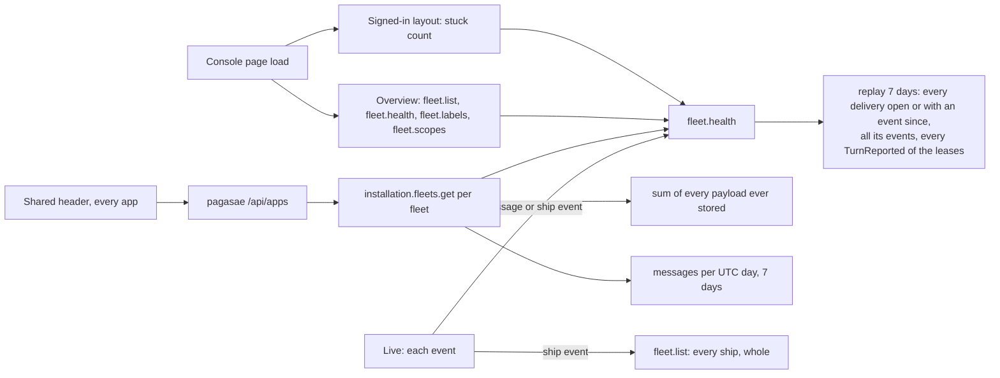

# Performance at scale

Design for [#1130](https://github.com/ThomasHendrickx/aeolus-fleet/issues/1130), from the 0.29 production slowness ([#1117](https://github.com/ThomasHendrickx/aeolus-fleet/issues/1117), measured in [#1128](https://github.com/ThomasHendrickx/aeolus-fleet/pull/1128)), with [#1126](https://github.com/ThomasHendrickx/aeolus-fleet/issues/1126), [#1127](https://github.com/ThomasHendrickx/aeolus-fleet/issues/1127) and [#1112](https://github.com/ThomasHendrickx/aeolus-fleet/issues/1112). Docs only. Thomas answered Q2 to Q9 (section 3); Q1 is open (section 4).

## 1. Purpose (proposed)

Every read a console page, the shared header or an installation caller makes costs the same at 10,000,000 messages and 3,000 ships in a fleet as it does today, and no slow part holds up the rest of a page.

The outcomes:
1. A read's cost follows what it answers, never the fleet's history: no read scans every message, event or delivery a fleet ever stored.
2. Reads are cut per resource and requirement, not per screen (Thomas). Each part of a page asks for only what it shows, and one slow part never blocks another.
3. Every list is paged (Thomas: "pagination as standard practice").
4. History that only grows (the 7 days of stuck per hour, the storage, the messages per day) is kept as snapshots with a strategy, not replayed on every call (Thomas: "a decent strategy and not a quick fix").
5. The shared header knows which apps an account may open without a call per page load; a link the account can no longer open is refused by that app.
6. Scale is proven by tests at the target size before a release, as delivery guarantees are proven by tests.

Not the purpose:
- Message retention or deleting stored messages (a product question of its own).
- A second database, a cache product or a queue (0003).
- Changing what any page shows.

## 2. Lessons

### What production showed on 22 Oct (core and console 0.29.1, one fleet, 2 vCPU at load ~3)

- `installation.fleets.get` p50 4.6 s, p90 6.4 s. It sums the UTF-8 bytes of every payload the fleet ever stored (#1126), counts messages per UTC day, and replays 7 days of health.
- pagasae's `/api/apps` called it per fleet, uncached, on every header load in every app; the console asked twice per page and again on tab focus (cut to once in #1128; pagasae's side in pagasae#122).
- `fleet.health` p50 about 2 s. The overview reads `fleet.list` and `fleet.health` twice on first load (#1127, also in 0.28.3).
- A navigation click waited on `console.session` (p90 1.3 s) before showing anything (#1128 shows it opening).
- Locally the overview loads as in 0.28.3: the cost is server load from reads, not render. This is one fleet, so it gets worse with every message and every fleet.

### What core reads today

- **Health** (0041, 0042; architecture operation 9): each `fleet.health` and each fleet on `installation.fleets.list` and `get` reads the ships and leases of 168 hours, every delivery open or with an event in 168 hours, every event of those deliveries, and every `TurnReported` of those leases by a JSON field with no index of its own; then `stuck.ts` classifies at now and at each of 168 hours. Nothing is stored, by decision.
- **Storage and messages** (blueprint, "Installation"): storage is a full scan of the fleet's payloads, read from TOAST; messages per day groups 7 days of message rows.
- **Live** (`console/lib/live-fleet.ts`): every message event reloads `fleet.health` and the message lists; every ship event reloads `fleet.list` whole and `fleet.health`. A busy fleet replays health many times a second per open console.
- **Lists:** `fleet.list` answers every ship with its report, labels and crew request, unpaged. The timeline and messages take a limit but no cursor (#1112). Inbox and Needs attention answer all.
- **The 30 second pass** (operation 8) reads each pushed lease's waiting deliveries with their latest return, receipt or hand-over from the event log, every fleet each pass.
- **Indexes** serve the per-fleet reads by `(fleet_id, occurred_at)` on events and an open-states partial index on deliveries; none serves events by type.

### Decisions this checks against

- **0041, 0042** say health is read, not stored, and reject "a health table or events kept by the server". Outcome 4 and decision 2 reopen that; Q1 settles how.
- **0003:** Postgres is the broker and the one system to run; snapshots and counters live in it.
- **CLAUDE.md:** every state change writes its event in the same transaction, so a counter kept on send is written in the send's transaction; every query scoped by `fleet_id`.
- **0033:** logic runs on the web app's server; the browser renders what it is given.
- **0058, 0054:** pagasae signs accounts in and issues the account token for one account in one fleet; the header is pagasae's.
- **0005:** ids are time-ordered ULIDs, so a list can page by id.
- **0011:** every candidate is walked on staging (`staging-walk`) before release.
- **0013:** no compatibility layers; a paged procedure replaces the unpaged one.

## 3. Decisions

1. **Storage and messages per day** are counters per fleet and UTC day (messages and payload bytes), added to in the send's transaction. Storage is the sum of the days; the daily message limit counts from the same row.
2. **Reads are cut per resource and requirement:** one procedure per requirement, answering only what it needs (the stuck count for the sidebar, the stuck history for Health, a page of ships for the overview, one ship's row for live). Each part of a page asks its own and shows its own loading. The cut is per domain; Thomas: "it is per domain . Health is answering a different question than fleet overview is doing, different jobs".
3. **Live updates** reload only the resource the event concerns: the ship's row for a ship event, the stuck count for a delivery that moves; never the whole fleet snapshot or the full health.
4. **Every list procedure is paged**, the fleet snapshot included: by cursor on the time-ordered id, newest or oldest first as the list is today, with a page size the caller asks within a maximum. No offset.
5. **Budgets per read** at the target scale on a production-sized host, checked by the scale tests: p95 under 100 ms, p99 under 500 ms, error rate "< 99%". Thomas: "lets set them and see where we land, we can always adjust. But these are amazon numbers, so might be setting the bar high." Flag: "< 99%" likely means under 1%; orchestrator-1 confirms with Thomas.
6. **The shared header** reads the account's apps and fleets from a cookie pagasae writes at sign-in and at each token renewal, from its own records, with no core call; an app refuses a link the account can no longer open. Built in pagasae; core is off the header's path.
7. **Scale tests run on staging**, seeded at the target (10,000,000 messages, 3,000 ships in one fleet), with staging's containers capped to production's size (Thomas: "Ok on your capping the containers"; infra#70). The walker measures the budgets of decision 5 in `staging-walk`, so a candidate that misses them is not released (0011). The walk's own checks run in a fleet of their own beside the seeded one.
8. **Order:** measure first (decisions 5, 7), then the stuck history (Q1), counters (1), reads cut and live (2, 3), paging (4).

## 4. Open: Q1, the 7 days of stuck per hour

Thomas: "The problem with 1 is that we still redo the calculations every single time of things we already did. 1 snapshot every hour is fine by me, but that snapshot is true for everything previous to that hour. To me a snapshot is the limit after which an index crawler can stop. This is not a new problem, how is this solved in other places? Event driven I believe there would be a health service listening on the broker and keeping that snapshot real time right? Or what are the other patterns?"

The hard case for every pattern: stuck is partly time. A pushed lease's clock runs out (`hasClockRunOut`, `NOT_CONFIRMED_MINUTES`) and a delivery becomes stalled in flight with no event written. So a pattern either evaluates the rule (0042) at a moment over stored states and their since, or needs something to write the change.

| Pattern | How it works here | Stuck by time passing | Cost |
|---|---|---|---|
| 1. Projection kept current by a consumer with a checkpoint | A worker in core reads `events` after its checkpoint and keeps a table of each open delivery's state, since and place, plus a row per closed hour. The "health service on the broker"; with Postgres as broker (0003) it polls the event table. | The table holds since and clocks; "stuck now" applies the rule at now, so no event is needed. The hour row is the rule at the hour mark. | Read: constant. A new moving part: checkpoint, lag, and events committed out of id order (a transaction with an earlier id commits later), so the checkpoint trails by a safe margin. Two instances need one owner (a lock). |
| 2. Hourly cumulative snapshot, replay of the open hour | At each closed hour the 30 second pass (operation 8) writes the snapshot of hour H: the open deliveries with state, since and place, and the stuck counts of that hour, built from the snapshot of H-1 plus hour H's events only. A read takes the latest snapshot and replays the open hour with today's rule. | The snapshot keeps since and clocks; the rule is applied at each hour mark when writing and at now when reading. | Read: one snapshot plus at most an hour of events. Write: one hour of events, once. The snapshot is closed only after a margin past the hour, for late commits; a lock makes two instances write it once. |
| 3. Postgres materialized view | A view of the 7-day replay, refreshed on a schedule (`REFRESH ... CONCURRENTLY`). | Handled at refresh only; stale between refreshes. | Each refresh replays all 7 days again: Thomas's objection to the old pick, moved off the read path. Stock Postgres has no incremental refresh. |
| 4. Time-bucketed rollups | Counters per fleet and hour, added to by events (+1 entering stuck, -1 leaving). Fits the additive counts of decision 1. | No event, no counter change: a sweeper must write the transition. Stuck is a gauge (how many at a moment), not a sum, so buckets drift from the rule. | Read: constant. Two rules (the counter's and 0042's) to keep equal. |

**Pick 2.** It is Thomas's snapshot as the limit for the crawler: true for everything before hour H, so nothing before H is read again. The open hour replays with the same rule as today, so "stuck now" and the history count alike (0042's one rule), and stuck by time falls out because the rule reads since and clocks at a moment. It adds no new worker: the 30 second pass already visits every fleet each pass. Pattern 1 gives a constant read but adds a consumer, a checkpoint and the out-of-order commit problem for at most an hour of replay saved; it is the next step if the open hour misses the budget of decision 5 at the target, which staging measures (decision 7). 3 still replays 7 days; 4 cannot see time.

## 5. Next

Once Q1 is answered: the decision records (0041 and 0042 reopened for the stored snapshot and counters), the full flow diagram of a read and of a snapshot being written (happy and unhappy paths, including a restart mid-hour, a late commit, and two core instances closing the same hour), and the slices.
