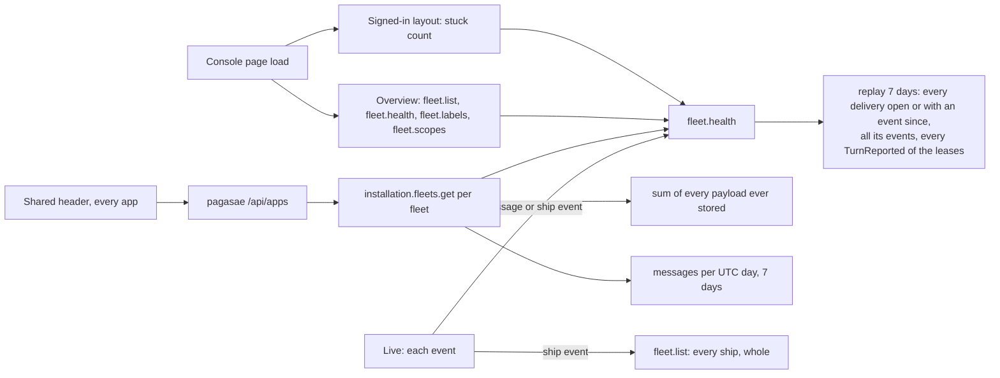
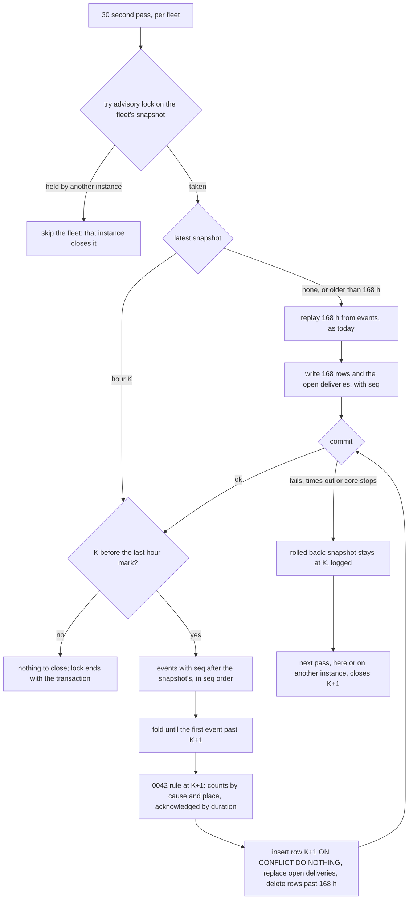
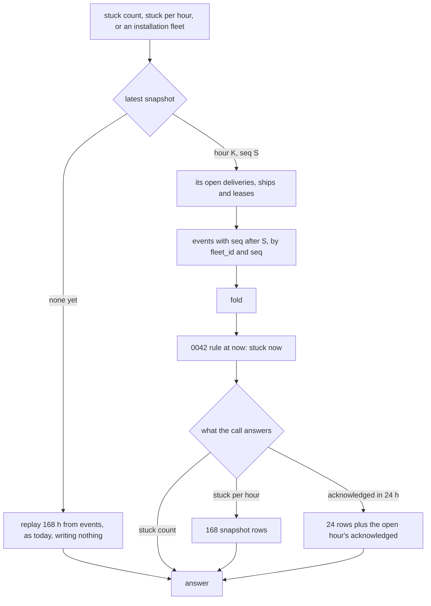

# Performance at scale

Design for [#1130](https://github.com/ThomasHendrickx/aeolus-fleet/issues/1130), from the 0.29 production slowness ([#1117](https://github.com/ThomasHendrickx/aeolus-fleet/issues/1117), measured in [#1128](https://github.com/ThomasHendrickx/aeolus-fleet/pull/1128)), with [#1126](https://github.com/ThomasHendrickx/aeolus-fleet/issues/1126), [#1127](https://github.com/ThomasHendrickx/aeolus-fleet/issues/1127) and [#1112](https://github.com/ThomasHendrickx/aeolus-fleet/issues/1112). Docs only. Thomas answered Q1 to Q11 (section 3). Sections 5 to 8 are the stuck snapshot in detail, its flows, the two questions it raised, and the slices.

## 1. Purpose (agreed)

Every read a console page, the shared header or an installation caller makes costs the same at 10,000,000 messages and 3,000 ships in a fleet as it does today, and no slow part holds up the rest of a page.

The outcomes:
1. A read's cost follows what it answers, never the fleet's history: no read scans every message, event or delivery a fleet ever stored.
2. Reads are cut per resource and requirement, not per screen (Thomas). Each part of a page asks for only what it shows, and one slow part never blocks another.
3. Every list is paged (Thomas: "pagination as standard practice").
4. History that only grows (the 7 days of stuck per hour, the storage, the messages per day) is kept as snapshots with a strategy, not replayed on every call (Thomas: "a decent strategy and not a quick fix").
5. The shared header knows which apps an account may open without a call per page load; a link the account can no longer open is refused by that app.
6. Scale is proven by tests at the target size before a release, as delivery guarantees are proven by tests.

Not the purpose:
- Message retention or deleting stored messages (a product question of its own).
- A second database, a cache product or a queue (0003).
- Changing what any page shows.

## 2. Lessons

### What production showed on 22 Oct (core and console 0.29.1, one fleet, 2 vCPU at load ~3)

- `installation.fleets.get` p50 4.6 s, p90 6.4 s. It sums the UTF-8 bytes of every payload the fleet ever stored (#1126), counts messages per UTC day, and replays 7 days of health.
- pagasae's `/api/apps` called it per fleet, uncached, on every header load in every app; the console asked twice per page and again on tab focus (cut to once in #1128; pagasae's side in pagasae#122).
- `fleet.health` p50 about 2 s. The overview reads `fleet.list` and `fleet.health` twice on first load (#1127, also in 0.28.3).
- A navigation click waited on `console.session` (p90 1.3 s) before showing anything (#1128 shows it opening).
- Locally the overview loads as in 0.28.3: the cost is server load from reads, not render. This is one fleet, so it gets worse with every message and every fleet.

### What core reads today

- **Health** (0041, 0042; architecture operation 9): each `fleet.health` and each fleet on `installation.fleets.list` and `get` reads the ships and leases of 168 hours, every delivery open or with an event in 168 hours, every event of those deliveries, and every `TurnReported` of those leases by a JSON field with no index of its own; then `stuck.ts` classifies at now and at each of 168 hours. Nothing is stored, by decision.
- **Storage and messages** (blueprint, "Installation"): storage is a full scan of the fleet's payloads, read from TOAST; messages per day groups 7 days of message rows.
- **Live** (`console/lib/live-fleet.ts`): every message event reloads `fleet.health` and the message lists; every ship event reloads `fleet.list` whole and `fleet.health`. A busy fleet replays health many times a second per open console.
- **Lists:** `fleet.list` answers every ship with its report, labels and crew request, unpaged. The timeline and messages take a limit but no cursor (#1112). Inbox and Needs attention answer all.
- **The 30 second pass** (operation 8) reads each pushed lease's waiting deliveries with their latest return, receipt or hand-over from the event log, every fleet each pass.
- **Indexes** serve the per-fleet reads by `(fleet_id, occurred_at)` on events and an open-states partial index on deliveries; none serves events by type.

### Decisions this checks against

- **0041, 0042** say health is read, not stored, and reject "a health table or events kept by the server". Outcome 4 and decision 2 reopen that; Q1 settles how.
- **0003:** Postgres is the broker and the one system to run; snapshots and counters live in it.
- **CLAUDE.md:** every state change writes its event in the same transaction, so a counter kept on send is written in the send's transaction; every query scoped by `fleet_id`.
- **0033:** logic runs on the web app's server; the browser renders what it is given.
- **0058, 0054:** pagasae signs accounts in and issues the account token for one account in one fleet; the header is pagasae's.
- **0005:** ids are time-ordered ULIDs, so a list can page by id.
- **0011:** every candidate is walked on staging (`staging-walk`) before release.
- **0013:** no compatibility layers; a paged procedure replaces the unpaged one.

## 3. Decisions

1. **Storage and messages per day** are counters per fleet and UTC day (messages and payload bytes), added to in the send's transaction. Storage is the sum of the days; the daily message limit counts from the same row.
2. **Reads are cut per resource and requirement:** one procedure per requirement, answering only what it needs (the stuck count for the sidebar, the stuck history for Health, a page of ships for the overview, one ship's row for live). Each part of a page asks its own and shows its own loading. The cut is per domain; Thomas: "it is per domain . Health is answering a different question than fleet overview is doing, different jobs".
3. **Live updates** reload only the resource the event concerns: the ship's row for a ship event, the stuck count for a delivery that moves; never the whole fleet snapshot or the full health.
4. **Every list procedure is paged**, the fleet snapshot included: by cursor on the time-ordered id, newest or oldest first as the list is today, with a page size the caller asks within a maximum. No offset.
5. **Budgets per read** at the target scale on a production-sized host, checked by the scale tests: p95 under 100 ms, p99 under 500 ms, error rate under 1%. Thomas: "lets set them and see where we land, we can always adjust. But these are amazon numbers, so might be setting the bar high."
6. **The shared header** reads the account's apps and fleets from a cookie pagasae writes at sign-in and at each token renewal, from its own records, with no core call; an app refuses a link the account can no longer open. Built in pagasae; core is off the header's path.
7. **Scale tests run on staging**, seeded at the target (10,000,000 messages, 3,000 ships in one fleet), with staging's containers capped to production's size (Thomas: "Ok on your capping the containers"; infra#70). The walker measures the budgets of decision 5 in `staging-walk` (decision 11). The walk's own checks run in a fleet of their own beside the seeded one.
8. **Order:** measure first (decisions 5, 7), then the stuck history (9), counters (1), reads cut and live (2, 3), paging (4).
9. **The 7 days of stuck per hour are cumulative hourly snapshots** (Q1, pattern 2 of section 4; Thomas: "cumulative snapshots it is"). The snapshot of hour H is built from the snapshot of H-1 and the events after it, once, and is true for everything before H: no read or write looks at an event the snapshot already holds. A read takes the latest snapshot and folds the events after it. Section 5 holds the parts. This replaces 0041's and 0042's "read, not stored" and their rejection of a health table kept by the server; the decision files change in the slice that builds it (S2).
10. **Acknowledged in 24 hours** keeps, in each hour row, a count per duration bucket (log-spaced, finer than the page rounds the median); the median is read from 24 summed rows (Q10; Thomas: "Q10 yes").
11. **The walker measures and reports each read against its budget, and never refuses a candidate** until Thomas gives the go to make it blocking (Q11). S1 takes the baseline: each read's p95, p99 and error rate on capped staging. Every later slice ends by running the same measurement on capped staging and reporting before and after per read to orchestrator-1. Thomas: "I do want a before and after on each slice reported to me. Where do we improve what."

## 4. Q1 compared: the 7 days of stuck per hour (decided: 2)

Thomas: "The problem with 1 is that we still redo the calculations every single time of things we already did. 1 snapshot every hour is fine by me, but that snapshot is true for everything previous to that hour. To me a snapshot is the limit after which an index crawler can stop. This is not a new problem, how is this solved in other places? Event driven I believe there would be a health service listening on the broker and keeping that snapshot real time right? Or what are the other patterns?"

The hard case for every pattern: stuck is partly time. A pushed lease's clock runs out (`hasClockRunOut`, `NOT_CONFIRMED_MINUTES`) and a delivery becomes stalled in flight with no event written. So a pattern either evaluates the rule (0042) at a moment over stored states and their since, or needs something to write the change.

| Pattern | How it works here | Stuck by time passing | Cost |
|---|---|---|---|
| 1. Projection kept current by a consumer with a checkpoint | A worker in core reads `events` after its checkpoint and keeps a table of each open delivery's state, since and place, plus a row per closed hour. The "health service on the broker"; with Postgres as broker (0003) it polls the event table. | The table holds since and clocks; "stuck now" applies the rule at now, so no event is needed. The hour row is the rule at the hour mark. | Read: constant. A new moving part: checkpoint, lag, and events committed out of id order (a transaction with an earlier id commits later), so the checkpoint trails by a safe margin. Two instances need one owner (a lock). |
| 2. Hourly cumulative snapshot, replay of the open hour | At each closed hour the 30 second pass (operation 8) writes the snapshot of hour H: the open deliveries with state, since and place, and the stuck counts of that hour, built from the snapshot of H-1 plus hour H's events only. A read takes the latest snapshot and replays the open hour with today's rule. | The snapshot keeps since and clocks; the rule is applied at each hour mark when writing and at now when reading. | Read: one snapshot plus at most an hour of events. Write: one hour of events, once. A late commit is folded by its `seq` (section 5); a lock makes two instances write it once. |
| 3. Postgres materialized view | A view of the 7-day replay, refreshed on a schedule (`REFRESH ... CONCURRENTLY`). | Handled at refresh only; stale between refreshes. | Each refresh replays all 7 days again: Thomas's objection to the old pick, moved off the read path. Stock Postgres has no incremental refresh. |
| 4. Time-bucketed rollups | Counters per fleet and hour, added to by events (+1 entering stuck, -1 leaving). Fits the additive counts of decision 1. | No event, no counter change: a sweeper must write the transition. Stuck is a gauge (how many at a moment), not a sum, so buckets drift from the rule. | Read: constant. Two rules (the counter's and 0042's) to keep equal. |

**Why 2.** It is Thomas's snapshot as the limit for the crawler: true for everything before hour H, so nothing before H is read again. The open hour replays with the same rule as today, so "stuck now" and the history count alike (0042's one rule), and stuck by time falls out because the rule reads since and clocks at a moment. It adds no new worker: the 30 second pass already visits every fleet each pass. Pattern 1 gives a constant read but adds a consumer, a checkpoint and the out-of-order commit problem for at most an hour of replay saved; it is the next step if the open hour misses the budget of decision 5 at the target, which staging measures (decision 7). 3 still replays 7 days; 4 cannot see time.

## 5. The stuck snapshot

What section 2 adds for it: each event has `seq`, its place in its fleet's stream, numbered from `fleets.last_event_seq` as the transaction's last statement, so a lower `seq` always commits first and there are no gaps (`adapters/prisma/event-log.ts`); `(fleet_id, seq)` is unique, so it is indexed. `occurred_at` is the core instance's clock when the event is written, before commit, so in `seq` order it runs back by at most a transaction's time (5 s, a bulk one 30 s) plus the instances' clock skew.

- **Tables** (core, `adapters/prisma`):
  - `health_snapshots`: one row per fleet and closed hour (`fleet_id`, `hour`, primary key both): `seq`, the last event folded into it; the stuck counts at `hour` by cause and place, each with its oldest since; the deliveries acknowledged in the hour, by duration bucket from send (decision 10). The latest row also holds the ships and open leases as `stuck.ts` reads them (type, awaiting crew, person ship, pushed, turn and its time, last seen). Rows older than 168 hours are deleted when a new one is written.
  - `health_snapshot_deliveries`: the fleet's open deliveries as of its latest snapshot, one row each: state, since, place, lease.
- **The fold:** one pure function beside `stuck.ts` (`domain/shared`) takes a snapshot's facts and events in `seq` order and answers the facts after them. The close and every read use it, with the one rule of 0042, so stuck now and each hour count alike.
- **Hour H's facts** are the latest snapshot's, folded with the events after its `seq` up to the first whose `occurred_at` is past H. An event that commits after H was closed has a higher `seq` than the snapshot's, so it is folded into the next hour, never lost; it lands at most a transaction's time late.
- **The close** runs in the 30 second pass (operation 8), per fleet, one transaction per hour: take `pg_try_advisory_xact_lock` on the fleet's snapshot (held: skip the fleet, the other instance closes it); read the latest snapshot; if its hour is the last hour mark, stop; else fold one hour, apply the rule at the mark, insert the row (`ON CONFLICT DO NOTHING`), replace `health_snapshot_deliveries`, delete rows past 168 hours, commit. Missed hours close one at a time, oldest first.
- **The first snapshot:** a fleet with no snapshot, or whose latest is older than 168 hours, gets the replay of today (operation 9) once, written as its 168 rows and its open deliveries. A new fleet starts with an empty snapshot at its creation hour.
- **Reads:** stuck now folds the latest snapshot with the events after its `seq` and applies the rule at now. Stuck per hour is the 168 rows and stuck now. Acknowledged in 24 hours sums 24 rows and the open hour's fold. The installation's figures (0041) read the same.
- **A closed hour stands** as it was counted, as Thomas's snapshot is true for everything before it: a plain lease's last seen (a column, no event) is the one read at the close, and a release that changes the rule counts from its first close on.
- **Fleet delete** deletes both tables' rows with the fleet's.

## 6. Flows

### A snapshot being written

Unhappy paths:
- **Restart mid-hour:** the open hour is only in events, so a stop loses nothing; a close cut off rolls back whole. The first pass after the start closes each missed hour from the snapshot's `seq`, oldest first. While no instance serves, no event is written, so a missed hour's facts are exactly the latest snapshot's.
- **Two instances close the same hour:** the second finds the advisory lock held and skips the fleet. One that takes the lock after the first committed reads K+1 as latest and stops. `ON CONFLICT DO NOTHING` on (`fleet_id`, `hour`) is the backstop.
- **Late commit:** an event written before the mark that commits after the close has a `seq` above the snapshot's and is folded into the next hour.
- **The pass fails for hours:** logged each pass; reads stay right and fold more events (below); when the pass works again it closes the missed hours one by one.
- **Core down over 168 hours:** the first snapshot is replayed again.

### A read

Unhappy paths:
- **Snapshot behind** (the pass fails or a close is under way): the read folds every event after S, right but slower as it trails; the budgets of decision 5 hold when the pass keeps up, and staging measures it (decision 7).
- **A close commits during the read:** the read uses one snapshot it read first; reading without a lock, it may see the older one, which is still right.
- **A fleet before its first snapshot** (the release that adds the tables, until its first pass): answered by today's replay.

## 7. Questions (decided)

### Q10 The median of acknowledged in 24 hours

A median does not add up from hour rows; today it reads every `DeliveryAcknowledged` of 24 hours and their send times.

1. Each hour row keeps every duration of its hour: exact; the row grows with traffic.
2. **Each hour row keeps a count per duration bucket** (log-spaced, finer than the page rounds the median): the median is read from 24 summed rows; the row's size is fixed.
3. Keep reading 24 hours of events: the cost grows with a day's traffic.

**Decided: 2** (decision 10). A fixed cost per read, and the page shows the same value while the buckets are finer than its rounding.

### Q11 When `staging-walk` starts refusing a candidate over budget

Today's reads miss the budgets, so a gate from S1 on refuses every candidate until S7.

1. **S1 measures and reports per read; the gate refuses a candidate from S7 on,** once every read was cut.
2. The gate from S1, with Thomas's `override_reason` (0011) on each release until S7.
3. Gate each read from the slice that brings it under budget.

**Decided: 1, without the S7 gate** (decision 11). Thomas: "For now the walker reports it, once everything is fixed I will give the go that it becomes blocking."

## 8. Slices

In the decided order (decision 8). Each ends green and released; the scale tests at the target run on staging from S1 on. Every slice from S2 on is done only when its before and after per read is reported to orchestrator-1 (decision 11).

| # | Slice | Done when |
|---|---|---|
| S1 | Measure: a seeded fleet on staging (10,000,000 messages, 3,000 ships) beside the walk's own fleet, containers capped (infra#70); the walker measures p95, p99 and the error rate of each read (decision 5) | `staging-walk` reports each read against its budget on a candidate, never refusing it; the baseline per read is reported to orchestrator-1 (decision 11) |
| S2 | The stuck snapshot (sections 5, 6): tables, fold, close in the pass, first snapshot, `fleet.health` and the installation figures read from it; 0041, 0042 and architecture operations 8 and 9 say it | Testcontainers tests for a restart mid-hour, two instances closing one hour, a late commit and a missed hour; the same counts as today's replay on one fleet's events; the health reads within budget on staging; before and after per read reported |
| S3 | Counters per fleet and UTC day (decision 1): a row per fleet and day (messages, payload bytes) added to in the send's transaction, beside `last_event_seq` as its last statements; storage and messages per day read from it; the daily message limit counts from it; existing messages counted into it once by the migration | a rolled back send counts nothing (test); `installation.fleets.get` within budget on staging; before and after per read reported |
| S4 | Core reads cut per requirement (decision 2): a procedure each for the stuck count, the stuck history, one ship's row, and each other part of a page | each answers only what its part shows; within budget on staging; before and after per read reported |
| S5 | Console: each part asks its own read and shows its own loading; live reloads only the resource an event concerns (decision 3) | one slow read does not hold up another part (test); no event reloads `fleet.list` or the full health; before and after per read reported |
| S6 | Paging, the fleet snapshot (decision 4): `fleet.list` by an opaque cursor on the ship's place in the order asked, with the overview's filters, search and sort in the same database query, a page size within a maximum; the overview pages 20 at a time | 3,000 ships page within budget on staging; before and after per read reported |
| S7 | Paging, every other list: timeline, messages (#1112), inbox, Needs attention | no list procedure answers unpaged; every read within budget on staging; before and after per read reported |

Decision 6 (the header's cookie) is pagasae's slice, in its own train (pagasae#122), and can go at any time.
