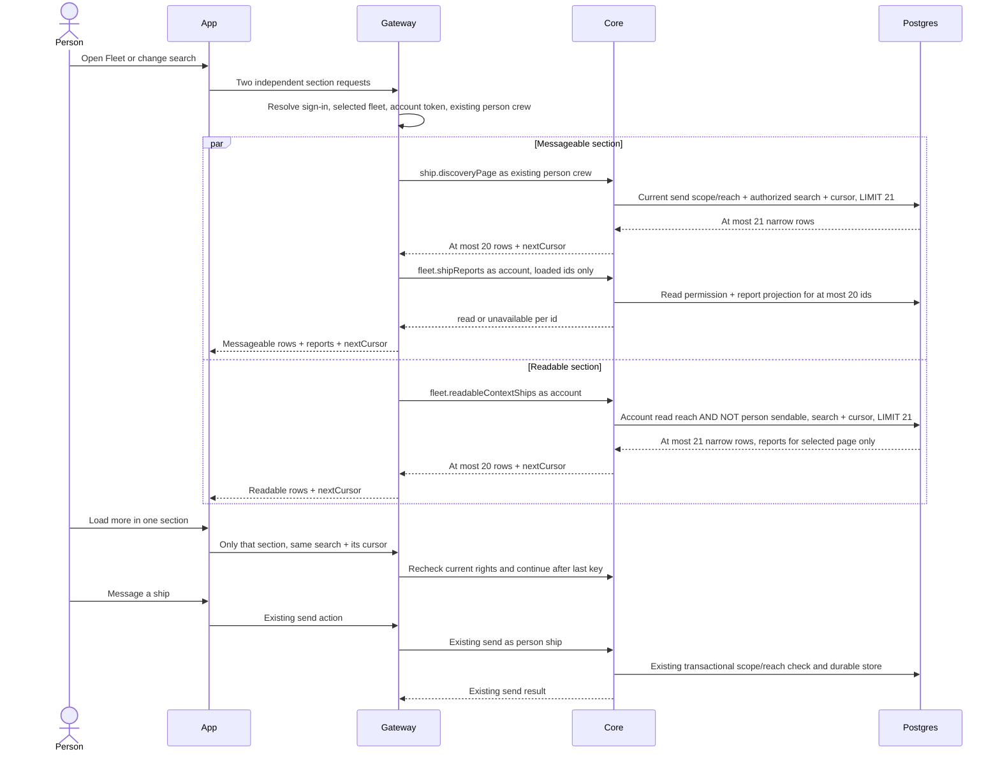

# Person ship reads

## Purpose

Let a signed-in person find an active ship they can message, and separately see ships they can read but cannot message, without loading the fleet into the app or gateway. Sending and reading remain separate rights: discovering a ship never grants its report, and reading a ship never grants a send.

This supplies the approved Fleet page in [app #97](https://github.com/ThomasHendrickx/aeolus-app/issues/97). The required behavior and fields are quoted in [fleet #1741](https://github.com/ThomasHendrickx/aeolus-fleet/issues/1741); [gateway #343](https://github.com/ThomasHendrickx/aeolus-fleet-gateway/issues/343) owns the person API. Those requirements remain the source of truth. This design covers core reads and their gateway composition only.

## Lessons to check against

- [Blueprint](../../blueprint.md): Aeolus supplies a fleet snapshot and durable delivery, not work execution. No message-history or progress read belongs here.
- [Decision index](../../decisions/README.md), especially [0034](../../decisions/0034-network-rules.md), [0047](../../decisions/0047-discovery-and-statements.md), [0057](../../decisions/0057-actors.md) and [0058](../../decisions/0058-pagasae-core-link.md): scopes say what, reach says where; statements and reports have different authorization. The account reads; the person ship sends. The gateway's plugin rights cannot substitute for either subject's rights. Core verifies the account token and ship credentials, not browser-supplied subjects.
- Current `packages/core/src/domain/registry/discover.ts` requires `messages:send`, excludes the caller, viewer and retired ships, and checks send reach without the answer-to-sender exception. It enumerates active ships, statements and verified facts. Reusing its whole result and slicing it would preserve the scale problem and fetch unused fields.
- The gateway's current `src/core/people/list-ships.ts` calls core discovery through `asPersonCrew` and returns the whole discovery. That preserves the person ship as the send subject, but does not provide pagination or account-authorized reports. Its crew helper can obtain a crew; the new read's behavior when there is no usable person identity needs the answer below.
- Current `list-fleet.ts` already asks the database for a cursor page plus one row. It also exposes reduced rows outside read reach. That is a different resource boundary from the requested readable context, which excludes those rows entirely.
- Current `read-reach.ts` computes restricted read reach by enumerating fleet ships and labels before the listing query. Merely adding a page argument cannot meet this design's database permission-filtering requirement.
- Current `check-reach.ts` and `network-settings.ts` define the existing semantics to preserve: built-ins, fleet rules and declared rules, label and owner selectors, matching `#` values, and open fleets. Meeting contributions use the separate meeting send path in `send-message.ts`; membership does not widen direct discovery destinations. A read must use one version of the rules; discovery has no reply context. SQL permission filtering must agree with those semantics rather than inventing another permission model.
- Current `read-on-behalf.ts` supplies a named ship's read reach with `fleet:read`; it does not represent the account's actual read rights. It cannot implement the account side of this feature.
- Current `statement.ts` falls back to the commission note in full discovery. The approved app requires a nullable human description from a crew statement, with missing statements remaining null. Do not copy the discovery fallback into this projection.
- Current `read-harbour.ts` supports selected ids and derives the state used by Harbour. Reuse its state meaning, while avoiding its fleet-wide reach enumeration and any counts for these reads.
- The [performance skill](../../../.agents/skills/performance/SKILL.md) and #1741 require database cursor pagination, search and permissions, indexed queries, and fetching only loaded rows. The target is 3,000 ships and 10,000,000 retained messages per fleet; each read must achieve p95 below 100 ms, p99 below 500 ms and errors below 1%. Measure the finished app/gateway/core path after its implementation work is merged. No performance claim is made by this document.
- #1741 already fixes 20 rows, no totals, active only, literal case-insensitive substring search over name or authorized description, case-insensitive name then id ordering, opaque query-bound cursors, independent sections and one report batch for at most 20 loaded messageable ids. Search must not match unauthorized text. Excluding only loaded messageable ids is incorrect.

## Approved behavior

Thomas approved the purpose and all four behavior answers through orchestrator-1:

- Add new reads beside today's reads. Existing consumers and contracts stay unchanged.
- Description is the crew summary's first sentence, retaining punctuation. A sentence ends at the first `.`, `?` or `!` followed by whitespace or end. Trim surrounding whitespace; abbreviations are literal, and an empty or missing crew summary is null. No commission-note fallback.
- If messaging is unavailable, that section says so while account-readable context remains independent. Opening either list never commissions or crews a ship.
- Continue pagination from the person's place with current rights. Renamed or newly matching ships before that place appear after refresh. A later page never includes a ship the caller lost access to.
- If reports fail to load, keep messageable ships visible with reports unavailable. Readable context shows its own result. Unavailable is distinct from a read report with a null note or activity time.

## Flow



Gateway resolves the account and fleet through its existing signed-in request context and the person ship from that fleet's account association. It looks up an existing crew without calling `asPersonCrew`'s commissioning/crewing path. No crew token reaches the browser. Missing/ended crew or absent send scope fails only the messageable section. An account token with no active person association can still read: the exclusion set is then empty. An active associated ship with send scope contributes its current sendable set to exclusion even if its crew is temporarily unavailable: a lease is required to act as that ship, not to evaluate its stored rights.

Each core call reads one consistent snapshot of rules, actor scopes, labels, ownership, active ships and statements. Use the existing shared network-settings advisory lock, then the snapshot transaction for the read; release at completion. No lock spans two gateway calls. Page results and later report enrichment can observe different moments, deliberately: the batch rechecks account rights rather than trusting discovery. Account rights take effect according to token renewal/cut-off in 0058, not an invented rights cache. A permission change after a response cannot retract data already delivered; every subsequent read and actual send checks again.

### Unhappy paths and visible states

| Trigger | Messageable section | Readable section |
| --- | --- | --- |
| Initial request or load more | Loading; retain existing loaded rows during load more | Independent loading state |
| Valid search has no matching authorized row | Empty rows, null cursor | Independent empty rows, null cursor |
| Person crew absent/ended or send scope missing | Messaging unavailable, no implicit crew action | Continue account-authorized read |
| Account lacks `fleet:read` | Discovery still works; reports unavailable | Permission error, not a successful empty list |
| A report id is absent, retired or outside read reach | That report is unavailable, without exposing why | Such a row is excluded from context |
| Report service/network failure | Keep discovered rows, all affected reports unavailable | Independent result or section error |
| Discovery service failure | Section error with retry; no report batch | Independent result |
| Context service failure | Independent result | Section error with retry |
| Sign-in/token expired or cut off | Existing sign-in flow; do not disguise as missing reports | Same sign-in flow |
| Invalid or wrong-section/search/fleet/subject cursor | Section error; restart that section from first page | Same, independently |
| Ship renamed/retired or rights changed before next page | Continue after old key, using current filters and rights | Same, with current full-set exclusion |
| Send refused after a row was displayed | Existing send error; refresh affected row/report | No Message action here |

The browser never auto-fetches all pages, merges section failures, filters unauthorized rows, or calculates exclusion. Search changes reset both cursors; a slow response for an older search is discarded. No totals or counts are read. Requests for both sections run in parallel. Loading, empty, error and partial report states are distinct.

## Contracts

Names below are new tRPC procedures and gateway person API operations, not changes to today's calls. REST and MCP expose core procedures through their existing mappings, with no duplicate logic. Shared schemas live in common; registry owns the read use cases and ports; typed SQL lives in the Prisma adapter. Gateway use cases compose the public core calls, never core tables or internal domain code.

### Shared values

```text
PageInput = { search?: string, cursor?: string | null }
RowRefreshInput = { search?: string, shipIds: ShipId[1..20] }
ShipRow = { shipId, name, kind, description: string | null }
Report = { status: "unavailable" }
       | { status: "read", state: HarbourState,
           note: string | null, lastActivityAt: ISODateTime | null }
FleetRow = ShipRow & { report: Report }
Page<Row> = { rows: Row[0..20], nextCursor: string | null }
```

Search defaults to blank, is trimmed once in core, and is a literal substring after database case folding. Match only name or the description authorized for this section. `%`, `_` and `\` are literal characters, not wildcard syntax. No ownership, kind, state, attention, retired, sort, limit or total parameter is accepted. For bounded live row refresh only, the two page operations also accept RowRefreshInput instead of PageInput: distinct resource ids, never permission subjects, no cursor; nextCursor is null. Their normal page contract remains PageInput. Core's existing request-size limit bounds input; no new arbitrary search-length product restriction. Unknown fields are rejected. Description is plain text and is displayed as text. HarbourState is the existing `alert | awaitingCrew | blocked | working | idle` meaning, including argo's existing behavior.

### Core

| Procedure | Authentication and input | Successful output |
| --- | --- | --- |
| `ship.discoveryPage` | Existing ship crew authentication, current `messages:send`; PageInput | Page<ShipRow>, send reach before paging; caller, viewer and retired/removed ships excluded as in discovery |
| `fleet.shipReports` | Authenticated actor with `fleet:read`; `{ shipIds: ShipId[0..20] }`, distinct ids | `{ rows: { shipId, report: Report }[] }`, exactly one result per supplied id, same order; no cursor/counts |
| `fleet.readableContextShips` | Authenticated read actor with `fleet:read`; PageInput; exclusion subject from authenticated association only | Page<FleetRow>, account-readable active rows excluding the full current sendable set before paging |

The gateway uses the account token for both fleet calls, never the gateway plugin crew or a manufactured on-behalf `fleet:read` subject. Core resolves the associated person ship from the verified token's `personShipId` and fleet-scoped current ship row. It takes no account id, person id, scope, labels or reach from request data. For the shared core read use case, a ship actor's exclusion subject is itself and the installation has none; the same scope/reach machinery remains available to every actor (0057). This does not grant the gateway authority to choose another subject.

`fleet.shipReports` refuses the whole call for a missing read scope. For a valid reader it returns unavailable for each unknown, retired/removed or unreadable id, with no reason distinction. A missing lease or crew report alone is not unavailable: a readable active ship still has a Harbour state and may have null note/activity. Empty input returns empty without querying reports. More than 20 ids or duplicates is invalid input. This same operation serves concerned loaded ids during live refresh; it does not load a new page.

`fleet.readableContextShips` evaluates read reach as the authenticated actor and send reach as the associated ship with its current stored scopes and labels. If no active associated ship or no `messages:send`, its sendable set is empty. Exclusion uses exactly the discovery set, including discovery's self/viewer exclusions, with no search or cursor on the exclusion test. The readable section follows #1741's active account-readable population without adding a kind filter. The person's own ship and the viewer may therefore be present when account-readable, since neither belongs to the discovery set. The viewer is always crewed under the blueprint and has no crew note; do not mistake its lack of a lease for awaiting crew. argo has no special sorting position in either new list.

Use existing core authentication, scope and invalid-input errors (`SCOPE_NOT_HELD`, `LEASE_ENDED`, token failures and validation refusal); a malformed/mismatched cursor is an invalid-input error. Service failure is a failure, never an empty result. A filtered list is not an individual refused operation and writes no per-row refusal records. Existing individual send/read refusal auditing remains unchanged.

### Gateway person API

`messageableShips(PageInput) -> Page<FleetRow>` resolves the existing person crew and calls `ship.discoveryPage`. It then requests one `fleet.shipReports` batch under the account token for exactly the returned ids, skipping the call for an empty page. Join by ship id, not array position. Missing/malformed batch rows fail the enrichment and become unavailable; they never grant report access. A missing account read scope or batch service failure preserves the discovery page with unavailable reports. An account authentication failure uses the existing sign-in failure path. No full discovery, fleet list or per-row report requests.

`readableContextShips(PageInput) -> Page<FleetRow>` calls the core procedure once with the account token. It does not obtain a person crew, fetch sendable ids, post-filter or enrich rows. Each operation returns its own error using the gateway's existing error envelope. Missing messaging identity, ended crew or missing send scope maps to the messageable section's unavailable error; a functioning identity with no reachable matching ships returns a successful empty page. Existing errors retain their core code for server diagnostics without exposing rules or credentials to the person.

For live refresh, both operations forward RowRefreshInput to the same core projection with all current authorization/search/exclusion predicates and a fleet-scoped `s.id = ANY($ids)` restriction, no cursor and no look-ahead. Missing, retired or no-longer-matching rows are omitted; the app removes concerned loaded rows absent from this response. New or changed matching rows outside loaded pages are shown first and highlighted until refresh, following the performance skill. Use only existing authorized event hints; this adds no statement broadcast or wider event visibility (0047). Where the person has no authorized event stream, explicit refresh re-reads the view. Coalesce event ids into batches of at most 20; never enumerate a collection to refresh it. Report-only changes refresh loaded reports through `fleet.shipReports`, exposed by a gateway account-authorized `shipReports({ shipIds })` forwarding operation with the same 20-id bound and unavailable/sign-in behavior. A messageable row refresh still enriches only returned ids, in one batch.

Both gateway operations forward the core cursor unchanged. They expose no permission subject. The alternative live-refresh input names at most 20 concerned resource ids, never an exclusion set or authorization grant. App routing uses the existing authenticated selected-fleet context. The Message action still invokes the existing send call, which rechecks permission and durably stores before OK.

### Cursor

Use an opaque base64url encoding of a versioned, strictly validated continuation record: fleet id, section, authenticated actor identity, associated send-subject id (or null), normalized search, fixed ordering version, and last returned `(lower(name), shipId)`. The gateway never decodes it. Compare every binding against the new request's authenticated context and normalized search. No settings version or snapshot id is bound: approved continuation uses current rights. A changed associated person identity requires restarting. An ended crew alone does not change the association.

The last key is the last returned row, not the look-ahead row. The database requests 21; core returns 20 and a cursor only if row 21 exists. An empty last page has null cursor. The decoded cursor is untrusted input, never an authorization grant: bind parameters for its key and reapply every permission/search predicate. Its contents need no server-side collection or long-lived snapshot. Consumers must treat the string as opaque. Stable keys continue to work if the original anchor ship has since retired or been renamed, without looking it up.

## Database design

### Permission plan

A registry read port takes fleet, validated page position, normalized search and a domain permission plan. In the same read unit of work, load only the network settings, applied/declared rules, the authenticated actor's labels and associated ship scopes/labels. Never call `readReachOf`, `ships.list`, `listActive`, or full `discover` to supply a set of recipient ids. Read the fleet's and installation's declared rules by fleet, filtering unrelated verbs before transfer: send for discovery, read for reports, both for context. Built-ins remain part of the domain plan. No recipient materialization in the domain or gateway.

The plan retains domain selectors; the Prisma adapter renders parameterized SQL predicates. Before rendering, reject rules whose subject-side fixed terms cannot match, substitute the subject values into same-value terms, and deduplicate identical remaining candidate predicates. A matching rule with no candidate restriction collapses that verb to true. Do this for the fixed authenticated subjects, never by enumerating recipients. The scale run must include many declarers and verify planning time as well as execution time; a giant unbounded OR tree is not an acceptable implementation. Build one predicate per verb and subject. Built-ins are boolean branches equivalent to `reachRuleOf`; own and declared rules are OR branches; every selector's terms are AND branches. Account labels come only from verified token group values resolved against this fleet's label `group`; unknown group values match none. Owner terms see the account's person ship, as `selectedOf` already does.

| Selector term | SQL predicate on candidate `s` |
| --- | --- |
| Exact carried value | `EXISTS (SELECT 1 FROM ship_labels sl WHERE sl.fleet_id = s.fleet_id AND sl.ship_id = s.id AND sl.value_id = $value)` |
| Any value of a label | Same EXISTS with `sl.label_id = $label` |
| Same value `#` | Same EXISTS with `sl.label_id = $label AND sl.value_id = ANY($subjectValuesForLabel)`; apply for every term on both sides |
| Exact owner | `s.owner_ship_id = $owner` |
| Any owner | `s.owner_ship_id IS NOT NULL` |
| Same owner `#` | Subject selected owner is non-null AND `s.owner_ship_id = $subjectOwner` |

Subject-side exact/any terms are resolved from authenticated subject facts. Subject-side `#` also tests the candidate's matching label or owner; it cannot be pre-evaluated to true merely because the subject has some value. Render every permission predicate as a total boolean, using `COALESCE(predicate, false)` for nullable comparisons. In particular, exclusion is `NOT COALESCE(sendable, false)`, so a null owner never accidentally removes a readable ship. Keep simple label EXISTS correlated with `OFFSET 0`: PostgreSQL can otherwise replace them with a global hashed label scan. All SQL values are parameters; only fixed operators/column names come from the renderer.

Send built-ins: operator sender or recipient; subject owns candidate; plugin sender or recipient; open. No answer exception without a reply. Read built-ins: operator reader, actor owns candidate, plugin reader, enabled viewer reader, open; ship readers also read themselves as `readReachOf` does. Reading argo is not an automatic recipient exception. Installation's manage-only rule does not become read/send permission. For this new account route the relevant subset is account owner/open/explicit read rules and the associated ship's send rules, but parity tests cover the shared renderer's branches.

Meeting contributions use `contributeWithin` in `send-message.ts`, checking meeting participation and distributing to participants without the ordinary direct-ship check. These page reads enumerate direct discovery destinations, not meetings. Preserve that distinction and do not add meeting membership as permission to send a new direct message to a participant. The reply-only send exception likewise does not enter discovery.

### Description and search indexes

Define one immutable SQL function `crew_description(statement jsonb) -> text | null` implementing the approved first-sentence rule on `statement->>'summary'`. It trims leading/trailing whitespace, returns null for absent/empty text, retains the first qualifying punctuation, and otherwise returns the whole trimmed summary. Display and search use that exact function. Use shared fixtures to prove the SQL implementation and the pure domain helper agree for spaces, newlines, abbreviations, Unicode and missing statements. Capabilities and other summary sentences never cause a match.

The scalar expression is:

```sql
CREATE FUNCTION crew_description(doc jsonb) RETURNS text
LANGUAGE sql IMMUTABLE PARALLEL SAFE AS $$
  WITH whitespace AS (
    SELECT U&'\0009\000A\000B\000C\000D\0020\00A0\1680\2000\2001\2002\2003\2004\2005\2006\2007\2008\2009\200A\2028\2029\202F\205F\3000\FEFF' AS chars
  ), trimmed AS (
    SELECT regexp_replace(COALESCE(doc->>'summary', ''),
             '^[' || chars || ']+|[' || chars || ']+$', '', 'g') AS summary, chars
    FROM whitespace
  )
  SELECT NULLIF(regexp_replace(
           COALESCE(substring(summary FROM '^.*?[.!?](?:[' || chars || ']|$)'), summary),
           '[' || chars || ']+$', '', 'g'), '')
  FROM trimmed
$$;
```

Whitespace follows ECMAScript `trim` and `\s`, including NBSP, BOM and Unicode separators; PostgreSQL POSIX space classes differ. The matched terminating whitespace is trimmed back off; punctuation is retained. Statement schema validation already guarantees summary is text. The implementation migration must verify the shared sentence fixtures against PostgreSQL, including a newline inside a sentence.

No description column, permission cache or parallel statement store is added. Expression indexes maintain derived search keys transactionally on statement writes; release removes the open-lease index entry automatically. Enable Postgres `pg_trgm` and `btree_gin` in the migration, then add:

```sql
CREATE INDEX ships_person_page_idx
  ON ships (fleet_id, (lower(name)) COLLATE "C", id COLLATE "C")
  WHERE retired_at IS NULL AND removed_at IS NULL;
CREATE INDEX ships_person_name_search_idx
  ON ships USING gin (fleet_id, (lower(name)) gin_trgm_ops)
  WHERE retired_at IS NULL AND removed_at IS NULL;
CREATE INDEX leases_crew_description_search_idx
  ON leases USING gin (fleet_id, (lower(crew_description(statement))) gin_trgm_ops)
  WHERE ended_at IS NULL;
CREATE INDEX leases_person_open_idx
  ON leases (fleet_id, ship_id) WHERE ended_at IS NULL;
CREATE INDEX ship_labels_person_match_idx
  ON ship_labels (fleet_id, ship_id, label_id, value_id);
CREATE INDEX events_person_activity_idx
  ON events (fleet_id, actor_ship_id, seq DESC) INCLUDE (occurred_at)
  WHERE type IN ('MessageAccepted', 'DeliveryAcknowledged');
```

The existing `ships_listing_idx` sorts argo first and cannot serve this exact global name ordering. Existing ship-label primary key `(fleet_id, ship_id, value_id)` serves exact values; the new index also serves any/same-label probes. Reuse existing `(fleet_id, owner_ship_id)`, fleet-scoped ship keys, label/group lookup keys, rule-table fleet keys and `alerts_open_on_ship_idx`. The open-lease unique key already enforces one lease; the fleet-leading index keeps open-lease search bounded by fleet. The partial activity index avoids walking other event types at 10,000,000 retained messages. Do not add a messages-table scan.

Trigram indexes are search accelerators, not permission stores. Each composite GIN index includes `fleet_id` through `btree_gin`, so common matches in other fleets do not enter its candidate bitmap. A single-column trigram index can make PostgreSQL ignore the separate fleet index for common search. Verify selective, common and no-match plans with many fleets, alongside the active/open index paths. For blank or fewer than three search characters use the fleet's active name-order index and candidate open-lease lookups: literal one/two-character substring search has no reliable trigram. It may inspect up to this fleet's 3,000 active index entries, but returns only a page. It must not scan global tables, ended leases, retired ships or history. Candidate evaluation in the database is not permission filtering after pagination.

### Paged queries

`SENDABLE(s)` below means active non-viewer candidate, candidate id different from the associated ship, active associated ship holding `messages:send`, and the compiled send predicate. `READABLE(s)` means the compiled read predicate for the read actor, whose `fleet:read` is checked before query execution. These are SQL fragments, not SQL functions performing per-row queries or an application-side collection. Their expansion is defined above.

For blank/short search, the messageable query is:

```sql
SELECT s.id AS ship_id, s.name, s.kind,
       crew_description(l.statement) AS description,
       lower(s.name) COLLATE "C" AS sort_name
FROM ships s
LEFT JOIN leases l ON l.fleet_id = s.fleet_id
  AND l.ship_id = s.id AND l.ended_at IS NULL
WHERE s.fleet_id = $fleet
  AND s.retired_at IS NULL AND s.removed_at IS NULL
  AND SENDABLE(s)
  AND ($blank OR lower(s.name) LIKE $literal ESCAPE '\'
       OR lower(crew_description(l.statement)) LIKE $literal ESCAPE '\')
  AND ($first OR (lower(s.name) COLLATE "C", s.id COLLATE "C")
                > ($afterName COLLATE "C", $afterId COLLATE "C"))
ORDER BY lower(s.name) COLLATE "C", s.id COLLATE "C"
LIMIT 21;
```

Generate separate first/continuation and blank/nonblank SQL shapes, omitting unused predicates rather than requiring PostgreSQL to plan generic `$blank`/`$first` branches. `$literal` escapes backslash, percent and underscore then wraps the normalized lower-case text in `%`. Case folding is PostgreSQL `lower` for both keys and search; `COLLATE "C"` supplies deterministic byte ordering of folded names and ids, matching the index. Do not use JavaScript locale sorting.

For search with at least three characters, produce candidate ids from a UNION of fleet-scoped active name matches and open-lease description matches using the trigram indexes. Join candidates to active ships in the same fleet, then apply SENDABLE, cursor, exact literal-search recheck, order and LIMIT 21 as above. UNION removes duplicate name/description matches before the limit. Do not LIMIT either search branch before permissions/order. Every branch joins or constrains its fleet. The resulting page has the same semantics as the short-search query. The RowRefreshInput shape instead uses the fleet-scoped ship primary/unique key for its at most 20 ids, then the same permission and literal search predicates; it never runs either search over the whole fleet. A correlated lateral primary-key probe with `OFFSET 0` per concerned id prevents the optimizer from adding a whole-fleet bitmap to the refresh path.

For readable context, use the same search shapes, replacing `SENDABLE(s)` with:

```sql
READABLE(s) AND NOT COALESCE(SENDABLE(s), false)
```

Here SENDABLE uses the account-associated person ship, not the account's send scope. It has no search or continuation predicate inside it: it excludes every messageable ship, including matches on later pages or not matching this section's description. Both read and exclusion predicates use the same snapshot. Readable descriptions are authorized through read reach; messageable descriptions through discovery's send reach. Apply these predicates before both search-result pagination and report joins. The same mathematical set difference holds when the associated person ship is absent, retired or lacks send scope: SENDABLE is false.

### Report projection

Select at most 20 context ids after the 21-row look-ahead is removed; then enrich only those ids inside that core read. The messageable batch starts from `unnest($ids::text[]) WITH ORDINALITY`, left joins active fleet-scoped ships only if READABLE, and returns unavailable when none joins. Never return a hidden name or why a row was unavailable. The authenticated actor's scope is checked before compiling READABLE. Permission-gate all lease, alert and activity projections.

For each authorized page/batch ship use the Harbour state CASE already in `adapters/prisma/harbour.ts`: open alert first, no lease for a ship other than the always-crewed operator/viewer means awaitingCrew, blocked report, working report, else idle. Note is the open lease's `report_note`. Activity query:

```sql
SELECT e.occurred_at
FROM events e
WHERE e.fleet_id = $fleet AND e.actor_ship_id = $ship
  AND e.type IN ('MessageAccepted', 'DeliveryAcknowledged')
ORDER BY e.seq DESC LIMIT 1;
```

Use a LATERAL join for each selected ship through `events_person_activity_idx`, and `GREATEST` with the open lease's `activity_at`, exactly as Harbour does. Check open alerts through the existing partial per-ship index. A report row returns `status: read` plus state/note/time, even if note/time are null. Context reports remain in the same core snapshot as row authorization. A batch's distinct ids are the only report candidates, never the full fleet. Context enrichment takes only the selected row objects through an internal snapshot port; those rows already passed READABLE, so their enrichment need not compile or transfer the same predicate twice. Arbitrary requested report ids always pass the full current read predicate. Core performs look-ahead slicing only on at most 21 already authorized rows; it never slices a full collection.

## Acceptance and scale proof

Implementation scenarios follow the approved behavior and must be built red, green, refactor under the testing skills. This design does not implement or claim those tests:

- More than 40 rows, folded-name ties and three pages: exact 20-row boundary, id tie-break, no overlap for unchanged data, null last cursor; argo sorts by name.
- Full-set exclusion: a ship beyond the loaded messageable page never appears in context; exclude by send rights even when account read rights differ. Account-only readability and discovery-only descriptions/reports stay separate.
- Scope absent, no associated ship, retired associated ship, ended crew: independent section results, no commission/crew side effects. A caller cannot supply another account, fleet or ship to widen either set.
- Blank/trimmed/case-varied, Unicode, literal `%`, `_`, `\`, one/two-character searches; name and authorized first-sentence matches only. Hidden text and later summary sentences cannot match. Missing crew statement remains null despite a commission note.
- Malformed/cross-fleet/cross-section/cross-search/cross-subject cursor is refused. Rename/retire/revoke between pages never restores access; continuing from a missing anchor works. No snapshot-wide invalidation on normal changes.
- Permission-plan parity with `allowsReach`/`readReachOf`: open, owner, account groups, argo, plugin, viewer switch, exact/any/same terms on each side, declared and installation-declared rules, self-read, no answer-only discovery, no direct-message grant from meeting membership. Include negative combinations, not just each built-in's happy path.
- Report batch limits, duplicate rejection, mixed readable/unreadable/missing ids, null note/time, awaiting crew, alert precedence, activity ordering, and the viewer's always-crewed state when account-readable. One batch per loaded messageable page; no batch on empty pages; concerned-id refresh stays bounded.
- Service/permission/authentication failures follow the unhappy-path table. Both sections start independently; one slow/failing section does not hold the other's result. Older search responses cannot overwrite newer ones.
- Rule/label/scope/statement changes concurrent with a read yield a consistent authorized snapshot. Actual sends retain their existing transactional recheck and durability guarantees.

At implementation completion, use the staging performance run on the finished app/gateway/core path with 3,000 active ships and 10,000,000 retained messages, long ended-lease/retired history, other fleets, realistic maximum rule density, sparse and broad permissions, blank/short/selective/common search, deep cursors and 20-id report refresh. Record p95, p99 and error rate per operation, query count and `EXPLAIN (ANALYZE, BUFFERS)` for each query shape. Verify index-driven fleet bounds, no full-table/history scan, no per-recipient application calls, no report work for look-ahead rows, no full-reach-id materialization and no client/gateway all-page fetch. Required budgets are in the lessons above; measurement is pending implementation, not evidence supplied by this docs PR.
