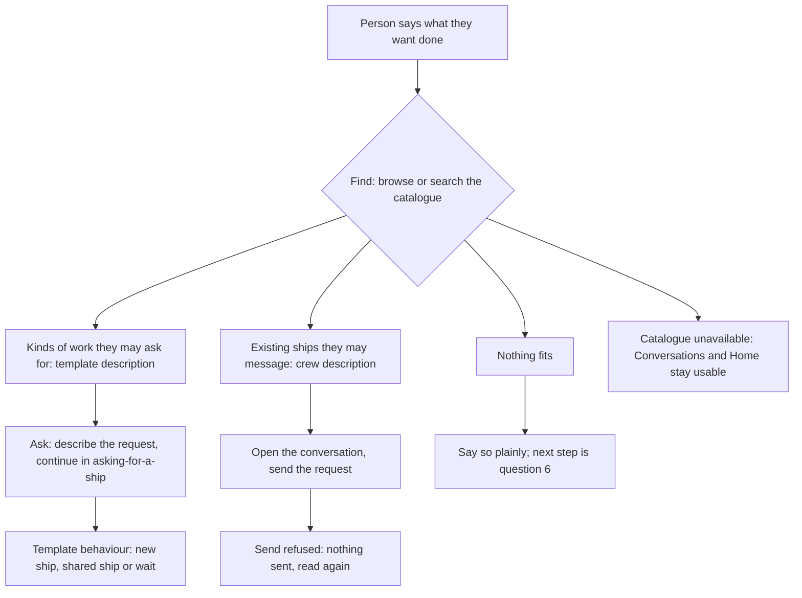

# A catalogue of what can be done: purpose, journey and questions

A docs-only proposal for Thomas. It comes before any technical design: no search architecture, no reads, no UI. It supersedes the [purpose assessment](purpose-assessment.md), which stays as evidence; its directory options are not the direction.

## Direction

Thomas, 11 Nov, relayed by orchestrator (message `msg_01m75x3w4f9gs49rsayxj96ywp`; this is the relayed sense, not his words): the page answers "I want to get xyz done; is there a potential ship that can do that for me?" Templates and their short descriptions come first, and current ships second. Semantic or vector search is noted as a new area.

This approves none of the following: the small contactable directory, the prior Fleet structure (the two sections of [app-060](https://github.com/ThomasHendrickx/aeolus-app/blob/65b9e8ca70328f9f533eb66538f9d5eda4c2b804/docs/design/app-060/README.md)) or a vector implementation.

## Proposed purpose

Help a person start from the work they want done and find what can do it: a kind of work they may ask for (a template), or a ship that already does it. Then they take the one next step that fits, which is either asking for a ship or messaging one.

This is step 1 of the approved [asking for a ship](https://github.com/ThomasHendrickx/aeolus-fleet-squadrons/blob/221896c5630f95ff1ca892aa299b4253add000e3/docs/design/asking-for-a-ship/asking-for-a-ship.md) experience ("Find and ask: the person picks from a list of kinds of work described in everyday words"). Today that experience has no place to find work from. Existing ships come second because a person who finds a ship already doing the work may not need a new one. Whether a ship made from a template counts as "already doing it" is the template owner's behaviour (that design, items 4 and 9), not this page's.

## Four facts kept apart

| Fact | Question | Source today | Who decides |
| --- | --- | --- | --- |
| Discoverable | Does the person see that this exists? | Ships: core discovery within send reach (0047). Templates: nothing outside squadrons; core knows no templates (0017) | Templates: asking-for-a-ship item 7, "the rest is not shown". Ships: the existing reaches |
| May ask | May the person ask for a ship from this template? | Not existing. Today `squadrons:form` is the only right, and it is per actor, not per template (asking-for-a-ship lesson 4) | The organisation (item 7); its mechanism is that design's, unbuilt |
| May contact | May the person ship message this existing ship? | Send scope and reach (0034, 0057), checked again on every send | The existing rules; this page adds none |
| Commission | Does asking create a ship? | Squadrons forming as the asker's person ship's owner; the count and an ask while one exists come from the template | Template owner (asking-for-a-ship items 4, 8 and 9) |

Rules for the page that follow from the table:

- Seeing a template grants no right to ask for it.
- Seeing a ship grants no send, and sending grants no report.
- Asking never sends to an existing ship unless the template's behaviour says so.

Read-only context ships and reports are not part of this purpose. Whether they return is question 5.

## Journey

Happy paths:

- A matching template: the person asks, and asking-for-a-ship takes over from step 2.
- A matching existing ship: the person messages it, and the conversation holds the request.
- Both match: both show, and the person chooses. The page does not pick for them.

Unhappy paths:

- Nothing fits, the person may not ask for the template, or a message is refused: the page says what is unknown or refused, never what it guessed.
- A search finds nothing: the page says so and leaves browsing open.

## Example job queries

These are illustrative and invented here, not user evidence. Each shows what the matching has to bridge.

| Person types | Template or ship described as | Literal text match? |
| --- | --- | --- |
| "review my pull request" | "Reviews a branch or pull request" | Yes |
| "write the release notes" | "Drafts the changelog for a release" | No: different words |
| "is our site down?" | "Watches the fleet's monitoring and reports outages" | No: a question, not a task |
| "contract check" | "Reads agreements and flags unusual clauses" | No: a synonym |
| "TypeScript slice" | "Implements a slice in a TypeScript repository" (squadrons' own example) | Yes, but only for a developer's wording |

Today a template's one-line `description` is required and written for template lists ([squadrons.md](https://github.com/ThomasHendrickx/aeolus-fleet-squadrons/blob/main/docs/squadrons.md)). Its existing examples use a developer's words. A ship's description is the first sentence of its crew statement, and it may be missing. The quality of these texts limits every way of finding below.

## Ways to find, compared

| Way | Fits when | Person gains | Person loses | Costs, without assuming a design |
| --- | --- | --- | --- | --- |
| Browse: the list, perhaps grouped | The list is short enough to scan | Sees everything they may ask for; no wrong guesses | Slow on a long list | Only the list and its access check |
| Text: literal or word search over name and description (#1741's search) | The person's words appear in the description | Predictable: they see why it matched | Misses synonyms and questions (rows 2 to 4) | Owners may write better descriptions or add example asks |
| Semantic: matching by meaning | The words differ but the job is the same | Rows 2 to 4 match | Less predictable; may suggest a wrong fit with confidence | A new area. It could be done by embeddings, by an agent ship reading the person's words (like the case-handling ship asking-for-a-ship proposes), or by owner-written synonyms. A vector database is one option, not a requirement. Each option has its own cost in privacy (the person's words go to a model), freshness and access filtering |

How big the catalogue is decides much of this. Templates per organisation are likely far fewer than ships, but no figure is known. The 3,000-ship target belongs to the old directory and does not carry over.

## Known and assumed

Known:

- The approved asking-for-a-ship step 1 needs a list of kinds of work.
- Templates carry a required one-line description.
- Core is content-blind and does not interpret requests (asking-for-a-ship lesson 2).
- Discovery shows reachable ships, not templates (0047).
- No per-template right to ask exists yet.

Assumed:

- That people phrase needs as jobs rather than ship names.
- That the catalogue stays small enough to browse; its size is unknown.
- That semantic matching is worth its unpredictability.
- That one-line descriptions are good enough for a business user.

## Questions for Thomas

1. Is the proposed purpose right: start from the work, templates first, then existing ships, and one next step (ask or message)?
2. Should the catalogue be part of asking-for-a-ship's step 1, a page of its own in the app, or both?
3. Who writes the business words? The template owner, with today's one-line `description` rewritten for business users, or a new field, such as example asks?
4. For the first version: browse only, browse plus text search, or semantic? And what catalogue size should decide it?
5. Do read-only context ships or reports belong on this page at all, or elsewhere?
6. When nothing fits, what is the next step: say so only, ask someone (whom?), or request a new kind of work?
7. May the 1741 rule matches prototype, PR #1747's context and report reads, and PR #1750 now be closed, kept frozen as evidence, or kept for messaging existing ships?
