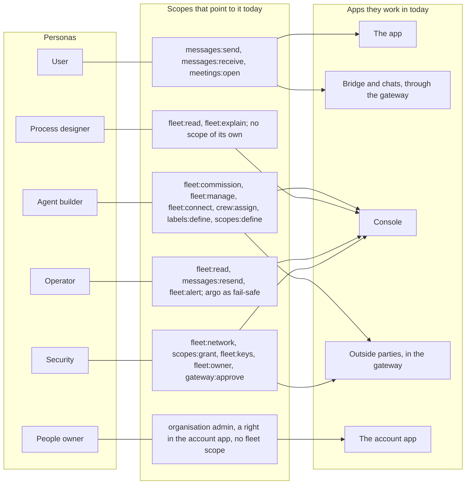

# Personas: one persona, one job per screen

Status: stage 1, for Thomas. The purpose was approved by Thomas on 22 Nov 2026. The lessons and questions below are open; nothing here is decided beyond the purpose. No detailed decisions, mockups or screen changes in this stage.

## 1. Purpose (approved)

### For whom

Six personas, as a company works:

- **User**: does the job with the fleet (answers, sends, follows up). Kept as one persona for now: "I would keep users later simple, making that complex now's would make it worse".
- **Agent builder**: adds capability (ships, crew settings, templates, MCP servers). "It is the builders proving to the tom designers where gaps are and improvements can come from."
- **Process designer**: "Workflow and process to me are kinda the same in modern companies. You design and follow up on execution. Continuous improvement of the flow and process is their key metric."
- **Operator**: keeps the fleet running.
- **Security**: makes sure people and ships do and can do only what they should. "Operator and security are indeed separate."
- **People owner**: accounts, groups, company sign-in, minimal.

### The job

Every screen answers "what is the purpose of this screen"; "If there is none it is filler, if it has multiple it is crowded." One persona, one job.

### How personas are known

"scope is a really good indicator. Also a very good way to scale one human to be able to be different personas at the same time or across screens." "Questions are needed when they are not something we can see in what we have. So fallback when needed."

### What steers it

"The level design is indeed a matrix that formulates with the personas on the other axis. 'what is a L2 user?', 'what is an L4 process designer?' what do they need?"

### Not the purpose

- More guides, tours or wizards: a guide is a smell to fix in the screen.
- A budget persona: "more aeolus designed flows (company flow) is where that sits".
- Personalisation now: "Maybe allowing for personalisation in the long term (customizing layouts for example) could solve that issue better than questions and fixed adoption". A later issue: [#2021](https://github.com/ThomasHendrickx/aeolus-fleet/issues/2021).

## 2. Lessons to check against

### The personas today

The scopes are the ones that point to each persona today ([scopes](../../guide/scopes.md)), read from what each persona does; which scopes identify a persona is question 2. The apps are where that work happens today. "The app" is the person's workspace; "the account app" holds accounts and organisations.

### Lessons

Evidence is a file and line in aeolus-fleet (AF), [aeolus-fleet-gateway](https://github.com/ThomasHendrickx/aeolus-fleet-gateway) (GW) or [aeolus-fleet-sign-in](https://github.com/ThomasHendrickx/aeolus-fleet-sign-in) (SI). Read from two read-only investigations on 22 Nov 2026: one of personas, one of every screen's purpose.

#### The persona model today

| # | Lesson | Evidence |
| --- | --- | --- |
| L1 | The product adapts to actors (argo, viewer, account) and scopes, never to a persona: "No human has a role" | AF `docs/decisions/0050-domain-language.md:8`; AF `packages/console/lib/access.ts:49-54` |
| L2 | An earlier persona set (Builder, Decider, Flow owner) exists in the onboarding design, and no code reads it | AF `docs/design/hosted-onboarding/README.md:11-20` |
| L3 | The organisation admin never implies fleet scopes, so the people owner cannot be seen in scopes | AF `docs/decisions/0051-organisation.md:5` |
| L4 | The process designer has no scope and no screen: nothing follows one flow across ships, and a flow view was deferred | AF `docs/design/hosted-onboarding/README.md:425` |
| L5 | The fleet sign-in models one role only, the fleet manager, and tells apps no account is argo | SI `packages/sign-in/src/core/shared/identity.ts:23`; SI `packages/sign-in/src/app.ts:146` |
| L6 | Argo is the fail-safe, never a normal path; every argo job is a scope any actor can hold | AF `docs/decisions/0012-operator-is-a-ship.md`; AF `docs/decisions/0053-nothing-is-argos-alone.md` |
| L7 | The solo developer is an anti-persona, while the agent builder's first paths are one person with their own agent | AF `docs/blueprint.md:29`; AF `docs/design/hosted-onboarding/README.md:12` |
| L8 | Every account counts as the operator for labels | AF `packages/console/lib/fleet.ts:35` |

#### Screens that mix personas

| # | Lesson | Evidence |
| --- | --- | --- |
| L9 | One empty fleet text for argo, accounts and the viewer: everyone reads "argo is your own ship" | AF `packages/console/features/fleet/state/fleet-overview.tsx:80-84` |
| L10 | The console's "Operator inbox" is shown to accounts, who can never answer there | AF `packages/console/lib/console-navigation.ts:28`; AF `packages/console/lib/access.ts:54`; AF `packages/console/features/inbox/ui/organisms/question-reader.tsx:420` |
| L11 | A raw scope name stands in for a screen someone cannot use | AF `packages/console/app/(console)/network/network-page.tsx:116`; GW `web/features/outside-parties/ui/switch-card.tsx:14` |
| L12 | Bridge shows the security and builder pages (Outside parties) to every person, and the palette offers "Add outside party" with no rights | GW `web/features/bridge/ui/bridge-sidebar.tsx:73`; GW `bridge/palette/services/palette-list.ts:32` |
| L13 | One header bar mixes the person's client with operator pages | GW `web/features/frame/ui/gateway-tabs.tsx:8-13` |
| L14 | An approval queue, a security job, sits under the person's Settings | GW `web/features/bridge/state/bridge-settings.tsx:28` |
| L15 | Dialogs almost always do one job; the crowded routes are homes, settings and the page for one object. The ship page holds about ten jobs for builders, security, operators and process designers | AF `packages/console/app/(console)/ships/[shipId]/ship-page.tsx:144-264`; AF `packages/console/app/(console)/overview-page.tsx:64-116`; AF `packages/console/app/(console)/settings/page.tsx:57-171` |

#### Dead ends and filler

| # | Lesson | Evidence |
| --- | --- | --- |
| L16 | "Ask someone" texts send a person to another persona with no name and no path | AF `packages/console/app/sign-in/no-rights/page.tsx:17`; GW `bridge/recovery/ui/disconnected.tsx:5`; GW `web/features/authorize/services/authorize.ts:26`; SI `packages/sign-in/src/app.ts:184` |
| L17 | A screen that only explains and offers no next act is filler | AF `packages/console/app/sign-in/switch-failed/page.tsx:14-15`; SI `packages/sign-in/src/app.ts:76` |

#### Words

| # | Lesson | Evidence |
| --- | --- | --- |
| L18 | The person in charge has many names (operator, fleet manager, builder, whoever runs your fleet, the person who runs this installation) | AF `docs/design/README.md:3`; GW `bridge/recovery/ui/disconnected.tsx:5`; GW `web/features/authorize/services/authorize.ts:26`; SI `packages/sign-in/src/app.ts:184` |
| L19 | One meaning per term: "Computer ... Never 'machine'", yet the console says machine | AF `docs/decisions/0050-domain-language.md:14`; AF `packages/console/features/trierarchs/ui/organisms/machine-list.tsx:81-82` |

#### Guides

| # | Lesson | Evidence |
| --- | --- | --- |
| L20 | The console tour has no content in this repository, and a self-hosted server has no guide | AF `docs/decisions/0024-guide.md:4` |
| L21 | The tour costs: its phone test failed 4 of the 60 most recent failed CI runs (15 to 22 Nov) | AF `e2e/console-guide-phone.e2e.test.ts:173` |
| L22 | A guide built from the product's own primitive works in context: the gateway sends a person a step to sign in where it is needed | GW `src/core/party-grants/tell-sign-in-needed.ts:25-39` |
| L23 | The empty state rule already says what an empty screen does: what is empty, what happens next, one action only when it can be fixed here | AF `docs/design/README.md:102`; AF `packages/ui/src/molecules/empty-state.tsx:12` |
| L24 | Before 1.0.0, keep designs minimal: no polish for zero customers | AF `docs/decisions/0013-breaking-changes-before-1-0.md` |

## 3. Questions for Thomas

One decision each, ordered so the first ones unblock the rest. Each pick is a recommendation; none is decided.

### Q1. Do the six personas replace Builder, Decider and Flow owner?

1. Yes: Builder becomes the agent builder, Decider the user, Flow owner the process designer; the onboarding design follows.
2. No: the three stay for onboarding, the six for screens.
3. The six replace them, and the onboarding design keeps its paths under the new names only once its next stage reopens.

Pick: 1. Two persona sets that never meet is lesson L2's problem again; one model is what screens and levels can both read.

### Q2. Which signal identifies each persona?

1. Scopes for the four with scopes (user, agent builder, operator, security); the organisation admin right for the people owner; the fallback question only for the process designer, who has neither (L3, L4).
2. A new scope per persona, so every persona is read the same way.
3. A question for every persona at first sign-in, scopes only as a check.

Pick: 1. It reads what the product already holds, as the purpose asks, and keeps the question to the one persona nothing shows.

### Q3. Where is each persona's home?

1. One home per persona, in the app it works in today: user in the app (and Bridge), agent builder, process designer, operator and security each a home in the console, people owner in the account app.
2. One home per app, shaped by the scopes the person holds.
3. One home for everyone, listing a section per persona the person holds.

Pick: 1. One persona, one job starts with where each persona lands; options 2 and 3 are today's crowded homes (L15).

### Q4. When one human holds several personas, how do they move between them?

1. Each screen serves one persona; the navigation shows the homes of every persona the person's scopes give, and they move between them.
2. A persona switcher: the person picks who they are now, and screens follow.
3. The persona the person holds most shapes everything.

Pick: 1. It is the purpose's "different personas at the same time or across screens" through scope, with no switch to forget.

### Q5. What does a screen show someone who cannot act there?

1. Nothing: it is not in their navigation, and its address takes them to their own home with one line why.
2. The screen read-only, with one line naming who can act.
3. An explanation of the right they lack, as today (L11).

Pick: 1. Read-only and explanations are where most filler comes from (L10, L11, L12); seeing without acting stays only where seeing is the job, such as the process designer reading a flow.

### Q6. May a home or a settings screen be a hub?

1. No: a home has one job ("what needs me" for its persona), settings one job ("where and when things reach me"), and links to other apps live in the app switcher.
2. Yes: a hub of links is itself one purpose.
3. A home has one job; settings may be a hub.

Pick: 1. Homes and settings are most of today's crowded routes (L14, L15); a hub is a guide by another name.

### Q7. Is a page for one object "manage this", or everything about it?

1. "Manage this", for the persona who changes it (the agent builder for a ship); the timeline and hand-offs belong to the process designer's view, permissions to security's.
2. Everything about it, in sections per persona.
3. Everything about it, in tabs per persona.

Pick: 1. That one choice decides the most crowded pages (L15), and options 2 and 3 keep several jobs on one screen.

### Q8. Is the viewer of the live demo a persona?

1. No: the viewer is an actor for the demo; the demo shows the user's or the process designer's screens read-only.
2. Yes: a seventh persona with screens of its own.
3. No, and the demo keeps its tour as the one guide.

Pick: 1. The approved six are how a company works; the demo is a way to see them, and a tour is the smell the purpose names (L20, L21).

### Q9. Do the persona names reach the screens?

1. No: personas are design words; the screens keep the product's words, with one name for the person in charge in [Words](../../guide/words.md) (L18).
2. Yes: the screens say "agent builder", "security" and so on.
3. Only where a person moves between personas, as the navigation's labels.

Pick: 1. One meaning per term (0050); a screen names its job, not who the reader is.

### Q10. Where does the levels times personas matrix live?

1. In the levels strategy Thomas asked for first; this design names the six personas, and the matrix there answers "what is a L2 user?" per cell.
2. Here, with the levels as columns.
3. In both, the matrix here pointing at each level's definition there.

Pick: 1. The levels strategy is not written yet; levels own the matrix, and every fact has one source (AGENTS.md).
