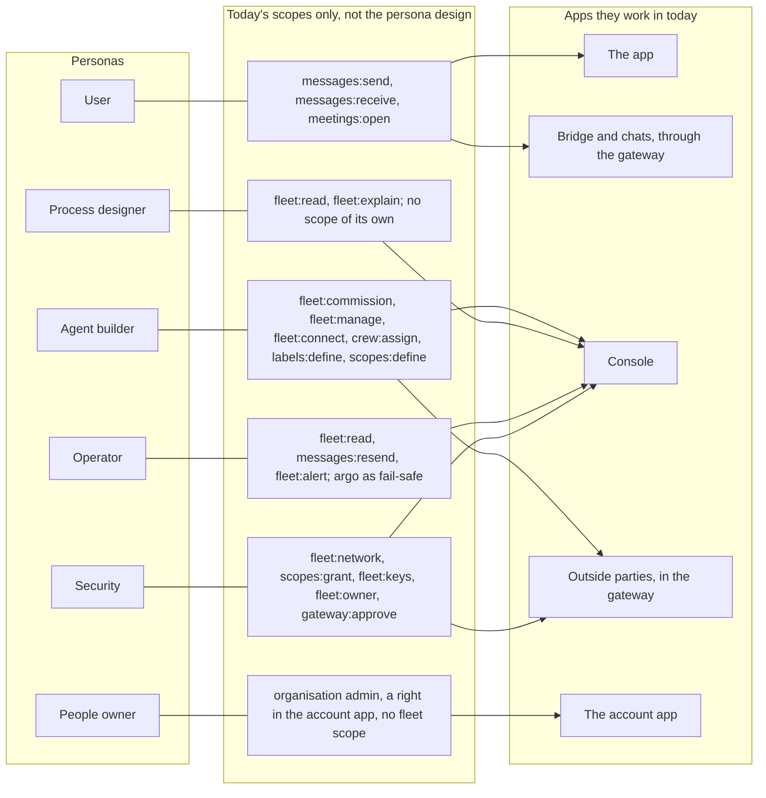

# Personas: one persona, one job per screen

Status: stage 2, for Thomas. The purpose was approved by Thomas on 22 Nov 2026, and the decisions in section 2 are his. Section 4 holds each persona's jobs to be done; the questions in section 5 are open. No detailed decisions, mockups or screen changes in this stage.

## 1. Purpose (approved)

### For whom

Six personas, as a company works:

- **User**: does the job with the fleet (answers, sends, follows up). Kept as one persona for now: "I would keep users later simple, making that complex now's would make it worse".
- **Agent builder**: adds capability (ships, crew settings, templates, MCP servers). "It is the builders proving to the tom designers where gaps are and improvements can come from."
- **Process designer**: "Workflow and process to me are kinda the same in modern companies. You design and follow up on execution. Continuous improvement of the flow and process is their key metric."
- **Operator**: keeps the fleet running.
- **Security**: makes sure people and ships do and can do only what they should. "Operator and security are indeed separate."
- **People owner**: accounts, groups, company sign-in, minimal.

### The job

Every screen answers "what is the purpose of this screen"; "If there is none it is filler, if it has multiple it is crowded." One persona, one job.

### How personas are known

"scope is a really good indicator. Also a very good way to scale one human to be able to be different personas at the same time or across screens." "Questions are needed when they are not something we can see in what we have. So fallback when needed."

### What steers it

"The level design is indeed a matrix that formulates with the personas on the other axis. 'what is a L2 user?', 'what is an L4 process designer?' what do they need?"

### Not the purpose

- More guides, tours or wizards: a guide is a smell to fix in the screen.
- A budget persona: "more aeolus designed flows (company flow) is where that sits".
- Personalisation now: "Maybe allowing for personalisation in the long term (customizing layouts for example) could solve that issue better than questions and fixed adoption". A later issue: [#2021](https://github.com/ThomasHendrickx/aeolus-fleet/issues/2021).

## 2. Decisions (Thomas, 22 Nov 2026)

- **D1. One persona model.** The six personas are the one model; Builder, Decider and Flow owner are replaced, the onboarding design included.
- **D2. Scopes define the persona, not yet which.** "I agree with the philosophy of scopes define persona, but don't agree with how they are layed out now. But to me the exact scopes is an persona design work step, which we are not yet doing". The diagram in section 3 shows today's scopes only, not the persona design.
- **D3. No screen questions yet.** On a home per persona: "This is to simplistic and not yet relevant question. Reason is that some are also part of a plugin that can be active or not. There is also nothing wrong with shaping an app to be what it needs to be. This is mixing up personas with jtbd.." Every question on homes, moving between personas, screens someone cannot act on, hubs, object pages, the viewer and persona names is withdrawn: screen questions come after the jobs.
- **D4. Next: jobs to be done per persona.** "Do understand that this is not a 1-1 mapping. It is a 1-n between persona and jtbd. Plus a persona is more than just a jtbd, but it is at its core so the most important thing to get right."

## 3. Lessons to check against

### The personas today

The scope lists below are today's scopes only ([scopes](../../guide/scopes.md)), read from what each persona does. They are not the persona design: which scopes identify a persona is a persona design step, not yet done (D2). The apps are where that work happens today. "The app" is the person's workspace; "the account app" holds accounts and organisations.

### Lessons

Evidence is a file and line in aeolus-fleet (AF), [aeolus-fleet-gateway](https://github.com/ThomasHendrickx/aeolus-fleet-gateway) (GW), [aeolus-fleet-sign-in](https://github.com/ThomasHendrickx/aeolus-fleet-sign-in) (SI), [aeolus-fleet-squadrons](https://github.com/ThomasHendrickx/aeolus-fleet-squadrons) (SQ), [aeolus-fleet-trierarch-plugin](https://github.com/ThomasHendrickx/aeolus-fleet-trierarch-plugin) (TP) or [aeolus-fleet-watch-plugin](https://github.com/ThomasHendrickx/aeolus-fleet-watch-plugin) (WP). Read from two read-only investigations on 22 Nov 2026: one of personas, one of every screen's purpose.

#### The persona model today

| # | Lesson | Evidence |
| --- | --- | --- |
| L1 | The product adapts to actors (argo, viewer, account) and scopes, never to a persona: "No human has a role" | AF `docs/decisions/0050-domain-language.md:8`; AF `packages/console/lib/access.ts:49-54` |
| L2 | An earlier persona set (Builder, Decider, Flow owner) exists in the onboarding design, and no code reads it | AF `docs/design/hosted-onboarding/README.md:11-20` |
| L3 | The organisation admin never implies fleet scopes, so the people owner cannot be seen in scopes | AF `docs/decisions/0051-organisation.md:5` |
| L4 | The process designer has no scope and no screen: nothing follows one flow across ships, and a flow view was deferred | AF `docs/design/hosted-onboarding/README.md:425` |
| L5 | The fleet sign-in models one role only, the fleet manager, and tells apps no account is argo | SI `packages/sign-in/src/core/shared/identity.ts:23`; SI `packages/sign-in/src/app.ts:146` |
| L6 | Argo is the fail-safe, never a normal path; every argo job is a scope any actor can hold | AF `docs/decisions/0012-operator-is-a-ship.md`; AF `docs/decisions/0053-nothing-is-argos-alone.md` |
| L7 | The solo developer is an anti-persona, while the agent builder's first paths are one person with their own agent | AF `docs/blueprint.md:29`; AF `docs/design/hosted-onboarding/README.md:12` |
| L8 | Every account counts as the operator for labels | AF `packages/console/lib/fleet.ts:35` |

#### Screens that mix personas

| # | Lesson | Evidence |
| --- | --- | --- |
| L9 | One empty fleet text for argo, accounts and the viewer: everyone reads "argo is your own ship" | AF `packages/console/features/fleet/state/fleet-overview.tsx:80-84` |
| L10 | The console's "Operator inbox" is shown to accounts, who can never answer there | AF `packages/console/lib/console-navigation.ts:28`; AF `packages/console/lib/access.ts:54`; AF `packages/console/features/inbox/ui/organisms/question-reader.tsx:420` |
| L11 | A raw scope name stands in for a screen someone cannot use | AF `packages/console/app/(console)/network/network-page.tsx:116`; GW `web/features/outside-parties/ui/switch-card.tsx:14` |
| L12 | Bridge shows the security and builder pages (Outside parties) to every person, and the palette offers "Add outside party" with no rights | GW `web/features/bridge/ui/bridge-sidebar.tsx:73`; GW `bridge/palette/services/palette-list.ts:32` |
| L13 | One header bar mixes the person's client with operator pages | GW `web/features/frame/ui/gateway-tabs.tsx:8-13` |
| L14 | An approval queue, a security job, sits under the person's Settings | GW `web/features/bridge/state/bridge-settings.tsx:28` |
| L15 | Dialogs almost always do one job; the crowded routes are homes, settings and the page for one object. The ship page holds about ten jobs for builders, security, operators and process designers | AF `packages/console/app/(console)/ships/[shipId]/ship-page.tsx:144-264`; AF `packages/console/app/(console)/overview-page.tsx:64-116`; AF `packages/console/app/(console)/settings/page.tsx:57-171` |

#### Dead ends and filler

| # | Lesson | Evidence |
| --- | --- | --- |
| L16 | "Ask someone" texts send a person to another persona with no name and no path | AF `packages/console/app/sign-in/no-rights/page.tsx:17`; GW `bridge/recovery/ui/disconnected.tsx:5`; GW `web/features/authorize/services/authorize.ts:26`; SI `packages/sign-in/src/app.ts:184` |
| L17 | A screen that only explains and offers no next act is filler | AF `packages/console/app/sign-in/switch-failed/page.tsx:14-15`; SI `packages/sign-in/src/app.ts:76` |

#### Words

| # | Lesson | Evidence |
| --- | --- | --- |
| L18 | The person in charge has many names (operator, fleet manager, builder, whoever runs your fleet, the person who runs this installation) | AF `docs/design/README.md:3`; GW `bridge/recovery/ui/disconnected.tsx:5`; GW `web/features/authorize/services/authorize.ts:26`; SI `packages/sign-in/src/app.ts:184` |
| L19 | One meaning per term: "Computer ... Never 'machine'", yet the console says machine | AF `docs/decisions/0050-domain-language.md:14`; AF `packages/console/features/trierarchs/ui/organisms/machine-list.tsx:81-82` |

#### Guides

| # | Lesson | Evidence |
| --- | --- | --- |
| L20 | The console tour has no content in this repository, and a self-hosted server has no guide | AF `docs/decisions/0024-guide.md:4` |
| L21 | The tour costs: its phone test failed 4 of the 60 most recent failed CI runs (15 to 22 Nov) | AF `e2e/console-guide-phone.e2e.test.ts:173` |
| L22 | A guide built from the product's own primitive works in context: the gateway sends a person a step to sign in where it is needed | GW `src/core/party-grants/tell-sign-in-needed.ts:25-39` |
| L23 | The empty state rule already says what an empty screen does: what is empty, what happens next, one action only when it can be fixed here | AF `docs/design/README.md:102`; AF `packages/ui/src/molecules/empty-state.tsx:12` |
| L24 | Before 1.0.0, keep designs minimal: no polish for zero customers | AF `docs/decisions/0013-breaking-changes-before-1-0.md` |

## 4. Jobs to be done per persona

One persona has 1 to n jobs (D4), and a persona is more than its jobs. Each job reads "When <situation>, I want to <act>, so I can <outcome>", in the blueprint's words. A job two personas share is listed once, under the first, naming both; the other persona points to it.

Each job names the part that delivers it: core, squadrons, the trierarch plugin, the watch plugin, the networking plugin, the gateway, the account app or sign-in. A job of a plugin exists only in a fleet where that plugin is connected and switched on. Today names one line of evidence where Aeolus serves the job, or says it is a gap. The evidence keys are section 3's, read on 22 Nov 2026.

The networking plugin delivers no job: network rules are core's ("Network rules live in core (decision 0034): the networking plugin goes", AF `packages/core/src/adapters/prisma/migrations/20261020160000_network_in_core/migration.sql:1`), while its own README still says it holds them (NP `packages/networking-plugin/README.md:3`, in [aeolus-fleet-networking-plugin](https://github.com/ThomasHendrickx/aeolus-fleet-networking-plugin)).

The agent's own jobs (register, receive, send, report) stay in the blueprint's [Users](../../blueprint.md#the-agent-a-ships-crew): the six personas are humans.

The levels axis stays open: the levels strategy is not written, so no job names a level (question J7).

### User

A human of the organisation who acts as their account and sends and receives through their person ship, where they may message or own a ship (AF `docs/blueprint.md:98`). Every ship has an owner who maintains it, like an application owner, so a user who owns ships answers for them (AF `docs/blueprint.md:41`). They care that the fleet does the work and that they "still gate and steer on the critical points", not act as the glue (AF `docs/blueprint.md:30`).

| # | Job | Part | Without that part | Today |
| --- | --- | --- | --- | --- |
| U1 | When I am in the client I already use, I want to reach my fleet from there, so I can work with ships without another app | The gateway; the app is another door | Without the gateway, only through the app or a chat crewing the person ship | Served: GW `src/core/mcp-in/call-tool.ts:80` |
| U2 | When a ship I own asks me a question, I want to answer it where I am, so I can let it go on without being its glue | Core carries the question; the gateway (Bridge) or the app shows it | Core alone: the question waits on the person ship until some crew shows it | Served: GW `src/core/people/answer-delivery.ts:48` |
| U3 | When a ship needs what only a human can do, I want to see the step and its link and say done or cannot, so I can unblock it | The gateway (Bridge) | Without the gateway, the step is a message with no place of its own | Served: GW `src/core/people/finish-own-step.ts:42` |
| U4 | When I have work for a ship, I want to send it to that ship or its type, so I can hand it over and get the answer back | Core; the gateway or the app as the door | Core alone: only through the ship API | Served: GW `src/core/people/send-message.ts:34` |
| U5 | When my agents need an outside MCP server, I want to ask for it and learn the outcome, so I can get them the tool without chasing anyone | The gateway | Does not exist | Served: GW `src/core/requests/ask-for-server.ts:40` |
| U6 | When a ship I own goes quiet or misses what was expected of it, I want to be told, so I can step in before the work stalls. Shared with the operator | The watch plugin, on core's facts | Does not exist: core keeps expectations and alerts, nothing raises one | Gap: the watch plugin's signals are "the next slices" (WP `docs/watch-plugin.md:11`) |

### Agent builder

Adds capability to the fleet: ships, crew settings, templates, MCP servers; "It is the builders proving to the tom designers where gaps are and improvements can come from." Its first paths are one person with their own agent (L7).

| # | Job | Part | Without that part | Today |
| --- | --- | --- | --- | --- |
| B1 | When the company needs a new agent, I want to commission a ship with its scopes and owner and get its crew line, so I can put it to sea without setup work | Core | Always there | Served: AF `packages/core/src/domain/registry/commission-ship.ts:250` |
| B2 | When a ship should stay crewed, I want to declare its crew settings once, so I can have a trierarch keep it crewed on a fitting computer | Core holds the crew request; the trierarch plugin assigns it | Without the trierarch plugin, the request stands and nobody assigns it: crewed by hand | Served: TP `packages/trierarch-plugin/src/core/assignment/assign-crews.ts:35` |
| B3 | When an agent needs outside tools, I want to give its crew the MCP servers it needs, so I can have it work with them on every crew | The trierarch plugin | Does not exist | Served: TP `packages/trierarch-plugin/src/core/mcp-configuration/replace-mcp-configuration.ts:18` |
| B4 | When a piece of work keeps coming back, I want to write it once as roles, templates and hand-offs, so I can form a squadron that runs it the same way each time. Shared with the process designer | Squadrons | Does not exist | Served: SQ `packages/squadrons/src/core/squadron/form-squadron.ts:66` |
| B5 | When the company has words of its own (a CRM, a team), I want to define its labels and scopes, so I can have ships selected and tools guarded in those words | Core | Always there | Served: AF `packages/core/src/domain/registry/define-scope.ts:27` |
| B6 | When an agent hits what the flow cannot do, I want to show the process designer where the gap is, so I can have the flow improved | None yet | | Gap: a crew reports blocked with a note per ship (AF `packages/core/src/domain/registry/report.ts:30`); nothing gathers it per flow (question J6) |

Shared: O2 (with the operator).

### Process designer

"You design and follow up on execution. Continuous improvement of the flow and process is their key metric." No scope and no screen today (L4).

| # | Job | Part | Without that part | Today |
| --- | --- | --- | --- | --- |
| P1 | When work runs across several ships, I want to follow one flow from start to end, so I can see where it slows or breaks (question J1) | None yet | | Gap: an exchange is what two ships said to each other (AF `docs/blueprint.md:323`); a combined flow view was deferred (AF `docs/design/hosted-onboarding/README.md:425`) |
| P2 | When a flow waits on people, I want to see where it waits and for how long, so I can design the human out where they are only the glue | None yet | | Gap: Bridge counts what waits per person only (GW `src/core/people/read-waiting-count.ts:14`) |
| P3 | When I have changed a flow, I want to compare how it runs before and after, so I can show it improved | None yet | | Gap: no flow is recorded to compare (P1) |
| P4 | When a step of a flow must be done by a time, I want to set that expectation on the ship, so I can know when the flow misses it | Core keeps the expectation; the watch plugin tells | Without the watch plugin, the expectation is kept and nothing tells | Gap: core sets it (AF `packages/core/src/domain/registry/set-expectations.ts:32`), the watch plugin raises nothing yet (WP `docs/watch-plugin.md:11`); only its owner or a ship managing it sets one (AF `docs/blueprint.md:259`) |

Shared: B4 (with the agent builder).

### Operator

Keeps the fleet running; "Operator and security are indeed separate." Not argo: argo is the fail-safe, never a normal path, and every argo job is a scope any actor may hold (L6; question J3).

| # | Job | Part | Without that part | Today |
| --- | --- | --- | --- | --- |
| O1 | When I start my day or something feels off, I want to see every ship, its crew and what needs a hand, so I can know what is sailing right now | Core | Always there | Served: AF `packages/core/src/domain/registry/list-fleet.ts:101` |
| O2 | When something went wrong with a ship, I want to read everything it sent, received and changed, so I can understand what happened. Shared with the agent builder | Core | Always there | Served: AF `packages/core/src/domain/messaging/read-record.ts:40` |
| O3 | When a delivery is stuck or used every attempt, I want to resend or dismiss it, so I can trust that nothing falls through the cracks | Core | Always there | Served: AF `packages/core/src/domain/messaging/resend-delivery.ts:80` |
| O4 | When a ship's session is gone, I want to release or recrew it, so I can get the ship crewed again | Core | Always there | Served: AF `packages/core/src/domain/registry/recrew-ship.ts:33` |
| O5 | When a computer joins or its trierarch goes silent, I want to bring it in and see which computers answer, so I can keep ships crewed where they run (question J5) | The trierarch plugin | Does not exist | Served: TP `packages/trierarch-plugin/src/core/machines/list-machines.ts:31` |
| O6 | When a send is refused, I want to learn which rule refused it and how a ship reaches another, so I can tell a fault from a rule. Shared with security | Core | Always there | Served: AF `packages/core/src/domain/registry/explain-reach.ts:37` |
| O7 | When the system fails and a ship has nowhere else to go, I want to sign in as argo and act, so I can get the fleet out | Core | Always there | Served: AF `docs/blueprint.md:182` |

Shared: U6 (with the user).

### Security

Makes sure people and ships do and can do only what they should. Aeolus enforces scopes exactly and adds no rules of its own (AF `docs/blueprint.md:17`).

| # | Job | Part | Without that part | Today |
| --- | --- | --- | --- | --- |
| S1 | When ships must reach only whom they should, I want to draft the network rules, see what the draft gains and loses, and apply it, so I can change reach without breaking what works | Core | Always there | Served: AF `packages/core/src/domain/registry/save-network-rules-draft.ts:28` |
| S2 | When a ship needs to do more, I want to grant it a scope I hold, so I can widen its access no further than I may | Core | Always there | Served: AF `packages/core/src/domain/registry/grant-scopes.ts:37` |
| S3 | When an outside MCP server or client asks in, I want to approve or deny it and name its owner, so I can admit only what the company trusts | The gateway | Does not exist | Served: GW `src/core/requests/decide-request.ts:52` |
| S4 | When payloads must stay the company's, I want to seal the fleet under the company's own key, so I can keep stored messages unreadable to the server | Core | Always there | Served: AF `packages/core/src/domain/messaging/turn-on-sealing.ts:54` |
| S5 | When agents run on the company's computers, I want to say which models and repositories they may use, so I can keep crews to what the company allows (question J4) | The trierarch plugin | Does not exist | Served: TP `packages/trierarch-plugin/src/core/models/set-model-enabled.ts:12` |

Shared: O6 (with the operator), N2 (with the people owner).

### People owner

Says who is in, with which rights; accounts, groups, company sign-in, minimal. The organisation admin right never gives fleet scopes (L3). The account app is private; its jobs are in the public blueprint.

| # | Job | Part | Without that part | Today |
| --- | --- | --- | --- | --- |
| N1 | When someone joins or changes team, I want to put their account in groups and give its own rights, so I can have their rights in each fleet follow | The account app; sign-in on a self-hosted fleet, for the fleet manager only | Self-hosted without sign-in: argo's own sign-in only, no accounts | Served in the account app (AF `docs/blueprint.md:111`); on sign-in only the fleet manager's right (SI `packages/sign-in/src/core/accounts/setup.ts:20`, L5) |
| N2 | When someone leaves, I want to disable their account, so I can end their access at once while their ships stay. Shared with security | The account app, with core releasing the person ship | Does not exist without the account app | Served: AF `packages/core/src/domain/identity/cut-off-account.ts:37` |
| N3 | When the company signs in with Google or Microsoft, I want its accounts to sign in with those logins, so I can keep one company sign-in | The account app | Does not exist | Gap: identity providers and the directory are "to build" (AF `docs/blueprint.md:205-206`) |
| N4 | When a fleet needs someone who can act as argo, I want to say which accounts may, so I can keep the fail-safe in named hands | The account app | Self-hosted: argo's own sign-in | Served in the account app (AF `docs/blueprint.md:113`) |

## 5. Questions for Thomas

One decision each, ordered so the first ones unblock the rest. Each pick is a recommendation; none is decided.

### J1. What is one flow, for the process designer's jobs?

P1 to P4 and B6 all need one flow to follow, and nothing names one today.

1. A task: the ships whose reports name the same task, a typed reference to where the work lives such as an issue or a PR (AF `docs/blueprint.md:272`), form one flow.
2. A thread: a message and every reply that follows from it, across ships.
3. A squadron: from forming to stand-down.

Pick: 1. Core already keeps each report's task (0071), and a task is the same with or without squadrons; a thread breaks as soon as a ship starts a new message, and a squadron leaves out the work done outside one.

### J2. Which gap is designed first?

1. The process designer's flow (P1 to P3): the one persona no job serves today.
2. Being told when a ship goes quiet or misses an expectation (U6, P4): core keeps the facts already.
3. Company sign-in (N3).

Pick: 1. Continuous improvement of the flow is the process designer's key metric, and nothing serves it; U6 and P4 are already the watch plugin's next slices (WP `docs/watch-plugin.md:11`).

### J3. Is the operator persona the blueprint's operator?

The blueprint's operator is the human who signs in as argo, and its job table holds both running the fleet and commissioning ships (AF `docs/blueprint.md:115-130`).

1. No: the operator persona is whoever holds the running jobs (O1 to O7) by scope; the blueprint's operator stays the human signed in as argo, the fail-safe, and its jobs point to this section's operator and agent builder.
2. Yes: the operator persona is whoever signs in as argo.
3. No, and the human signed in as argo gets another name in [Words](../../guide/words.md), so "operator" means the persona alone.

Pick: 1. Nothing is argo's alone (0053), so a persona cannot be argo; one name per meaning (L18) is a words step after the jobs, not this decision.

### J4. Whose job is saying which models and repositories crews may use (S5)?

1. Security's: what a crew can do is what it should.
2. The operator's: it is how the fleet runs.
3. The agent builder's: it is part of building the crew.

Pick: 1. "Makes sure people and ships do and can do only what they should" names it; the agent builder picks within what security allows (B2, B3).

### J5. Whose job is bringing computers in and seeing which answer (O5)?

1. The operator's.
2. The agent builder's.
3. Both, listed once naming both.

Pick: 1. Keeping ships crewed where they run is keeping the fleet running; the agent builder says what a ship needs (B2), not on which computer.

### J6. How does the agent builder show the process designer a gap (B6)?

1. With what exists: a crew's blocked report with its note, and its question to its owner, read by the process designer along one flow (J1).
2. A message type of its own for a gap, sent to the process designer.
3. Not the builder's job: the process designer finds gaps in the flow alone.

Pick: 1. It adds nothing new before 1.0 (0013), and the gap shows once a flow does; option 3 drops Thomas's "builders proving to the tom designers where gaps are".

### J7. How do the jobs meet the levels?

The levels strategy is not written; this question decides only how the two meet.

1. Each persona and level cell names the jobs from section 4 it needs; the jobs stay here, the cells there.
2. Each job here says what it looks like at every level.
3. The levels strategy names its own needs per cell, and the jobs here are checked against it afterwards.

Pick: 1. "what is a L2 user? what do they need?" asks for needs per cell, and a job is the need; each fact keeps one source (AGENTS.md), and option 2 writes levels before their strategy exists.

### J8. Where does the levels times personas matrix live?

Still open from stage 1.

1. In the levels strategy Thomas asked for first; this design names the six personas, and the matrix there answers "what is a L2 user?" per cell.
2. Here, with the levels as columns.
3. In both, the matrix here pointing at each level's definition there.

Pick: 1. The levels strategy is not written yet; levels own the matrix, and every fact has one source (AGENTS.md).
