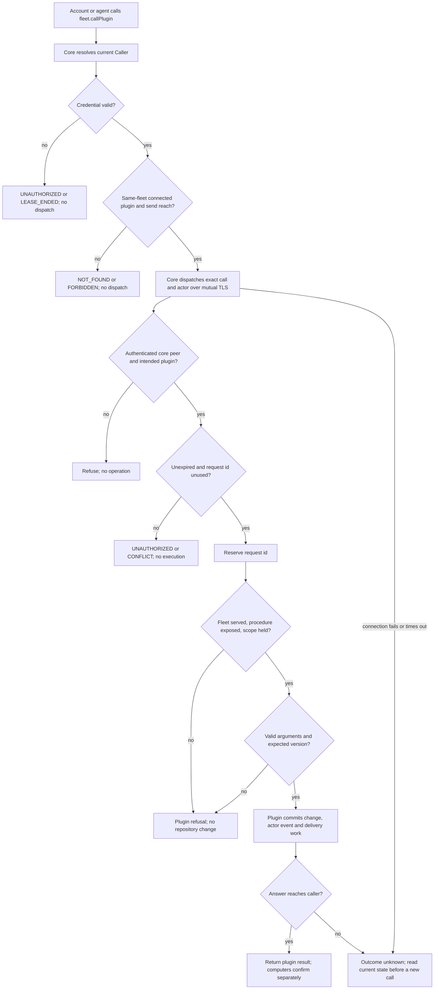

# Authenticated plugin calls

Proposed core contract for [trierarch #452](https://github.com/ThomasHendrickx/aeolus-fleet-trierarch/issues/452) and its [approved design, decision 1](https://github.com/ThomasHendrickx/aeolus-fleet-trierarch/blob/debb2c053fecb8f98249a935f89effaade451d69/docs/design/trusted-repositories.md). Specification only; implementation needs approval of this contract.

## Purpose

A person or agent with `trierarch:repositories` manages their fleet's trusted repositories through the trierarch plugin. An agent uses its normal authenticated fleet connection. Core establishes the actor over an authenticated server connection; the plugin enforces its scope from that verified context, including the current fleet and scopes. No credential becomes visible to an agent session.

## Lessons and existing parts

- [Blueprint](../blueprint.md), [0046](../decisions/0046-scope-catalogue.md), [0057](../decisions/0057-actors.md): one actor model and scope catalogue. Core checks its own scopes; plugins check theirs. A message carries no rights. `fleet:on-behalf` is not management impersonation.
- [0020](../decisions/0020-installation.md): installation calls above a fleet stay separate; a fleet call by the installation uses its existing fixed scopes, not argo's rights.
- [0026](https://github.com/ThomasHendrickx/aeolus-fleet-trierarch/blob/main/docs/decisions/0026-trierarch.md): a crewed session calls through its ship's socket; the trierarch attaches that ship's credential and forwards unchanged. It does not authorize the operation.
- [0030](https://github.com/ThomasHendrickx/aeolus-fleet-trierarch-plugin/blob/main/docs/decisions/0030-trierarch-plugin.md): the plugin owns configuration and policy, uses public core calls, and has its own database and events.
- Today the console's server calls plugin tRPC procedures with filtered sign-in cookies (`packages/console/lib/plugin-call.ts`). The plugin checks them through core `console.session` (`adapters/fleet/console-sessions.ts` in the plugin). This establishes console sessions, not an agent calling through its fleet connection. `ship.whoami` identifies a ship but does not establish authority for a different plugin call. Neither is a complete reusable contract here.
- Reuse core's `actorProcedure`, `Caller`, `actorOf`, network check and REST/MCP mapping. Reuse the plugin's existing repository operations and served/connected checks. Core receives no repository table, URL validation, git access check or placement rule.

## Call and answer

Propose `fleet.callPlugin`, mapped to REST `POST /api/v1/fleet/callPlugin` and MCP `fleet_callPlugin` through the same procedure. This is an actor call, not a messaging call or an installation-only procedure.

```json
{
  "pluginShipId": "shp_...",
  "procedure": "repositories.add",
  "input": { "name": "main", "url": "https://github.com/org/repo.git", "expectedVersion": 3 }
}
```

`pluginShipId` names a connected plugin of the caller's fleet. `procedure` names an exposed operation of that plugin. `input` is that operation's existing input, validated by the plugin. Unknown envelope fields are rejected: callers cannot supply actor, fleet, scopes, server URL, HTTP headers or an event actor. The complete serialized input fits the existing 256 KB limit. Answers use the existing tRPC data/error shape and the REST/MCP mappings; core returns the plugin operation's data or refusal, without interpreting repository data.

The first exposed operations are the approved `repositories.list`, `repositories.add`, `repositories.remove`, `repositories.check` and `repositories.access`. Their inputs, answers, version conflicts and no-op behavior belong to the approved repository design and plugin schemas. The plugin exposes this set explicitly; the relay never opens its installation, connection or arbitrary tRPC procedures. A person may use the same core call with their account token or console sign-in; the installation uses its existing fleet-scoped authentication on tRPC only. A ship uses its crew token through its existing transport. Existing console-cookie operations keep their present authentication and Origin checks; this slice does not widen MCP configuration management.

## Authentication, scope and reach

1. Core resolves the caller through its normal actor authentication. Ship scopes are read from the server on every call; an ended lease or retired ship is refused. Accounts follow 0058: checked signature, issuer, fleet, expiry and cut-off on every call, with rights from the checked token. Account rights changes take effect at token renewal as today, not by a new lookup. Console changes retain Origin checks. Installation rights stay those of 0057.
2. Core resolves the target plugin within that fleet and checks access using the existing `send` reach check to the plugin ship. This is only a reach check: it neither sends a message nor requires `messages:send` for an account's administrative call. The existing `sendToPlugin` built-in rule applies; no new reach verb or rule is introduced. Core does not require `fleet:read` or `fleet:manage` to transport a plugin operation.
3. Core dispatches once, immediately, to the server-configured plugin endpoint for that ship. The caller cannot choose an endpoint, and redirects are refused. The plugin must serve and be connected to this fleet. Its own scopes never replace the caller's.
4. Core passes the following alongside the operation on the authenticated server connection. These are server fields, never fields of `input`:

   | Field | Meaning |
   | --- | --- |
   | `requestId` | Core-generated unique id for this dispatch, reused only for transport duplicate detection |
   | `fleetId`, `pluginShipId` | Authenticated caller's fleet and the exact intended plugin ship |
   | `actor` | Existing event actor shape from `actorOf(caller)`: ship, account or installation; never `system` |
   | `scopes` | Effective scopes from this call's resolved `Caller`, including plugin scopes |
   | `procedure`, `input` | The exact operation and arguments authorized for this dispatch |
   | `expiresAt` | End of this immediate dispatch, at most 30 seconds after authentication and no later than a known credential expiry |

5. The plugin verifies the server connection, destination, deadline and exposed procedure before using context. It checks `trierarch:repositories` on every repository operation, including reads and access answers, and uses only the verified `fleetId` for storage. `trierarch:join`, `fleet:manage`, plugin ownership or message reach alone do not grant it. Argo's existing all-scopes semantics apply through the shared scope check, not a new operator-only path.

Proposed server authentication: HTTPS with mutual TLS between configured core and plugin services. The plugin accepts the configured core client certificate identity, core verifies the configured plugin server identity, and neither follows redirects. This is deployment configuration, not a new actor, scope, token kind or rights token. Keep certificate keys out of logs and source control. The context endpoint is separate from public cookie-authenticated plugin procedures; forwarded headers on a public endpoint establish nothing. TLS termination must preserve the authenticated peer through a private, authenticated connection; public callers cannot supply that identity through headers. No TLS early data on this endpoint.

## What the plugin may trust, replay and revocation

The plugin may trust that core authenticated the named actor for that fleet and resolved those scopes for this exact operation at admission. It may use the event actor directly, preserving an account's id and `throughShipId`, and argo's `signedInAccountId` where present. No emails or original credentials travel to the plugin. It may not treat this as permission for a later operation, another fleet, a changed input or a core management call. It must perform its own input, scope, version and storage checks. If a later plugin feature needs target-specific reach, use core's existing reach checks; a scope array is no proof of reach to arbitrary ships.

There is no reusable signed assertion or authorization cache. Each new call authenticates again, even on a reused TLS connection. Revoking a ship's scope, ending its lease, cutting off an account token, disconnecting the plugin or deleting the fleet refuses the next admission. A call already admitted may finish, as an ordinary in-flight core call may; this contract adds no cross-process transaction that cancels a committed plugin write. A delayed dispatch past its deadline is refused, never queued for later execution.

The plugin admits each `(fleetId, pluginShipId, requestId)` once with the exact procedure, input and actor. Reserve the id atomically before execution; duplicate or changed use returns `CONFLICT` without executing again. Keep the reservation through the deadline; after that, the deadline itself rejects replays. A restart must not forget a still-valid reservation. A context copied into a message, another connection without core's authenticated identity, or another plugin cannot authorize anything.

Core makes no automatic retry after dispatch. A disconnect or timeout can mean the plugin committed and the answer was lost. Return that uncertainty explicitly; never say nothing changed. The caller reads the current list/access state and, if necessary, makes a new call using the observed version. Existing optimistic versions and identical-add/absent-remove no-ops remain the repository contract. A retry is freshly authorized and cannot reuse an old scope snapshot. This is a synchronous API call, outside the message delivery guarantee.

## Refusals and events

Use existing tRPC codes and their REST/MCP mappings:

| Code | Cause and effect |
| --- | --- |
| `UNAUTHORIZED` | Missing, invalid or ended caller credential; invalid core peer or expired context. No operation admitted. Crew-token lease end retains the existing `LEASE_ENDED` mapping. |
| `FORBIDDEN` | Reach denied; required plugin scope absent; plugin switched off. No repository change. |
| `NOT_FOUND` | Target not a connected plugin in the caller's fleet, or procedure not exposed. No dispatch to a caller-selected URL. |
| `PRECONDITION_FAILED` | Plugin knows the fleet but is not connected, following its current API. |
| `BAD_REQUEST` | Malformed/oversized envelope or invalid plugin arguments. No repository change. |
| `CONFLICT` | Replayed dispatch, stale version or existing repository name bound to another URL. No second change. |
| `BAD_GATEWAY` / `TIMEOUT` | Plugin unavailable, invalid server answer or answer not received in time. Before dispatch: no operation started. After dispatch: outcome unknown; read state before retrying. |
| `INTERNAL_SERVER_ERROR` | Sanitized internal failure, with core's request id; no credential, certificate key, body or raw upstream diagnostic. |

Authentication and relay reads do not invent domain changes or `MessageSent`/delivery events. Reuse the existing reach-refusal record when reach denies. Log request id, target, procedure, timing and outcome without input, scope arrays or credentials.

A repository change, its version, the plugin's actor event and delivery work commit together in the plugin database, as the approved design requires. The event records the actual verified actor, operation, repository name, version and request id, never the plugin ship as the requester. No event for identical add or absent remove. Reads write no configuration event. Explicit checks and access results retain the approved plugin check/version records and their actual requesting actor where applicable; a machine answer is attributed to its authenticated sender. Ordinary core sends of configuration still produce their existing message events. Core does not duplicate the plugin's configuration history or claim that an API answer means a computer applied it.

## Flow



## Acceptance scenarios

1. A scoped agent calls add/list/check/access/remove through its normal fleet tool connection; a trierarch-crewed session uses its socket and sees no credential. An account uses the same core procedure with its account identity. Changes name the actual actor in plugin events. Neither needs argo or `fleet:manage` in addition to the approved scope.
2. Missing credentials, another fleet's target, forged actor/scopes/URL fields and missing `trierarch:repositories` refuse both reads and writes. `fleet:manage`, `trierarch:join` and a send to the plugin confer no repository authority. Argo works through existing all-scopes semantics; the installation gains no plugin scope implicitly.
3. A public caller copying context, a wrong core certificate, wrong plugin identity, redirected endpoint, wrong destination fleet/ship and an expired context execute nothing. A valid call reaches only the explicitly exposed repository operation. No installation or MCP-configuration procedure is reachable through this set.
4. Revoke the agent's scope between two calls on the same connection: the second is forbidden. End its lease: the second has the normal lease-end result. Cut off an account token or delete the fleet: the next call fails authentication. Account rights still follow existing token renewal. A previously admitted call may finish; no cached context authorizes another.
5. Two concurrent copies of a dispatch execute at most once, including across plugin restart. A changed body using its id conflicts. A later new call authenticates afresh. Neither an expired reservation nor its deletion permits an expired context to execute.
6. Bad arguments, stale expected versions and simultaneous writes follow the approved plugin repository scenarios. A failed plugin transaction leaves no configuration, event or delivery work. A successful change records all together; a no-op records no configuration event.
7. Stop the plugin before dispatch: no work starts. Lose the answer after commit: the caller sees outcome unknown and can discover the committed version; core never retries the mutation automatically. No error or log contains a credential or repository input.
8. Existing console-cookie calls and Origin refusals retain their behavior. Test tRPC once at the use-case boundary and the REST/MCP mappings as adapters, including the socket path with the owning ship's credential, not the trierarch's authority.

## Thin build slices

1. **Core/common and plugin boundary:** common envelope/context schemas, one actor-authorized core procedure and its REST/MCP mappings, configured authenticated server transport and explicitly exposed plugin boundary. Prove identity, fleet isolation, live authorization, peer authentication, replay/restart and unavailable/uncertain answers using a thin plugin test adapter; store no repositories in core. Tests first in their own `(red)` commits, then implementation. Publish the actual minimum core version in [compatibility](../compatibility.md), and raise the plugin's minimum before it starts using the call, as that contract requires.
2. **Trierarch plugin repository API:** connect the five approved operations to verified context, shared scope checks, actor events and optimistic writes. Prove the agent and account paths with #452's authorization and competing-writer scenarios before enabling placement. Versioned distribution, git checks and placement remain the later slices of the approved design, not this core slice.

At 3,000 ships and 10,000,000 messages per fleet, authentication and plugin lookup use indexed current records, never message history. Access-answer reads use database cursor pagination, 20 rows per page. Measure core admission separately from plugin execution and network latency; completed reads target p95 below 100 ms, p99 below 500 ms and errors below 1%.

## Decisions still needed

No additional product decision identified: actor equality, scope, fleet ownership, operations and repository behavior are settled by the approved design. This document proposes two engineering choices for contract review: mutual TLS for the core-to-plugin connection (alternative: a signed, request-bound assertion with key rotation and replay checks; pick mutual TLS to avoid another rights-token format), and the existing send reach check for access to the plugin (alternative: a new reach verb; pick the existing check and built-in plugin rule). Neither adds repository policy to core.
