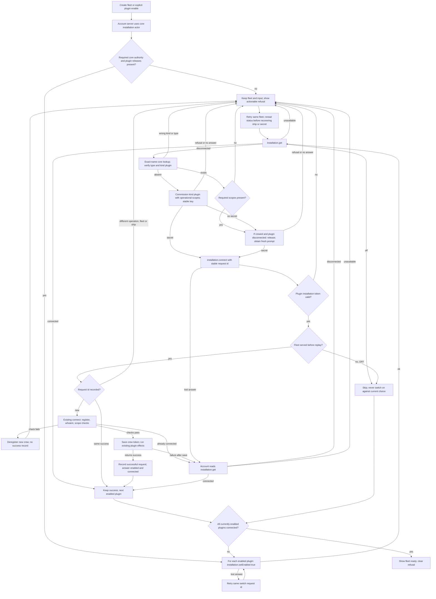

# Installation connect for every enabled plugin

Approved on 18 November 2026, card d5ebca8a, option 1, "Approve as written", including the installation scopes in Q3. The shared-contract direction is decided: 18 November, card a10e8485, option 1, "Same contract for all four". On 18 November, card 7a1d4c2a, option 1 dropped networking because its repository is archived and production does not run it.

## Purpose

When the account app makes a hosted fleet, every plugin it enables is connected before the fleet is shown ready. A person needs no second Connect step in Console Settings. Squadrons, the trierarch plugin and watch receive the same installation-level hand-over as the gateway.

[Hosted onboarding Q8](../hosted-onboarding/README.md) supplies the purpose. [Gateway PR 407](https://github.com/ThomasHendrickx/aeolus-fleet-gateway/pull/407) supplies the working contract; account app PR 245 covers only its gateway path. This design completes that dependency, without changing which plugins a fleet enables.

## Lessons to check against

| Lesson | Check |
| --- | --- |
| [0057](../../decisions/0057-actors.md): one authority model, installation events name their actor | Account app uses ordinary core fleet calls as installation; no argo sign-in or plugin holding core's installation token. |
| [0046](../../decisions/README.md): commission grants only scopes the granter holds | Check each plugin's full operational scopes, not only its connect minimum. The gateway's scope grant is insufficient for all three. |
| [0021](../../decisions/0021-squadrons-installation.md): off keeps everything | Enable and connect remain separate; off/on retains the connection. Delete keeps each plugin's existing cleanup. |
| [0050](../../decisions/README.md): commission is connect | Hand over a kind-plugin ship server to server; keep only its crew token, never its secret in logs, storage or browser output. |
| [Approved gateway design, 16 November](https://github.com/ThomasHendrickx/aeolus-fleet-gateway/blob/f88bf27b/design/installation-connect/README.md), sections 4, 7, 8 | Reuse its checks and successful-request replay, including failure windows; do not invent a stronger transaction across core and a plugin. |
| [0013](../../decisions/0013-breaking-changes-before-1-0.md) | Three small adapters to existing connect use cases, no plugin framework or compatibility path. |
| [0033](../../decisions/README.md): console logic on the server | Hosted provisioning stays on the account server; existing manual connects remain available. |

## Questions and picks

### Q1. What is shared?

**Pick: the gateway's exact installation envelope and replay rules**, rather than adding credentials to `setEnabled` or accepting console sessions in provisioning.

```ts
// tRPC installation.connect, x-aeolus-installation-token of this plugin
input = { requestId, fleetId, shipId, secret } // strict; secret non-empty
output = { enabled: true, connected: true }
```

No configured installation token: `NOT_FOUND`. Missing or wrong token: `UNAUTHORIZED`. Check served/enabled before replay: off is `FORBIDDEN`, even for a previously successful request. Hash operation + fleet + ship, excluding the secret; a request id used for another operation, fleet or ship is `REQUEST_ID_USED` / `CONFLICT`. A successful replay returns its first answer without registering again. Record only successes. A refusal remains retryable with the same id and a fresh secret for that ship.

Delegate to each plugin's existing connect, preserving `ALREADY_CONNECTED` / `CONFLICT`, and `SECRET_REFUSED`, `OTHER_FLEET`, `MISSING_SCOPES` / `BAD_REQUEST`. Preserve any existing availability refusals and mapping. The account app reads `get` after an ambiguous outcome or `ALREADY_CONNECTED`; it does not release a connection the plugin already holds. Replay is a receipt of success, not a health check: use `get` for current state.

All three expose:

| Procedure | Input | Answer and meaning |
| --- | --- | --- |
| `installation.get` | `{ fleetId }` | `{ enabled, connected }`; off may still be connected. |
| `installation.setEnabled` | `{ requestId, fleetId, enabled }` | `{ fleetId, enabled }`; replayable switch, no hand-over. |
| `installation.delete` | `{ requestId, fleetId }` | `{}`; replayable cleanup, not switching off. |

### Q2. What remains different?

**Pick: share the envelope, retain each plugin's checks and effects.** No scope or network behavior is standardised by this change.

| Plugin and source | Connect checks after registration and fleet identity | Existing effects and deletion | Current minimum core |
| --- | --- | --- | --- |
| [Squadrons](https://github.com/ThomasHendrickx/aeolus-fleet-squadrons/blob/main/packages/squadrons/src/core/management/connect.ts) | `fleet:read`, `fleet:commission`, `fleet:manage` | Saves management crew; delete withdraws declared rules, then forgets plugin data, leaving ships and labels. | 0.39.0 |
| [Trierarch](https://github.com/ThomasHendrickx/aeolus-fleet-trierarch-plugin/blob/main/packages/trierarch-plugin/src/core/connection/connect.ts) | `fleet:read`, `fleet:commission`, `crew:assign`, `crew:run` | Saves connection, then declares scopes; declaration refusal retains connection and periodic retry. Delete withdraws rules before forgetting. | 0.42.0 |
| [Watch](https://github.com/ThomasHendrickx/aeolus-fleet-watch-plugin/blob/main/packages/watch-plugin/src/core/connection/connect.ts) | `fleet:read`, `fleet:alert` | Saves connection; delete deregisters before forgetting. | 0.39.0 |

A failed identity/scope check deregisters the newly acquired crew and keeps no connection. Existing post-save work can fail after the connection exists; the account app checks `get` before another hand-over. Connected does not mean every later plugin task has completed.

The routers beside these use cases are the installation API sources. Their delete calls retain data and return `FLEET_UNAVAILABLE` when prerequisite withdrawal/unregistration cannot complete. Do not copy the gateway's forget-only delete.

[Console connectPlugin](../../../packages/console/lib/connect-plugin.ts) currently serves squadrons, trierarch, gateway and watch: read connection; reuse last active ship or matching name/type; reject wrong kind/type; grant missing scopes; release a crewed ship only when disconnected; get a fresh starting prompt or commission; hand secret to `connection.connect`. The browser receives status only. Squadrons is commissioned with labels and scope-declaration permissions too; trierarch with labels and scope-declaration permissions too. These are operational requirements beyond their connect checks.

### Q3. What minimum core and authority does hosted provisioning need?

**Pick: leave each plugin's minimum unchanged for the new endpoint, but gate the account slice on sufficient installation authority.** The endpoint itself uses no new core call. All three together already require at least core 0.42.0 because trierarch does.

The installation holds `crew:assign`, `crew:run` and `fleet:alert` in its fixed [scopes](../../../packages/core/src/domain/identity/authenticate-installation.ts), so it can commission plugin ships with those operational scopes. Its built-in manage reach covers plugin ships it commissioned. These scopes also let the installation directly call crew assignment and explanation and alerts.

Follow the approved gateway flow for existing ships: reuse one with sufficient scopes; show `MISSING_SCOPES` for a deficient one, repaired through the existing console. Automatic scope repair would additionally require `scopes:grant` and wider authority; it is not part of this pick. Record the first core release with the three grants as the account app's actual minimum before building its slice.

### Q4. In what slices?

**Pick: one PR/release per plugin repository, then one account app slice.** Order: squadrons, trierarch plugin, watch plugin, then the account app. Each plugin can ship independently of the others and reuse its existing installation request store and connect use case.

Each plugin slice proves token rejection, strict input, off-before-replay, success/restart replay, request-id collision, retry after refusal, fleet mismatch, missing scopes, concurrent hand-overs retaining one connection, and off/on retention. Include its existing post-save effects and delete behavior in the relevant checks. Only touched tests run locally; CI judges the rest. Production changes follow test-only `(red)` commits.

The three plugin slices are merged. The account slice needs a core release containing the authority in Q3. The account slice pins released plugin endpoints and the resulting core minimum, extends the gateway provisioning path to every enabled plugin, and proves a new fleet, partial failure/retry, retained form/fleet, off/on, and no duplicate ships. It supplies the missing hosted onboarding M10/M11 and full A7/Q8 evidence.

### Q5. What retries and which fleets?

**Pick: complete new-fleet provisioning and explicit enable through the account app, retaining successful plugins on partial failure.** Do not add a sweep reconnecting deliberately disconnected existing fleets in this slice. Existing disconnected fleets keep Settings, as hosted Q8 specifies; gateway's already approved wider reconcile is unchanged. No automatic switch-on of disabled plugins.

Use stable request ids per operation/plugin/fleet/ship, with separate ids for switch and commission. Keep ids and progress, never secrets. On transport failure read current state, then retry; on secret refusal get a fresh starting prompt. Surface lasting authority/type/fleet failures beside the provisioning result or switch; keep names and the same fleet for retry. A plugin error does not undo the fleet or successful connections. Ready means every enabled plugin answers connected, not merely that its switch was saved.

## Full flow



At the plugin boundary, a transport failure can occur between saving connection and recording success. `get` resolves it; receipt replay alone does not. Off/on retains the stored connection. Delete follows the plugin-specific cleanup above, and is never a rollback for a partial onboarding failure. Reads are bounded fleet/request/name lookups, not scans over the target 3,000 ships or 10,000,000 messages per fleet.
