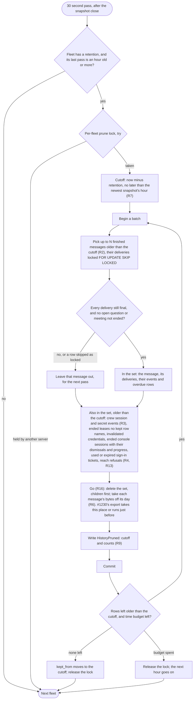
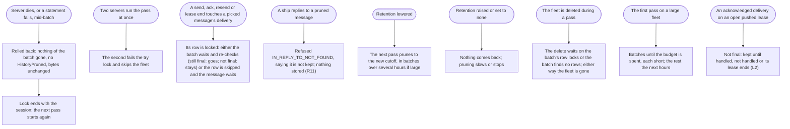

# Retention: what a fleet keeps, and for how long

Design for [#1080](https://github.com/ThomasHendrickx/aeolus-fleet/issues/1080), Aeolus 0.32.0. Docs only. Thomas agreed the purpose and answered Q1 to Q9 on 25 Oct. Stage 2: the decisions in detail (section 3), the split of the events (section 4), the pruning pass and its flows (section 5), the questions it raised (section 6, decided) and the slices (section 7). Audit beyond the retention is [#1230](https://github.com/ThomasHendrickx/aeolus-fleet/issues/1230)'s job (cold storage, later), not this design's.

## 1. Purpose (agreed by Thomas, 25 Oct)

A fleet keeps what the delivery promise and its people still need, and lets the rest go, so its database grows with what the fleet does now, not with everything it ever did.

For whom: the hosting service and the fleet manager who pays for a fleet's storage; argo and the fleet's people, who read timelines, threads and meetings; and the crews whose deliveries are still on their way.

Today nothing has a window: events, messages and deliveries, ended leases, invalidated credentials and ended console sessions stay until the fleet is deleted. Production on 21 Oct: 113 MB, of which events 56 MB, messages 22 MB, deliveries 18 MB, growing a few MB a day in the real fleets (#1080). Thomas on the demo: "There is zero value into keeping that".

The outcomes:
1. No delivery still on its way, or still waiting on a person, goes: pending, received, handed, undeliverable and not handled deliveries, and an acknowledged one a crew may still re-read, stay with their messages whatever their age. No message is ever lost.
2. Past its window, a fleet's finished history goes: its messages, their deliveries and their events, and its ended leases, invalidated credentials and ended console sessions.
3. Nothing goes silently: what a fleet keeps and for how long is visible to the fleet's managers, and a timeline says where its history begins.
4. A demo fleet's data costs nothing past its day.
5. Pruning is proven by tests, as the delivery guarantees are: it never takes an open delivery, under concurrency and across a restart.

Not the purpose:
- Backup, export or a deleted fleet coming back (#730; a deleted fleet is gone, 0020).
- Reading or changing payloads (content-blind).
- Retention in squadrons, the trierarch plugin or the gateway: each keeps its own database (0049).

## 2. Lessons to check against

| # | Lesson | Source |
| --- | --- | --- |
| L1 | No message is ever lost; a delivery is handed again until acknowledged; an undeliverable one is kept on Health until resent or dismissed | blueprint, Purpose; 0040 |
| L2 | An acknowledged, not yet handled delivery stays readable whole until handled (the person's second MCP client) | re-read-delivery design; 0040 |
| L3 | Events are the timeline, the audit trail and the live-update source, append-only by a trigger; only a fleet's delete removes them | blueprint, Domain events; architecture, Core tables and Delete |
| L4 | Abandoned and dismissed deliveries "stay in the timelines"; a retired ship's deliveries "stay in the audit trail and their senders can see it" | blueprint, Retire a ship, Health 5 |
| L5 | A retired ship's id can never be claimed or addressed again | blueprint, Retire a ship 3 |
| L6 | A question is open until argo answers it, whatever its delivery's state | 0038; blueprint, Questions to argo 4 |
| L7 | An ended meeting keeps its messages, deliveries and history, read by former participants; a lasting conversation has no end | meetings design, M15 and Purpose |
| L8 | A scheduled message's outcome is an event in its ship's history | scheduled-messages design, S8 |
| L9 | The stuck snapshot keeps 168 hours and folds the events after its last `seq`: events younger than the newest closed hour must stay | performance design, decision 9; architecture, `health_snapshots` |
| L10 | Storage and messages per day are counters in `message_days`, summed per fleet; the 7 day message measure and the daily limit read them | performance design, decision 1 |
| L11 | Limits are configuration: an installation default, a per-fleet override, unset means none; Aeolus sets no maximum or minimum of its own | 0016, 0020 |
| L12 | No hidden behaviour: every rule visible, every change an event | blueprint, Principles; 0034 |
| L13 | A deleted fleet is gone, every row in one transaction, children first; a bulk delete without indexed foreign keys timed out | 0020; #331 |
| L14 | A read's cost follows what it answers, never the fleet's history | performance design, Purpose 1 |
| L15 | The demo fleet does not pile up: pagasae's demo runner deletes it every night at 03:00 UTC and builds a new one, at most a day (about 50 MB) | #1080, correction comment (a read-only check of pagasae, not verifiable from this repo) |
| L16 | Core knows no demo: no flag on a fleet, the demo runner lives with the hosting service | 0022, 0023, 0024 |
| L17 | Already pruned today: health snapshots past 168 hours, account cut-offs past their 11 minutes | architecture, `health_snapshots` and `installation.accounts.cutOff` |
| L18 | Pre-1.0: no compatibility work | 0013 |

| L19 | A message's in-reply-to and resend-of name a stored message (foreign keys, `Restrict`); a reply naming no stored message is refused `IN_REPLY_TO_NOT_FOUND` | `schema.prisma`, `messages`; `domain/messaging/message.ts` |
| L20 | Events name their message and delivery, deliveries their claiming lease, overdue rows their lease and delivery, console sessions their lease, all `Restrict`: rows go children first | `schema.prisma` |
| L21 | Core is content-blind: an answer is a reply to its question (core sees `inReplyTo`), a withdrawal or replacement names the question only inside its payload | 0038; blueprint, Purpose |

## 3. Decisions

Thomas's answers, then what follows from them. R1 to R6 answer Q1 to Q6; Q7 to Q9 are in R2, R3, R13 and R15.

| # | Decision |
| --- | --- |
| R1 | **Retention is configuration, as the limits are** (Q1: 1; Thomas: "We can make that into a pricing model this way"). The installation sets a default retention in days; each fleet follows it, or has its own number of days, or none; unset means kept for good. Set with `installation.settings.set` and `installation.fleets.setLimits` beside the ship and daily message limits, which write `FleetLimitsChanged`; read with `fleet.limits` (`fleet:read`), so every fleet manager sees it. A whole number of days, at least 1; core sets no other minimum or maximum (0016). |
| R2 | **A message is finished** when every delivery of it is final, and it is not an open question or a contribution to a meeting or room not ended (Q2: 2). Final: handled, dismissed, abandoned, or acknowledged where no re-read can come (its claiming lease ended, or never pushed). Pending, received, handed, undeliverable and not handled are never final (L1, L2). An open question: of the question content type, with no reply of the answer content type (L6, L21; Q7). A finished message older than the cutoff goes with its deliveries and their events. |
| R3 | **Events split in three** (Q3: 2): those of a message go with it (any event naming a message or delivery); those of a crew's sessions and secrets go by age past the cutoff (Q8: 3); every other event, the changes to the fleet itself, is kept for good. Section 4 holds the split on production. |
| R4 | **Ended leases, invalidated credentials and ended console sessions go** once ended before the cutoff and no kept row names them; used or expired sign-in tickets go with them; a retired ship's row stays for good (Q4: 1). A console session takes its notice dismissals and guide progress with it. |
| R5 | **Nothing in core for the demo fleet** (Q5: 1): pagasae's nightly delete prunes it (L15). The demo part of #1080 closes on confirming that in pagasae. |
| R6 | **Storage is what the fleet holds now** (Q6: 1): a pruned message's payload bytes come off its day's row in `message_days` in the transaction that prunes it. The day's message count stays: the messages per day and the daily limit count what was sent. |
| R7 | **The cutoff** is now minus the fleet's retention, and never later than the hour of the fleet's newest stuck snapshot, so no event the snapshot has not folded goes (L9). |
| R8 | **One pruning pass per fleet per hour**, run by the 30 second pass (operation 8) after the snapshot close, for each fleet with a retention, under a per-fleet advisory lock taken with try (a second server skips the fleet). It prunes in batches, each one transaction, until nothing older than the cutoff is left or the pass's time budget is spent; the next hour goes on. |
| R9 | **Each batch writes its event** `HistoryPruned` (system, a fleet change, so kept for good): the cutoff and how many rows of each kind went. The fleet's `kept_from` moves to the cutoff once a pass finishes. |
| R10 | **Where history begins is shown**: the ship timeline, the message thread and Health say that the fleet keeps finished history from `kept_from`, older open deliveries apart. |
| R11 | **The two message references stay as written**: in-reply-to and resend-of lose their foreign keys, so a kept reply may name a pruned message; reading it answers that the message is no longer kept. A new reply to a pruned message is refused as today, `IN_REPLY_TO_NOT_FOUND`, its text saying the message is not kept (L19). |
| R12 | **A meeting or room that ended before the cutoff** keeps its row and its participants (small, as a retired ship); its contributions go as R2 says, and its mic and participant events go with them. |
| R13 | **Reach refusals go by age** past the cutoff: a refusal is a record of a call that stored nothing (Q9: 1). |
| R14 | **Proven by tests** (Testcontainers): an open delivery of every state survives a pass at any age; an acknowledged delivery on an open pushed lease survives; an open question survives; a pass racing a send, an ack, a lease end and a second server's pass; a batch rolled back mid-way leaves everything as it was; a restart mid-pass goes on the next hour; storage drops by the pruned bytes; a fleet delete during a pass. |
| R15 | **A question withdrawn or replaced but never answered is kept for good** (Q7: 1): core sees only answers (L21). Rare and small. |
| R16 | **"Goes" is one step.** A batch first chooses its rows, every table's, as one set; one step then makes that set go, by deleting it, in the batch's transaction. Thomas: "Go can now be cold storage, I want to have a way for later to audit". #1230's export takes that step's place, or runs just before it in the same transaction, without changing how a batch is chosen; until then, a row that goes is gone. |

## 4. The split of the events (R3)

Thomas: "What is the split? What percentage is permanent and what is archive able with this rule?" From production core on 25 Oct, about 04:20 UTC, read-only aggregates by aeolus-fleet-infra. The Aeolus fleet, 30 Sep to 25 Oct (the demo fleet is rebuilt every night and test-fleet holds 13 events). Size is each row's stored size; the events table is 77 MB with its indexes, of which 24 MB rows.

| Class | Event types | Goes | Events | Size |
| --- | --- | --- | --- | --- |
| A message's | `MessageAccepted` and every `Delivery*`; a meeting's mic and participant events (none yet) | With its message (R2, R12) | 29,051 (55%) | 9.5 MB (59%) |
| A crew's sessions | `ShipReported` 5,052, `TurnReported` 4,545, `ShipClaimed` 2,148, `LeaseRevoked` 2,130, `CrewStatusChanged` 1,957, `LeasePushed`, `StatementSet`, `SignInTicketIssued`, `ViewerSessionStarted` | By age past the cutoff (R3) | 16,097 (31%) | 4.9 MB (30%) |
| A crew's secret | `StartingPromptIssued` 2,306, `CredentialRevoked` 2,289: once per crew, as the trierarch crews ships again | By age past the cutoff (R3) | 4,595 (9%) | 1.2 MB (7%) |
| The fleet itself | Crew requests and their assignment (1,982), commission (240), retire (216), owners, plugins, network rules, labels, scopes, limits, rename | Kept for good | 2,806 (5%) | 0.7 MB (4%) |

By count, with Q8 decided as 3, 95% of events go once past the cutoff and 5% stay for good (Q8's option 1 would have kept 14%, option 2 45%).

Other facts from the same read:
- Messages 31 MB, deliveries 22 MB with indexes. Of the Aeolus fleet's 8,511 messages, 64 are not finished (R2): 17 younger than 7 days, 47 between 7 and 30. Nothing is older than 30 days yet, so a 30-day retention would prune nothing today.
- Ended leases 2,130 (0.55 MB), invalidated credentials 2,289 (0.47 MB), ended console sessions 67: small beside the events.
- Reach refusals: none stored.
- Pruned rows free their space for Postgres to use again (autovacuum); the database file stops growing rather than shrinking. Storage (R6) counts payload bytes, not the file.

## 5. Flows

### The pruning pass, one fleet

### What goes wrong

## 6. Questions (decided by Thomas, 25 Oct)

### Q7. A question withdrawn or replaced but never answered (decided: 1)

Core sees an answer (a reply to its question) but not a withdrawal or a replacement, which name the question only in their payload (L21). Under R2 a withdrawn question is open to core, so kept for good.

1. **Kept for good.** Rare and small; no protocol change.
2. **A withdrawal and a replacement are sent in reply to their question** (a change to 0038 and the asking scripts), so core sees them as it sees an answer, and the question is finished.
3. **An open question is kept for a second, longer period** and then goes like any message.

Pick: 1. Few rows, no new rule; 2 is right if withdrawals turn out common.

### Q8. Do the crew's session and secret events go by age? (decided: 3)

Q3's pick named "sends, receives, hand-overs, turns" as the bulk that goes. A ship's claims, lease ends, pushes, reports, statements and crew statuses are not a message's but are the same traffic; so is each crew's secret, issued and revoked once per crew (section 4).

1. **The session events go by age past the cutoff; the secret events are kept for good.** 14% of events stay for good.
2. **Both are kept for good**, as changes to the fleet. 45% stay for good.
3. **Both go by age past the cutoff**; the credential rows go with them (R4). 5% stay for good: commission, retire, owners, scopes, labels, rules, plugins, crew requests.

Pick: 3. What stays is what the fleet manager changed; the rest repeats with every crew, and a ship's timeline still shows its crews within the retention.

### Q9. Reach refusals (decided: 1)

A refusal stores its record, read with `fleet:explain` (0034). It is not in #1080's list but only grows.

1. **By age past the cutoff** (R13).
2. **Kept for good.**

Pick: 1. It is finished history of a call that stored nothing.

## 7. Slices

| # | Slice | Done when |
| --- | --- | --- |
| S1 | **Retention as configuration** (R1): the setting on the installation and per fleet, `FleetLimitsChanged`, `fleet.limits`, the console's limits | Set, read and shown; the decision record, blueprint and architecture state retention; nothing pruned yet |
| S2 | **Pruning messages** (R2, R6, R7, R8, R9, R11, R12, R14, R15, R16): the pass, batches, `HistoryPruned`, storage, the reference keys, the not-kept text | The R14 tests pass by name; staging prunes a seeded fleet within the performance budgets |
| S3 | **Pruning the rest** (R3, R4, R13), each a part of the batch's one set (R16): events by age, leases, credentials, sessions, tickets, refusals | Their tests pass by name |
| S4 | **Where history begins** (R10): `kept_from` on the timeline, thread and Health | Walked on staging |
