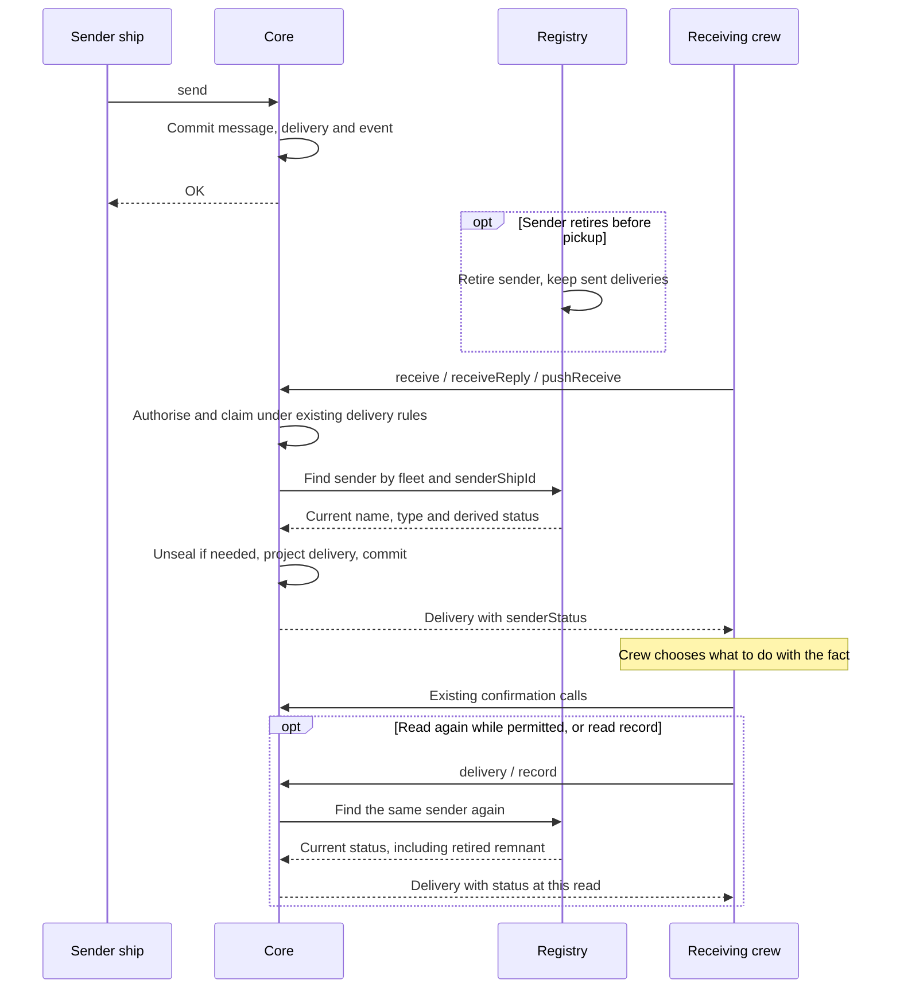

# A delivery's sender, retired or not

Design for [#1714](https://github.com/ThomasHendrickx/aeolus-fleet/issues/1714). New core fleet functionality, so it goes purpose first. Thomas set the direction (8 Nov): no client behaviour in core; a bit of data that lets a client filter what it wants, or an explicit ask in the request, never core giving a client everything it needs. Thomas agreed the purpose and chose option 1 for R1 to R3 (8 Nov). The complete design below is for his approval. No code.

## 1. Purpose (agreed)

A ship that holds a delivery cannot tell from it whether the ship that sent it is still in the fleet or retired. Core already answers the sender's name and type as they are now on every delivery it hands; whether that same sender is retired is a fact of the same kind, about the same ship, and core holds it.

A person client shows why it matters: it counts the plain messages waiting on a person ship that the person can still open, and opens them from the list of exchanges, which leaves retired ships out (0070). A plain message from a ship retired before the person saw it is counted but never listed, so the count never clears. The client has no way to tell that sender from the ship contract short of paging every exchange.

The outcomes:
1. **A ship can tell, from a delivery it holds, whether its sender is retired**, with no extra call.
2. **Core decides nothing for the client.** Which deliveries a client counts, shows or hides stays the client's; core states a fact about the sender and changes no delivery, list or count.
3. **No extra client call.** The read that names the sender today states its status too; server work stays bounded by the delivery batch or record page.

Not the purpose:
- A count of what waits on a person. That is the client's (`people.waitingCount` in the gateway).
- Changing what a retire does to the deliveries a retired ship sent. They stay where they are, as the blueprint's Retire a ship says: only deliveries to the retired ship are abandoned.
- Leaving retired senders out of `receive`, `pushReceive` or `inbox`. A delivery from a retired ship is still a delivery the ship is owed (promise 2).
- Which ships the caller may send to now. That is `discover`, which also leaves out what the network rules hide.

## 2. What is true today

- **Every delivery read names its sender as it is now.** `receive`, `pushReceive`, `delivery` and `record` answer `senderShipId`, `senderName` and `senderType`, read from the sender's ship when the delivery is read (`receivedDeliveryOf`, or the batch lookup in `readRecord`: the sender's `Ship` is already loaded, retired or not). Retirement is on that row; crewed status also needs its open lease. Neither status is answered.
- **A retired ship stays a ship** (0070): it keeps its id, name, type and kind, as a remnant once pruned; a sender always exists.
- **Retire abandons only the deliveries to the retired ship.** What it sent and is still pending, received or handed at another ship stays so.
- **`exchanges`** leaves retired other ships out (`s.retired_at IS NULL` in `exchange-rollups.ts`), with no way to ask for them; each row answers the other ship's id, name, type and kind, no status.
- **`exchange`** reads the exchange with a retired ship by id, and **`ackUpTo`** acknowledges up to a message of it: neither checks the other ship's status.
- **Ship status** is one enum in common: `awaitingCrew`, `crewed`, `retired`, as the fleet read answers it.

## 3. Lessons to check against

- **Blueprint, promise 2; 0001, 0040.** No delivery is lost or hidden from its ship. Whatever is offered is a fact beside the delivery, never a filter on what is handed.
- **0016 and the blueprint's Purpose.** Core is content-blind and adds no rules of its own; what a client does with a retired sender is the client's call.
- **0070.** No count and no list shows retired ships; `fleet.list` only when its status asks. A design that lists retired ships must follow that pattern: an explicit ask.
- **0047 and the receive guarantee.** The sender's name is answered as it is now so a crew answers it by name; a retired sender cannot be answered, since a send to a retired ship is refused. The status serves a crew too, not only a person client.
- **0057, 0034.** Authorised by scopes read from the server. Every read in R2 already needs `messages:receive` and names the sender; no new reach is opened.
- **0050 and CLAUDE.md, domain language.** Use the status the fleet read already answers; invent no new term for "gone".
- **0013.** No compatibility layer: the field is added; clients read it once core releases it.
- **0066.** A delivery a client chooses to hide stays open, and open deliveries are never pruned. That is the client's choice and its consequence, stated here so the choice is made knowingly.
- **The performance skill.** Retirement is already loaded; crewed status requires open-lease presence. Read it only for the referenced senders, batched for a page, never by loading the fleet.

## 4. Questions

Each has its options, the pick and Thomas's answer.

### R1 What core offers

1. **The sender's status on each delivery a ship reads.** Why it belongs in core: core already answers the sender's name and type as they are now on the same read; the status is derived by Registry from that ship and its open lease, true from core's own view, and useful to any crew (it tells a crew a reply would be refused) as much as to a person client. With it, the client chooses to leave the delivery out of its count, or to open it: `exchange` already reads a retired ship's exchange by id and `ackUpTo` already marks it seen.
2. **An explicit ask on `exchanges` to list retired other ships too**, each row with the other ship's status. Why it belongs in core: it is 0070's own pattern, a list that leaves retired ships out unless the caller asks. But the client must then page every exchange to find a delivery's sender, which is the cost the issue names, or still match deliveries to rows by sender id.
3. **Both 1 and 2.** Both facts belong in core for the reasons above, but combine two contract changes where option 1 alone meets the purpose.
4. A filter on `receive`, `pushReceive` and `inbox` leaving retired senders out. Rejected: it hides deliveries from their ship (promise 2) and puts a client's view into core.
5. A waiting count in core. Rejected: the client-shaped answer Thomas's direction rules out.

**Pick 1.** The smallest true fact, on the read the client already makes, and it leaves both client behaviours open. Option 2 can follow on its own when a client needs to list retired exchanges.

**Thomas (8 Nov): option 1.**

### R2 Which reads carry it

1. **Every read that answers a delivery as `receive` hands one**: `receive`, `pushReceive`, `delivery` and `record` (one schema, `receivedDeliverySchema`, which the others extend), and `receiveReply`, which answers the same delivery.
2. `pushReceive` alone, the read the person client makes. The sender fact belongs in core here too, but restricting it to one read follows a client rather than the delivery contract.

**Pick 1.** One delivery shape, one meaning everywhere; a field on one read alone splits the schema for one client's sake.

**Thomas (8 Nov): option 1.**

### R3 The field

1. **`senderStatus`**, the ship status enum the fleet read answers (`awaitingCrew`, `crewed`, `retired`), as it is when the delivery is read, beside `senderName` and `senderType`.
2. `isSenderRetired: boolean`. Core owns this lifecycle fact, but it introduces a second representation of status.
3. `senderRetiredAt`, the retire time or null. Core owns this timestamp, but a history detail is more than the purpose needs.

**Pick 1.** It reuses the fleet's one word for a ship's state (0050), and sits with the name and type read at the same moment. A boolean answers only today's question; a time is a history fact, not the sender's state.

**Thomas (8 Nov): option 1.**

## 5. Delivery contract

The proposed implementation adds required `senderStatus` beside `senderName` and `senderType` in the shared delivery shape. Its values are the existing ship status enum: `awaitingCrew`, `crewed`, `retired`. Registry derives the status with its existing `shipStatus(ship, { isCrewed })` rule: retired first, argo and the viewer always crewed, otherwise whether an open lease exists. Expose that projection through Registry's public interface to Messaging. Extend the existing sender lookup with open-lease presence, scoped by fleet and sender id, without locking the sender or its lease for this observation. For `readRecord`, keep the existing batch lookup and obtain open-lease presence for those sender ids in the same bounded projection, including when a payload is unreadable. The adapter may use an indexed join or batched lease lookup; no per-entry lease query on a record page. No persisted delivery field, migration or new event is needed.

| Read | Where the field appears |
| --- | --- |
| `receive` | Every returned delivery |
| `receiveReply` | The returned reply delivery, when one exists |
| `pushReceive` | Every returned delivery, including received or handed ones returned again |
| `delivery` | The acknowledged delivery read again |
| `record` | Every entry on the requested page, in every retained delivery state |

The field describes the sender when that row is read, not when the message was sent or the response arrives. It is no promise that a later send succeeds: the sender may retire, change name or become unreachable after the read. An awaiting-crew sender is active; the usual send can wait for its next crew. A retired sender stays retired after pruning. Reuse of its name by a new ship does not change the original sender's id or status.

`inbox` answers counts, not deliveries. `exchange` answers messages with a small `receivedDelivery` reference (id and state), not the shared whole delivery shape. `exchanges` answers other ships and their newest messages. None gains this field or changes its selection, counts or pagination. In particular, the delivery remains available even when discovery or the list of exchanges does not list its sender. Existing scope, lease and ownership checks still apply.

## 6. Flows

Happy path: an active sender sends, the receiver reads a delivery with `crewed` or `awaitingCrew`, then confirms it under the existing delivery protocol. A sender retired before pickup still has its delivery handed to the receiver with `retired`. Core neither suppresses nor acknowledges it because of the sender's status.

| Unhappy path | Result |
| --- | --- |
| Sender retires between two reads | The earlier result may say `crewed`; a read after retirement commits says `retired`. Same delivery and message ids; no status snapshot or cache. A concurrent read reflects the sender row it observes, without extra locks. |
| Sender is released or crewed between reads | The next read reflects `awaitingCrew` or `crewed` using the same projection. |
| Retired sender is pruned to a remnant | Its kept id, name, type and retired status still supply the projection. Open deliveries survive retention. |
| Another ship takes the retired sender's name | The delivery still names its original senderShipId with `retired`; status is never looked up by name. A reply by name needs the caller's usual care. |
| Reply attempted after sender retires | The existing send refusal applies; reading status grants no right or reservation to send. |
| Sealed payload key unavailable during a receive | Existing key acquisition and rollback apply: no partial result or committed claim, attempt or event from the failed receive. Retry after key recovery reads the sender afresh. |
| Sealed payload cannot be opened on a read-only read | Preserve that read's existing sealed-payload representation or refusal; sender metadata does not require a key and does not bypass payload rules. |
| Lease ended, scope missing, delivery belongs to another crew, or delivery no longer eligible for reread | Existing refusal, with no extra delivery or sender data exposed. |
| Answer lost, receiver restarts or delivery is claimed concurrently | Existing retry, pushed hand-over and claim rules apply. A repeated result may carry newer sender metadata; delivery identity and confirmation semantics stay the same. |

A person client can use the fact to omit retired senders from its own count, without paging exchanges or using discovery. If it keeps delivery objects locally, the field remains a fact at their last core read; this design adds no retirement notification or client cache invalidation. A fresh status requires a permitted delivery read. Hiding a delivery does not finish it: it remains open and cannot be pruned. Client refresh and completion choices belong to the client, outside this core slice.

## 7. Acceptance scenarios for implementation

These are proposed tests for approval, not tests run by this documentation PR. Build red, green, refactor per approved scenario (0014).

| Scenario | Proof |
| --- | --- |
| Each delivery read answers current status | In-memory use-case tests for all five reads in R2, with each enum value and argo's always-crewed rule; `receiveReply` receives the matching reply and `record` covers retained states and multiple senders. Assert existing ids, payload and delivery fields too. |
| Retirement does not hide a sent delivery | Send, retire sender, then receive by pull and by push; delivery is still claimable, status is retired and confirmation still succeeds. `inbox` still counts what the existing delivery rules count. |
| Status changes between reads | Read, release or crew sender, read again; retire sender, read again through permitted reread and record. Assert current status without mutating the delivery merely to refresh metadata. |
| Remnant and reused name | With retention enabled, prune a retired sender while its sent delivery stays open, commission another ship with that name; original sender id and retired status survive in delivery and record. Real Postgres test proves foreign keys and pruning. |
| Races and restart preserve distribution | Real Postgres tests race retirement with pickup and concurrent receivers. A claimed delivery is not lost or claimed twice by different crews; retirement alone does not change its state. Restart the receiving side and reread under the existing protocol with current sender status. |
| Sealing preserves rollback | Real Postgres plus the existing key-vault fake: unavailable key on receive commits no claim, attempt or event; recovery returns the same message with current status. Cover record's sealed representation and delivery reread's existing key failure path. |
| Contract reaches every door | Common schema tests require the field, accept exactly the three enum values and reject missing or unknown values. tRPC, REST and MCP contract tests assert the field survives output parsing for all five reads and their shared extensions. |
| Authorisation and unrelated reads stay intact | Existing scope, ended lease, wrong fleet and wrong crew tests still refuse. Assert `inbox`, `exchange`, `exchanges`, forced ordering, max, cursors and receiveReply selection keep their existing behaviour with retired senders. No payload or content type changes selection. |

At the performance skill's scale of 10,000,000 messages and 3,000 ships per fleet, work follows the delivery batch or record page. The added open-lease presence read uses the existing fleet/ship lookup index, restricted to referenced senders. Verify its query plan and query count, including multiple deliveries from one sender; no fleet-wide scan or per-entry record lookup. The implementation's completed work is measured through the staging performance run: p95 under 100 ms, p99 under 500 ms and errors under 1%, excluding intentional waits. This design PR claims no measurement.

## 8. Documentation and release scope

After approval, implementation updates the blueprint's delivery and ship-contract descriptions with a pointer to the shared delivery shape's read-time sender status. Update the domain projection's description and common's `receivedDeliverySchema` using the existing status enum; its extensions and `receiveReply` share the field. Update procedure metadata so the generated REST/OpenAPI and MCP ship contract describe the same meaning. No separately maintained door schema.

Architecture needs no new table or mechanism: the sender lookup and tRPC door remain as documented. No recorded decision is reopened. This document holds the approved design; the blueprint holds product behaviour when implemented.

The gateway follows in its own repository under #322 after the core release, raising its minimum core version in its compatibility contract. Its tests cover the client count, including meetings and retirement. Core supplies no client count, client filter, new exchange-list option or automatic acknowledgement. This PR contains documentation only, references #1714 and leaves implementation gated on Thomas's approval of the complete design.
