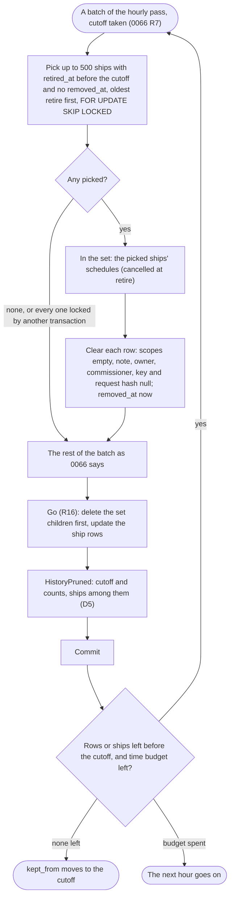
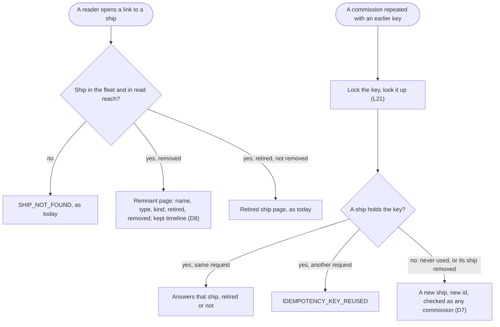
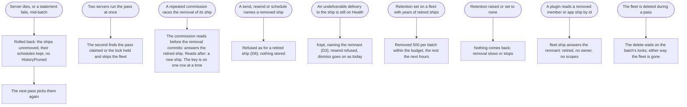

# Retired ships: hidden now, removed after a retention period

Design, stage 2. Docs only. Thomas agreed the purpose and answered Q1 to Q5 and N1 on 29 Oct (section 3, recorded as [decision 0069](../../decisions/0069-retired-ships.md)). This stage holds the decisions in detail (section 4), the flows (section 5), the acceptance scenarios (section 6), the screens that need a before and after mockup (section 7), the slices (section 8) and the question it raised, answered (section 9).

Thomas's choice, option 3 of his question: "Both: hide now, remove after a retention period". Retired ships are hidden everywhere by default now; after a retention period they are removed; their messages and events stay and show them as a retired ship.

Today a retired ship is kept for good: blueprint, Registry rules and Retire a ship; decisions 0029, 0031, 0045, 0059; retention R4 ("a retired ship's row stays for good", 0066); the `ShipRetired` and `DeliveryAbandoned` events.

## 1. Purpose (agreed by Thomas, 29 Oct)

The fleet snapshot shows the ships that sail, and a retired ship leaves the fleet for good: hidden from every view and count at once, and after the fleet's retention period nothing of it is kept but what its kept history needs to name it.

For whom: argo and the fleet's people, who read the fleet list, counts, pickers and timelines; the fleet manager, who pays for what a fleet keeps; and the plugins (squadrons, the gateway) that retire ships as routine work (216 `ShipRetired` in the Aeolus fleet from 30 Sep to 25 Oct, retention design section 4).

The outcomes:
1. By default no view, count, picker or discovery answer shows a retired ship; one deliberate step still finds it.
2. A message or event that names a retired ship keeps showing it, by name and type and as retired, before and after removal.
3. After the retention period the retired ship's own data goes: what it was allowed, who owned it, its note, how it was commissioned.
4. Its id is never claimed or addressed again, removed or not (blueprint, Retire a ship 3).
5. Removal is visible as every change is (an event), and proven by tests as pruning is.

Not the purpose:
- Changing what retire does at the moment of retire (deliveries abandoned, lease and secret revoked, crew request removed, labels retired, owned ships falling to argo).
- Un-retiring a ship.
- What squadrons, the trierarch plugin or the gateway keep about a retired ship in their own databases (0049).

## 2. Lessons to check against

### Where a retired ship still shows today

| # | Lesson | Source |
| --- | --- | --- |
| L1 | The fleet list and ship types already answer active ships only, unless the status filter asks for retired; the console has a "Show retired (n)" switch | `common/src/rules/ship-filter.ts`, `list-fleet.ts`, `list-ship-types.ts`; blueprint, operator jobs |
| L2 | Ship counts carry a `retired` number beside active, crewed and awaiting crew | `domain/registry/ship-counts.ts`, `console/lib/ship-counts.ts` |
| L3 | `fleet.ship` answers a retired ship (its page opens from a link in a timeline or thread) | `get-ship.ts` |
| L4 | Discovery, send pickers, the reach graph and the owner picker of a network rule leave retired ships out already | blueprint, `discover`; `reach-graph.ts`; `network-rules.ts`; `selector-picker.tsx` |
| L5 | A network rules file naming a retired owner is left out with "names a ship that no longer exists" | `network-rules-file.ts` |
| L6 | A retired ship carries no labels and its own labels retire with it; owned ships fall to argo with `OwnerChanged` | 0031, 0045 |
| L7 | Timelines, threads, the inbox's senders and delivery history read senders by id, retired ones included, and show a name that may be ambiguous over time with its id | `inbox-senders.ts`, `ship-name.tsx`, `timeline-sentence.ts` |
| L8 | An undeliverable delivery to a retired ship stays stuck on Health until resent or dismissed; a resend to it is refused | blueprint, Retire a ship 2, Health 6 |
| L9 | A meeting a retired ship owned ends; it leaves meetings it took part in; its schedules are cancelled | 0061, 0062 |

### What removal touches

| # | Lesson | Source |
| --- | --- | --- |
| L10 | About 30 foreign keys name a ship, most `Restrict`: messages (sender, selector ship), deliveries (recipient, claimer), events (ship, actor, actor through), meetings (owner, moderator, opener, mic holder), participants, schedules, overdue rows, leases, credentials, console sessions, crew request give-backs, worktree clear requests, owners, label owners | `schema.prisma` |
| L11 | Messages and their events go by the fleet's retention; events that change the fleet itself (commission, retire, owners, labels, scopes, rules) are kept for good, so a retired ship stays named by kept events forever | 0066 R2, R3 |
| L12 | Ended leases and invalidated credentials already go by age past the cutoff; scope namespaces, declared network rules, verified facts, crew requests and clear requests already go at retire | 0066 R4; architecture, tables |
| L13 | The stuck snapshot reads each ship's commission and retire dates for its 168 past hours | `domain/shared/stuck.ts`; performance design, decision 9 |
| L14 | A ship's name is unique among active ships and reusable after retire; messages store the id, so a name alone cannot tell two ships apart over time | blueprint, Ship name; Registry rules |
| L15 | A commission repeated with its idempotency key answers the same ship; the key and request hash live on the ship row | architecture, `ships` |
| L16 | The fleet snapshot is one of the two promises: which ships exist, what type, who crews them | CLAUDE.md, What Aeolus is |
| L17 | Retention is configuration (installation default, per fleet, unset is kept for good), pruned once an hour in batches with `HistoryPruned`; `kept_from` says where history begins | 0066 R1, R8, R9, R10 |
| L18 | Every change writes its event; no hidden behaviour | blueprint, Principles |
| L19 | Pre-1.0: no compatibility work | 0013 |

| L20 | A retire cancels the ship's schedules but keeps their rows, payload included; a schedule keeps the messages it names from pruning | 0062; `retire-ship.ts`; 0066 |
| L21 | A commission locks its key per commissioning actor, then looks it up; the key is unique per actor and fleet | `commission-ship.ts`; `ships_commission_key_key` |
| L22 | Kept fleet-change events carry what the change was: `ShipCommissioned` the name, type, kind and scopes, `OwnerSet` and `OwnerChanged` the owner, `ScopesChanged` the scopes; events are append-only | `ship.ts`; blueprint, Domain events; architecture |

## 3. Thomas's answers (29 Oct)

| Q | Answer |
| --- | --- |
| Q1 | Option 1: drop the retired count, keep Show retired off by default |
| Q2 | Option 1: a remnant row (id, name, type, kind, dates), the rest cleared, foreign keys kept |
| Q3 | Option 1: the fleet's retention (0066), the hourly pass |
| Q4 | Option 1, against the pick: a repeated idempotent commission after removal creates a new ship. Thomas: "name is unique for ships within those that are known, id is unique always." |
| Q5 | Option 1: a link to a removed ship opens its remnant page with its kept history |
| N1 | Option 1: "known" is active; a ship's name is unique among active ships, so a retired ship's name is free at once, removed or not (today's rule) |

## 4. Decisions

| # | Decision |
| --- | --- |
| D1 | **No retired count** (Q1). `fleet.shipCounts` counts no retired ships; the overview's subtitle loses "n retired", the Show retired switch its "(n)", and "x of y ships" counts ships that are not retired. The switch stays, off by default, the one deliberate step: on, the list shows the retired ships not yet removed, and its count line says how many rows it shows. |
| D2 | **A removed ship is a remnant** (Q2). The ship row keeps its id, name, type, kind, commission date (`created_at`) and retire date, and gets `removed_at`. Its scopes are emptied; its note, owner, commissioner, idempotency key and request hash are cleared. Its schedules, every one cancelled at retire (L20), go with it, so the messages they named can be pruned. |
| D3 | **Foreign keys stay** (Q2). Every row that names a removed ship (messages, deliveries, events, meetings, participants, other ships' schedules, overdue rows) stays or goes by its own rule (0066); its ended leases and invalidated credentials go by age as R4 says. Removal deletes no event: the kept fleet changes keep naming the ship and what each change was (L22), as the fleet's history, not the ship's data. |
| D4 | **Nothing lists a remnant.** `fleet.list` (the retired status too), `fleet.shipCounts`, `fleet.listShipTypes`, discovery, pickers, the reach graph and the network rules' owner picker leave it out. The ship limit never counted it. |
| D5 | **Removed by the hourly pass** (Q3). The pruning pass (0066 R8) removes ships retired before its cutoff (R7), up to 500 per batch, each ship row locked `FOR UPDATE SKIP LOCKED`; a row another transaction holds waits for the next pass. The batch's `HistoryPruned` counts the ships removed. A fleet with no retention removes none: its retired ships are kept for good, as all its history. |
| D6 | **Still retired.** A remnant's status is retired: its id is never claimed or addressed again (register, a send or resend to it and a schedule to it are refused as today, with the same codes); its name stays reusable, as a retired ship's is (blueprint, Ship name). |
| D7 | **A repeated commission after removal is a new request** (Q4). Removal clears the key, so a commission repeated with it commissions a new ship with a new id, checked as any commission (name, limits, scopes, owner). Before removal it answers the retired ship, as today. Thomas: "name is unique for ships within those that are known, id is unique always." |
| D8 | **A link opens the remnant** (Q5). `fleet.ship` answers a removed ship within read reach: id, name, type, kind, status retired, its commission, retire and removed dates, empty scopes and no owner, note, statement, labels or crew. Its timeline answers what the fleet still keeps that names it (its history within the retention, the fleet changes for good). Every link to a ship (timeline, thread, inbox senders, delivery history, Health) opens it, as for any retired ship. |
| D9 | **Proven by tests** (Testcontainers): a ship retired before the cutoff is removed and one after it is not; a fleet with no retention removes none; the remnant keeps its messages, deliveries, events and meetings readable by name and type; a batch rolled back leaves the ship as it was; a removal racing a commission with the ship's key answers either the retired ship or a new one, never two ships for one key at once; a restart mid-pass goes on the next hour; the stuck snapshot reads a remnant's dates. |

## 5. Flows

### Removal in the pruning pass

The pass is the retention design's (section 5); removal is one more part of a batch's one set (R16).

### Reading and commissioning after removal

### What goes wrong

## 6. Acceptance scenarios

Each one becomes a test by name in the slice that builds it.

Hidden by default (D1, D4)
1. Given a fleet with 3 active agent ships and 2 retired ones, when argo opens the overview, then the subtitle says "3 active ships and argo" with no retired number, Show retired is off and says no count, and the count line says "3 of 3 ships".
2. Given the same fleet, when argo turns Show retired on, then the list shows the 2 retired ships with the 3 active ones and its count line says 5 rows.
3. Given a retired ship that was removed, when argo turns Show retired on, then it is not in the list, and `fleet.list` with the retired status does not answer it.
4. Given a removed ship, when a ship calls discover or opens a send picker, the reach graph or the network rules' owner picker, then the removed ship is not there.

Removal (D2, D3, D5)
5. Given a fleet with a 30 day retention and a ship retired 31 days ago, when the hourly pass runs, then the ship row keeps its id, name, type, kind, commission and retire dates, gets `removed_at`, has no scopes, note, owner, commissioner, key or request hash, and `HistoryPruned` counts 1 ship.
6. Given a ship retired 29 days ago in that fleet, when the pass runs, then it is not removed.
7. Given a fleet with no retention and a ship retired a year ago, when the pass runs, then it is not removed.
8. Given a removed ship's cancelled schedule that named a finished message older than the cutoff, when the pass runs, then the schedule goes with the removal, and the message goes in a later batch or pass.
9. Given messages, deliveries, events and an ended meeting naming a ship, when the ship is removed, then each stays as its own rule says, and a thread, timeline or meeting shows the ship by name and type as retired.
10. Given an undeliverable delivery to a removed ship, then it stays on Health naming the ship; resend is refused and dismiss works as today.
11. Given a batch that fails after clearing a ship row, then the ship is as it was, its schedules kept, and no `HistoryPruned` is written.
12. Given more retired ships before the cutoff than a batch takes, when the pass runs, then they are removed oldest retire first, 500 per batch, the rest within the budget or the next hour.

Still retired (D6)
13. Given a removed ship, when a session registers with its id, a ship sends or resends to it, or a schedule names it, then each is refused as for a retired ship, storing nothing.
14. Given a removed ship named `planner`, when a ship is commissioned named `planner`, then it is commissioned with a new id.

Repeated commission (D7)
15. Given a ship commissioned with key `k` and retired, when the same commission is repeated with `k` before removal, then it answers the retired ship.
16. Given that ship removed, when the same commission is repeated with `k`, then a new ship is commissioned with a new id, checked as any commission.
17. Given a commission repeated with `k` while the pass removes its ship, then it answers either the retired ship or a new ship, and no two ships hold `k`.

The remnant's page (D8)
18. Given a removed ship within read reach, when a reader calls `fleet.ship` with its id, then it answers its id, name, type, kind, status retired, its commission, retire and removed dates, no scopes, and no owner, note, statement, labels or crew.
19. Given a timeline entry naming a removed ship, when argo opens its link, then the ship page says the ship was retired and removed, with both dates, offers no action, and shows the kept history that names it.
20. Given a removed ship outside the reader's read reach, when the reader calls `fleet.ship`, then it is refused as today.

## 7. Screens that need a before and after mockup for Thomas

Each is built only after Thomas approves its mockup.

1. **The fleet overview** (desktop and the phone's filter sheet). Before: subtitle "12 active ships and argo, 216 retired", "Show retired (216)", "12 of 228 ships". After: "12 active ships and argo", "Show retired" with no number, "12 of 12 ships"; with Show retired on, the retired ships not removed in the list and a count of the rows shown.
2. **The ship page of a removed ship.** Before: a retired ship's header, its notice "Retired on ... Read-only.", the meta strip with owner, scopes, note and labels. After: the header with name, type and kind; the notice "Retired on ..., removed on .... Kept: its name, type and the history that names it."; a meta strip with commission, retire and removed dates only; the timeline with what the fleet still keeps, its kept-from line as today.

## 8. Slices

Each one PR, in order, built red, green, refactor from the scenarios it names.

| # | Slice | Done when |
| --- | --- | --- |
| S1 | **Removal** (D2 to D7, D9): `removed_at`, the pass removing ships, clearing the row and its schedules, `HistoryPruned`'s ship count; reads leaving remnants out of every list, count and picker; `fleet.ship` answering `removedAt`; the blueprint (Retire a ship, Ship name, Registry rules, `HistoryPruned`, the retention paragraph) and architecture (`ships`, the pass, operation 8) | Scenarios 3 to 18 and 20 pass by name |
| S2 | **No retired count** (D1, screen 1), after Thomas approves its mockup: `fleet.shipCounts` without retired ships, the overview's subtitle, switch and count line | Scenarios 1 and 2 pass by name; walked on staging |
| S3 | **The removed ship's page** (D8, screen 2), after Thomas approves its mockup | Scenario 19 passes by name; walked on staging |

## 9. Question for Thomas (answered: option 1)

### N1. Which ships "known" means for a name

Thomas's note on Q4: "name is unique for ships within those that are known, id is unique always." Today a name is unique among active ships and reusable at once after retire (blueprint, Ship name; the partial unique index on `retired_at`).

1. **Known is active**: today's rule stays; a retired ship's name is free at once, removed or not. D6 and scenario 14 as written.
2. **Known is not removed**: a retired ship's name stays taken until the ship is removed, then is free; a commission or rename to it is refused until then.

Pick: 1. Squadrons and the gateway retire and commission ships under the same names as routine work (216 retires in under a month); option 2 would block a name for the fleet's whole retention, or for good in a fleet with none.
