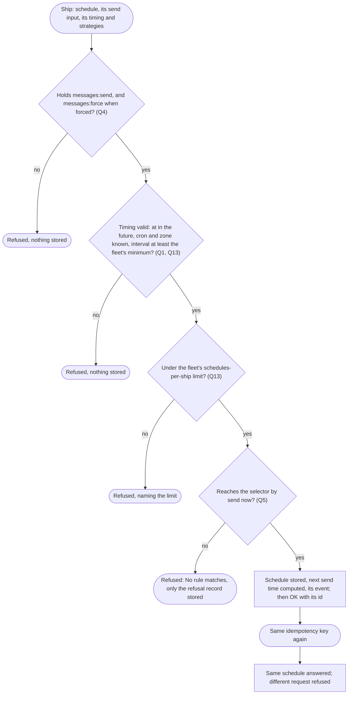
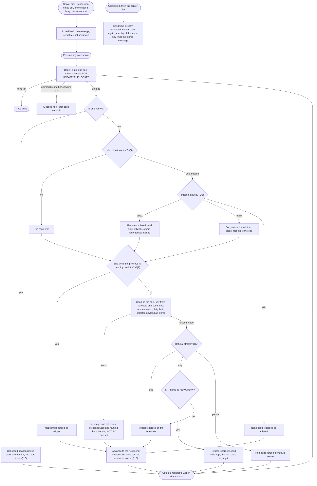

# Scheduled messages: a ship's own message, sent by core at its time

Design for [#1183](https://github.com/ThomasHendrickx/aeolus-fleet/issues/1183), Aeolus 0.32.0. Docs only. Step one: purpose, lessons, the flows the picks give, and the questions. Nothing here is decided until Thomas answers.

## 1. Purpose (agreed by Thomas, 24 Oct, on #1183)

A ship schedules a message, once at a set time or repeating. Core stores it and sends it at that time as that ship. The schedule belongs to the ship that made it, shows in its history, can be listed and cancelled. No extra ship, so no ship limit and no clutter in the fleet overview.

Thomas: "give them as much options as possible": the ship that creates a schedule chooses how it behaves (what happens to a missed send time, to a refused send), rather than core assuming it up front.

First use: the company's 6-hourly check-in to the chief of staff (aeolus-company `ship:scheduler`), and a session's reminder to itself ("tomorrow at 9 a.m. UTC").

The outcomes:
1. Each send time gives exactly one message, across restarts and several core servers, or a recorded reason why none was sent.
2. Every send is checked as a send by that ship at that time: scopes, reach, limits.
3. Which strategy applies to a missed or refused send time is the creator's choice, stored on the schedule.

Not the purpose: running work at a time (Aeolus distributes, 0001); reading or changing payloads; a schedule sending as another ship.

## 2. Lessons to check against

From other schedulers:

| # | Lesson | Source |
| --- | --- | --- |
| L1 | A send time the scheduler was down for needs a stated rule: fire once now, fire every missed one, or skip; each scheduler lets the caller pick | Quartz [misfire instructions](https://www.quartz-scheduler.org/documentation/quartz-2.3.0/tutorials/tutorial-lesson-04.html) (`FIRE_ONCE_NOW`, `DO_NOTHING`, a misfire threshold); systemd [`Persistent=`](https://www.freedesktop.org/software/systemd/man/latest/systemd.timer.html) (one catch-up); Temporal [catchup window](https://docs.temporal.io/schedule) |
| L2 | Catching up every missed send time floods: a minute schedule down for a day is 1440 sends | Kubernetes [CronJob](https://kubernetes.io/docs/concepts/workloads/controllers/cron-jobs/) refuses to start after 100 missed schedules unless `startingDeadlineSeconds` bounds it |
| L3 | A new run while the previous one is still open needs a rule (allow, skip, replace) | Kubernetes `concurrencyPolicy`; Temporal overlap policy |
| L4 | Wall-clock schedules break on summer time: a time skipped in spring, doubled in autumn; schedules carry a time zone | Temporal and AWS [EventBridge Scheduler](https://docs.aws.amazon.com/scheduler/latest/UserGuide/schedule-types.html) take an IANA zone |
| L5 | A send that fails at its time needs a rule too: retry within a window, drop, or pause the schedule | EventBridge Scheduler retry policy with a maximum age; Temporal pause on failure |
| L6 | Several servers firing the same schedule fire it twice unless one claim wins | Quartz clustered job store (row locks); Kubernetes one controller |

From Aeolus (the issue's lessons, with today's facts):

- **Exactly once across restarts and several servers.** Postgres is the broker (0003): commit before OK, `SKIP LOCKED` claims. A message is unique on its sender and idempotency key (architecture, `messages`), so a send time keyed by its schedule can be stored only once. Core already runs one 30 second pass for the 10 and 60 minute clocks and the stuck snapshot, safe when two run at once (architecture, step 8).
- **A missed time: the creator picks the strategy** (Thomas, above; L1).
- **Reach checked at send time.** Every send is checked when it is sent, against both ships as they are then (0034); a refusal stores only its record.
- **A retired sender's schedules stop.** A retire ends everything the ship holds in its transaction (blueprint, Retire a ship): crew request, clear requests, labels.
- **Time zones and summer time** (L4). The daily message limit counts by UTC day (0020).
- **Floods: a limit per ship, a minimum interval** (L2). Limits are configuration: installation default, per-fleet override, unset is none; Aeolus sets no minimum of its own (0016, 0020). Every message counts toward the daily message limit.
- **The promise.** Creating a schedule is an OK for something not yet sent. A send time that sends nothing must leave a visible reason, never silence.
- **Model** (0018). Every send of an agent ship states its session's model; at a send time no session runs.
- **The fleet never speaks for a ship** (wake-a-person, I-1). The scheduled message is the creator's own, written at creation.
- **One door, events in the same transaction** (0004, CLAUDE.md). Every change of a schedule writes its event; its ship's history shows them.
- **Pre-1 (0013).** No compatibility work.

## 3. Flows (with the picks below)

### Create

### A send time (exactly once)

Every 30 seconds, per fleet, one transaction per schedule. Due means its next send time is at or before the database's `now()`, so servers with different clocks agree.

Exactly once rests on three guards: the row claim (`SKIP LOCKED`, one pass per schedule), the message and the advanced send time in one transaction (both or neither), and the key derived from schedule and send time (unique per sender, so even a second claim cannot store a second message).

### Lifecycle

```mermaid
stateDiagram-v2
  [*] --> active: created
  active --> paused: ship or manager pauses, or the pause strategy
  paused --> active: resumed; send times passed while paused are skipped
  active --> ended: once sent, past its end, or its count reached
  active --> cancelled: ship or manager cancels, or its ship retires
  paused --> cancelled: ship or manager cancels, or its ship retires
```

## 4. Questions

Each with options and my pick. Q6, Q7 and Q9 are the creator's choices Thomas asked for; the question is which choices and their defaults.

**Q1. Timing.**
1. Once (an instant with its offset) and every (an ISO 8601 duration from a start).
2. As 1, plus cron (five fields) with an IANA time zone, UTC when none.
3. RFC 5545 recurrence rules.

Pick 2: "every 6 hours" and "weekdays at 9 Amsterdam" are both first uses; cron is what agents already write; RFC 5545 adds a grammar no use asks for.

**Q2. Summer time for cron.**
1. One rule: a skipped wall time sends at the first valid minute after it; a doubled one sends once, at its first.
2. The creator picks per schedule.

Pick 1: each case has one sensible answer, so a choice here is a setting nobody sets differently. Every and once are instants, untouched by summer time.

**Q3. What a schedule sends.**
1. A whole send input: ship or type selector, payload (at most 64 KB), content type, optional in-reply-to, optional force; stored as given, never changed.
2. A ship selector and a payload only.

Pick 1: the same send the ship could make itself, so one rule set covers both; a type lets a reminder reach whichever ship of the type is crewed.

**Q4. The scope to create one.**
1. `messages:send` (and `messages:force` for a forced one), as for a send.
2. A new `messages:schedule`.

Pick 1: a schedule sends nothing the ship could not send itself; floods are Q13's limits, and a runaway is cancelled by Q11. Option 2 if Thomas wants organisations to grant scheduling apart.

**Q5. Reach.**
1. Checked at creation and again at every send time.
2. Only at every send time.

Pick 1: a schedule that can never send is refused while the creator is there to see it; the send-time check (0034) stays the one that counts.

**Q6. A missed send time** (core not passing at the time, L1, L2). The creator sets a grace (how late still counts as on time) and a strategy:
1. `once` (one send for the latest missed send time), `each` (every missed one, oldest first, at most 100 a pass), `skip` (none, wait for the next). Default `once`, grace 5 minutes.
2. One fixed rule, `once`.

Pick 1: Thomas asked for the choice; the cap is L2's lesson. Each missed send time not sent is recorded with its time.

**Q7. A refused send** (reach, daily limit, recipient retired, a scope gone). The creator picks:
1. `skip` (record it, go on to the next), `retry` (each pass again until stored or its retry window ends, then skip), `pause` (record it, pause until resumed). Default `skip`; a once schedule with `skip` ends.
2. One fixed rule, `skip`.

Pick 1: L5; a reminder wants `skip`, a one-off handover wants `retry`, a check-in that must not run blind wants `pause`.

**Q8. How the creator learns of a refused, missed or skipped send time.**
1. On the schedule (its last outcome: the message, or the code and time) and as an event in its ship's history; read when the ship lists its schedules.
2. As 1, plus a delivery to the ship from itself.
3. As 1, plus Needs attention.

Pick 1: no new path where the fleet speaks (I-1) and none to argo (0053); a delivery would itself be refused by the same daily limit. The cost: an uncrewed ship learns only when it next lists.

**Q9. The previous one is still pending** (L3).
1. Always send.
2. The creator may pick skip while the schedule's previous message has a delivery still pending; default always send.

Pick 2: a 6-hourly check-in to an uncrewed chief of staff otherwise piles up four a day in its inbox.

**Q10. Ending a repeating schedule.**
1. Optional end time and optional number of sends, either ends it.
2. Cancel only.

Pick 1: "remind me hourly until Friday" and "three times" need no session to come back and cancel.

**Q11. Who acts on a schedule.**
1. Its ship creates, lists, pauses, resumes and cancels its own; an actor with `fleet:manage` within manage reach of the ship lists, pauses and cancels them. No edit: cancel and create.
2. Its ship only.

Pick 1: the owner, or argo as fail-safe, stops a runaway schedule of a released ship; edit would make which send time is next ambiguous.

**Q12. The ship's lease.**
1. Released or awaiting crew: schedules go on, messages wait as any message. Retired: its schedules are cancelled in the retire's transaction, each with its event.
2. Released or awaiting crew pauses them.

Pick 1: the purpose sends without a session; Q9 keeps an uncrewed inbox from filling.

**Q13. Limits.**
1. Every scheduled send counts toward the daily message limit; schedules per ship and the minimum interval are limits as 0020's (installation default, per fleet, unset none), refused at create naming the limit.
2. Fixed numbers in core.
3. No limits beyond the daily message limit.

Pick 1: the issue names both floods; 0016 and 0020 keep the numbers the hosting service's, never core's.

**Q14. Precision.**
1. The existing 30 second pass: send times at the minute, sent within about 30 seconds after.
2. A pass of its own every few seconds.
3. A timer per server to the next send time, told of new schedules by `NOTIFY`, the pass as fallback.

Pick 1: reminders and check-ins live at the minute; option 3 is the upgrade if a use needs seconds.

**Q15. The envelope and the model.**
1. The message names its schedule and send time; the model is the one stated when the schedule was created.
2. Nothing added; no model.

Pick 1: the receiver tells a scheduled message from a live one without reading the payload; the payload's author was that model (0018).

**Q16. What 0.32.0 ships.**
1. The ship calls (tRPC, MCP, REST), the pass, events in the ship's history, and the console's ship page listing its schedules with Pause and Cancel.
2. The ship calls only.
3. As 1, plus the gateway for person ships.

Pick 1: argo as fail-safe needs to see and stop them (Q11); a person ship's schedules come with the gateway after.

## 5. Where it lives

Core's messaging context: a `schedules` table (fleet_id, its ship, the send input, timing, strategies, next send time, state, last outcome), a `sch_` id, its events, and the pass beside the 10 and 60 minute clocks. Detailed once the questions are answered.
