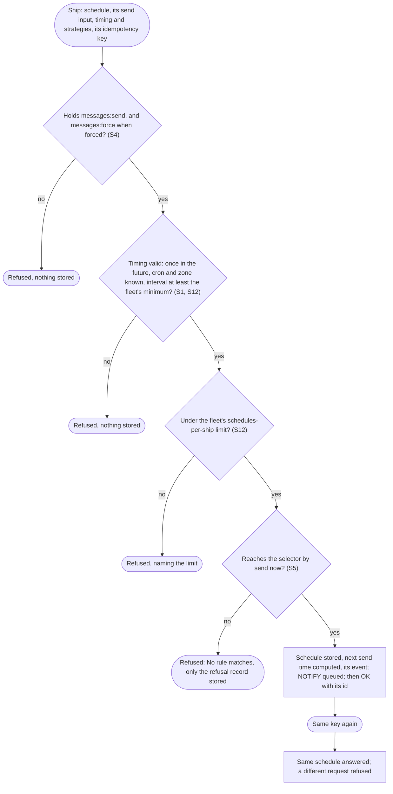
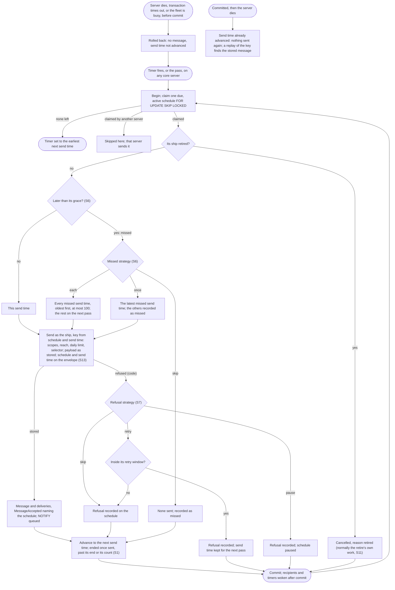

# Scheduled messages: a ship's own message, sent by core at its time

Design for [#1183](https://github.com/ThomasHendrickx/aeolus-fleet/issues/1183), Aeolus 0.32.0. Docs only. Purpose, lessons, Thomas's decisions, the flows and the slices.

## 1. Purpose (agreed by Thomas)

A ship schedules a message, once at a set time or repeating. Core stores it and sends it at that time as that ship. The schedule belongs to the ship that made it, shows in its history, can be listed and cancelled. No extra ship, so no ship limit and no clutter in the fleet overview. Thomas: "give them as much options as possible": the creator chooses how its schedule behaves, rather than core assuming it up front.

First use: the company's 6-hourly check-in to the chief of staff (aeolus-company `ship:scheduler`), and a session's reminder to itself ("tomorrow at 9 a.m. UTC").

The outcomes:
1. Each send time gives exactly one message, across restarts and several core servers, or a recorded reason why none was sent.
2. Every send is checked as a send by that ship at that time: scopes, reach, limits.
3. The strategy for a missed or refused send time is the creator's choice, stored on the schedule.

Not the purpose: running work at a time (Aeolus distributes, 0001); reading or changing payloads; a schedule sending as another ship; sending only on what waits in an inbox (S9).

## 2. Lessons to check against

From other schedulers:

| # | Lesson | Source |
| --- | --- | --- |
| L1 | A send time the scheduler was down for needs a stated rule: fire once now, fire every missed one, or skip; each scheduler lets the caller pick | Quartz [misfire instructions](https://www.quartz-scheduler.org/documentation/quartz-2.3.0/tutorials/tutorial-lesson-04.html); systemd [`Persistent=`](https://www.freedesktop.org/software/systemd/man/latest/systemd.timer.html); Temporal [catchup window](https://docs.temporal.io/schedule) |
| L2 | Catching up every missed send time floods: a minute schedule down for a day is 1440 sends | Kubernetes [CronJob](https://kubernetes.io/docs/concepts/workloads/controllers/cron-jobs/) stops after 100 missed schedules |
| L3 | A new run while the previous one is still open needs a rule | Kubernetes `concurrencyPolicy`; Temporal overlap policy |
| L4 | Wall-clock schedules break on summer time: a time skipped in spring, doubled in autumn; schedules carry a time zone | Temporal and AWS [EventBridge Scheduler](https://docs.aws.amazon.com/scheduler/latest/UserGuide/schedule-types.html) take an IANA zone |
| L5 | A send that fails at its time needs a rule: retry within a window, drop, or pause | EventBridge Scheduler retry policy; Temporal pause on failure |
| L6 | Several servers firing the same schedule fire it twice unless one claim wins | Quartz clustered job store (row locks) |

From Aeolus:

- **Exactly once across restarts and several servers.** Postgres is the broker (0003): commit before OK, `SKIP LOCKED` claims, `NOTIFY` after commit. A message is unique on its sender and idempotency key (architecture, `messages`). Core runs a 30 second pass, safe when two run at once (architecture, step 8).
- **Reach checked at send time** (0034); a refusal stores only its record.
- **A retired sender's schedules stop**, as everything a ship holds ends in its retire's transaction (blueprint, Retire a ship).
- **Floods.** Limits are configuration: installation default, per-fleet override, unset none (0016, 0020). Every message counts toward the daily message limit, by UTC day.
- **The promise.** Creating a schedule is an OK for something not yet sent: a send time that sends nothing leaves a recorded reason.
- **Model** (0018): every send of an agent ship states its session's model.
- **The fleet never speaks for a ship** (wake-a-person, I-1); argo is the fail-safe, never a normal path (0053, 0057).

## 3. Decisions (Thomas, 24 Oct, on #1184)

| # | Rule |
| --- | --- |
| S1 | **Timing reads like cron.** Once (an instant with its offset), every (an ISO 8601 duration), or cron (five fields) with an IANA time zone, UTC when none; a repeat takes an optional start, end time and number of sends, either ending it. The options are the ones listed here: "we are almost reinventing the cron job ... keep as close to that spec with the options we determine" |
| S2 | **Summer time.** A skipped wall time sends at the first valid minute after it; a doubled one sends once, at its first. Once and every are instants, untouched |
| S3 | **A whole send input.** Ship or type selector, payload (at most 64 KB), content type the creator picks, optional in-reply-to, optional force; stored as given, never changed |
| S4 | **The scope is the send's.** `messages:send`, and `messages:force` for a forced one: "a delayed send of a message conceptually or a message that gets send multiple times" |
| S5 | **Reach checked at creation and at every send time.** "Conceptually ... it is sending the message from the source (creator) at the desired time, even if that creator is no longer there" |
| S6 | **A missed send time.** A send time the pass reaches later than its grace is missed. The creator picks `each` (every missed one, oldest first, at most 100 a pass), `once` (the latest only) or `skip` (none, wait for the next); default `each`, grace 5 minutes. Each one not sent is recorded with its time |
| S7 | **A refused send** (reach, daily limit, recipient retired, a scope gone). The creator picks `skip` (record it, go on), `retry` (each pass again until stored or its retry window ends, then skip) or `pause` (record it, pause until resumed); default `skip`; a once schedule ends after its skip |
| S8 | **The outcome lives on the schedule.** Its state and last outcome (the message, or the code and time) and an event in its ship's history; a ship lists its schedules to check their status. No notice delivery, nothing to argo |
| S9 | **Always send.** No send hangs on what is already queued: that is the receiver's execution, not distribution, and idempotency is the session's. A session back after 24 hours sees each check-in stamped with its send time (S13) and decides |
| S10 | **Who acts.** Its ship creates, lists, pauses, resumes and cancels its own; an actor with `fleet:manage` within manage reach lists, pauses and cancels them, so argo always removes one, the fail-safe for a malicious schedule. No edit: cancel and create |
| S11 | **The ship's lease.** Released or awaiting crew, its schedules go on and their messages wait as any message. A retire cancels them in its transaction, each with its event |
| S12 | **Limits.** Every scheduled send counts toward the daily message limit. Schedules per ship and the minimum interval are limits as 0020's (installation default, per fleet, unset none), refused at creation naming the limit |
| S13 | **The envelope.** The message names its schedule and its send time, both required, beside the content type the creator picked, so a scheduled message may share a type with a live one. The model is the one stated when the schedule was created |
| S14 | **Precision: a timer, the pass as fallback.** Each server holds a timer to the earliest next send time, told of a new, resumed or advanced schedule by `NOTIFY`; the 30 second pass also sends whatever is due, so a lost timer is late by at most a pass. A test proves two servers never send the same send time twice |
| S15 | **0.32.0 ships** the ship calls (tRPC, MCP, REST), the sending, events in the ship's history, and the console's ship page listing its schedules with Pause and Cancel |

Later, filed: a token bucket defending the fleet server whatever a customer configures ([#1187](https://github.com/ThomasHendrickx/aeolus-fleet/issues/1187)); a ship recrewed after a set time ([#1188](https://github.com/ThomasHendrickx/aeolus-fleet/issues/1188)).

## 4. Flows

### Create

### A send time (exactly once)

Woken by a server's timer or the 30 second pass (S14). One transaction per schedule. Due means its next send time is at or before the database's `now()`, so servers with different clocks agree.

Exactly once rests on three guards: the row claim (`SKIP LOCKED`, one server per schedule), the messages and the advanced send time in one transaction (both or neither), and the key derived from schedule and send time (unique per sender, so even a second claim cannot store a second message).

### Lifecycle

```mermaid
stateDiagram-v2
  [*] --> active: created
  active --> paused: ship or manager pauses, or the pause strategy
  paused --> active: resumed; send times passed while paused are skipped
  active --> ended: once sent, past its end, or its count reached
  active --> cancelled: ship or manager cancels, or its ship retires
  paused --> cancelled: ship or manager cancels, or its ship retires
```

## 5. Slices (0.32.0)

Each slice ends on its tests, the guarantees by name.

1. **A once schedule, sent exactly once.** Core's messaging context: a `schedules` table and its `sch_` id, create (S3 to S5, the idempotency key), list, cancel (S10), the send time in one transaction with the derived key and S13's envelope, S7's refusal strategies, the retire cancelling (S11), the timer and the pass (S14), events. A late once schedule is sent. Tests: two servers never send the same send time twice; a rollback sends nothing and advances nothing; a restart before and after commit; reach refused at creation and at send time.
2. **Repeating.** Every and cron with zone, S2's summer time, start, end and count (S1), S6's missed strategies with grace and cap, pause and resume. Tests: each strategy after a gap, the cap of 100, a skipped and a doubled wall time.
3. **Limits.** Schedules per ship and the minimum interval as 0020's limits, set by the installation, refused at creation (S12).
4. **Console.** The ship page lists its schedules with state and last outcome, Pause and Cancel; the history shows their events (S15).
