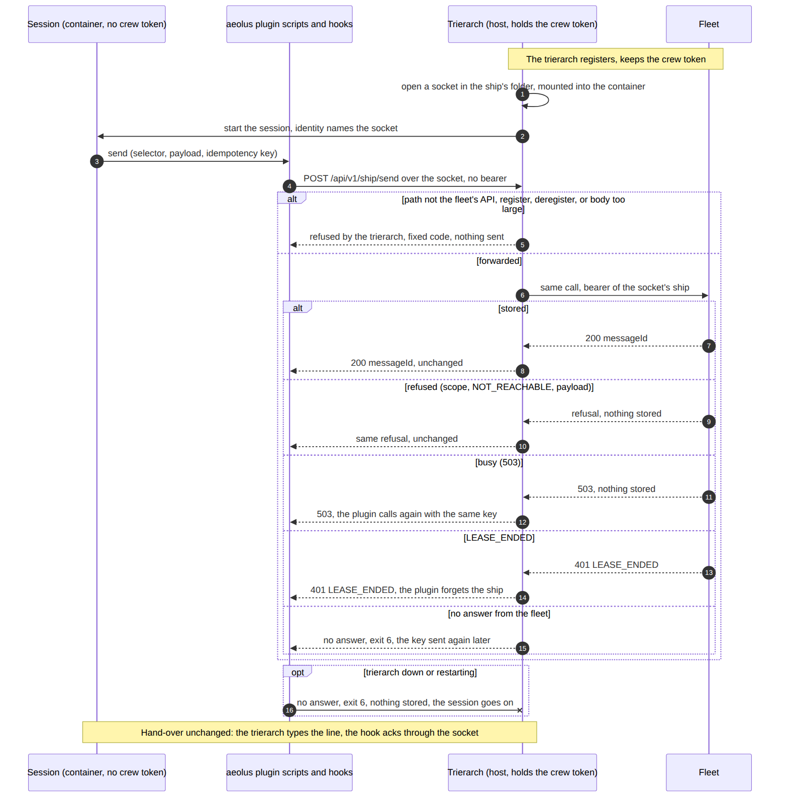

# Fine-grained scopes for 0.27.0 (#348, #600, #866)

Design proposal by designer-2. Part 0 sets the product direction (one organisation, one fleet, one operator, many people, apps and agents) and records Thomas's decisions of 17 Oct (0.A to 0.S). Part 5 holds decisions 1 to 13. Part 6 is the scope catalogue fitted to all of them. Three questions are open (64 to 66, listed at the end of part 0).

Diagrams in this folder: `1-model-a.png`, `2-model-b.png`, `3-model-c.png`, `4-forced-delivery.png`, `5-squadron-forming.png`, `6-contained-calls.png` (sources in `src/`).

---

## 0. One organisation, one fleet (product direction, before the catalogue)

Thomas (17 Oct): "one organisation where a symbiosis of humans, apps and agents are interconnected in a secure and managed way that removes the current human as the glue and maximises value through fast information flow where humans still gate and steer on the critical points." And: "scope is what a ship can do, network (e.g. done with labels) is where it can do it." Thomas decided the direction (below); the questions (15 onward) carry each decision in place, and the few still open have options.

### Decided (17 Oct)

Thomas answered direction questions in four rounds, and added one principle (0.S). They are the frame for the rest of part 0; the questions they settle are marked in place.

- **0.A Core's surface.** "A, indeed you read me correctly." Core Aeolus is the fleet server, its API and argo's admin console, nothing more. People reach their ships through their own app or a chat; plugins serve their own pages; the questions UI in the console is frozen and later moves out.
- **0.B The where covers every interaction.** "A, indeed the what (scope) vs where (network) is an all type of interactions." The network decides reading as well as sending, one rule per verb, and discovery and statements follow the same reach. Where applies to every type of interaction, not only send and read (0.2).
- **0.C Every ship has an owner.** "A, and it follows the 'a human is always responsible'. Gates are clear, but every ship needs to be maintained. It's like application owners in current IT management." Every ship belongs to a person, a fact core knows, set by argo or inherited at commission. Questions, trouble and gates go to the owner, argo as fallback. A PA's statement is trusted for a person only when the PA belongs to that person. What the owner maintains is in 0.10.

Two more rounds (17 Oct):

- **0.D Apps and outside parties are ships, of their own kind.** "A, it is the promise at the core. One network to connect all. And we need to be true on what it is." An app such as the CRM, and a ship standing in for an outside party, is a ship that the network gates. Beside `agent` there are new kinds `person` and `app`, and only an agent states a model (0018). This settles question 25 here, and question A of the decision review (`design/adr-review`).
- **0.E Three network verbs.** "A, and if needed we are still pre v1." Rules name send, read and manage. Force, discover and resend ride them. The owner's ship always reaches the ships it owns, and rules can select by owner (0.2).
- **0.F Owners, strict in principle, grown where needed.** "A, plugins etc are also owned by the operator. But we need to be VERY careful here that we don't introduce process due to process. So in spirit yes, but let this grow where needed and not shoot ourself in the foot." Every ship has an owner, argo by default, plugin and trierarch ships included. argo alone changes it, and a retired owner's ships fall to argo. No workflow comes with it (0.10).
- **0.G Fleet access contained by default, as designed in 0.8.** "A". Questions 37 to 42 take their picks.
- **0.H Discovery and statements, as picked in 0.9.** "A". Questions 43, 45, 47, 48, 49, 51, 52 and 54 take their picks.
- **0.I MCP and A2A: borrow now, speak the protocols as the end state.** "I agree with (a) for short term but the end state is level 3 for all. And I will be pushing hard on it to have it soon rather than late." In the short term, statements borrow the agent card's and MCP's field names. The end state is level 3, (c) of question 55, for both MCP and A2A, in both directions: outside agents and clients reach fleet ships, and fleet ships reach outside ones. The interop design starts now, not after the scope rework ships.
- **0.J No rights travel with a message.** "scopes is for core, a receiver just receives and has no indication that it may receive the message. Receiving it is enough. Scope logic is for core and the plugins to police." A receiving ship is never a policy point. Core and the plugins enforce scopes and reach; a message that reached a ship was allowed, and the ship acts on its own scopes. This settles question 27.

The last round (17 Oct), closing part 0:

- **0.K Shared plugins** (question 23): "agreed". One connection each, fleet-wide reach, and each person served only what that person may read.
- **0.L A person's ship stays crewed** (decision review B): "agreed". The person's app holds the lease, and an absent person is not counted as stuck.
- **0.M Whose machine runs whose ship** (decision review C): "This is a rule the organisation needs to make and will probably become a ruleset on the trierarch plugin based on labels." No product default. Placement rules are the organisation's, a label-based ruleset in the trierarch plugin, not core.
- **0.N The networking plugin at fleet create** (decision review D): "yes for now, I am even debating making networking just part of the core since it is so vital (same importance as scopes) and to not bother with network traffic between the plugin and core. But that is busy work and we have more important things to do now." The hosting service switches the networking plugin on at fleet create. Networking in core is considered and deferred: no work now.
- **0.O The flagship stays the proxy** (question 10): "yes". The forming ship's owner gates through it.
- **0.P A stopped turn's message** (question 11): "yes since the force message could say to stop doing that exact message." It is handled when the forced turn ends.
- **0.Q Forming ship and flagship reach each other by the same-owner rule** (question 12): "yes same owner rule (labels will need to be set here for visibility and enforcing it)". How it holds for a squadron is question 64.
- **0.R A retired forming ship** (question 13): "yes". The flagship proxies to its owner, argo as fallback.
- **0.S No hidden reach.** "I just don't like rules that determine behaviour that are not visible. Hidden behaviour is a source of debugging nightmare." Every way a ship can reach another is a rule argo can see, and every change that affects reach or ownership is a visible event (0.11).

### 0.1 Purpose

One organisation, one fleet, one operator: argo manages the whole fleet. People, apps and agents are all in it, connected. A subfleet (`subfleet=thomas`) is a group of ships a person owns inside one network, not a separate fleet and not isolation. Crossing between people's ships is the normal case. Three things make it safe and fast:

- **The network says where** a ship can act: which ships and apps it reaches.
- **Scopes say what** a ship may do, wherever it acts.
- **People gate and steer** at the critical points: a question or an approval reaches the right person, not one human who carries everything.

Worked scenario:

| | Thomas | Charlotte (PM) | Burak |
| --- | --- | --- | --- |
| Ships | a tech lead ship, his PA | a PRD ship | a tech lead ship |
| Reaches the CRM (an app) | yes | yes | no |
| Reaches | the PRD ship's answers | both tech lead ships | the PRD ship's answers |
| May do | his tech lead forms delivery squadrons (`squadrons:form`) | the PRD ship sends and directs; it holds no `fleet:commission` and no `squadrons:form`, so it cannot start implementation ships | his tech lead forms delivery squadrons |
| Gates | approves what his tech lead starts | approves the PRD | approves what his tech lead starts |

argo (the operator) sets the network, grants scopes, connects the plugins and sees everything. A good outcome: Charlotte's PRD ship directs both tech leads with no human passing messages along; Burak's ships cannot get at the CRM; the PRD ship cannot start ships, it can only ask a tech lead, whose own scopes and whose person decide; each question lands with the person who owns the work.

### 0.2 Scope says what, network says where: every type of interaction

0.B: "the what (scope) vs where (network) is an all type of interactions." Every interaction a ship has with core gets a where. For some, the where is a network verb, so a rule names which ships may do it to which. For the others, it is who the caller is (identity), what it owns (a label, a namespace, its ships by 0.C) or what was assigned to it. Today the network has one verb, send (0034), and `fleet:read` reads every payload with no rule in the way. That is the gap 0.B closes.

Each interaction core has, with its procedures and scope today and its where under 0.B:

| Interaction | Procedures today | Scope | Where |
| --- | --- | --- | --- |
| Send, ask a question | `send`, `fleet.reply` | `messages:send` | Network verb **send** (0034) |
| Answer a message received | `send` with inReplyTo | `messages:send` | Fixed exception (0034): to that message's sender |
| Force | new (decisions 3, 4) | `messages:force` | Rides **send**: a forced message is a send |
| Receive and confirm | `receive`, `pushReceive`, `ack`, `pong`, `handed`, `handled`, `notHandled`, `markRead`, `markDone`, `inbox` | `messages:receive` | Identity: its own ship |
| Say what it is doing | `report`, `turn`, `reportLog` | the crew | Identity: its own ship |
| Read a ship and its messages | `fleet.list`, `ship`, `shipTimeline`, `shipWay`, `shipMessages`, `message`, `follow`, `events`, `labels`, `findLabelValue` | `fleet:read` | Network verb **read**, a message by its sender or recipient (question 17) |
| Read fleet-wide views | `health`, `limits`, `needsAttention`, `overdue`, `noShipCanTake` | `fleet:read` | argo's administration (0.A); for any other ship, only the ships in its read reach |
| Discover | new (0.9) | `messages:send` | Rides **send** (question 46) |
| State what it is and offers | new (0.9) | its own ship | Identity for writing; read by the ships that can send to it (question 50) |
| Manage a ship: release, retire, rename, recrew, crew request, ping, clear a worktree | `fleet.release`, `retire`, `rename`, `recrew`, `crewRequest`, `removeCrewRequest`, `ping`, `clearWorktree` | `fleet:manage` | Network verb **manage** (question 56; today any ship, gap G6) |
| Resend, dismiss a stuck message | `fleet.resend`, `dismiss` | `fleet:manage` (`messages:resend` in part 6) | Resend is checked as the original sender's send (0034); who may resend rides **read** of the message |
| Commission | `fleet.commission` | `fleet:manage` (`fleet:commission` in part 6) | Not a reach: the new ship lands with its commissioner's owner, argo by default (0.F) |
| Define a label, declare rules on it | `defineLabel`, `changeLabelValues`, `deleteLabel`, `declareNetworkRules` | `labels:define` | Ownership of the label (0031, 0037) |
| Assign a label | `assignLabel`, `unassignLabel` | `labels:assign` | Ownership (decision 5): a rule granting it would let the network widen reach |
| Declare and grant scopes | new (decisions 1, 2, 6) | `scopes:declare`, `scopes:grant` | Ownership of a namespace; the subset rule |
| Set the network | `setNetworkRules`, `registerNetworkPlugin`, `unregisterNetworkPlugin`, `declaredNetworkRules` | `fleet:network` | The networking plugin's ship only (0035) |
| Crew a ship for a request | `assignedCrewRequests`, `reportCrewStatus`, `giveBackCrewRequest`, `confirmCrewRelease`, `confirmWorktreeCleared` | `crew:run` | Assignment: the requests assigned to it |
| Place a crew request | `assignCrew`, `explainCrewRequest` | `crew:assign` | Any request (the trierarch plugin's ship) |
| Explain reach, read refusals | `explainReach`, `reachRefusals` | `fleet:read` | argo only, by kind (0034) |
| A plugin serving a person | squadrons' and the trierarch plugin's APIs, checked by `console.session` | `fleet:read`, `fleet:manage` | The person's own reach bounds what the plugin serves them (question 23) |

So three verbs take a network rule (send, read, manage). Force, discover and resend ride one of them; the rest stay identity, ownership or assignment. argo reaches every ship for every verb by a built-in rule (0.11).

In the scenario of 0.1, "Charlotte has access to CRM, as does Thomas but Burak does not" becomes a send rule and a read rule. Thomas's PA with `fleet:read` reads the CRM ship's messages only where a read rule lets it, and Burak's ships see nothing of the CRM.

56. **Which verbs do network rules name?** Decided by 0.E: (a), send, read and manage; force, discover and resend ride them; the owner's ship reaches the ships it owns.

### 0.3 Single-operator assumptions: what holds, what breaks

Holds: one operator `argo` with every scope, managing the whole fleet (0002, 0012); risk is the operator's call (0016); argo past every rule (0034); argo connects the plugins and edits the network (0017, 0021, 0030, 0036).

Breaks, because today the operator is the only human in the fleet and so the glue:

| Assumption | Where |
| --- | --- |
| One account, one console session, sign-in takes over; "Better Auth if several human users ever come": Charlotte and Burak have no way in but argo's or the viewer's session | 0012, 0022 |
| Questions go to argo; one operator inbox | 0038, the ship protocol rule 4 |
| Overdue, not handled, undeliverable and no ship can take go to one Needs attention | 0040, 0041, 0042 |
| An unassigned crew request is the operator's to-do; a crashed crew is told to argo | 0029, 0026 |
| Squadrons serves writes to the operator's session alone (`fleet:manage`) | 0017 |
| Labels are argo's or a plugin's; a person's ship cannot label the ships it commissions with that person's group unless it owns the label | 0031, question 5 |
| No rules is all-to-all, reading included once reading follows the network | 0035 |
| Notices and the guide address `operators` and `viewers` | 0023, 0024 |
| An app is no part of the fleet: a session reaches the CRM through its own tools, where no rule applies | 0034 (rules cover sends only) |

### 0.4 Lessons to check against

- **Every caller is a ship** (0012, 0022): a person or an app in the fleet is a ship, never a flag on argo's session; 0022 rejected "one caller with two rights".
- **Scopes on the server, never in the request** (0002); revocation at once.
- **Reach is the containment** (0034): rules select by labels only, never by type; only a label's owner assigns it, so a ship cannot widen its own reach; a refusal says nothing about the rules. The same must hold for reading.
- **Owners declare their group's reach** (0037). A person's group could be such a group.
- **Labels are for selection, reach included** (0031), never for lifecycle, configuration or secrets.
- **Aeolus distributes, not executes** (0001): the receiving ship decides what to do with a request; Aeolus does not follow a request's intent from ship to ship.
- **No policy** (0016): whatever the network and scopes allow is allowed; the operator sets them.
- **Limits are for speed, not policy** (0037): every send is checked; checking every read and every live event is many times more checks.
- **Rules exist only through a plugin** (0035), and no plugin is all-to-all.
- **Questions are a message to one ship** (0038): open until that ship answers.
- **No compatibility layers** (0013); thin designs for a few people.
- **Tenancy** (0007): one fleet stays one tenant; a person is not a tenant.
- **Console logic on the server** (0033): what a person may see is decided on the server.
- **Earlier rounds**: the network design on #260 and #573; questions 5, 12 and 14 here.

### 0.5 Questions for Thomas

15. **How is a person in the fleet?** Decided by 0.A: a person's ship is crewed through their own app or a chat, holding its crew token as any crew does (0015); argo keeps the console's login.
16. **Does reach govern reading as well as sending?** Decided by 0.B: (c), each rule names its verb, and every type of interaction gets a where (0.2, question 56).
17. **Reading a message: reach to which side?** Decided by 0.B: (a), its sender or its recipient, the pick that follows: a message is part of both ships' timelines.
18. **Does a ship outside read reach show at all?** Decided by 0.B: (b), name, type and status only: one organisation shares one picture of which ships exist and who crews them, and no word of work leaks.
19. **Dropped**: who sets the network. The purpose answers it: argo, the one operator, manages the whole fleet; declared rules (0037) stay as they are.
20. **How does a ship belong to a person?** Decided by 0.C: an owner core knows, set by argo or inherited from the commissioner at commission, not a label; how rules see it is question 60.
21. **Dropped** by 0.A: what a person sees is their own app's; the console is argo's, and for core the question is 16.
22. **Who is told about a ship's trouble?** Decided by 0.C: the owner, by a message to the owner's ship; argo when no one else owns it, and argo keeps Needs attention as the admin's view.
23. **Shared plugins.** Decided by 0.K: (a), one connection each with fleet-wide reach, each person served only what that person may read (how: question 66).
24. **Dropped**: argo past every rule. The purpose answers it: the operator manages the whole fleet, so 0034's exception stays and covers reading too.
25. **How is an app such as the CRM in the fleet?** Decided by 0.D: (a), the app is a ship, of kind `app`; the network gates it like any ship.
26. **Who gates?** Decided by 0.C: (a), the owner of the asking ship, argo as fallback.
27. **Does a request carry its asker's scopes?** Decided by 0.J: (a), no rights travel with a message; the receiving ship acts on its own scopes, and core and the plugins enforce scopes and reach.

**Questions 1 to 14 against 0.A to 0.J:** 10 and 13 reopen toward the owner (part 5, 0.10); 14 folds into question 56; 5 (labels bound by lineage) stands, since the owner is a fact, not a label (question 60); 1 and 12 fit: argo grants scopes and sets reach.

### 0.6 What this means for the console

Thomas (17 Oct): "our questions in console solution is the wrong direction. It can be a plugin or hence just a totally different web app, where a human gets a ship. But it is not core of aeolus ... Same with console taking on every plugin in its UI ... squadrons could perfectly have its own UI running separately, or we do micro front ends." In his direction a human is a ship, reached through whatever app suits them: a separate web app, a plugin, a chat. Core Aeolus is the fleet server and its API, not the human interface. The console's job becomes argo's administration of the fleet. 0.A decides this direction; each row is a choice made earlier that it touches.

| Part | Today | Under this direction | Touches |
| --- | --- | --- | --- |
| Questions in the inbox | Open questions on top of the operator inbox, the pick preselected, one tap answers (0038); the console's server checks an answer and sends it through `fleet.reply` | Move to a plugin or a separate app where a person's ship answers its questions; leave argo's admin console | `lib/questions.ts`, `question-answer.ts`, `questions-actions.ts`, `features/inbox`; #512, #849, #854, #869, #870 |
| Question content types | `application/vnd.aeolus.question+json`, answer, withdrawal, replacement; core never reads them, but the ship protocol text it serves teaches them and names argo as the one who answers (0038, rule 5) | Keep as a fleet convention any app can answer, or move into the app that owns them (question 29) | `packages/core/src/adapters/trpc/ship-protocol.ts`, `plugins/aeolus/scripts/aeolus-ask.sh`, `packages/common` |
| Ship protocol rule 4 | "A question only the operator can answer goes to argo" | Goes to the person the ship belongs to (question 26); the protocol text changes | `ship-protocol.ts`, the aeolus plugin skills |
| Operator inbox | argo's messages, read, done, reply, compose (0012: "Messages to argo are the operator inbox") | Keep as argo's inbox, the admin's; people's inboxes live in their own app | `app/(console)/inbox`, `features/inbox`, `features/compose`, `lib/inbox*.ts`; #849, #863 |
| Needs attention | Undeliverable, not handled (Resend, Dismiss), overdue, no ship can take, as the operator's to-do (0040, 0041, 0042) | Keep as argo's view of the fleet's state; telling a person about their ship moves to that ship's messages (question 22) | `app/(console)/needs-attention`, `lib/needs-attention.ts`; #789, #799, #845 |
| Fleet health | Stuck deliveries by cause and place, the trend (0041, 0042) | Keep: fleet administration | `app/(console)/fleet-health`, `features/health`; #304, #864, #865, #867, #868 |
| Needs crew | An unassigned crew request is the operator's to-do, with a starting prompt (0029) | Keep: fleet administration | `app/(console)/needs-crew`, `features/needs-crew` |
| Fleet, ship, labels pages and ship actions | List, ship page, timeline, commission, release, retire, ping, labels | Keep: fleet administration | `features/fleet`, `features/ship`, `features/ship-actions`, `features/labels` |
| Squadrons pages | The console's server calls squadrons' API with the console session cookie (0017); catalogue, forming, members, messages | Squadrons' own UI, run separately, or a micro frontend in the console (question 30) | `app/(console)/squadrons/**`, `features/squadrons`, `lib/squadrons-*.ts`, `lib/forming-members.ts`; `packages/squadrons` |
| Trierarchs (machines) pages | The console reads machines from the trierarch plugin (0030), silent machines flagged | As squadrons (question 30) | `app/(console)/trierarchs/**`, `features/trierarchs`, `lib/trierarch-plugin-*.ts`, `lib/machines.ts`; `packages/trierarch-plugin` |
| Network page | argo edits the rules held by the networking plugin (0036), sees declared rules apart (0037), and the reach graph from `fleet.explainReach` (0034) | Rule editing to the networking plugin's own UI (question 30); the reach graph and refusals, which are core's, stay | `app/(console)/network`, `features/network`, `lib/networking-plugin-*.ts`, `lib/network-rules.ts`; `packages/networking-plugin` |
| Connect | Settings: the web app's server commissions the plugin's ship and hands its secret to the plugin server to server (0017, 0030, 0036) | Keep as an admin action (commissioning a ship with scopes is argo's), or move into each plugin's own setup | `features/settings`, `lib/connect-plugin.ts` |
| Plugin presence in the console | Navigation, health and version checks per plugin; which plugins are on reaches the browser only as what a page shows (0033) | Shrinks to links when plugin UIs run apart | `lib/plugin-nav.ts`, `lib/plugin-ships.ts`, `lib/startup-warnings.ts`; #432, #454, #502, #503 |
| `console.session` | Another service checks a console session from the forwarded cookie (0012, 0022); squadrons serves writes to `fleet:manage` | Stays the way a plugin UI checks argo; a person's app signs in as the person's ship instead (question 15) | `packages/core/src/adapters/trpc/console.ts`, `packages/squadrons/src/adapters/trpc/router.ts` |
| Notices | The installation sets notices for `everyone`, `operators` or `viewers` (0023) | Keep for the admin console; a person's app shows its own | `features/notices`; installation procedures |
| Guide | The installation sets one guide per audience (0024) | Keep for the admin console | `features/guide`, `lib/guide.ts`; #690, #721 |
| Viewer | Read-only sessions of the whole fleet, argo's inbox included (0022) | Keep as a read-only look at the admin console (the hosted demo) | `features/sign-in`, `lib/session.ts` |
| Sign-in | argo's email and password, or a hosted one-time ticket (0012, 0020) | Keep for argo; people sign in to their own app | `app/sign-in`, `lib/hosted-sign-in.ts` |
| Analytics | Off by default, a closed list of console events (0025) | Keep | `lib/analytics*.ts` |

Questions 15, 21, 22 and 26 are settled by 0.A and 0.C (0.5).

**Questions this table forces:**

28. **Does core keep any human-facing surface beyond argo's administration?** Decided by 0.A: (a), the fleet server, its API and argo's admin console, nothing more.
29. **Does the question content type stay a core convention?** Decided by 0.A: (a), a fleet convention in the ship protocol, answered by whatever app crews the owner's ship; the console's questions UI is frozen and later moves out.
30. **Plugin UIs: apart or inside?** Decided by 0.A: (a), each plugin serves its own pages, linked from the console.
31. **What happens to the work on the console's questions now?** Decided by 0.A: (a), #849 is frozen with the rest of the console's questions UI.

### 0.8 Fleet access contained by default

Thomas (17 Oct): "I see benefits from containing aeolus access by default. The agent if ran by trierarch does not need the token." In his direction a session the trierarch crews holds no fleet credential. Its fleet calls go through the trierarch on its machine, which holds the crew token, so a container needs no route to the fleet. A session crewed by hand, or a chat with the fleet's connector, keeps its crew token as today (0015). 0.G decides it as designed here.

**Why it contains.** Today a container holds its ship's crew token in its home (0039: "its own home (the harness's config folder, the aeolus plugin, its ship's identity file)"). A breached session can copy that token out and act as its ship from anywhere until the lease ends, past the end of the session and from outside the network's view of where the ship runs. Without the token, the session acts as its ship only while it runs, only from its container, and only through the trierarch; a release, which stops the session (0026), ends that too. What its ship may do does not change: scopes stay on the server (0002) and reach stays the network's (0034).

**Today, read in the code:**

- `plugins/aeolus/scripts/aeolus-fleet.sh` is the one door for a session's fleet calls: it reads the crew token from the folder's identity file and calls the fleet's REST API with curl, the token as the bearer. Every hook and every model call goes through it.
- The trierarch registers with the secret on the host (0026) and writes the identity, crew token included, through the host's aeolus plugin into the ship's home, `~/.aeolus/trierarch/homes/<shipId>` (`claude-code-home.ts`), mounted as the container's home (`container.ts`).
- The trierarch's hand-over already runs on the host: it runs the host's `aeolus-push.sh hand` and `died` against that home (`plugin-identity.ts`), so push receive and handed are the host's calls today, with the token read on the host.
- The container runs on the runtime's default network (`container.ts` names no network), so it reaches anything, the fleet included.

**The calls that move** (the ones a session makes from inside its container):

| Call | Made by | Moves to the trierarch |
| --- | --- | --- |
| `ack` | the PreToolUse and Stop hooks, confirming a hand-over (0040) | yes |
| `turn`, `handled`, `notHandled` | the hooks (0040) | yes |
| `send`, `report`, `inbox`, `whoami`, `reportLog`, `pong` | the model, through the plugin's scripts and skills, `aeolus-ask.sh` included | yes |
| `protocol` (the fleet's OpenAPI text) | the model, at the start of crewing | yes |
| a `fleet.*` procedure its scopes allow (an orchestrator ship with fleet scopes) | the model | question 38 |
| `pushReceive`, `handed` | the trierarch, already on the host | no change |
| `register` | the trierarch, already on the host | no change |
| `deregister` | the model | question 38 |

**How it would work.** The identity a trierarch writes for a session holds no crew token; it names the trierarch instead. `aeolus-fleet.sh` sends the same REST call to the trierarch over a Unix socket in a folder mounted into the container (curl's `--unix-socket`), with no bearer. The trierarch knows the ship by the socket the call came in on, one per ship, adds that ship's crew token and forwards the call to the fleet unchanged, then hands back the fleet's answer unchanged: status, code and body. The crew token stays in the trierarch's own state on the host, never in the ship's home. Diagram `6-contained-calls.png`.

**What the trierarch adds or checks on the way.** Deterministic only, nothing that reads content: 0026 rejected an AI dispatcher, and the trierarch is a plain process. It adds the bearer. It checks that the path is one of the fleet's API (question 38) and that the body fits the payload limit plus its envelope (0006), refusing anything else itself with a fixed code that says the trierarch refused it. It logs one line per call (ship, path, status), never a body. The fleet still authorises every call by the ship's scopes and the network rules; the trierarch duplicates none of that. **Content moderation stays out of the trierarch.** If it is ever wanted, it is a server-side plugin hook that every ship's sends pass through, crewed by hand or not, never a check on one machine that a hand-crewed session skips.

**The delivery guarantee.** A send is OK only once the server stored it, and the trierarch never answers OK itself: it holds no queue and buffers nothing, so the answer the session gets is the fleet's. The idempotency key goes through unchanged, so the plugin's busy retries keep their meaning. While the trierarch is down or restarting, a call gets no answer, exactly as when the fleet does not answer (`aeolus-fleet.sh` exit 6), and nothing is stored. A send whose answer was lost between the fleet and the trierarch is sent again with its key, as today.

**How the turn and the hand-over keep working.** They do not change. The trierarch already types the hand-over line; the hooks' `ack`, `turn`, `handled` and `notHandled` reach the fleet through the socket, so the agent still confirms its own message (0040 rejected the computer side acking for the agent). LEASE_ENDED comes back as the fleet answered it, and the plugin forgets the ship as today. A ship crewed again gets a new crew token in the trierarch's state while the socket stays the same, which takes the place of the plugin's "crewed again during the call" retry for these sessions.

**What a session crewed by hand or a chat keeps.** Its crew token, held as today: in the folder's identity file for a hand-crewed session with the aeolus plugin, in the conversation for the connector (0015). Nothing stands between it and the fleet, so it gains none of this containment. The plugin keeps both paths: the identity names either a crew token or the trierarch's socket.

**Egress.** With no fleet route needed, a container's egress could be narrowed. But the model API and git are not all a session reaches today: the published image runs a repository's tests, npm installs and Testcontainers through Podman inside the container (0039), so it pulls packages and images. Rootless Podman's default network has no allowlist by name, so narrowing takes an egress proxy or firewall rules per container, and a list per repository. That is a cost of its own (question 41).

**Cost.**

- The trierarch gains a small server, one socket per ship, opened before the session starts and closed on release, and the crew tokens move into its own state.
- The plugin gains a socket branch in `aeolus-fleet.sh` and in the identity it writes, and `aeolus-push.sh` and the hooks read the identity through it as now.
- The container gains one mounted folder.
- Each call takes one more local hop, a few milliseconds.
- docs/trierarch.md (Session runtime) and 0039's "What it sees" change.
- 0039 rejected "a credential proxy on the host, for now". That was the model login, on subscription terms that are unclear; the fleet is Aeolus's own API, so that reason does not carry over.

**Questions:**

37. **Which sessions hold no fleet credential?** Decided by 0.G: (a), every session a trierarch crews.
38. **What does the trierarch forward?** Decided by 0.G: (a), any call to the fleet's API except `register` and `deregister`.
39. **What does the trierarch add or check?** Decided by 0.G: (a), the bearer, the path, the body size and one log line without the body.
40. **How does a session reach the trierarch?** Decided by 0.G: (a), a Unix socket in a folder of the ship's own, mounted into the container.
41. **Is the container's egress narrowed now?** Decided by 0.G: (a), not in this step.
42. **What happens while the trierarch is down?** Decided by 0.G: (a), no answer and no queue, as when the fleet is down.

### 0.9 Discovery

Thomas (17 Oct): "I would like to add a discovery tool for ships. Now we are using networking, asking aeolus who is on the network and is accessible should be a normal call to make. Like a discovery call on an IP network." In his direction any ship asks the fleet which ships it can reach right now, as a normal call. 0.B decides that discovery and statements follow the same reach (questions 44, 46, 50), 0.H takes the rest as picked, and 0.I sets the depth of MCP and A2A.

**Today:**

- A ship sees other ships only with `fleet:read`, which shows every ship, timeline and payload with no rule in the way (the gap in 0.2).
- Only argo asks whom a ship reaches (`fleet.explainReach`, 0034), answered with the ships, never the rules or why, and recorded nowhere.
- A ship without `fleet:read` learns of others only from the messages it gets, its starting prompt, or a squadron's hand-offs (0017); or by sending and being refused (`NOT_REACHABLE`, one fixed message, each refusal recorded for argo).
- What a ship carries that could say what it is for:
  - its name;
  - its type, a free text;
  - the optional note the commissioner gives at commission (blueprint: "name, type, optional note"; `Ship.note`);
  - its crew's report: state, note and details, kept with the lease, not the ship (0028).

  No ship carries a description of what it offers, and nothing states the content types a ship answers.

**How it would work.** A ship procedure, beside `whoami`, that every ship with `messages:send` may call. It answers with the ships the caller can send to now, checked as a send would be at that moment, the same matching `fleet.explainReach` uses (0034):

- the rules in force, or all-to-all with none;
- argo always, since every ship sends to argo;
- never a retired ship, never the viewer ship.

It answers too the types the caller can send to now, each with how many of its ships it reaches. As with explainReach, it answers the ships, never the rules or why, and records nothing. A refusal stays as 0034 has it: one fixed message, no reasons.

**What it touches:**

| Question | How discovery relates |
| --- | --- |
| 16 (does reach govern reading?) | Discovery answers send reach: who will take my message. With 16 decided (c), read reach is a second set, answered by the read procedures, not by discovery (question 46) |
| 17 (reading a message, which side) | Untouched: discovery shows ships, never messages |
| 18 (what shows outside read reach) | Discovery shows of each ship what 18 shows outside read reach, so it never shows more than reading would (question 44). |
| 25 (an app as a ship) | With 25 (a), the CRM is a ship. Charlotte's PRD ship discovers it with its note; Burak's ships do not, since no rule lets them send to it. Discovery is how a ship finds the apps it may use, with no list kept in a prompt |
| 0034 (a refusal says nothing about the rules) | Holds. A ship learns the set it reaches, which it could learn by sending; it learns no rule and no reason. Unlike probing by sending, discovery leaves no refusal record for argo (question 45) |
| Squadrons' hand-offs (0017) | Unchanged: a role still names its hand-offs; discovery adds a way to find ships outside them |
| REST and MCP | The call maps onto the one tRPC procedure, as every ship call does (0004), so a chat with the connector discovers too |

**Cost.** One reach check over the fleet's ships per call; core already does this check for argo's explainReach. With rules set, the cost grows with the ships and rules; limits are for speed (0037), so a call may be capped like the other reads. Common gains the answer's schema; the plugin and the protocol text gain a line on the call.

**Questions:**

43. **Who may discover?** Decided by 0.H: (a), every ship with `messages:send`, no new scope.
44. **What does it show of each ship?** Decided by 0.B: (a), name, type, status and statement; no labels, no report.
45. **Is a discovery call recorded?** Decided by 0.H: (a), not recorded.
46. **Discovery and read reach.** Decided by 0.B: (a), send reach: discovery follows the same reach.

**What a ship states: what it is and what it offers.** Thomas (17 Oct): "I do see potential in having a way that each ship can broadcast what it is. For example issue tracker ship gets crewed, it does a discovery call and the PA agent of Mathilde says he is the PA of the finance responsible and takes on any requests where a go is needed by Mathilde. The CRM application states the capabilities it exposes and how to use them (MCP like right?)." The earlier question 47 (the commission note as the description) is withdrawn by this direction.

*Purpose.* A ship states what it is and what it offers, so a ship that just got crewed discovers not only who it can reach but who it can work with and how, with no list kept in a prompt and no human passing it along. In Thomas's example, an issue tracker ship is crewed and discovers; among the answers:

- Mathilde's PA: "the PA of the finance responsible; takes on any requests where a go is needed by Mathilde";
- the CRM: its capabilities, each with the message to send and what comes back.

The issue tracker then sends the CRM a request in the shape the CRM stated, and sends Mathilde's PA a request for a go when finance must approve. Core stores and serves what each ship states; it acts on none of it (0001, 0016).

*Who states it.* The one who knows best is the ship's own crew: the PA's session knows whom it serves, the CRM's adapter knows the capabilities it exposes and changes them with its own releases. The commissioner knows why the ship exists before any crew runs. A statement is a claim: core does not vouch that a ship is Mathilde's PA, so any ship that can state can claim it. Readers need to know who wrote what, and the gate on a claim like Mathilde's PA comes from elsewhere (question 53). Question 47.

*Its shape, against what exists in the field:*

| | MCP 2026-07-28: `server/discover` and `tools/list` | A2A 1.0.0 agent card | What a ship's statement needs |
| --- | --- | --- | --- |
| Who it is | the server's info and instructions from `server/discover` | `name`, `description`, `provider`, `version` | a short summary: who it is and what it takes on |
| What it offers | tools: `name`, `title`, `description`, `inputSchema` (JSON Schema), optional `outputSchema` and `annotations` | `skills`: `id`, `name`, `description`, `tags`, `examples`, `inputModes` and `outputModes` (media types), no input schema | capabilities: name, description, the content type to send, the payload it expects (JSON Schema), and what comes back (content type, payload) |
| How to reach it | stdio or Streamable HTTP, OAuth 2.1 | `supportedInterfaces` (url, binding), `securitySchemes`, `capabilities` (streaming, push notifications) | nothing: the fleet is the transport, the crew token the auth, the network the reach |
| How it is found | configured in the client, or a server card and AI catalog | `/.well-known/agent-card.json` | discovery |

MCP gives each capability a JSON Schema for its input and output, which a ship needs to send a payload that fits. The agent card states who an agent is and names its media types per skill, which maps onto content types. Neither fits whole: the card's transport, auth and streaming are what the fleet already is, and an MCP tool is a call, while a ship answers a message (it may answer later or not at all, 0001). Question 48.

*"Broadcast".* Read against the fleet's promises, broadcast can mean two things:

- **Stated once, pulled by discovery.** The ship states what it is once; every ship that discovers it reads the statement in discovery's answer, with a version, so a ship asking again sees a change. Nothing is sent to anyone.
- **Pushed on change.** Each change is a message to every ship that can reach it. That is a message per ship per change, each one a turn for an agent and a delivery the fleet must keep. Who receives it is itself a reach question: the ships that can send to it, or the ones it can send to? And the fleet would be speaking for a ship, which 0040 already declined for overdue deliveries.

No policy (0016) says the fleet should not decide that a change matters to anyone; a ship that wants news asks again. Question 49.

*Who sees it.* Discovery's set, turned around: a ship's statement is read by the ships that can send to it, and by argo. A ship outside that set cannot use what the statement offers anyway, and the statement can say much about the work (a CRM's capabilities name customer data). Beyond discovery, what `fleet:read` shows follows question 16. Question 50.

*Limits.*

- **Size.** 0006's 64 KB covers a payload. 0028's 16 KB covers report details, sized against rewriting a row on every report. A statement changes rarely and need not sit on a row that changes often. A CRM with twenty capabilities, each with a schema of a kilobyte or two, needs more than 16 KB and less than 64.
- **How often it changes.** Limits are for speed, not policy (0037). An unchanged statement writes nothing, a change writes its event (every state change does), and the fleet's limits for speed bound the rest.
- **Where it is kept.** If the crew states it, it belongs to the crew, as a report does (0028): kept with the lease, gone on release. Until the next crew states again, the ship shows its commission note; at re-crew the new crew states afresh, as the plugin or the app's adapter does when it starts.

Questions 51 and 52.

*Gating.* Mathilde's PA "takes on any requests where a go is needed by Mathilde". Question 26 picks (a): a ship asks the person it belongs to, found by question 20's ownership. A statement gives a second way to find the gate: the asker reads statements in discovery and picks the ship that says it gates for that person or that kind of approval. Core routes on neither: a statement is text the asker reads. The two can hold together:

- ownership says whose a ship is;
- a PA's statement says which ship answers for that person.

But a statement is a claim, so a gate found by statement alone trusts whatever ship states it. Question 53 lists the ways; it follows question 26 and takes no pick here.

*Core stores, never interprets.* Core keeps the statement, serves it in discovery to the ships that may see it, writes its event and bounds its size. It never routes, filters, ranks or acts on what a statement says (0001), and never checks that a ship does what it states. Whether core checks the statement's shape at write, as any procedure checks its input, or keeps it as opaque JSON as report details are kept (0028 rejected a typed schema enforced by the server), is question 54.

**Questions on what a ship states:**

47. **Who states what a ship is and offers?** Decided by 0.H: (c), the commission note as the default, the crew's statement over it, the writer of each shown.
48. **The statement's shape.** Decided by 0.H: (a), a short summary plus capabilities on MCP's tool fields, with the content types to send and that come back.
49. **What does "broadcast" mean?** Decided by 0.H: (a), stated once and pulled by discovery, with a version.
50. **Who sees a ship's statement?** Decided by 0.B: (a), the ships that can send to it, and argo.
51. **Where is it kept, and how large may it be?** Decided by 0.H: (a), with the lease, at most 64 KB, apart from the report.
52. **How often may a statement change?** Decided by 0.H: (a), no limit of its own.
53. **Statements and gating.** Decided by 0.C: (c), ownership says whose a ship is, and a PA's statement is trusted for a person only when the PA belongs to that person.
54. **Does core check a statement's shape?** Decided by 0.H: (a), checked at write against the shape in common.

**Leveraging MCP and A2A: borrowed shapes, spoken formats or spoken protocols.** Thomas (17 Oct): "it is like we are leveraging MCP and A2A then? If that is really fully using that I am excited!" "Leveraging" can mean three different depths, and the specs as they stand today decide what each costs.

*What the specs say now* (read 17 Oct 2026):

- **A2A 1.0.0**, the latest release (https://a2a-protocol.org/latest/specification/, https://a2a-protocol.org/latest/topics/agent-discovery/):
  - *Agent card.* Served at `/.well-known/agent-card.json`. Required fields: `name`, `description`, `supportedInterfaces`, `version`, `capabilities`, `defaultInputModes`, `defaultOutputModes`, `skills`. Each interface names a `url`, a `protocolBinding` (JSON-RPC, gRPC or HTTP+JSON) and a version, with an optional `tenant` for many agents behind one endpoint. The card has optional JWS `signatures`, and an extended card for authenticated callers.
  - *Skills.* A skill has `id`, `name`, `description`, `tags`, optional `examples` and `inputModes`/`outputModes` as media types, and no input or output schema: the spec calls skills "largely a descriptive concept".
  - *Tasks.* Work is a Task with server-made ids and states: submitted, working, input-required, auth-required, completed, failed, canceled, rejected. Results come back as artifacts, and a `contextId` groups related tasks and messages. A send returns a Task or a direct Message. Long-running work goes on "in the background", followed by polling, an SSE stream or push notifications: webhooks delivered "at least once".
  - *Registries.* The spec "does not prescribe a standard API for curated registries".
- **MCP 2026-07-28**, the latest (https://modelcontextprotocol.io/specification/2026-07-28/server/tools, `/server/resources`, `/server/discover`, `/basic/transports`, `/basic/authorization`; https://modelcontextprotocol.io/extensions/tasks/overview; https://modelcontextprotocol.io/seps/2127-mcp-server-cards.md):
  - *Stateless.* No initialize handshake and no session. `server/discover` answers versions, capabilities, server info and instructions.
  - *Tools.* `name`, `title`, `description`, `icons`, `inputSchema` (JSON Schema), optional `outputSchema` and `annotations`, which clients treat as untrusted unless the server is trusted. Results may carry `structuredContent`; a list is paged and may announce changes. Resources list `uri`, `name`, `mimeType` and the like.
  - *Calls.* A call is request and response. The Tasks extension adds a long-running call: the server returns a task, "durably created before the response is sent", which the client polls (`tasks/get`) through working, input_required, completed, failed or cancelled.
  - *Transports and auth.* stdio or Streamable HTTP, with OAuth 2.1 on HTTP.
  - *Server cards.* SEP-2127, final as an extension: a static card at `<url>/server-card` and an `/.well-known/ai-catalog.json`. They hold identity and endpoints, not tools.
- **The fleet today** serves its ship procedures as a remote MCP server (`/mcp`, one tool per ship procedure, stateless, the crew token as an argument; `packages/core/src/adapters/mcp/mcp-endpoint.ts`). An MCP client already crews a ship this way. It does not call a CRM ship's capabilities as tools: it sends messages.

*What maps cleanly and what does not:*

| Aeolus | A2A | MCP | Fit |
| --- | --- | --- | --- |
| A ship's statement: summary and capabilities | agent card: `name`, `description`, `skills` | `server/discover` info; `tools/list` | Clean for who it is. A2A skills carry no schema, MCP tools do |
| A capability: content type to send, payload schema, what comes back | a skill's `inputModes`/`outputModes` (media types) | a tool's `inputSchema`/`outputSchema` | Clean: a content type is a media type, a payload schema is an input schema |
| A message, its content type, its payload (64 KB, 0006) | a Message with parts, each with `mediaType` | a `tools/call` with arguments | Clean for the message itself |
| A reply naming its message (inReplyTo) | a direct Message answer, or a Task's status and artifacts | the call's result | Only when the answer comes at once. A ship answers when it does, or never (0001) |
| Stored before OK, then delivered and acknowledged (0001, 0040) | a Task submitted | a task "durably created before the response is sent" | Partly: stored before OK matches. Acknowledged means received, not working |
| What the ship does with it | working, input-required, completed, failed, canceled, rejected | working, input_required, completed, failed, cancelled | No counterpart. Aeolus does not follow work (0001); a task state would have to be inferred from replies, which is interpreting them |
| A crew token per ship, scopes on the server (0002, 0012) | `securitySchemes`, an extended card per caller | OAuth 2.1 bearer | Each outside caller must be a ship. A token can map to a bearer; OAuth issuance is new |
| Reach (0034) | none (selective disclosure by a registry is only mentioned) | the tool set may vary by authorization | Fits: what a caller sees can follow its reach |
| Discovery (this section) | the well-known card; registries not standard | server cards, the AI catalog | One card per fleet, with a `tenant` or an interface per ship, could list ships |

*What (c) would cost.*

- **An A2A server.** At least one binding (JSON-RPC, gRPC or HTTP+JSON), SSE streams, push notification configs and webhooks out, and a task store. A send becomes a task, completed by some later reply. Which reply completes a task, and when a ship that never answers fails it, is a rule core does not have and would have to invent.
- **MCP calls on ship capabilities.** Either calls held open until a reply comes, or the Tasks extension with polling.
- **Identity.** Every outside agent and client gets a ship: commissioning and crew, an OAuth 2.1 server or a token mapping, reach rules covering them.
- **Upkeep.** Both specs move: A2A went from 0.3 to 1.0 and MCP went stateless within a year. Each change is Aeolus's to follow.

All of it is a bridge between task lifecycles and durable messaging. As a plugin ship holding the bridge, it would keep core distributing, not executing (0001), the way squadrons sits beside core (0017).

55. **How far does Aeolus speak MCP and A2A?** Decided by 0.I: (a) in the short term, statements borrowing the agent card's and MCP's field names; the end state is (c) for MCP and A2A in both directions, and its design starts now.

### 0.10 A human is always responsible: the owner

0.C: "it follows the 'a human is always responsible'. Gates are clear, but every ship needs to be maintained. It's like application owners in current IT management." 0.F: "plugins etc are also owned by the operator. But we need to be VERY careful here that we don't introduce process due to process. So in spirit yes, but let this grow where needed and not shoot ourself in the foot."

The owner is the person who answers for a ship, as an application owner answers for an application. In core it is one fact on the ship and the places that fact is used. It is not a workflow.

**What core keeps:**

- **One owner field on every ship but argo and the viewer**, naming a person's ship. argo is the default: argo's own commissions, plugin ships (squadrons, the trierarch plugin, the networking plugin) and trierarch ships are argo's unless argo names another owner.
- **Inherited at commission.** A ship a ship commissions gets its commissioner's owner. A squadron squadrons forms for Thomas's tech lead is argo's, since squadrons is. Its questions and trouble still reach Thomas through the flagship, which proxies to the forming ship (decision 10).
- **argo alone changes it.**
- **A retired owner's ships fall to argo.**
- **argo counts as a human** for this: a human crews argo (0012), so argo is the fallback owner.

**Where the owner is used**, each through what already exists:

- questions and gates go to the owner's ship (question 26);
- trouble is told to the owner's ship by message (question 22);
- the owner's ship reaches the ships it owns for every verb, and rules may select by owner (0.E);
- a PA's statement is trusted for a person only when the PA belongs to that person (question 53).

**Left out until a need shows:**

- a list of argo-owned ships to work through;
- a handover flow between owners, or an acceptance step;
- reminders or reviews of ownership;
- owner-only rules for scopes or reach requests: an owner asks argo by message, as any ship does;
- a person record beside the person's ship.

Each can be added when the fleet shows the need, before 1.0.0 without a compatibility layer (0013).

**Questions 57 to 63:**

57. **Is an owner mandatory for every ship?** Decided by 0.F: (a), every ship but argo and the viewer, argo by default, plugins and trierarch ships included.
58. **Does argo count as a human for owning?** Decided by 0.F: (a), as the fallback, without the list of argo-owned ships, which waits for a need.
59. **What does an owner name?** Decided by 0.F: (a), a person's ship.
60. **How do network rules see the owner?** Decided by 0.E: (a), a selector term for the owner, with `#` for "same owner".
61. **What happens to a retired owner's ships?** Decided by 0.F: (a), they fall to argo.
62. **Who changes a ship's owner?** Decided by 0.F: (a), argo only.
63. **Dropped** by 0.F, back for plugins through 64 (a): who owns a ship a plugin commissions for a requester. The commissioner's owner, argo for a plugin, is enough: the flagship already carries a squadron's questions and trouble to the forming ship, whose owner gates them. It comes back if a need shows.
64. **The same-owner rule for a squadron** (0.Q against 60 and 63, re-answered under 0.S). Question 60 gives visibility and enforcement without a label: the owner field shows where labels show, and `owner=#` is matched in the same check as label terms. But under 0.F a squadron's ships would inherit squadrons' owner, argo, while the forming ship is Thomas's, so same owner never holds.
    Options: (a) squadrons names the forming ship's owner on the squadron's ships at commission, shown as an `OwnerSet` event naming squadrons and how; (b) a label: squadrons labels its own ships, argo labels the forming ship (decision 5), and a rule names that label; (c) only the answer exception.
    Pick: (a). The same-owner rule holds, Thomas owns his squadron, and the event shows who set the owner and why, so nothing is hidden. Only a plugin ship may name an owner other than its own, and only the owner of the ship that asked it. That brings 63 back for plugins.

### 0.11 No hidden reach

0.S: "I just don't like rules that determine behaviour that are not visible. Hidden behaviour is a source of debugging nightmare." Every way a ship can reach another is a rule argo can see. Every change that affects reach or ownership is an event on the ship it touches.

**Each implicit behaviour, made visible:**

| Behaviour | Today or in part 6 | Made visible as | Can it be turned off? |
| --- | --- | --- | --- |
| argo to and from every ship | fixed exception (0034) | built-in rule, every verb | Never: the operator manages the whole fleet, and a bad rule set must not lock argo out |
| The owner's ship reaches the ships it owns | fixed exception (0.E) | built-in rule, every verb, selecting "owner = the other side" | Never: a human is always responsible (0.C), and an owner who cannot reach its ship cannot answer for it |
| An answer reaches the sender of the message it answers | fixed exception (0034) | built-in send rule, scoped to answers (inReplyTo) | Never: a ship allowed to send must be able to get its answer, or every conversation needs a second rule |
| The viewer reads every ship | by kind (0022) | built-in read rule | Yes, by argo. The viewer is optional, the hosted demo |
| No rules means all-to-all | none at version 0 (0034, 0035) | a built-in open rule per verb (empty selector to empty selector), seeded at fleet create | Yes: the one built-in meant to be removed, by the networking plugin as an explicit action, never by setting other rules |
| Force, discover and resend ride a verb | the catalogue's mapping | each check names the verb it was checked as ("force, checked as send, allowed by rule X") | Not a rule: the mapping is fixed in the catalogue |
| A new ship takes its commissioner's owner | inherited (0.F) | an `OwnerSet` event on the new ship at commission, naming the owner and how: inherited, named by the commissioner, or argo by default | Not a rule: an event |
| A retired owner's ships fall to argo; argo changes an owner | 0.F | an `OwnerChanged` event on each ship, naming the old and new owner and why | Not a rule: an event |
| Label values, rules and scopes change | events exist (0031, 0034, `ScopesChanged`) | unchanged | Already visible |

**Built-in rules** are core's, kept apart from the networking plugin's rules and the declared rules (0037). They are seeded at fleet create, marked built-in, and shown first in the rule list. A built-in that can be turned off is turned off by argo as its own action, which writes an event and is never a side effect of setting other rules. 0035's "rules exist only through a plugin" holds for every rule but these.

**explainReach and reach refusals name the rule.** argo's `explainReach` answers, per verb, each ship with the exact rule that allows it: a built-in, a networking plugin rule, or a declared rule and its declarer. A recorded refusal names the settings version and that no rule allowed it. Both are argo's alone (0034). The sender's refusal still says nothing about the rules, and discovery still answers ships only, so no ship maps the rules. This changes 0034's rejection of "reasons in the explain": the reasoning there was about the sender, not argo.

Question 64 is re-answered under 0.S.

### Open questions after 17 Oct

Part 0 is closed: every question is decided or dropped, but one.

- **Decided** (43): 10, 11, 12 (in principle), 13, 15 to 18, 20, 22, 23, 25 to 31, 37 to 62. Decision review A to D: 0.D, 0.L, 0.M, 0.N.
- **Dropped** (5): 14 (folded into 56), 19, 21, 24, 63.
- **Open** (3):
  - 64: the same-owner rule for a squadron; pick under 0.S: squadrons names the forming ship's owner at commission, as a visible event.
  - 65: who commissions a person or app ship (part 6).
  - 66: how a shared plugin knows what a person may read (part 6).

---

## 1. Purpose

**What scopes are for.** A scope is the one way Aeolus says what a ship may do. Every caller is a ship (0012); the server reads its scopes, never the request (0002). Aeolus adds no policy of its own (0016): whatever a scope allows is allowed. So the scopes are the operator's only lever on risk, and they have to be fine enough that the operator never has to give a ship more than it needs.

**Who holds them.**

| Holder | Needs | Must never get |
| --- | --- | --- |
| argo (operator) | everything | |
| viewer | read | any write |
| plugins (squadrons, trierarch plugin, networking plugin) | the fleet actions their job needs, on the ships they run | reach or control over ships that are not theirs |
| trierarch ships | crew the ships assigned to them | crew any other ship |
| orchestrator ships (orchestrator-1, a tech lead) | send, and, when argo grants it: force a message into a running session, form and stand down squadrons | the operator's powers |
| agent ships, squadron members | send and receive | anything else by default |

**A good outcome for 0.27.0.**

1. argo can give orchestrator-1 the right to force a message into a running session without giving it anything else (#866), and take it back.
2. A label owner cannot widen reach to ships that are not its own (#600).
3. A tech lead ship can form and stand down a delivery squadron, under a scope argo granted, without holding `fleet:manage` itself (#348).
4. No scope can be used to create a scope its holder does not have.
5. Little new surface: a one-user product pays for every concept forever.

---

## 2. Today

### The scopes

Nine, one list: `SCOPES` in `packages/common/src/fleet/index.ts:10`; the seven commission may add are `FLEET_SCOPES` (line 23). Stored on the ship (`ships.scopes`), returned with the crew token lookup, never changed after commission (0002).

| Scope | What it allows (where) |
| --- | --- |
| `messages:send`, `messages:receive` | every agent ship; send, receive, ack (`packages/core/src/adapters/trpc/ship.ts`) |
| `fleet:read` | list, ship, timeline, messages, labels, health, follow, events (`fleet.ts`) |
| `fleet:manage` | commission (with any fleet scopes), rename, release, re-crew, retire any ship, ping, resend, dismiss, crew requests, clear worktree |
| `crew:assign` | assign crew requests, explain why none fits (0029) |
| `crew:run` | only for requests assigned to its ship: starting prompt, release, status, give back, clear requests (0029, 0032) |
| `labels:define` | define, change, delete its labels; declare network rules on them (0031, 0037) |
| `labels:assign` | assign and unassign the values of labels it owns, **on any ship** (0031) |
| `fleet:network` | register as networking plugin, set rules (only the registered one), read declared rules (0034, 0035, 0037) |

Beside scopes, a few calls are argo's by kind, not by scope: `explainReach` and `reachRefusals` (`NOT_THE_OPERATOR_SHIP` in `packages/core/src/domain/registry/explain-reach.ts:39`, `read-reach-refusals.ts:19`).

### Who gets them, and how

| Ship | Scopes | Given by |
| --- | --- | --- |
| argo | all nine | fleet creation (`found-fleet.ts`, `initialise-fleet.ts`) |
| viewer | `fleet:read` | installation (0022) |
| agent ship | send, receive, plus any fleet scope ticked | Commission dialog (`packages/console/features/fleet/ui/organisms/commission-dialog.tsx:66`, all seven offered flat) or `fleet.commission` by any `fleet:manage` ship |
| squadrons | `fleet:read`, `fleet:manage`, `labels:define`, `labels:assign` | console Connect (`packages/console/lib/connect-plugin.ts:19`) |
| trierarch plugin | `fleet:read`, `fleet:manage`, `crew:assign`, `labels:define`, `labels:assign` | console Connect (`connect-plugin.ts:22`) |
| networking plugin | `fleet:read`, `fleet:network` | console Connect (`connect-plugin.ts:25`) |
| trierarch ship | `crew:run` | trierarch plugin (`packages/trierarch-plugin/src/core/machines/join-machine.ts:12`) |
| flagship, squadron member | send, receive | squadrons at form |

### Where they are checked

- At the API door, before any use case: `scopedProcedure`, `anyScopeProcedure`, `scopedCrewProcedure`, `scopedCrewCallerProcedure` in `packages/core/src/adapters/trpc/trpc.ts:414-470`, one per procedure in `fleet.ts` and `ship.ts`.
- In the domain, the finer rules: label owner (`assign-label.ts`, `unassign-label.ts`), networking plugin owner (`set-network-rules.ts`), crew requests assigned to the caller (`crew:run` use cases), argo only (above).
- In squadrons: the console session's scopes from `console.session` (`packages/squadrons/src/adapters/trpc/router.ts:101`, `fleet:manage` for every write), and its own ship's scopes at connect (`packages/squadrons/src/core/management/connect.ts:13`, `label-squadrons.ts:66`).
- In the console: writes removed for a session without the scope (`packages/console/lib/access.ts`).

### The gaps the three issues expose

| # | Gap | Issue |
| --- | --- | --- |
| G1 | A ship can grant a scope it does not hold. Any `fleet:manage` ship commissions a ship with any fleet scope (`commission-ship.ts:55`, "any caller with fleet:manage may give them"): squadrons could commission a `fleet:network` or `crew:run` ship. A scope widens itself. | all three |
| G2 | Scopes never change after commission. Giving orchestrator-1 one new right means retiring it and commissioning a new ship; taking one back the same. | #866, #348 |
| G3 | A label owner assigns its labels on any ship, and declares rules on them (0037): it can pull any ship into its reach. | #600 |
| G4 | No ship can form a squadron: squadrons' API takes only a console session, and forming needs `fleet:manage`, so only the operator forms. | #348 |
| G5 | No forced delivery: the computer side hands a message over only while the turn is idle (0040; `docs/trierarch.md` "inbox watch"; `plugins/aeolus/README.md` "The hand-over"). | #866 |
| G6 | `fleet:manage` is coarse: a plugin may release or retire any ship, not only its own. Accepted for squadrons in 0017. Reported, not in scope. | (none) |

---

## 3. Lessons to check against

**Decisions.**

- 0001, 0040: Aeolus distributes, not executes; the promise ends at the agent's confirmation. Forced delivery may change *when* the message is handed over, never what the agent does with it, and never weaken exactly once.
- 0002: scopes live on the server, are never carried by the ship, and the crew token lookup returns them in one query. Keep that: any change of scopes takes effect at the next call.
- 0010: no heartbeats; a forced delivery must not need one.
- 0012: argo holds every scope and is the operator; the only human authority.
- 0016: no policy. Limits on forming (#348 Q2) are configuration, as fleet limits are (0020), never a hidden guard.
- 0017, 0030: Aeolus knows nothing about squadrons. A `squadrons:form` that core understands would break this; core may store and show it, never interpret it.
- 0031, 0037: ownership is the existing safety idea (a label's owner alone assigns it; declared rules only on owned labels). Reuse ownership rather than invent a second idea.
- 0034: reach is checked at send time and is the containment for a rogue ship. A forced send must still pass reach.
- 0013: no compatibility layers; existing ships may be re-granted by argo once.

**Security.**

- Least privilege: argo grants exactly what a ship needs; plugins get only what their job needs.
- A scope never widens itself: a ship may grant only scopes it holds (or, for a plugin's own scope, that it declared). Fixes G1.
- Granting needs its own authority: changing a live ship's scopes is argo's, so a compromised plugin cannot raise itself or its ships.
- Revocation is immediate, as release is today.
- No secret in a message: a ship-formed squadron is crewed by crew requests, never by crew lines carried in a payload (any `fleet:read` ship reads payloads).

**Cost.** One user, one operator. Every new concept shows in the console, the docs, the plugin and the tests. Prefer: few new scopes, one rule that covers many cases, nothing a role table or resource grammar would add unless a real case needs it.

---

## 4. Models

All three share two things: the send carries `force`, and a ship-formed squadron is asked of squadrons by a message (diagram 5), since tRPC stays core's only door and squadrons already is a ship that receives. They differ in what a scope *is*.

### Model A: few new scopes, bounded by ownership (diagram `1-model-a.png`)

Scopes stay verbs. Add only what the issues need, and let the existing idea of ownership bound them.

- **Forced delivery:** a new core scope `messages:force`. Without it a send with `force` is refused FORBIDDEN, nothing stored. With it, reach still applies. A forced message is handed over at once: a busy turn is stopped first (question 3).
- **Labels:** `labels:assign` narrows to the owner's own ship and the ships it commissioned (core already stores the commissioning ship). Squadrons labels only ships it commissioned and itself; the trierarch plugin only trierarch ships it commissioned and itself; argo keeps any ship, as it commissioned none but holds the fleet. A plugin can no longer pull another ship into its reach.
- **Squadron forming:** squadrons declares its namespace `squadrons` and the scopes in it (part 6). Core stores them on ships and shows them; only squadrons interprets them, reading the sender's scopes with `fleet.ship`. The squadron belongs to the ship that formed it: only it or argo stands it down. A blueprint names the scopes each template's ships get, squadrons' own included, so a member may form in turn when its blueprint says so (question 8). The flagship is the forming ship's one contact with the squadron (question 10).
- **Grant and revoke:** argo grants and revokes any scope on a live ship (one event, effective at the next call). At commission, a ship grants only scopes it holds; a plugin may also grant the scopes of its own namespace. Fixes G1, G2.
- **Console:** the ship page lists scopes with the words already used in the Commission dialog, plus an Edit scopes action for argo; a plugin's scopes listed under its namespace and the plugin that declared it. A forced message is marked forced in the timeline.

### Model B: resource-scoped scopes (diagram `2-model-b.png`)

A scope names its object: `labels:assign:squadron`, `messages:force:type=coder`, `squadrons:form:delivery@3`.

- **Forced delivery:** force allowed only to the ships or types named.
- **Labels:** assign only the keys named, but on any ship: the #600 spam stays possible within those keys unless the resource also names ships.
- **Squadron forming:** per blueprint.
- **Grant and revoke:** argo grants scope plus resource; resources may name things that do not exist yet (a key before it is defined, a blueprint before it is tagged).
- **Console:** a scope editor with a small grammar per scope.
- Cost: a grammar in common, matching in every check, every plugin connect writing resource strings. Precise, but more than any case today asks for.

### Model C: roles that bundle scopes (diagram `3-model-c.png`)

Core holds named sets of scopes (operator, plugin, orchestrator, agent, trierarch); a ship gets a role; argo edits roles.

- **Forced delivery:** the orchestrator role holds `messages:force`.
- **Labels:** a role does not narrow *which* ships: the #600 spam stays.
- **Squadron forming:** the orchestrator role holds it.
- **Grant and revoke:** edit the role (every ship of it changes) or move a ship to another role.
- **Console:** a roles page plus a role on each ship.
- Cost: a second concept beside scopes, and a role is a new word the fleet does not have. Solves nothing scopes alone do not.

### Pick: Model A

It answers all three issues with one new core scope, one narrowing that reuses ownership, and one generic way for a plugin's own scope to live on a ship. It fixes G1 and G2, which the other models need too. B can come later for one scope if a real case needs a resource; C solves nothing here.

### The backbone flows of the pick

**Forced delivery** (`4-forced-delivery.png`). Happy path: the sender holds `messages:force`, reach allows, the message is stored before OK. The computer side takes it with a push receive, forced deliveries first (question 4).

- Turn idle: handed over as today; the prompt the line starts confirms it.
- Turn busy, trierarch session (Claude Code or Codex): the trierarch sends the session its interrupt key, so the turn stops; it marks the turn idle itself, as it stopped it; then hands the message over with its number and types the line as a new prompt, which confirms it (question 3).
- Turn busy, hand-crewed session: the watcher has no hold on the terminal and cannot stop a turn, so the hooks confirm at the next tool call (PreToolUse acks, then denies that call with the message as its reason) or at Stop, as a mid-turn hand-over does today. This is the most a hand-crewed session allows.

Unhappy paths: no scope (FORBIDDEN, nothing stored, key unused); reach refuses (NOT_REACHABLE, recorded); a pull ship (force changes nothing, its next receive gets it); the interrupt does not stop the turn within 10 seconds (the line is typed anyway, queued, and the next tool call confirms it); ack refused or unanswered (stays received, handed again with the next number); the session dies (handed again, then once more and not handled, as 0040 says); compaction (the store survives, the next prompt or tool call confirms, exactly once); lease ends (back to pending, attempts kept). A forced delivery runs on the 10 minute clock, busy or not. What happens to the message the stopped turn was working on is question 11.

**Squadron forming by a ship** (`5-squadron-forming.png`). The forming ship sends squadrons' ship `application/vnd.aeolus.squadron.form+json` (blueprint, parameters, idempotency key); the fleet stores it as any message, under reach. Squadrons acks, reads the sender's scopes with `fleet.ship`, checks its limits (configuration, unset is none, question 9) and the blueprint, commissions the flagship and members with the scopes each template names (question 8), writes labels, declared rules and a crew request per member, and answers with the squadron id and the flagship's name. Unhappy paths: no `squadrons:form`; a limit reached; a blueprint that is invalid or names a scope squadrons cannot grant (refused before anything is commissioned, as the existing template checks); a repeat of a key (the first answer again); squadrons off or not connected (the message waits, as any delivery). No secret travels in a message.

**How the flagship proxies (question 10).** After forming, the flagship is the forming ship's one contact with its squadron, and the forming ship is the squadron's one contact outside it.

1. Squadrons keeps with each squadron its forming ship: argo for a squadron formed from the console, otherwise the sender of the form request as the fleet gives it, never a name in the payload.
2. A member never sends to the forming ship. It sends its flagship `application/vnd.aeolus.squadron.relay+json` with its payload. The flagship acks it and sends the forming ship a new message of the same content type: the squadron, the member's ship name and role, the member's message id, and the payload. A payload that does not fit 64 KB with that envelope is refused by the flagship in a reply, asking for a reference.
3. The forming ship answers a relay with a reply to it; the flagship sends that answer to the member as a reply to the member's message. The forming ship may also send the flagship a relay naming a member or a role; the flagship sends it on to that member, or to one ship of the role.
4. What a flagship tells argo today about its squadron (a member late or silent, standing down, stood down) goes to the forming ship instead. For a squadron argo formed nothing changes.
5. Stand down, add member and remove member: the forming ship sends them to the flagship (`squadron.stand-down+json`, `squadron.add-member+json`, `squadron.remove-member+json`); the flagship refuses them from any ship but the forming ship and argo. The operator keeps every action in the console.
6. Reach: flagship and argo always reach each other (0034). Between a flagship and a forming ship that is not argo, see question 12. A forming ship that is retired: question 13.

---

## 5. Decisions and open questions

Questions 1 to 13 carry Thomas's answer as the decision; 14 is folded into 56.

1. **argo changes a live ship's scopes.** Decided: (a) argo grants and revokes on a live ship, effective at the next call, with an event. Carried by `scopes:grant` (part 6).
2. **A ship grants only the scopes it holds.** Decided: (a) subset rule; a plugin may also grant the scopes of its own namespace; the trierarch plugin gets `crew:run` itself.
3. **How a forced message enters a busy turn.** Decided: (b) "it is force, it means it needs to act NOW": the trierarch stops the turn, then hands the message over as a new prompt. A hand-crewed session, which nothing can stop from outside, gets it at the next tool call or Stop. Flow above.
4. **Forced before older messages.** Decided: (a) forced first.
5. **`labels:assign` bound.** Decided: (a) the owner's own ship and the ships it commissioned; argo unbounded.
6. **Where plugin scopes live.** Decided: (a), with Thomas's rule: core enforces only the scopes it imposes itself; the mechanism is open for plugins to declare their own; each plugin declares one namespace and can take up only that one (squadrons has `squadrons:<action>`), so it cannot spam namespaces. Format in part 6.
7. **How a ship asks squadrons.** Decided: (a) messages to squadrons' ship, content types `application/vnd.aeolus.squadron.*`.
8. **Members of a ship-formed squadron forming in turn.** Decided: (b) "no policy, the squadron blueprint decides. Else it would be us guessing and putting a security stamp on it." A template names the scopes its ships get; squadrons grants them at commission within the subset rule (scopes it holds, and its own namespace).
9. **Limits on forming.** Decided: (a) "indeed no policy": squadrons' configuration (per fleet, per forming ship, members per squadron), unset is none.
10. **The forming ship and its squadron.** Decided: (a) "scalable, but through the flagship, that ship is the proxy towards the forming ship. When the squadron was created by argo, it is a proxy to argo. If it was by another ship it is that ship." Mechanism above.
    Reopened by 0.C, decided by 0.O: the proxy stays the forming ship; its owner gates through it.

Decided later (0.O to 0.R):

11. **The message a stopped turn was working on.** Decided by 0.P: (a), handled when the forced turn ends, "since the force message could say to stop doing that exact message."
12. **Reach between a forming ship and its flagship while network rules are in force.** Decided by 0.Q: the same-owner rule; how it holds for a squadron is question 64.
13. **A forming ship that is retired.** Decided by 0.R: (a), the flagship proxies to the forming ship's owner, argo as fallback.
14. **`fleet:manage` bound** (gap G6). Folded into question 56 (0.2): manage becomes a network verb, with the owner's ship reaching the ships it owns.

---

## 6. The scope catalogue

Fitted to decisions 1 to 13 (part 5) and 0.A to 0.S (part 0). Scope says what; the where of every scope is a network verb (send, read, manage, 0.E), or identity, ownership or assignment (0.2). argo, the owner and an answer reach by built-in rules, visible like any rule (0.S, 0.11). No rights travel with a message (0.J): core and the plugins check scopes and reach, never the receiving ship.

### Format

- A scope is `<namespace>:<action>`, each part lowercase `a-z`, `0-9` and `-`, starting with a letter, 1 to 32 characters.
- **Core namespaces**, reserved: `messages`, `fleet`, `crew`, `labels`, `scopes`. Core enforces these, and only these.
- **A plugin namespace** (decision 6): a ship holding `scopes:declare` declares its one namespace and its scopes with `fleet.declareScopes` (`{ namespace, scopes: [{ action, description }] }`), its whole list each time (as 0037). The first declaration takes the namespace for good. Descriptions are one line of at most 200 characters.
- Core stores plugin scopes on the ships granted them and answers them with a ship's scopes; the plugin enforces them. `fleet.scopes` (`fleet:read`) lists every namespace, its declaring ship and its scopes.
- **Refused**, each by name:
  - a malformed scope;
  - a core namespace declared;
  - a namespace already taken (CONFLICT);
  - a second namespace from one ship;
  - more than 20 scopes in a namespace;
  - a scope removed that ships still hold;
  - a grant of an undeclared scope;
  - a core scope granted by a ship that lacks it;
  - a plugin scope granted by anyone but argo or its declarer.
- Retiring the declaring ship frees its namespace and removes its scopes from every ship (as 0031). Events: `ScopesDeclared`, `ScopesChanged`.
- **Granting** (decisions 1, 2): at commission, scopes the commissioner holds and scopes of its own namespace; on a live ship, `scopes:grant` within the same rule, effective at the next call. argo grants anything.
- **Built-in rules** (0.11), seeded at fleet create and shown in the rule list: argo every verb, the owner's ship every verb, an answer to its sender (never off); the viewer reads (argo may turn it off); open per verb (removed by the networking plugin). `explainReach`, `reachRefusals` and `fleet.setOwner` are argo's alone; explainReach and refusals name the rule.
- **Kinds** (0.D): `agent`, `person`, `app`, beside `operator` and `viewer`. Only an agent states a model. Every agent, person and app ship gets `messages:send` and `messages:receive` at commission.
- **Owner** (0.F): every ship but argo and the viewer has one, a person's ship: the commissioner's owner, argo by default, or for a plugin the owner of the ship that asked it (question 64). Set with an `OwnerSet` event at commission; only argo changes it, with `OwnerChanged`.
- **No scope needed**: a ship's own `report`, `turn`, `reportLog`, `whoami`, and its own statement (0.9). These are identity.

### Core scopes

| Scope | Allows | Guards | Where |
| --- | --- | --- | --- |
| `messages:send` | send, answer, ask a question; discover | `send`, `fleet.reply`, discovery | **send** reach; an answer to its sender always (0034) |
| `messages:receive` | receive and confirm; the computer side's calls; argo's read and done | `receive`, `ack`, `pong`, `inbox`, `pushReceive`, `handed`, `handled`, `notHandled`, `fleet.markRead`, `markDone` | its own ship |
| `messages:force` | a forced send: handed over first, a busy turn stopped (decisions 3, 4, 11) | `send` with `force` | **send** reach |
| `messages:resend` | resend or dismiss an undeliverable or not handled delivery | `fleet.resend`, `dismiss` | **read** reach of the message; the resend is checked as the original sender's send |
| `fleet:read` | read ships, timelines, messages, labels, events; fleet-wide views reduced to what it reads | `fleet.list`, `ship`, `shipTimeline`, `shipWay`, `shipMessages`, `message`, `follow`, `events`, `labels`, `findLabelValue`, `needsAttention`, `overdue`, `noShipCanTake`, `health`, `limits`, `clearRequests`, `scopes` | **read** reach: a message by its sender or recipient; outside read reach, name, type and status only |
| `fleet:commission` | commission a ship, granting only what it may grant | `fleet.commission` | the new ship gets its owner as above, with `OwnerSet`, and counts as commissioned by it |
| `fleet:manage` | rename, release, crew again, retire, starting prompt, ping, crew request, clear a worktree | `fleet.rename`, `release`, `recrew`, `retire`, `getStartingPrompt`, `ping`, `crewRequest`, `removeCrewRequest`, `clearWorktree` | **manage** reach (replaces "ships it commissioned", question 14) |
| `crew:assign` | place a crew request, say why none fits | `fleet.assignCrew`, `explainCrewRequest` | any crew request |
| `crew:run` | work the crew requests assigned to its ship | `fleet.assignedCrewRequests`, `getStartingPrompt`, `release`, `reportCrewStatus`, `confirmCrewRelease`, `giveBackCrewRequest`, `clearRequests`, `confirmWorktreeCleared`, `ship` | assignment |
| `labels:define` | define, change, delete its labels; declare rules on them (0037) | `fleet.defineLabel`, `changeLabelValues`, `deleteLabel`, `declareNetworkRules` | labels it owns |
| `labels:assign` | assign values of labels it owns | `fleet.assignLabel`, `unassignLabel` | its own ship and ships it commissioned (decision 5) |
| `fleet:network` | register as the networking plugin, set rules, read declared rules | `fleet.registerNetworkPlugin`, `unregisterNetworkPlugin`, `setNetworkRules`, `declaredNetworkRules` | the networking plugin's ship (0035) |
| `scopes:declare` | take up one namespace, declare its scopes | `fleet.declareScopes` | its own namespace |
| `scopes:grant` | grant and revoke on a live ship | `fleet.grantScopes` | what it may grant |

**Rules** (0034, changed by 0.E): each rule names one verb (send, read or manage). A selector term is a label, or the owner, with `#` for the same value on both sides. Rules are built-in, the networking plugin's, or declared (0037). `explainReach` answers per verb with the rule that allows.

### Who holds what

| Ship | Scopes | Reach it needs |
| --- | --- | --- |
| argo | every scope, plugin scopes too | built-in rule, every verb |
| viewer | `fleet:read` | built-in read rule |
| agent, person or app ship | `messages:send`, `messages:receive`, and what argo or its commissioner grants | argo's rules; its owner's ship reaches it |
| squadrons | `messages:*`, `fleet:read`, `fleet:commission`, `fleet:manage`, `labels:define`, `labels:assign`, `scopes:declare` | read fleet-wide (0.K); manage of its squadron ships, declared on its own label (0037) |
| trierarch plugin | `messages:*`, `fleet:read`, `fleet:commission`, `crew:assign`, `crew:run`, `labels:define`, `labels:assign` | read fleet-wide (0.K) |
| networking plugin | `messages:*`, `fleet:read`, `fleet:network` | read fleet-wide (0.K) |
| trierarch ship | `messages:*`, `crew:run` | none beyond its requests |

A plugin's fleet-wide read reach is one read rule of argo's per plugin, or none needed while the fleet has no rules. All plugin and trierarch ships are argo's (0.F).

### Squadrons' namespace (declared by squadrons, enforced by squadrons)

| Scope | Allows | Where |
| --- | --- | --- |
| `squadrons:form` | ask squadrons to form a squadron (`squadron.form+json`) and stand it down; the flagship proxies to the forming ship (decision 10, 0.O), and to its owner once it is retired (0.R) | squadrons it formed |
| `squadrons:scale` | add and remove members (`squadron.add-member+json`, `squadron.remove-member+json` to the flagship) | squadrons it formed |

A template names the scopes its ships get; squadrons grants them within the subset rule (decision 8). Limits are squadrons' configuration (decision 9).

### What the other decisions add to no scope

- **Contained access** (0.G): no scope changes. The trierarch forwards a session's calls with the ship's crew token and refuses `register` and `deregister`; the fleet checks scopes and reach as for any call.
- **Discovery and statements** (0.H): discovery rides `messages:send` and send reach. A statement is written as identity and read by the ships that can send to it. Its shape borrows the agent card's and MCP's field names (0.I).
- **Questions and gates** go to the owner's ship as messages (0.C). They need no scope beyond send.

### From today's scopes to these

One migration, no compatibility layer (0013):

- `fleet:manage` splits into `fleet:commission`, `messages:resend` and `fleet:manage`, which is bounded by manage reach. Every holder today gets all three.
- `messages:force`, `scopes:declare` and `scopes:grant` are new.
- Squadrons gains `fleet:commission` and `scopes:declare`.
- The trierarch plugin swaps `fleet:manage` for `fleet:commission` and gains `crew:run`.
- Every ship gets an owner, argo's. Agent ships keep their kind; the kinds person and app are new.
- Rules gain a verb. Existing rules become send rules, and argo adds read and manage rules.
- Connect sets these scope sets for a new connection.

**Questions the decisions leave open:**

65. **Who commissions a person or app ship?**
    Options: (a) argo only; an agent ship with `fleet:commission` commissions agents; (b) any `fleet:commission` holder, any kind.
    Pick: (a). A person's or app's ship stands for something outside the fleet, which only the admin vouches for; an agent commissioning a "person" would be untrue to what it is (0.D).
66. **How does a shared plugin know what a person may read?** (0.K) A person reaches the plugin through their own app, not a console session (0.A).
    Options: (a) the person's app hands the plugin the person's crew token, and the plugin reads from core with it; (b) a plugin ship argo connected asks core to read for a named ship, and core answers under that ship's read reach.
    Pick: (b). The crew token stays with the person's app, as 0.G keeps tokens where they belong, and core still decides what the person may read; (a) spreads a credential to every plugin a person uses.
