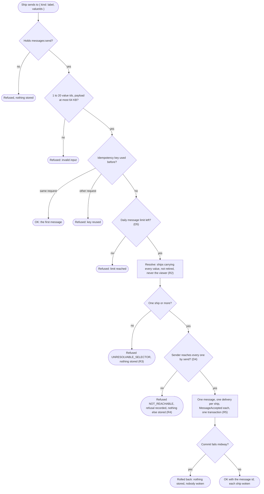
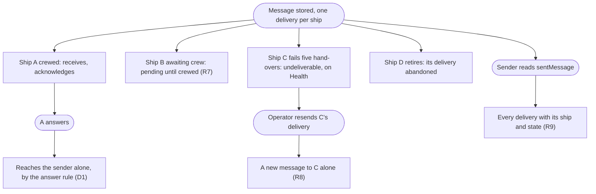
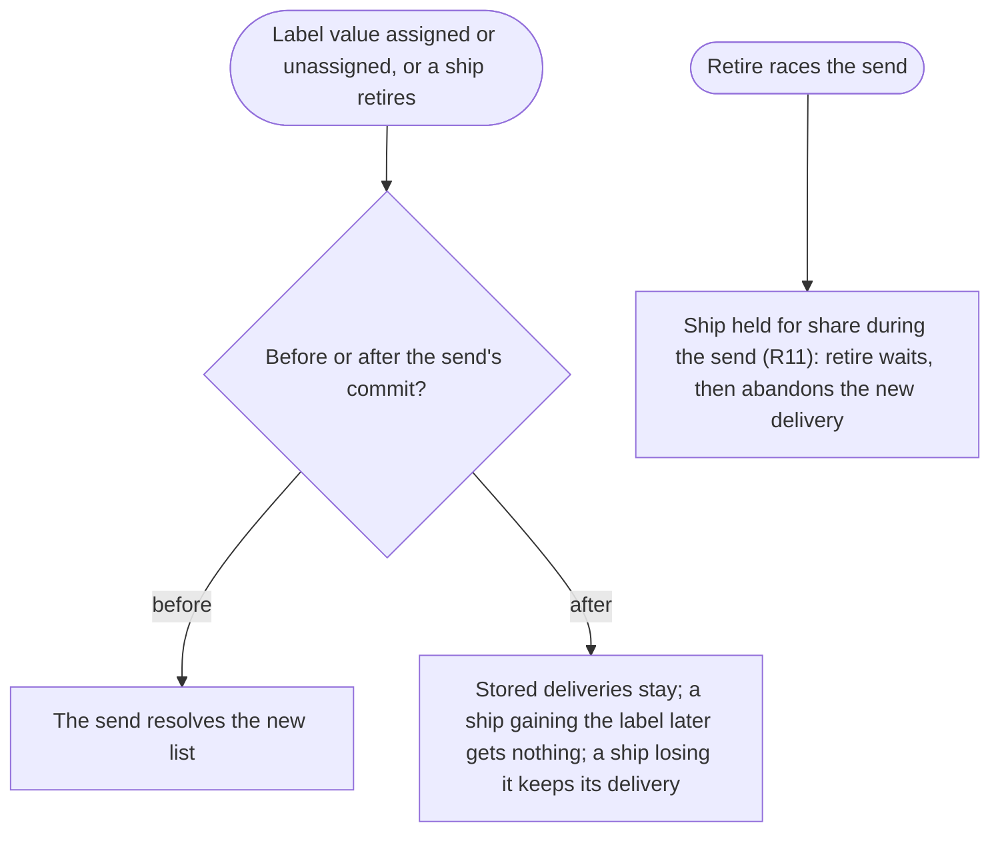

# Selector: one message to a set of ships

Design for [#976](https://github.com/ThomasHendrickx/aeolus-fleet/issues/976), Aeolus 0.32.0. Docs only. Purpose, lessons, Thomas's decisions, the detail, the flows, the gaps and the slices.

## 1. Purpose (agreed by Thomas)

A ship sends one message to a set of ships, named by their labels, and each ship of the set gets its own delivery under the delivery promise. Today a ship reaches one ship (`ship`), one claiming ship of a type (`type`), or the participants of a meeting (`meeting`). Telling a set of ships the same thing means one send per ship, and the sender must first find out who is in the set.

For whom: a ship that coordinates others. A chief of staff telling every head the plan for the day; an orchestrator telling every ship labelled `team=frontend` that main is red; a person ship telling the ships it owns to stop. No conversation follows: each recipient acknowledges and, if it answers, answers the sender alone.

The outcomes:
1. One send, one message, one delivery per ship of the set, stored in one transaction; OK only once every delivery is stored.
2. Each delivery has its own state: one ship's pending, undeliverable or stuck delivery never touches another's.
3. The set is resolved at send, from labels the sender can see; who received it is readable afterwards.
4. Who may send to a set, and to which ships, is scope and reach, visible like every other rule.

Not the purpose: a conversation where everyone hears every answer (that is a meeting, and the room next); a type's one claimed delivery; reading payloads; sending across fleets.

## 2. Lessons to check against

| # | Lesson | Source |
| --- | --- | --- |
| L1 | `group` is taken: pagasae's group of accounts, a value of the label `group` in a fleet. Rejected there: "groups in core; a selector by group" | 0052; #976 body |
| L2 | Thomas on #976: "Maybe call by label?" Labels are "an owned vocabulary for selecting ships" | #976 (24 Oct); #102 purpose (6 Oct) |
| L3 | A label selection is exact and AND, by value ids; an unknown id selects no ship; richer selectors (in, not, exists) rejected "before anyone needs them" | 0031 |
| L4 | Meetings already resolve a label selection into a list of ships at invite, and refuse the whole open when the owner does not reach one invitee | 0061; meetings design M5, M6 |
| L5 | One message to many deliveries in one transaction exists: a contribution, with rollback tests on a fan-out failing midway | 0061; Meetings S1 (#1186), `meetings.integration.test.ts` |
| L6 | A type is one claimed delivery, never a fan-out; with network rules, only the type's ships the sender reaches may claim it, and none reachable refuses the send | 0034; 0061 rejected list |
| L7 | Reach is checked at send; a refusal stores nothing and says only "No rule matches" (Thomas: "it works or doesnt"); a stored message is delivered whatever the rules become | 0034 |
| L8 | An unresolvable selector is rejected; a contribution whose other participants all retired is refused `UNRESOLVABLE_SELECTOR` | blueprint, Send; #1186 review |
| L9 | Everyone reading everything costs the square; floods come from many recipients answering | meetings design L1, L2; #1168 |
| L10 | A label owner spamming labels was closed by limiting who assigns (`labels:assign` on its own and commissioned ships) and an event per assignment | #600, #918 |
| L11 | The blueprint defers "Group and fleet-wide addressing (n-to-n)", hook "Selector with a kind, one delivery row per recipient"; its Selector row says "`group` and `fleet` later" | blueprint, Deferred on purpose and Messages |
| L12 | Type is metadata that can become a label; rules never select by type | #412; 0034 |
| L13 | No hidden behaviour, scope says what and reach says where, no policy of Aeolus's own, pre-1.0 with no compatibility work | blueprint Principles; 0013, 0016, 0034, 0046 |

| L14 | A contribution's undeliverable delivery is resent to its participant alone, as a message of its own | `resend-delivery.ts` |
| L15 | Texts are for people, ids for machines: a send selects by value ids; `fleet.findLabelValue` (`fleet:read`) turns a key and value into ids; selecting by texts is rejected | 0031 |
| L16 | `sentMessage` answers one delivery: a sender reads where its message stands without `fleet:read` | `read-sent-message.ts`; interop 3.5 |
| L17 | A schedule stores a ship or type selector and is checked as a send at each send time | scheduled messages design S3, S5 |

## 3. Decisions (Thomas, 25 Oct, on #1221)

| # | Rule |
| --- | --- |
| D1 | **A one-way send to a set** (Q1). One message, one delivery per ship of the set; each recipient answers the sender alone, by the answer rule, as to any send |
| D2 | **The set is a label selection, selector kind `label`** (Q2). Value ids, exact and AND, as meeting invites take (L3, L4). The name is the label value; `group` stays pagasae's (L1) |
| D3 | **No whole-fleet send** (Q3). An empty selection is refused; a fleet that wants every ship labels them. The blueprint drops `group` and `fleet` from the later kinds |
| D4 | **Reach to every ship, or nothing** (Q4). Thomas: "It resolved to a list of ships and then sends." One ship of the list out of the sender's send reach refuses the whole send, nothing stored, the refusal recorded as any other (L7) |
| D5 | **`messages:send` is enough** (Q5). No scope of its own; the daily message limit counts the message once |

## 4. Detail

Each rule follows from a decision above or from a rule the docs already hold; none is new policy.

| # | Rule | From |
| --- | --- | --- |
| R1 | The selector is `{ kind: 'label', valueIds: [lbv_…] }`, one to as many ids as a ship can carry (20), each once. Ids only; a sender learns them from its task or through `fleet.findLabelValue` | D2, L15 |
| R2 | Resolved at send, in the send's unit of work, into the ships that carry every value and are not retired, awaiting crew or crewed. The viewer receives nothing and is never in the list | blueprint Send; 0022 |
| R3 | No ship in the list (an unknown id, a value nobody carries): refused `UNRESOLVABLE_SELECTOR`, nothing stored | D3, L8 |
| R4 | Reach checked by send from the sender to each ship of the list, as one send checks one ship; any refusal refuses the whole send `NOT_REACHABLE` and records it | D4, L7 |
| R5 | One message keeping its selector as sent, one pending delivery per ship of the list, `MessageAccepted` per delivery, all in one transaction; OK only after commit; then each ship is woken | D1, outcome 1 |
| R6 | Everything else is a send's: payload at most 64 KB, content type, idempotency key over the whole request (a repeat answers the first message, whoever carries the label now), `inReplyTo`, force with `messages:force` | blueprint Send |
| R7 | Each delivery lives on its own: pending while its ship awaits crew, undeliverable after five hand-overs, abandoned when its ship retires, the others untouched | outcome 2, 0040 |
| R8 | A resend of one delivery goes to its ship alone, as a message of its own, as a contribution's does | L14 |
| R9 | `sentMessage` answers every delivery of the message, each with its ship and state; one delivery for a ship or type send, as today | outcome 3, L16 |
| R10 | Wherever a reader sees a message's recipient, a label message shows its selection as key and value texts, then each delivery with its ship | outcome 3, L15 |
| R11 | Locks: the sender's key, then the ships of the list in id order, held for share as a send to one ship holds it, so a retire and a send never pass each other | `resolve-selector.ts` |

## 5. Flows

### Send to a label

### Each delivery on its own

### The list changes around a send

## 6. Gaps in today's fleet

| Today | Gap |
| --- | --- |
| Selector `ship`, `type` or `meeting` (common `selectorSchema`) | Kind `label` with value ids |
| `resolveSelector` answers one ship or a type; meeting invites resolve a label selection | Resolving a label selection for a send, holding each ship |
| Fan-out stored only for a contribution | A send storing one delivery per ship of the list, with rollback and concurrency tests |
| `sentMessage` answers one delivery | Every delivery with its ship |
| Console's message read and sheet show one recipient (#1186 review: the first delivery only) | Every delivery of a label message, its ship and state; the selection as label texts |
| Blueprint Selector row: "`group` and `fleet` later"; deferred row for n-to-n | `label` in the row; the deferred row gone |

## 7. Slices for 0.32.0

One PR each, in order.

| # | Slice | Builds | Done when |
| --- | --- | --- | --- |
| S1 | Core: send to a label | Decision record and blueprint (Selector row, deferred row); `label` in common's selector; resolving the list with locks (R2, R11); refusals R3, R4; one message, one delivery per ship (R5); resend to one ship (R8); MCP and REST through the same procedure | Three ships labelled `team=a`, one not: a send reaches the three, each acknowledges on its own; one unreachable ship refuses the send and stores nothing; a failure at the second delivery rolls back all; a retire racing the send abandons its delivery; a repeat key answers the first message after the label moved |
| S2 | Core and console: who received it | `sentMessage` answers every delivery (R9); the console's message read and sheet list every delivery with its ship and state, the selection as label texts (R10) | A sender reads three deliveries with three states; the console's sheet of a label message shows every ship, on desktop and phone |

## 8. Open for Thomas

| # | Question | Options | Pick |
| --- | --- | --- | --- |
| O1 | May a schedule send to a label? Scheduled messages (0.32.0) store a ship or type selector (L17) | 1. Yes: the schedule stores the selection and each send time resolves and checks it as a send (D4); one line in S3 of that design. 2. Not now: ship or type only | **1.** A schedule is a send by its ship at its time; "tell the team every morning" is the first use that combines them |
| O2 | Is the sender in its own list when it carries the label? | 1. Never: every other ship, as a contribution goes to every other participant. 2. Yes, it gets a delivery as any carrier | **1.** A ship telling its team does not need its own message back |
