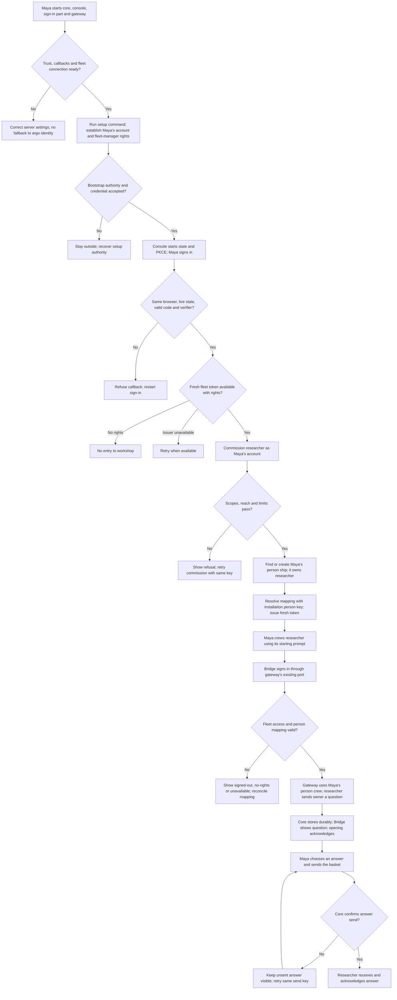
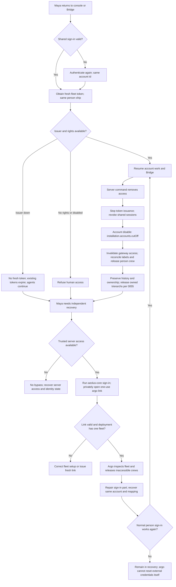

# Self-hosted sign-in: a person and their first agent

Design for [#1806](https://github.com/ThomasHendrickx/aeolus-fleet/issues/1806) and [gateway #355](https://github.com/ThomasHendrickx/aeolus-fleet-gateway/issues/355). Thomas approved the purpose and the five choices in the [source discussion](https://github.com/ThomasHendrickx/aeolus-fleet/issues/1806#issuecomment-6880153617). Those choices and the six decisions below are settled; the flow describes their consequences. Design only, with no implementation slices.

## 1. Purpose (agreed)

A person running their own fleet can establish a named human identity, commission an agent ship owned by that person's ship, and receive and answer its work through the gateway. The journey runs on the self-hoster's services. Additional people can get distinct identities and rights later. Keep argo available for recovery.

The outcome is a usable self-hosted fleet, from an empty installation to a human answering their agent. The first supported journey is one named person, commission and a Bridge answer. Other channels and organisation management are outside this acceptance set.

## 2. Lessons to check against

1. **One journey, two gaps.** An Owner field fix alone leaves the gateway unusable. Core #1806 and gateway #355 need a shared human entry and person-ship lifecycle; other channels still need their own configuration.
2. **Local recovery exists.** `packages/core/src/adapters/cli/sign-in.ts` issues a one-use argo console link. Optional argo email/password and `console.session` do not make that operator session a person's account. Argo has one console sign-in at a time (0012).
3. **Ownership is deliberate.** An agent commissioned by an account belongs to its person ship; an agent commissioned in argo's console must name an active person ship (0045, 0057). Ordinary questions reach that person, never argo.
4. **Core already accepts account actors.** Core keeps no accounts or credentials for people. It verifies signed fleet-specific account tokens and applies scopes and reach. `commission-ship.ts` creates a missing person ship at the first account commission under the installation's idempotency key (0052, 0057).
5. **Installation calls are machinery.** `installation.ts` supplies provisioning, tickets, sign-out and cut-off, but no people directory or browser login. It is off without an installation token. Enabling it for a trusted sign-in server changes self-host setup; its token never belongs in a browser (0020).
6. **Gateway already has a boundary.** Its `SharedSignIn` port expects code/PKCE, shared browser sign-in, a fleet account token, account/person mapping, app discovery and revocation. An arbitrary identity-provider token does not meet that contract.
7. **Preserve failure behavior.** Core remains the fleet API and admin console, gateway the messaging surface (0043). Human rights are account rights, not the person ship's management scopes. Expiry, cut-off, issuer failure and independent argo recovery must still work (0052, 0057, 0058). A successful Bridge sign-in proves neither email delivery nor push, Slack or chat integration.

Decision numbers refer to the [decision index](../decisions/README.md). Code contracts below are the authority for wire details.

## 3. Decisions answered by Thomas

- Q1, option 2: complete the single-person journey from setup to ownership and gateway replies, preserving a path to distinct additional people.
- Q2, option 3: run a small separate sign-in part supplying the account-token and gateway sign-in contracts through installation APIs.
- Q3, option 1: support one named person first, keeping a stable account and person-ship identity.
- Q4, option 1: commission plus Bridge receive/reply proves the first journey; other channels follow separately.
- Q5, option 1: preserve the identity and owner boundaries and revise self-host setup accordingly.
- Trusted server access authorises a setup command that creates the first named account and binds it to the existing fleet; persist its id before provisioning and resume it on retry.
- The first person signs in with a local password set through private input and reset through server access; the sign-in service stores a password hash and controls failed attempts.
- The first person is fleet manager, explicitly granted every offered fleet scope with journey reach; argo permission remains false and the person ship retains its existing messaging scopes.
- A server command removes access, records cleanup durably and notifies core and gateway; retry until acknowledged, report pending work, and bound gateway access by the account token expiry plus its existing 30-second allowance.
- A server recovery command restores the existing account, credential and requested rights, revokes old shared sign-ins, and relies on protected backups and a documented restore procedure.
- Run one small separate sign-in service from its own repository and image, configured by hand on HTTPS sibling addresses under one trusted installation domain, with exact callbacks and a shared Secure, HttpOnly parent-domain cookie.

## 4. One person's full journey

Maya runs one fleet, `workshop`, and commissions the agent `researcher`. Her display name is Maya; her opaque account id is stable and is not her email. Her person ship uses the existing `person-<first 12 account-id characters>` name. It owns itself and `researcher`. Reopening a browser or changing credentials does not create another account or ship.

### 4.1 First setup

Maya starts core and its console, the separate sign-in service from its runnable image, and gateway, each with durable state and the public addresses needed for browser redirects. She configures the service and explicit console and gateway client registrations by hand. Core must be healthy and the gateway connected to the fleet before Bridge can receive anything. The existing self-host setup supplies the fleet and argo; creating another fleet is not required to add sign-in.

She configures an installation token on core and the sign-in server, core's `ACCOUNT_TOKEN_ISSUER` and public keys, and the console and gateway's sign-in client settings. Redirect destinations and cookie deployment must fit the contracts in section 5. Private signing keys and the installation token stay on servers. Core receives only public signing keys and fleet claims.

Maya runs the setup command on the trusted server to establish her named account, set a local password through private input and bind the account to `workshop`. The command persists her account id before provisioning and resumes it on retry. A public browser arriving first cannot claim the installation. The command grants her fleet-manager rights, including every offered fleet scope and reach for the journey, while leaving argo permission false and giving her person ship its existing messaging scopes. Reconcile the grant when offered scopes change.

The sign-in part keeps the account-to-fleet and account-to-person mapping. Where messaging rights already require a person ship, it commissions one through `fleet.commission` as the installation, using `person-<account id>` as the idempotency key. Otherwise core creates it on her first account commission. Both routes converge on that same installation commission key. A failed mapping update can retry that key; it must not create a second person ship. Rights and labels follow 0052.

An invalid installation token, inaccessible issuer keys, bad callback address or a gateway not connected to the fleet stops the relevant step with a configuration failure. It does not silently admit Maya as argo or claim Bridge is ready.

### 4.2 First sign-in and commission

Maya opens the console's normal person sign-in. The console redirects to the separate sign-in part with state, PKCE and its registered callback. Maya authenticates there with her local password. The code returns to the initiating browser and is redeemed server to server. The console obtains a fresh account token for `workshop`, presents it to core and uses the account-token cookie for subsequent calls. This is an account session, with no argo lease.

A refused credential leaves her signed out. Expired state, a replayed or refused code, an incorrect verifier or a different browser cannot complete the sign-in; she starts again. No fleet rights means no entry to `workshop`; an unavailable sign-in server means retry later, not a wrong-password message.

Maya commissions `researcher` as her account through `fleet.commission`. Core checks her scopes, reach and limits. It finds or creates her person ship and makes that ship the owner of `researcher` in the commission transaction. The sign-in part resolves and records that same person ship for subsequent tokens. It must converge on core's existing key even if the first commission response is lost. A retry of the agent commission uses its original idempotency key, so it cannot produce two agents. A refused commission changes no ownership and must show the refusal, including a limit or missing scope.

Maya uses the returned starting prompt to crew `researcher` in her chosen harness. No agent is running merely because its commission succeeded. A claimed or lost starting secret follows the existing starting-prompt/release route, not a new account or agent commission.

### 4.3 Answering in Bridge

Maya opens Bridge for `workshop`. Gateway starts its existing browser-bound sign-in round trip. An existing shared sign-in can complete it without another credential prompt; otherwise Maya signs in. Gateway exchanges the shared sign-in server to server for the fleet token, including her stable person ship id. It checks her rights and uses its existing person-ship crew path. Maya holds no crew token in the browser. A missing mapping is resolved through the lifecycle in section 4.1, not a guessed ship name.

`researcher` sends a question to its owner, Maya's person ship. Core durably stores it before answering OK. Gateway receives it as that ship and Bridge shows it. Maya opens the question; the existing acknowledgement rule applies on opening, independently of whether she has answered yet. She chooses an option, puts it in Bridge's basket and sends the basket. Gateway sends the answer as her person ship, replying to the question under the existing question/answer contract. `researcher` receives and acknowledges the answer and continues.

A sign-in outage or gateway outage does not lose a pending delivery in core. If opening already acknowledged it, gateway's kept Bridge record preserves the work awaiting an answer. A failed answer send stays visibly unsent and can retry under the same send key; no successful send is claimed until core confirms durable storage. Existing Bridge rules handle a question replaced or withdrawn before Maya answers; sign-in adds no alternate answer path.

### 4.4 Returning sign-in

Maya closes her browser and comes back. With a valid shared sign-in, each app obtains a fresh fleet token and opens her existing account and person ship. With no valid shared sign-in, she authenticates again. Neither route commissions another person ship, changes ownership or claims argo's lease.

Account tokens live 10 minutes and are refreshed before expiry. Core validates every call. No-rights, signed-out and unavailable remain distinct. With an issuer outage, existing valid tokens may continue until they expire; no new human access token can be obtained. Agent messaging continues. A gateway-held person crew is not itself evidence that a browser is authorised to use it.

Signing out revokes the shared sign-in across apps. `installation.accounts.signOut` ends account-linked argo console sessions; it does not cut off already issued account tokens. Token expiry and access removal are distinct from sign-out.

### 4.5 Removing access

A trusted server command disables Maya's account or removes its fleet rights, recording cleanup work durably. The sign-in part stops issuing it usable fleet tokens and revokes its shared sessions. For disabling the account, it calls `installation.accounts.cutOff`; core refuses its previously issued tokens. The existing cut-off is installation-wide, not a per-fleet membership operation.

The installation reconciles the person ship's labels and releases it when neither messaging nor owning rights remain, as 0052 requires. The gateway must invalidate access through the disabled account, including use of any person crew it holds; cutting off an account token alone does not revoke a ship crew token. It must also perform the existing owned-ship cleanup required for account disabling. Following 0055, disabling also ends her account-linked argo sessions, removes any argo permission and releases every trierarch app ship her person ship owns. Releasing a trierarch releases every lease it crewed; other owned agents are not all released indiscriminately. Unreachable installations leave durable cleanup work to retry until it lands. An authenticated gateway invalidation call clears cached authorisation and immediately rejects the account when received. Removal remains pending until all cleanup targets acknowledge it.

The person ship, its history and ownership are retained, never retired and recommissioned as a rights change. Questions still reach it until ownership is moved through a later feature or the agent is retired; access removal does not reroute them to argo. If notification is lost, gateway human access expires no later than the current account token, including the existing 30-second allowance, without successful renewal. A retained person crew cannot authorise browser access by itself.

### 4.6 Recovery through argo

If Maya loses her credential, disables her only account or the sign-in part is unavailable, she uses trusted server access to run `aeolus-core sign-in` and opens its fresh one-use link privately. The command handles one fleet and refuses when there is none or more than one. Argo's independent sign-in remains usable without the account issuer. An expired or already used link needs a new link; argo takeover follows its existing single-sign-in rules.

As argo she can inspect the fleet and release inaccessible crews through the existing console. She repairs deployment settings or restores the sign-in part, then uses the server recovery command to reset her credential on the existing account, explicitly re-enable it or restore rights when requested, and revoke old shared sign-ins. She keeps and tests protected backups to restore the same account id, rights and person-ship mapping. Argo's console cannot reset a credential stored in another part merely by signing in. Without trusted server access or recoverable identity state, this design promises no bypass.

Maya signs in normally again, sees the same person ship and history and resumes Bridge. Argo is not the identity for her next ordinary agent or answer. Agent execution does not resume merely because human access was restored; released agents need crews again.

## 5. Responsibilities and existing contracts

These are required boundaries, not a claim that the separate part or its adapters exist today. Public code is sufficient to name the contracts; no other deployment's internals are needed.

| Part | Responsibility and contract |
| --- | --- |
| Separate sign-in part | Own durable human accounts, credentials, shared browser sessions, the one local organisation value required by tokens, fleet rights and stable account/person mapping. Authenticate people, issue/revoke shared sign-ins, sign fleet account tokens, publish public keys and reconcile person lifecycle through core. Its server commands handle setup, removal and recovery. Back up account ids, organisation value, fleet rights, person mappings, provisioning and cleanup retry records, deployment configuration and signing material in protected storage; restore them with the fleet backup and reconcile the existing person commission key. |
| Core token boundary | `packages/common/src/schemas/account-token.ts`: `accountTokenClaimsSchema`, `AccountTokenClaims`, `ACCOUNT_TOKEN_HEADER` (`aeolus-account-token`) and `FLEET_HEADER` (`aeolus-fleet`). JWT claims are `iss`, fleet `aud`, opaque `sub`, nonempty `org`, space-separated `scope`, `group`, optional `person_ship` and `argo`, and `iat`/`exp`. Group values must resolve to the fleet's labels; absent argo permission means false. An organisation field does not require building organisation administration. |
| Core signature and authorisation | `AccountTokenSignatures.verify` in `packages/core/src/domain/identity/ports.ts`, implemented by `createAccountTokenSignatures` in `adapters/crypto/account-token-signatures.ts`: exact configured issuer, `typ: at+jwt`, `kid`, EdDSA/Ed25519 or ES256/P-256, public JWKS. Core checks fleet, expiry, cut-off, scopes and reach. Preserve the 10-minute life, 30-second allowance and at-most-once-a-minute key refresh. Publish a replacement key before using it and retain the old one through its last token. |
| Core installation API | `packages/core/src/adapters/trpc/installation.ts`: `installation.fleets.create/get/list` for provisioning or resolving the fleet; `installation.accounts.cutOff` and `.signOut` for distinct lifecycle jobs; `installation.operators.issueSignInTicket` for one-use argo/viewer tickets (2 minutes), not normal person sign-in. `installationProcedure` requires the configured installation token, otherwise the procedures are absent. Never send that token to a browser. |
| Core fleet API and person lifecycle | `fleet.commission`, starting-prompt and release operations use the same actor/scopes/reach checks. `CommissionShip`, `CommissionShipInput` and `personShipKey` in `packages/core/src/domain/registry/commission-ship.ts` converge on the installation key `person-<account id>`. Core owns ships, labels, leases, events and durable messages, not account records. A person ship's messaging scopes are distinct from an account's management rights. |
| Console | Existing account sign-in in `packages/console/lib/account-sign-in.ts` provides state/PKCE, safe return paths, server-side token presentation and a core account-token cookie. Its issuer adapter/configuration must reach the separate part. `console.session` validates argo/operator sessions; it does not turn them into accounts. Preserve the independent CLI argo entry. |
| Gateway sign-in port | Public gateway `src/core/account-sign-in/ports.ts`: `SharedSignIn.authorizeUrl({state, codeChallenge})`, `.redeemCode({code, verifier})`, `.accountToken({signIn, fleetId})`, `.apps(signIn)` and `.revoke(signIn)`. `SharedAccountToken` returns token, end time, account id, nullable person ship, scopes and argo permission. `OpenableApps` supplies account display information, app URLs and fleet app choices even with one account and fleet. Refusals distinguish `signedOut`, `noRights`, `unavailable`; revoke can be unavailable. An adapter must meet all of these, not merely accept a password or validate an identity JWT. |
| Gateway browser round trip | `AccountSignInSeals`, `AccountSignInUnderWay` and `createCompleteAccountSignIn` in `src/core/account-sign-in/complete-account-sign-in.ts` bind a sealed state to verifier, browser secret, local return path and a 10-minute deadline. Unknown/expired state and another browser refuse before code redemption. `SHARED_SIGN_IN_COOKIE` is `aeolus_account_session`; the existing flow assumes a domain shared by apps. Cookie scope, HTTPS origins and registered redirects are deployment requirements, using HTTPS sibling addresses under one trusted installation domain and exact registered callbacks. |
| Gateway messaging and Bridge | Map the authenticated account to the person ship, keep its crew credential on the server, enforce current access at every human entry and apply revocation. Core carries deliveries; gateway keeps Bridge's records, question state and basket behavior. No new owner-routing or delivery semantics. |

## 6. Happy and unhappy paths

The paths apply the decisions above to setup, access removal and recovery.

