# Self-hosting operations: run, privileges, back up and restore

Design for [#1791](https://github.com/ThomasHendrickx/aeolus-fleet/issues/1791), [#1792](https://github.com/ThomasHendrickx/aeolus-fleet/issues/1792), [#1793](https://github.com/ThomasHendrickx/aeolus-fleet/issues/1793), [#1794](https://github.com/ThomasHendrickx/aeolus-fleet/issues/1794) and [aeolus-fleet-gateway#350](https://github.com/ThomasHendrickx/aeolus-fleet-gateway/issues/350): the five gaps [Run the server](../guide/run-the-server.md#not-covered-yet) lists as not covered. Docs only, for Thomas to approve; nothing is built yet. Purpose first (section 1), the lessons to check against (section 2), then per gap what is true on main today, the options and a pick (sections 3 to 7), the restore flow (section 8), the questions (section 9) and the slices once approved (section 10). Every pick is a proposal until Thomas answers its question.

## 1. Purpose

A self-hoster keeps their fleet running, upgrades it and gets it back after losing a server, by following one documented way, without guessing and without breaking the delivery promise more than the restore itself must.

For whom: the person who installed a fleet with [Self-host](../guide/self-host.md) and keeps it running; the crews of their ships, whose sessions must find their way back after a restore; and the company of a sealed fleet, whose keys decide whether a restored fleet can read its payloads.

The outcomes:

1. One supported way to run every server part (core, the console, squadrons, the trierarch plugin, the gateway) as services that start with the machine, start again when they stop and start in the right order.
2. The Postgres privileges each part needs, stated exactly, so a self-hoster grants no more.
3. A recommended backup schedule and retention, and a restore whose result is stated: what comes back, what is lost, what each session sees, and the one step that settles it.
4. A sealed fleet restored with what it needs besides the database, so it reads its payloads again.
5. The gateway upgraded, backed up and restored like every other part.

Out of scope: high availability (a standby Postgres, two core processes behind a balancer), Kubernetes, Aeolus's own backup tooling, and anything only the hosted fleet needs (pagasae, the private infra repository). Before 1.0 with zero self-hosting customers (decision [0013](../decisions/0013-breaking-changes-before-1-0.md)), each gap gets the smallest answer that is true and complete, not a product.

## 2. Lessons to check against

Every pick below is checked against these, the blueprint's promises and the decisions they rest on:

| | Lesson | Source |
| --- | --- | --- |
| L1 | **No message is ever lost; no send answers OK before the message is durably stored.** A restore to an earlier moment throws away messages that were stored and answered OK. A restore cannot keep this promise for its own window, so the design must keep that window small, say it plainly, and keep the promise for everything the backup holds. | [Blueprint](../blueprint.md), promise 2; decision [0003](../decisions/0003-postgres-as-broker.md) |
| L2 | **A delivery is handed again until acknowledged; receivers treat the delivery id as an idempotency key.** A delivery acknowledged after the backup comes back pending and is handed again. That is a duplicate the protocol already allows, not a loss. | Blueprint, Delivery; decision [0040](../decisions/0040-delivery-protocol.md) |
| L3 | **The operator is not the fail-safe.** A restored fleet must not need argo to find and release ghost leases one by one before deliveries flow again. | Blueprint, promise 2; decision [0012](../decisions/0012-operator-is-a-ship.md) |
| L4 | **Leases have no heartbeats; a lease ends only by release, retire, deregister or takeover.** A lease that ended after the backup is open again in the restored database, and nothing ends it by itself. | Decision [0010](../decisions/0010-leases-without-heartbeats.md) |
| L5 | **A crew token is stored only as its hash.** A token issued after the backup is unknown to the restored fleet; nothing can bring it back. | Decision [0015](../decisions/0015-ship-identity-per-conversation.md); `leases.crew_token_hash` |
| L6 | **A sealed fleet's payloads are readable only through the company's key; a copy alone reveals nothing.** A backup is such a copy. Restoring it must not need any key Aeolus holds, and Aeolus holds none. | Decision [0068](../decisions/0068-sealed-fleets.md) |
| L7 | **Migrations only go forward; each part migrates at start.** A restore goes back to the version that made the backup or a newer one, never older. | [Run the server](../guide/run-the-server.md#migrations-only-go-forward) |
| L8 | **Each non-core part checks a minimum core version at start and exits when core is older.** Start order matters. | Decision [0049](../decisions/0049-release-trains.md); [compatibility](../compatibility.md) |
| L9 | **Keep designs minimal before 1.0**: no compatibility layers, no paid-product polish for zero customers. | Decision [0013](../decisions/0013-breaking-changes-before-1-0.md) |

## 3. Running the parts as services (#1791)

### True on main today

- No train ships a Dockerfile, a Compose file or a service unit: core, squadrons, the trierarch plugin and the gateway publish to npm only. The trierarch alone installs its own launchd or systemd user service.
- Each part has a start command (`aeolus-core start`, `aeolus-console start`, `aeolus-squadrons start`, `aeolus-trierarch-plugin start`, `aeolus-gateway start`), reads its settings from the environment once at start, binds `127.0.0.1` by default, and stops cleanly on `SIGTERM`.
- Start order: squadrons, the trierarch plugin and the gateway ask core's version first and exit when it is older than their minimum (the gateway's is 0.38.5 today). They start only once core answers.
- One process per database for squadrons: a session advisory lock (`pg_try_advisory_lock(hashtext('aeolus-squadrons'))`) held for its life, so a second start refuses. The trierarch plugin has no such lock, and nothing documents that it runs once. The gateway is built for more than one process on one database (advisory locks per waiter, `SKIP LOCKED`, `NOTIFY` fan-out).
- The gateway's default port is 4200, the trierarch plugin's too: on one machine one of them must be moved.
- The hosted fleet runs exactly this as Docker Compose: one image per release train, each built on the server from the npm packages at pinned versions, the plugins started once core is healthy, Postgres 16 beside them with a role and database per part. Staging walks it before every release.

### Options

| | Option | For | Against |
| --- | --- | --- | --- |
| A | **systemd unit files**, one per part, with an environment file each | A few lines of text; no build; no Docker | Linux only; Node 26 and Postgres installed by hand; start order by `After=` only, so a plugin may start before core answers and exit (it restarts until core is up); a shape nobody runs or walks today |
| B | **One Compose file and one Dockerfile** that builds an image from the published npm packages at the versions the self-hoster names, as the hosted fleet does; Postgres as an optional service | The shape staging walks; health-gated start order (`depends_on: condition: service_healthy`); Linux and macOS; one command up; npm stays the one published artefact, so trusted publishing (decision [0011](../decisions/0011-release-via-trusted-publishing.md)) is untouched | Needs Docker; the image is built on the self-hoster's machine; one file names parts from five trains, each at its own version |
| C | **Published container images** per train on a registry, plus a Compose file | Nothing to build | A second artefact in five release pipelines, its signing and its registry kept; polish for zero customers (L9) |
| D | Kubernetes manifests or a Helm chart | | Far beyond one self-hoster's server (L9) |

### Pick: B

One Compose setup in this repository, under `deploy/compose/` (a `compose.yaml`, a `Dockerfile` and an `.env.example`), and nothing else supported. It:

- builds one image from the npm packages at the versions `.env` names, one variable per train (`AEOLUS_CORE_VERSION`, `AEOLUS_SQUADRONS_VERSION`, `AEOLUS_TRIERARCH_PLUGIN_VERSION`, `AEOLUS_GATEWAY_VERSION`);
- runs core and the console always, and squadrons, the trierarch plugin and the gateway each in a Compose profile of its own, so a self-hoster turns on only the plugins they use;
- starts every plugin only once core's `/health` answers, restarts every part on failure (`restart: unless-stopped`), stops each with `SIGTERM` and a grace period;
- runs one process of squadrons and of the trierarch plugin (no replicas);
- publishes no port but on `127.0.0.1`: TLS and the public address stay the self-hoster's reverse proxy, as [Self-host](../guide/self-host.md) already says;
- has a Postgres 16 service in a profile of its own, with an init script that makes each part's role and database as section 4 says; a self-hoster with a managed Postgres leaves that profile off and points each `DATABASE_URL` at it.

The guide's section 1 then names this setup as the one supported way, and says that any other service manager works if it does what the four bullets there already say.

## 4. Postgres privileges per part (#1792)

### True on main today

| Part | Its migrations create | At runtime it uses | Needs beyond owning its database |
| --- | --- | --- | --- |
| Core | Tables, indexes, enum types, plpgsql functions and triggers (`events_append_only`, `events_no_truncate`, `ships_scopes_are_known`), Prisma's `_prisma_migrations` | `LISTEN`/`NOTIFY` (`aeolus_delivery_pending`, the fleet event and schedule channels) on a connection of its own; transaction advisory locks; `set_config` of its own settings (`aeolus.deleting_fleet`, `aeolus.pruning_fleet`) for the append-only trigger; `SET LOCAL jit` | Nothing. No `CREATE EXTENSION` |
| squadrons | Tables, a temporary function in one migration | A session advisory lock held for the process's life | Nothing |
| Trierarch plugin | Tables | `SET LOCAL work_mem` | Nothing |
| Gateway | Tables, a plpgsql function and trigger (`notify_request_change`) | `LISTEN gateway_changes`; session advisory locks per waiter | Nothing |

- Prisma Migrate (`migrate deploy`) needs no shadow database and holds an advisory lock while it migrates; each part's start migrates.
- From Postgres 15, only the database's owner may create in its `public` schema; plpgsql is installed in every database. So a role that owns its database can migrate every part, and that is all any part needs. Postgres 16 or newer is already required.
- `LISTEN` and session advisory locks need a direct or session connection; a transaction pooler breaks core, squadrons and the gateway. The guide says so for core only.
- squadrons, the trierarch plugin and the gateway keep crew tokens and outside credentials as they are in their databases (the gateway's README and the trierarch plugin's say so). A role that can read another part's database can read them.

### Options

| | Option | For | Against |
| --- | --- | --- | --- |
| A | **One role per part, owning its database, nothing else**: `LOGIN`, no `SUPERUSER`, `CREATEDB`, `CREATEROLE`, `REPLICATION` or `BYPASSRLS` | What every part needs today and what the guide already shows; the hosted fleet runs it; each part's start can migrate | The running part can change its own schema, so a compromised core could drop its own append-only trigger |
| B | **Two roles per part**: an owner that migrates, and a runtime role with data rights only | The running part cannot change its schema | Start can no longer migrate: a second database URL per part, default privileges kept for every new table, a change in all five trains; it protects only against a part already compromised, which can read and change its data anyway (L9) |
| C | One role shared by parts | | One part reads another's crew tokens and outside credentials. Rejected |

### Pick: A

The guide's section 2 states, per part: a role with `LOGIN` that owns its database, no other attribute, no extension, Postgres 16 or newer, a direct or session connection for every part (not only core), one role per part and never shared. The same role takes and restores its database's backups (section 5), so no backup role is needed. The Compose setup's init script makes exactly these.

## 5. Backup schedule, retention and what a restored fleet does (#1793)

### True on main today

The guide says how to `pg_dump` and `pg_restore` each database, and nothing about how often, how long, or what the restored fleet does. Read from the code, a fleet restored to an earlier moment, against what happened after it:

| What happened after the backup | In the restored fleet | Who sees it |
| --- | --- | --- |
| A message was sent and answered OK | Gone, with its deliveries | Nobody is told. Its sender believes it sent; its receiver never gets it. **L1 broken for the window** |
| A delivery was acknowledged | Pending again, handed again | The receiver gets a duplicate, which the protocol allows (L2) |
| A session crewed a ship (a new lease) | No such lease. Its crew token answers `UNKNOWN_CREW_TOKEN`, not `LEASE_ENDED` | The plugin's scripts stop calling the fleet ("refused the crew token"); squadrons and the gateway drop that token and need connecting again. Whether the trierarch crews the ship again is not checked yet |
| A lease ended (release, deregister, takeover) | **Open again**, with a token hash whose holder forgot it; nothing ends it (L4) | The ship shows crewed by a session that is gone. A delivery to a type that was in flight to it stays in flight until argo releases the ship. **L3 broken** |
| A ship was commissioned or retired | Gone, or active again | Plugins and the gateway hold ids of ships core no longer has, or no longer know ships core has |
| A schedule's send times passed | Due again; each is sent if the pass reaches it within its grace (5 minutes by default), else recorded missed | No flood of catch-up sends after a long gap |
| Pruning removed messages and events | Back, and the next hourly pass removes them again | Nobody |
| Events were written | Each fleet's event sequence (`fleets.last_event_seq`) goes back | A follower still holding a position past it (the gateway's argo inbox follower, an open console tab) waits for numbers it already passed, and misses the new events numbered at or below its position |
| A console session or sign-in ticket was issued; argo's password changed | Gone; the old password works again | People sign in again |

The hosted fleet backs up nightly with `pg_dump` of every database, encrypted, kept 14 days, and runs continuous WAL archiving with base backups (point-in-time recovery), the 14 newest kept.

### Options: the schedule and retention

| | Option | What a restore loses | Against |
| --- | --- | --- | --- |
| A | **Nightly `pg_dump` of every database at once, plus one before every upgrade; keep 14 days** | Up to a day of messages | A day is a long window for L1 |
| B | **Continuous WAL archiving (point-in-time recovery)** with nightly base backups, 14 days | Minutes | Needs a tool (WAL-G, pgBackRest) or a managed Postgres that offers it; more for a self-hoster to run |
| C | A standby replica | Nothing for a disk loss | High availability, out of scope (L9) |

### Pick: A as the floor, B where the Postgres offers it

The guide recommends A as the schedule every self-hoster can run (the Compose setup does not run it; a cron line or a timer does), and says to turn on point-in-time recovery wherever the Postgres offers it, since it shrinks what a restore loses from a day to minutes (L1). Retention 14 days, with two notes: a backup keeps what the fleet's own retention (decision [0066](../decisions/0066-retention.md)) already pruned, for as long as the backup is kept; and every backup is as secret as the crew tokens and outside credentials the plugins' databases hold, so it is encrypted and kept off the server.

Two rules come with it:

- **Back up every database at the same moment, and restore every database to the same moment.** Never restore one part alone: core and each plugin hold each other's ids, crew tokens and messages, and a restore of one alone leaves them disagreeing (section 7 has the gateway's case).
- **Back up the settings too.** The databases hold the fleet; each part's environment holds what is not in them: core's `INSTALLATION_TOKEN` and KMS settings, the gateway's `GATEWAY_SECRET` and Web push keys, each plugin's installation token.

### Options: what a restored fleet does

| | Option | For | Against |
| --- | --- | --- | --- |
| A | **Document only**: after a restore, argo releases every crewed ship and reconnects each plugin | No code | argo becomes the fail-safe, ship by ship (L3); a missed ghost lease holds deliveries |
| B | **One core command run once after a restore, before core starts**: it ends every open lease but argo's with a new end reason `restored`, writing `LeaseRevoked` for each, in one transaction per fleet | One step to remember, then no ghost lease: every delivery in flight goes back to pending (L3, L4); every session that still holds a token from before gets `LEASE_ENDED`, which every crew and plugin already handles by forgetting the ship (that the trierarch then crews it again from its crew request is to be confirmed in its repository before slice 4); the timeline says why | Sessions that were fine at the backup moment are cut too, and crew again; a new end reason; a forgotten run leaves today's behaviour |
| C | **Detect a restore by itself**: an installation incarnation every client compares, or Postgres's timeline | No step to forget | Every train changes to compare it; a detection that guesses wrong ends every lease of a healthy fleet; far beyond L9 |

### Pick: B

`npx aeolus-core fleet:restored` (the name is Q8's), against the fleet's `DATABASE_URL`, after `pg_restore` and before `aeolus-core start`. It refuses to run while a core process is connected to the database (the delivery listener's `application_name` shows one). It changes nothing else: messages, deliveries and ships stay as the backup holds them.

What it cannot fix, and the guide says plainly:

- Messages sent after the backup are gone (L1). Point-in-time recovery shrinks that window; nothing removes it.
- A session that crewed after the backup holds a token the fleet never knew (L5): it gets `UNKNOWN_CREW_TOKEN`. For it to crew again by itself, every crew must treat `UNKNOWN_CREW_TOKEN` as `LEASE_ENDED`. The plugin's scripts, squadrons and the gateway already stop using such a token; the trierarch must then crew the ship again from its crew request (Q10).

Two small changes make the rest hold without argo:

- **A follower ahead of the fleet starts again.** `fleet.follow` given a position past the fleet's last event answers the fleet's last position with no events, so the follower goes on from there instead of skipping the new events (Q11). Stopping every part for the restore resets the parts' own followers; this covers an open console tab.
- The guide's restore steps stop every part first and start core before any plugin, so no plugin reconciles against a core that is not yet settled.

## 6. A sealed fleet (#1794)

### True on main today

- A sealed fleet's payloads are sealed with data keys (`data_keys`, `dky_`) that the database holds only wrapped: by the company's key in its own AWS KMS, bound to the fleet's id as the KMS encryption context, and, when the company set one, by its offline recovery key (an age X25519 key whose public half core holds). A check value per data key proves an unwrap gave the right key. Metadata stays readable.
- Core reaches the KMS as the installation's one principal: `KMS_REGION` (and `KMS_ENDPOINT` for another endpoint) in core's environment, with credentials from the AWS SDK's own chain (`AWS_ACCESS_KEY_ID` and `AWS_SECRET_ACCESS_KEY`, or the role the server runs as). Without `KMS_REGION`, core answers every seal and unseal `KEY_UNAVAILABLE`: sends to the fleet are refused storing nothing, receives claim nothing, deliveries wait pending, nothing is lost.
- An unwrapped data key lives in memory only, at most 5 minutes; no key is on the server's disk.
- `fleet.sealing` and Health say whether the key is reachable, why not and since when. `aeolus-core fleet:recover-keys` moves every data key under a new company key with the recovery key, when the company key is lost.

So a backup of a sealed fleet holds its wrapped data keys and its sealed payloads, and nothing that opens them (L6). What a restored sealed fleet needs besides the database lives with the company and in core's environment, never in a file on the server.

| A restored sealed fleet | Reads its payloads when |
| --- | --- |
| On the same installation | The company key still exists, is enabled and still grants the installation's principal for this fleet's id |
| On a new server or another AWS identity | As above, and core's environment names the KMS region and credentials of a principal the company's key policy grants, for this fleet's id |
| From a backup older than a company key change (`fleet.changeCompanyKey`) | The old company key still exists and grants, or the company recovers with the recovery key the backup's data keys are wrapped to |
| From a backup older than a recovery key change | The company still holds that older recovery key's private half, if it needs to recover |
| After the company destroyed its key, with no recovery key | Never. Its backups are shredded with it, as decision 0068 intends; deliveries wait pending |
| From a backup taken before sealing was turned on | It is not sealed: the backup holds plain payloads and a fleet without sealing. The fleet manager turns sealing on again |

### Options

| | Option | For | Against |
| --- | --- | --- | --- |
| A | **Document only**: what to keep, for how long, and how to see a restored fleet reads its payloads (`fleet.sealing`, Health) | Every behaviour above already holds on main; no code | The company must follow the key-keeping rule; Aeolus cannot check it |
| B | A check command that unwraps each data key of every sealed fleet after a restore and says which fail | One answer per fleet before people notice | `fleet.sealing` and Health already say it on the first failed unwrap; a second way to see the same fact (L9) |

### Pick: A

The guide gets a short part under backup and restore for sealed fleets, saying:

- Back up nothing more from the server: no key is on it. Keep core's KMS settings with the other settings.
- The company keeps its company key, and every company key it replaced, enabled and granted for as long as it keeps a backup made before the change; the same for every recovery key's private half. Scheduling a key's deletion shreds the fleet and every backup of it once the KMS's waiting period ends.
- On a new server, the company grants the new principal on its key for this fleet's id before the restored fleet starts, or its deliveries wait pending until it does.
- After the restore, `fleet.sealing` and Health say whether the key is reachable; when the old company key is gone, `aeolus-core fleet:recover-keys` with the recovery key the backup was wrapped to.
- A backup taken before turning sealing on is plain, and restores a fleet that is not sealed.

## 7. The gateway (#350, aeolus-fleet-gateway)

### True on main today (gateway repository)

- `aeolus-gateway start` checks core's version (0.38.5 or later), migrates its own database, starts its web app, reconnects every fleet with its kept crew token and listens; `aeolus-gateway migrate` only migrates. It stops cleanly on `SIGTERM`. Its default port is 4200, the trierarch plugin's too. Its README's minimum core version (0.28.0) is out of date against the code's.
- More than one gateway process may run on one database.
- Its database holds usable secrets as they are: its own crew token and each person ship's and proxy ship's, outside servers' credentials and their OAuth grants (decision [0067](../decisions/0067-outside-oauth-sign-ins.md)), pagasae's tokens, Slack tokens, A2A push tokens. What it issues (A2A bearers, its OAuth clients' secrets and tokens) it keeps only as hashes.
- `GATEWAY_SECRET` is in its environment, not its database. It derives ship aliases, the seals of sign-ins in progress and the idempotency keys of calls in progress. Lost or changed: every alias outside clients use changes, sign-ins in progress fail, and a call in progress may be sent to core twice. The Web push keys are in its environment too.
- Restored to an earlier moment than core: crew tokens issued since are lost; outside refresh tokens rotated since are already used up, so those grants fail until the person signs in again (Slack's configuration tokens rotate every 12 hours). Core restored to an earlier moment than the gateway: the gateway's tokens issued since are unknown, it drops them, and argo connects it again; ids it keeps point at nothing.
- Nothing documents its upgrade or backup. Run the server does not list it.

### Options

| | Option | For | Against |
| --- | --- | --- | --- |
| A | **The gateway in Run the server as one more part**: its row in the parts table, its database in section 2, its place in the upgrade order and the backup set; its README keeps its settings | One page for the whole installation, as for squadrons and the trierarch plugin; the restore rules (same moment, all together) cover it | A page in core's repository describing another train |
| B | A guide page of its own in the gateway's repository | Lives with its code | A self-hoster reads two pages for one upgrade and one restore |

### Pick: A

- **Upgrade order**: core first, then squadrons, the trierarch plugin and the gateway, each after core (each checks core's version). The gateway may run a new process beside the old one, so its upgrade needs no stop.
- **Backup**: its database with every other, at the same moment, and `GATEWAY_SECRET` and its Web push keys with the settings. Keep `GATEWAY_SECRET` for good: changing it is not a rotation but a break.
- **Restore**: with every other database, to the same moment. People whose outside grants rotated since sign in to that server again; a Slack workspace whose tokens rotated since is connected again.
- In the gateway's repository: its default port moves off 4200 (to 4300) so it never clashes with the trierarch plugin, and its README's minimum core version is corrected.

## 8. The restore flow

Happy path down the middle; each unhappy path ends where the guide says what to do.

```mermaid
flowchart TD
    start(["A server is lost, or a bad change must be undone"]) --> stop["Stop every part:<br/>core, console, squadrons,<br/>trierarch plugin, gateway"]
    stop --> pick{"A backup of every database<br/>from the same moment?"}
    pick -->|"no: one part's is missing<br/>or from another moment"| partial["Restore the nearest set taken together.<br/>A part with no backup starts empty<br/>and is connected again by argo"]
    pick -->|yes| settings{"The settings kept too?<br/>INSTALLATION_TOKEN, KMS,<br/>GATEWAY_SECRET, Web push keys"}
    partial --> settings
    settings -->|"no GATEWAY_SECRET"| newsecret["New secret: outside clients'<br/>ship aliases change, they are told anew"]
    settings -->|yes| empty["An empty database per part,<br/>owned by its role"]
    newsecret --> empty
    empty --> restore["pg_restore each backup<br/>into its own database, as its role"]
    restore --> version{"Installed version at least<br/>the one that made the backup?"}
    version -->|no| newer["Install that version or newer:<br/>migrations only go forward"]
    newer --> settle
    version -->|yes| settle["aeolus-core fleet:restored:<br/>every open lease but argo's ends, reason restored;<br/>in-flight deliveries back to pending"]
    settle --> corestart["Start core: it migrates what the backup lacks"]
    corestart --> health{"/health answers?"}
    health -->|no| corelog["Read core's log: settings, database"]
    health -->|yes| plugins["Start squadrons, the trierarch plugin, the gateway"]
    plugins --> reconnect{"Each plugin's kept token<br/>known to core?"}
    reconnect -->|"no: issued after the backup<br/>or ended by fleet:restored"| connect["The plugin drops it;<br/>argo connects it again in the console"]
    reconnect -->|yes| sealed{"A sealed fleet?"}
    connect --> sealed
    sealed -->|no| crews
    sealed -->|yes| key{"fleet.sealing: key reachable?"}
    key -->|yes| crews
    key -->|"no: new server, grant missing"| grant["The company grants the new principal;<br/>deliveries wait pending meanwhile, nothing lost"]
    key -->|"no: company key changed or lost since"| recover["Old key enabled again,<br/>or fleet:recover-keys with the recovery key<br/>the backup's data keys are wrapped to"]
    key -->|"no: key destroyed, no recovery key"| shredded["Payloads unreadable for good;<br/>deliveries wait pending"]
    grant --> crews
    recover --> crews
    crews{"A session's crew token?"}
    crews -->|"from before the backup"| ended["LEASE_ENDED: it forgets the ship;<br/>the trierarch crews it again from its crew request"]
    crews -->|"issued after the backup"| unknown["UNKNOWN_CREW_TOKEN: treated as LEASE_ENDED (Q10);<br/>crewed again the same way"]
    ended --> flow["Pending deliveries handed to the new crews.<br/>Acknowledged since the backup: handed again, a duplicate (L2)"]
    unknown --> flow
    flow --> lost["Messages sent after the backup are gone (L1):<br/>the guide says so; PITR keeps this to minutes"]
    lost --> done(["Check /health, each /api/health, /version"])
```

## 9. Questions for Thomas

1. **Purpose.** Is section 1 the purpose: one documented way to run, privilege, back up and restore every server part, a restore whose result is stated, sealed fleets and the gateway included, high availability out of scope? Pick: yes.
2. **Running the parts (#1791).** One Compose file and one Dockerfile that builds from the npm packages, as the hosted fleet does (B), rather than systemd units (A) or published images (C)? Pick: B, the shape staging already walks, with npm the one artefact.
3. **Where it lives.** One `deploy/compose/` in this repository, naming every train's part with a version variable each, rather than a piece in each train's repository? Pick: here, one file, since one installation runs them together.
4. **Postgres in it.** A Postgres 16 service in its own profile, with an init script making each part's role and database, left off by a self-hoster with a managed Postgres? Pick: yes.
5. **Privileges (#1792).** One role per part that owns its database and holds no other attribute (A), rather than a migrating role and a runtime role per part (B)? Pick: A; B changes all five trains to guard against a part already compromised.
6. **Backup schedule.** Nightly `pg_dump` of every database at the same moment plus one before every upgrade, kept 14 days, with point-in-time recovery recommended wherever the Postgres offers it? Pick: yes.
7. **Restore rule.** Always every database to the same moment, never one part alone? Pick: yes.
8. **A restored fleet (#1793).** A one-time core command after `pg_restore` that ends every open lease but argo's (B), rather than document-only (A) or automatic detection (C)? And its name: `aeolus-core fleet:restored`? Pick: B, with that name.
9. **Its end reason.** A new lease end reason `restored` on `LeaseRevoked`, rather than reusing `released`? Pick: `restored`, so a ship's timeline says why its session lost it.
10. **Unknown crew tokens.** Should every crew, the trierarch first, treat `UNKNOWN_CREW_TOKEN` as `LEASE_ENDED` and crew the ship again from its crew request, so a session that crewed after the backup comes back without argo? It is a trierarch train change (an issue there). Pick: yes.
11. **A follower ahead.** Should `fleet.follow`, given a position past the fleet's last event, answer the fleet's last position with no events, so an open console tab goes on after a restore instead of missing events? Pick: yes, a small core change in the same slice as the command.
12. **Sealed fleets (#1794).** Document only (A): nothing more from the server, the company keeps every company key and recovery key as long as its backups, a new server needs the company's grant, `fleet.sealing` and `fleet:recover-keys` after; no check command (B)? Pick: A.
13. **The gateway (#350).** The gateway as one more part in Run the server (A), not a guide page of its own (B), with its default port moved to 4300 and its README's minimum core version corrected in its repository? Pick: A and both fixes.
14. **The trierarch plugin runs once.** It has no process lock, unlike squadrons. Document "one process per database" for it, and the Compose file runs one, rather than add a lock now? Pick: document; a lock only if two processes are shown to do harm.

## 10. Slices, once approved

Each one PR, thin, in the order below. Only slices 4 and 5 hold code.

1. **Docs: privileges and backups.** Run the server sections 2 and 5: the privileges per part (Q5), the schedule and the rules (Q6, Q7), the settings to keep, what a restored fleet does and loses, the restore steps. Removes those bullets from Not covered yet.
2. **Docs: sealed fleets.** Run the server section 5, its sealed part (Q12). Removes the sealed bullet.
3. **Docs and gateway: the gateway as a part.** Run the server's tables, upgrade order and backup set (Q13); in the gateway's repository its default port and README. Removes the gateway bullet.
4. **Core: `fleet:restored` and the follower ahead** (Q8, Q9, Q11), from approved scenarios, with Testcontainers tests: every open lease but argo's ended with its events in one transaction per fleet; in-flight deliveries pending again; refused while a core process is connected; a follower ahead answered from the fleet's last position. The restore steps in the guide name the command. Q10 filed in the trierarch's repository.
5. **Core: the Compose setup** (Q2, Q3, Q4, Q14): `deploy/compose/`, walked once on a clean machine before it merges; Run the server section 1 names it. Removes the last bullet, and the Not covered yet part with it.
