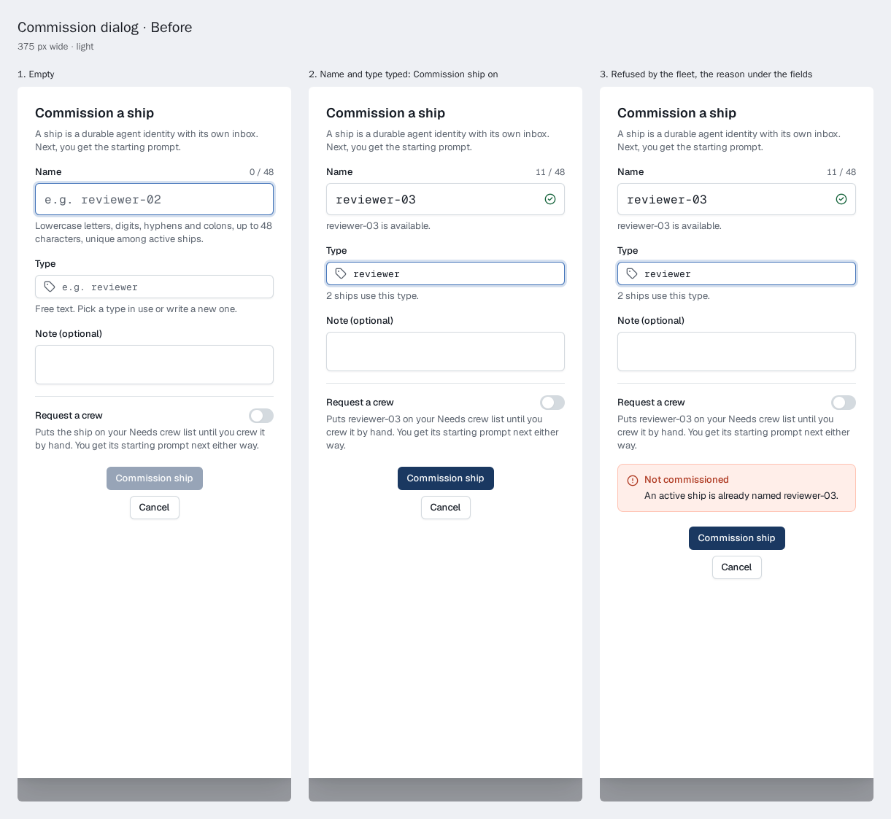
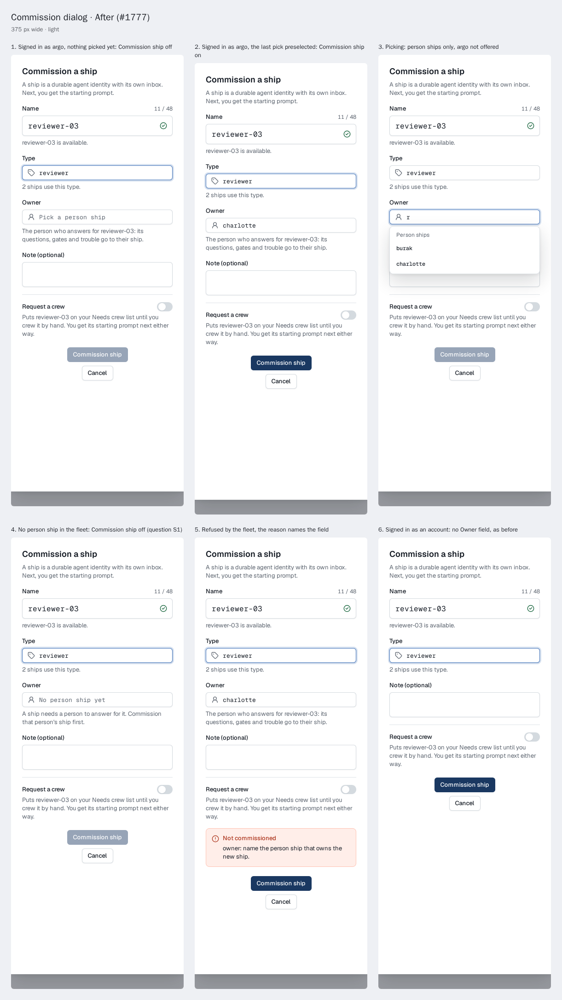
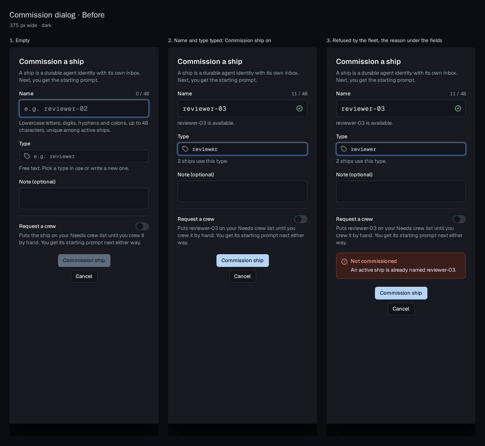
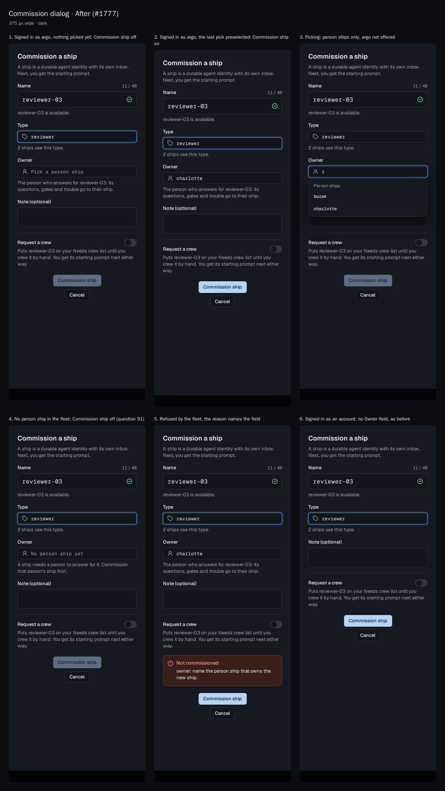
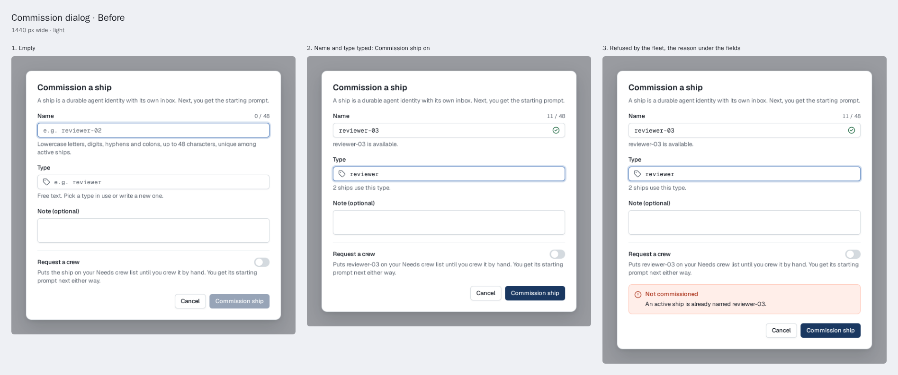
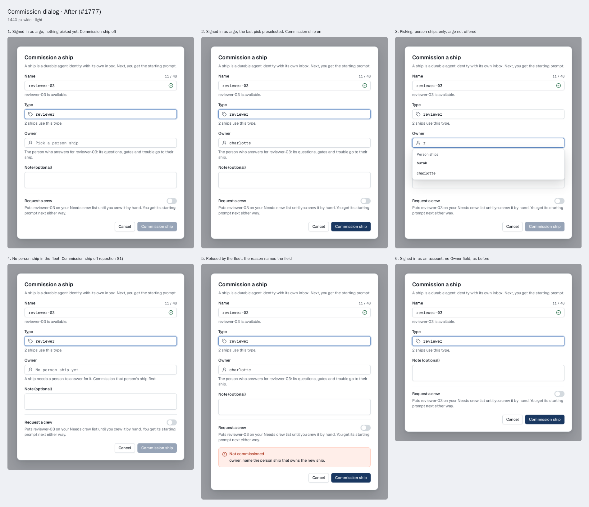
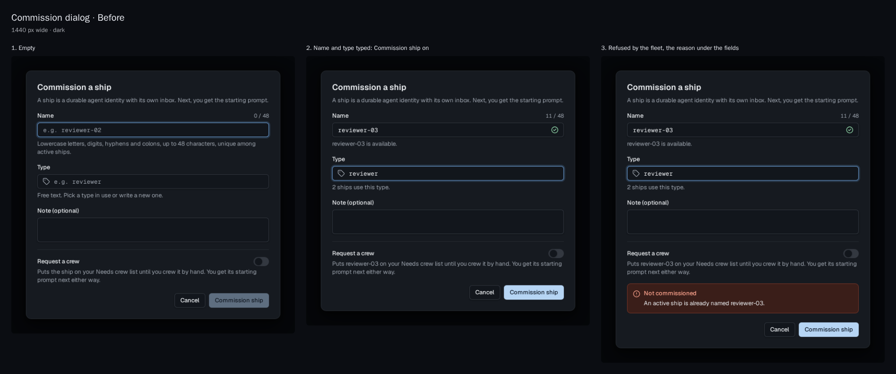
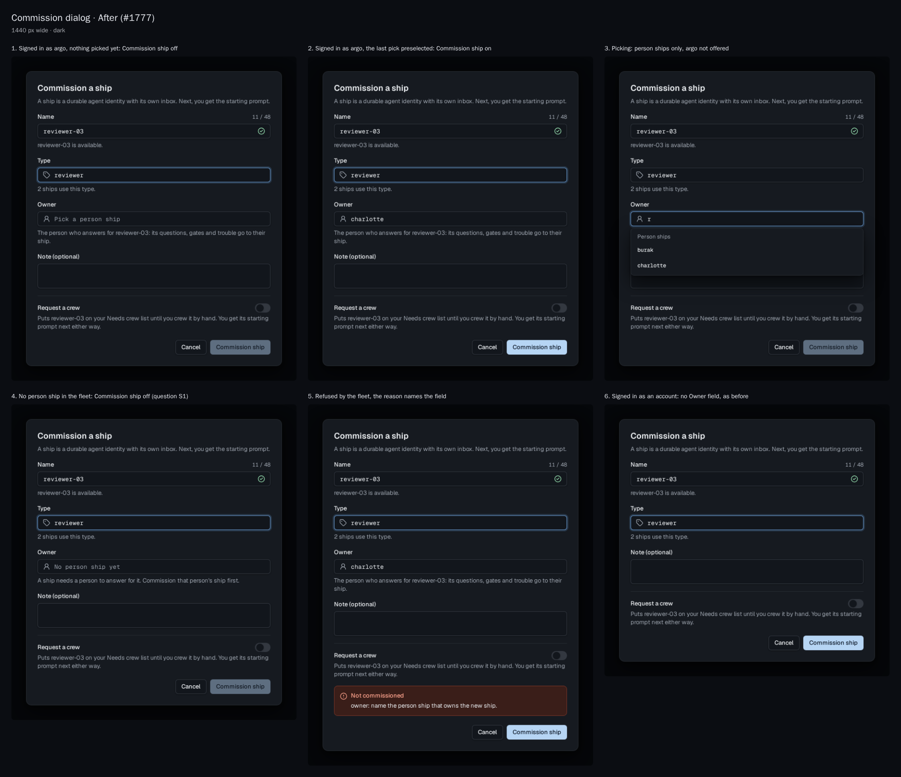

# Commission: the person ship that owns the new ship

For Thomas's approval; nothing is built. [Issue 1777](https://github.com/ThomasHendrickx/aeolus-fleet/issues/1777), slice 1 of aeolus-fleet-trierarch's [permission-asks.md](https://github.com/ThomasHendrickx/aeolus-fleet-trierarch/blob/main/docs/design/permission-asks.md), section "The core change" (O1 a): a commission from the console signed in as argo names its owner, a person ship, so a permission ask reaches a person and not argo (decisions 0045, 0057).

Every image is the console's own `CommissionDialog`, rendered in Storybook: before from `main`, after with an Owner field drawn into it from the console's `Combobox`. Each board holds every state of the dialog at one width and theme. Scope pickers are left out of every state: they do not change.

## What changes

```diff
 CommissionDialog
   Name
   Type
+  Owner              signed in as argo only: a person ship, the last pick preselected
+                     list: the fleet's active person ships; argo is not offered
+                     hint: who answers for the ship; with no person ship, commission one first
+                     nothing picked: Commission ship off
   Note (optional)
   Request a crew
```

Signed in as an account nothing changes: the account's person ship owns the ship (0045). A ship an agent ship commissions keeps its commissioner's owner (O2 a); no screen shows that.

## Boards

### 375 wide, light

| Before | After |
| --- | --- |
|  |  |

### 375 wide, dark

| Before | After |
| --- | --- |
|  |  |

### 1440 wide, light

| Before | After |
| --- | --- |
|  |  |

### 1440 wide, dark

| Before | After |
| --- | --- |
|  |  |

## Questions the issue does not settle

Each with this design's pick, for Thomas.

- **S1. No person ship in the fleet.** (a) The field says so and Commission ship stays off: commission the person's ship first. (b) The dialog falls back to argo as owner. **Pick (a)**: argo is the fail-safe, never a normal path (0057), and the issue offers argo nowhere here.
- **S2. Where the last pick comes from.** (a) The fleet: the owner argo named at its last commission, read with the person ships. (b) The browser's storage. **Pick (a)**: the same preselection on every browser, and the console keeps no browser storage.
- **S3. The squadron dialogs.** Forming a squadron or adding a member from the console asks the squadrons plugin, whose members get the forming ship's owner (0045). (a) Out of this slice: they stay as they are. (b) They name an owner too. **Pick (a)**: the issue names only the commission dialog; (b) would be its own issue.
