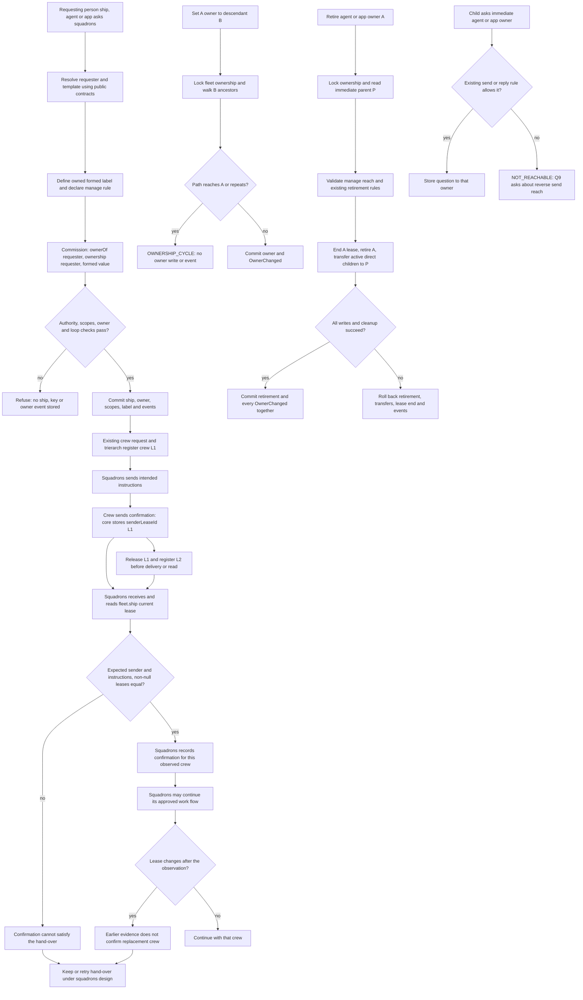

# Core for squadrons starting one ship

## Purpose approved by Thomas

Thomas approved this purpose on 20 November 2026 (purpose card `084724d0`). For a requesting ship, whether a person ship, agent or app, and for squadrons acting on its request, core supplies what is missing to start one named ship from a template: the resulting ship can belong to the ship that asked for it; squadrons can distinguish a confirmation from the current crew from one sent by a crew whose lease ended; and squadrons can manage the ships it forms directly through its owned labels and declared rules.

The job is to make the approved squadrons experience possible through core's public ship contract, with ownership, scopes, reach and leases enforced by core. The commissioner can choose requesting-ship ownership beside the existing choice of the requester's owner. Ownership and authority to grant scopes are separate.

Template interpretation, forming or leading a squadron, template counts, computer assignment, business work and deciding whether that work started stay with their existing parts. This design grants squadrons manage reach only over ships it forms. Account identity and reader reach in #1771 remain separate.

## Lessons to check against

Sources for [#1982](https://github.com/ThomasHendrickx/aeolus-fleet/issues/1982). The baseline rules below identify the contracts the build must update; the approved decisions in the next section govern the result.

1. **Keep the approved owner.** Thomas's words in #1982 are: "The ship who asked for it. The spirit of the option I picked is correct, the wording is not. Reason is that an agent or an app can also do this, not only persons". [Squadrons PR #61](https://github.com/ThomasHendrickx/aeolus-fleet-squadrons/pull/61) records that correction and ordered instruction hand-over; [PR #62](https://github.com/ThomasHendrickx/aeolus-fleet-squadrons/pull/62) keeps the ship owner separate from the appointed person ship that owns the template and decides its count. These approvals do not approve the missing core contracts.
2. **Ownership has consequences beyond commission.** [0045](../../decisions/0045-owners.md) is the baseline to update at build: person ships or argo as owners, copying the asking ship's owner. [0057](../../decisions/0057-actors.md) repeats that boundary. [0034](../../decisions/0034-network-rules.md) gives the owner direct reach for every verb, and [0038](../../decisions/0038-questions.md) sends questions to that owner. General ownership therefore needs explicit answers about reach, questions, retirement and cycles, while retaining a human's responsibility.
3. **Owner and scope authority are separate.** [0046](../../decisions/0046-scope-catalogue.md) checks grants against the asking ship or a recorded commission approval; neither makes an agent or app the owner today. [On-behalf scopes](../on-behalf-scopes/on-behalf-scopes.md) already trusts the authorised commissioner to name the actual requester, not a payload's asserted rights. Changing ownership must not silently change grant authority or widen on-behalf calls to manage.
4. **A confirmation must identify its crew.** [0010](../../decisions/0010-leases-without-heartbeats.md) and [0015](../../decisions/0015-ship-identity-per-conversation.md) end a crew's authority with its lease; a ship survives its crew. In the [#444 incident](https://github.com/ThomasHendrickx/aeolus-fleet/issues/444), a resumed old crew interfered with a replacement crew's valid identity. A confirmation accepted before release can also arrive after replacement. Checking the sender ship alone is insufficient; no secret or crew token may become proof passed to another ship.
5. **Receipt is not taking up instructions.** [0001](../../decisions/0001-ack-on-receipt.md) makes acknowledgement receipt only. In [#1318](https://github.com/ThomasHendrickx/aeolus-fleet/issues/1318), a wake was reported without message content while the lease stayed valid; the cause was unresolved in that report. Neither crewed status nor a delivery acknowledgement proves that the current crew took up the charter. Squadrons owns that confirmation and the order before work, as approved in PR #61.
6. **Manage reach must hold when the fleet has its own rules.** [#872](https://github.com/ThomasHendrickx/aeolus-fleet/issues/872) identified plugins being able to release or retire any ship; its resolution requires manage reach on every target. [0017](https://github.com/ThomasHendrickx/aeolus-fleet-squadrons/blob/main/docs/decisions/0017-squadrons-package.md), [0031](../../decisions/0031-labels.md) and [0037](../../decisions/0037-declared-network-rules.md) already provide owned labels and visible declared rules. PR #61 approves extending that scheme to directly formed ships, restricted to ships squadrons forms. A direct ship is not a squadron member; labels select reach, not membership.
7. **Walk the owner's actual job.** The [#1608 onboarding walk finding](https://github.com/ThomasHendrickx/aeolus-fleet/issues/1608) showed a person could commission a ship but could not get its starting prompt again. Thomas chose the ordinary scope and manage-reach check. A future walk must cover managing the resulting ship after commission and replacement of its crew, rather than stopping at a successful commission. This document reports no completed walk.
8. **Keep public contracts and evidence honest.** [Compatibility](../../compatibility.md) lists squadrons' calls and version requirements; none currently promises the missing ownership or current-crew proof. Core and common must publish the approved contracts before squadrons raises its minimum to their actual release. [0013](../../decisions/0013-breaking-changes-before-1-0.md) requires no compatibility layer. [Squadrons #57](https://github.com/ThomasHendrickx/aeolus-fleet-squadrons/issues/57) requires walking the exact candidate released. The later read design must hold at 3,000 ships and 10 million messages per fleet, targeting p95 below 100 ms, p99 below 500 ms and errors below 1%, without scanning history to find a current crew.

## Decisions approved by Thomas

Purpose and Q1 to Q8 were answered on 20 November 2026, each question on its own card. The selections below are the answers relayed with this task, not quotations of unprovided card text. Thomas's supplied words are quoted verbatim. These decisions settle behaviour; the detailed contracts and slices below await his design approval before implementation.

| Decision | Thomas's answer | Current rule for this design |
| --- | --- | --- |
| Purpose | Approved, card `084724d0` | Core supplies requesting-ship ownership, sending/current lease evidence and ordinary declared manage reach for squadrons' one-ship start. |
| Q1 | Option 1 | An authorised commissioner may choose the requesting ship itself as owner, beside the existing choice of that ship's owner. |
| Q2 | Option 1 | An owner's built-in reach stays direct. Reaching a further descendant requires ordinary rules. |
| Q3 | Option 1 | Questions go to the immediate owner's ship. That ship brings a question needing a human to its own owner. |
| Q4 | Option 2 | When an agent or app owner retires, its active directly owned ships go to the retiring owner's owner, each with `OwnerChanged`, in the retirement transaction. |
| Q5 | Option 1 | Refuse a commission or ownership change that would form a loop. Person ships retain their existing self-ownership. |
| Q6 | Option 1 | Core records the authenticated sending lease on each message and exposes the current lease for squadrons to compare. Core has no confirmation state. |
| Q7 | Option 1 | Current-lease evidence is readable with `fleet:read` within read reach, with no new scope. |
| Q8 | Option 1 | A separate squadrons-owned label selects every ship it forms, beside its squadron label. Direct ships do not become squadron members. |

Thomas on the requesting owner, verbatim ([#1982](https://github.com/ThomasHendrickx/aeolus-fleet/issues/1982)):

> The ship who asked for it. The spirit of the option I picked is correct, the wording is not. Reason is that an agent or an app can also do this, not only persons

Thomas's Q4 note, verbatim:

> Works like an org works, when middle management payer drops, the higher manager still takes the responsibility

Thomas's Q5 note, verbatim:

> Ownership is a tree (or multiple) never looped

## Ownership as current state

An active person ship, agent or app can own a ship; argo remains the fallback owner. Person ships own themselves. Argo and the viewer have no owner. Existing plugin and trierarch commission defaults stay with argo; this design introduces no new owner kind or scope.

Ownership is a forest of responsibility. A person ship's self-reference represents a root, not a traversable edge; argo is a root without an owner. An agent or app never owns itself, and no path through owners returns to an earlier ship. An owner must be active and in the same fleet. Built-in owner reach is one edge only, for each existing verb. Scopes never pass down an ownership edge.

A question names the immediate owner's ship explicitly, using existing `ask`/`step`/`send` contracts. The current built-in owner rule is owner-to-child, not child-to-owner: a question to an agent/app owner can therefore be `NOT_REACHABLE` under restricted fleet rules unless an ordinary rule or reply allowance permits it. Q9 below asks whether to add direct reverse send reach; this design does not assume that approval. Core does not walk to the human or redirect a stored question when the owner changes. Stored messages keep their destinations and delivery guarantees (0034, 0038). The receiving owner escalates human questions through its own owner.

Retiring an agent or app reparents its active direct children to its immediate owner as it stands in that transaction. Grandchildren stay owned by their existing parent. If the parent also retires, either retirement order gives the same surviving ancestor: the second transaction observes the first one's reparenting. Retiring a person ship retains the existing fallback to argo; its self-reference is not used as a replacement owner. Release, a lost crew, account disablement and ownership changes do not themselves retire a ship or reparent children. Account cut-off keeps 0055's releases and token cut-off, without adding recursive management reach or a new transfer process.

The build updates [0045-owners.md](../../decisions/0045-owners.md) and its [index line](../../decisions/README.md) in the same commit: eligible owners, explicit requesting-ship selection, immediate routing/direct reach, parent inheritance on agent/app retirement, and cycle refusal. It also aligns 0057's owner-kind sentence, the blueprint's commission/retire flows and the ship contract. This draft states the approved rules here; it does not claim the baseline ADR or runtime already implements them. Q4 replaces the agent/app-to-argo rule in 0045; Q5 adds the forest invariant.

## Detailed contract for approval

The following field names, storage and slice boundaries are proposed implementation mechanics for the approved decisions. They are not extra approvals. All doors use common schemas and the same core use cases: tRPC `fleet.*`/`ship.*`, REST `/api/v1/fleet/*` and `/api/v1/ship/*`, and MCP's mapped tools. Squadrons reads no core tables.

### Commission and ownership calls

| Call | Input and result | Authority, refusal and retry |
| --- | --- | --- |
| `fleet.commission` | Keep `ownerOf: ShipId` naming the actual requester. Add optional `ownership: 'requester' \| 'requester-owner'`, meaningful only with `ownerOf`. Omitted means `requester-owner`. `requester` makes `ownerOf` itself the owner. Output stays the existing `shipId`, first-use starting prompt and retry shape. | Commissioner still needs `fleet:commission` and, for `ownerOf`, `fleet:on-behalf`. Keep the existing kind checks and trusted commissioner boundary. `ownership` without `ownerOf`, or beside `owner`, is invalid input. An absent requester is `SHIP_NOT_FOUND`; a retired requester is `SHIP_ALREADY_RETIRED`; an ineligible owner is `INVALID_OWNER`; a loop is `OWNERSHIP_CYCLE`. No commission or key consumption on refusal. |
| `fleet.commission` with recorded `approval` | Keep `approval: { approvalId, subjectDigest }` and `ownerOf`; permit either ownership mode. | 0046's approval, scope subset, withdrawal and permitted commissioner checks still apply. Scope authority comes from that approval, or the current requesting ship without approval. The ownership mode supplies no scopes. |
| `fleet.setOwner` | Keep `{ shipId, ownerShipId }` and empty success. Permit an active person ship, agent or app, or argo as owner. | Existing `fleet:owner` and manage reach on the target. Keep `SHIP_HAS_NO_OWNER`, `SHIP_OWNS_ITSELF`, `SHIP_ALREADY_RETIRED` and `INVALID_OWNER`; add `OWNERSHIP_CYCLE`. Same owner is a no-op. A refusal changes no owner and writes no owner event. |
| `fleet.retire` | Keep `{ shipId }` and `{ abandonedDeliveries }`. Apply the retirement rule above within the existing retirement transaction. | Keep `fleet:manage`, target manage reach, protected ships and all existing retirement cleanup. Child inheritance is part of retiring the owner, not separate caller-authorised `setOwner` calls per child. Any failure rolls back retirement, lease ending, child transfers, cleanup and events together. |
| `ship.whoami`, `fleet.ship`, `fleet.list` | Existing immediate `ownerShipId`/owner fields can now name an agent or app. They continue to describe one edge. | Existing scopes and reach filtering. No ancestor array, descendant list or recursive built-in reach. Consumers must not interpret an owner id as proof of a human identity. |
| `ship.ask`, `step`, `withdraw`, `send` | Keep the explicit ship selector, question format and reply linkage. Clients resolve their immediate owner through the existing owner fact. | Existing send scopes, reach and idempotency, including `NOT_REACHABLE` without an allowing rule. Q9 is open for child-to-owner send reach. Owner changes do not rewrite a request already stored or change the recipient of a retry. |

Normalise absent and explicit `requester-owner` to the existing inherited-mode hash shape, without adding a default field to that shape. Add `ownership: requester` to the canonical input only for requester mode. This preserves retries of commissions already stored as well as making explicit and omitted defaults one request. Changing mode under the same key is `IDEMPOTENCY_KEY_REUSED`. A replay returns the existing ship without reparenting it or applying a later owner change again. Preserve the recorded-rights subject digest's existing meaning; ownership is not an extra approved right. Keep the current `owner` input's specialised app/argo-console cases and their checks; the new choice is expressed through `ownerOf` plus `ownership`.

Core trusts the authorised commissioner to name the actual requester, as it already does for `ownerOf`. Squadrons uses the request's authenticated sender, never a ship named by its payload. Owner eligibility and loop validation run for every effective owner assignment, including commissions and account-person creation, before writes.

### Sending and reading lease evidence

| Call | Contract change | Meaning and checks |
| --- | --- | --- |
| `ship.send` and formatted sends (`ask`, `step`, `withdraw`, `notice`), plus `ship.reply` | No new caller-supplied field. Persist `senderLeaseId: LeaseId \| null` from the authenticated crew when that crew is the message's sender. Success still returns only `messageId`. | The authenticated context supplies the lease, never payload, model, a header asserting provenance or input data. A console crew with a real lease records that lease. A path without an authenticated sending crew records null. |
| `ship.receive`, `pushReceive`, `receiveReply`, `delivery` | Add `senderLeaseId: LeaseId \| null` beside `senderShipId` on the received message. | This is the sender's lease at send, not the receiver's `claimedByLeaseId`, and never a fresh lookup of the sender. Existing receive/claim/ack authority stays unchanged. |
| `ship.exchange`, `fleet.message` and other existing full-message reads | Project the same stored `senderLeaseId`; do not add it to count-only or preview-only reads. | Existing message visibility applies. All full-message projections share the field; a replay or redelivery has the same evidence. No lease history or token is fetched. |
| `fleet.ship` | Add `currentLease?: { id: LeaseId, startedAt: UTC instant } \| null` to the detailed in-read-reach result. | With `fleet:read` and current target read reach, present field: null means no open lease, including retired/remnant ships. Omit it from the outside-read-reach shape and from the existing `crew:run`-only path. Absence means unavailable, not uncrewed. Reads on behalf use that ship's read reach. |
| `fleet.list`, `ship.discover`, `ship.lookup`, `register`, `ack`, `handed`, `handled` | No new lease-evidence contract here. | Squadrons reads one intended ship through `fleet.ship`; acknowledgement remains receipt. Registration output and credentials remain unchanged. |
| Scheduled, resend and core-generated messages | Use the shared persistence field, null unless there is an authenticated crew sending as that message's sender in this operation. | A schedule does not borrow a later current crew. A management resend does not copy the original lease as if its crew sent again. `resendOf` keeps the original reference, whose evidence remains unchanged. Generated retirement/meeting notices without that crew use null. |

The sending lease is immutable provenance, not a grant and not a secret. A duplicate send under the same key and request returns the original message and its original lease even if a replacement crew retries it. Do not include derived lease evidence in the caller's request hash: the same request remains the same retry. A genuinely new confirmation by a new crew needs a new message/key and the current instruction exchange. A new call authenticated with an ended lease retains the existing `LEASE_ENDED` refusal. A message accepted while a crew was valid can arrive after release; its old lease stays on it.

Squadrons checks the expected sender ship, the intended instructions/reply and the message's non-null `senderLeaseId` against that ship's non-null `fleet.ship.currentLease.id`. A mismatch, missing evidence, lost permission, or a failed read cannot establish confirmation. Core stores no charter, confirmation or readiness state. Squadrons' own design defines its waiting/retry and instruction correlation. A lease observation is valid at that read's snapshot: replacement after it remains possible. Q6 does not supply a conditional work send or an atomic confirmation-and-business-work transaction. A consumer claiming that stronger guarantee would need a separate decision.

### Squadrons' label calls

Q8 uses existing `fleet.defineLabel`, `assignLabel`, `commission.valueIds` and `declareNetworkRules`. Proposed vocabulary: squadrons owns `squadrons-formed` with values `controller` and `formed`; its plugin ship carries `controller`, and every ship it commissions carries `formed`, including direct ships and squadron ships. The existing `squadron` label retains its existing meaning and rules.

Declare an additional manage rule with source label value `squadrons-formed=controller` and target `squadrons-formed=formed`, expressed as the existing label/value ids. Both terms are owned by the declarer (0037). Definition and declaration are idempotent reconciliation of squadrons' own facts, not adoption of a label owned by another actor. Put the target value in `commission.valueIds` so the first commission transaction gives immediate manage reach once the rule is declared. Never label hand-off destinations or ships squadrons did not commission. Existing formed ships can be reconciled from squadrons' durable formation records and core's commissioner fact, through public calls, without a core data backfill.

No new core scope, hidden plugin exception or squadron membership is added. Withdrawal removes that declared allowance at once; existing other rules may still allow manage. Release and retire keep checking effective manage reach. Retiring the declaring plugin withdraws its rules and retires its labels/assignments in the existing transaction. Squadrons owns the label vocabulary and rollout in its repository, including the update of its decision 0017.

## Schema, migration and concurrency

### Forward-only migration

| Stored fact | Change | Existing rows and retention |
| --- | --- | --- |
| `messages.sender_lease_id` | Add nullable text, mapped to domain/common `senderLeaseId` using the existing `lse_` id type. Default null. No foreign key to `leases`. | Leave every older message null. Never infer a sender from timestamps, delivery claims or current crew. Ended leases may be pruned before an open message (0066), so the immutable id must survive lease deletion. The field is retained/pruned with its message. |
| `ships.owner_ship_id` | Keep the existing same-fleet self-relation and `(fleet_id, owner_ship_id)` index. Update domain/schema comments that restrict it to person/argo. | No reparenting of existing ships: their owner choices remain valid. The FK alone cannot prove acyclicity; transaction validation does. Person self-ownership and argo/viewer null remain. |
| `leases` | No new lease table, confirmation table or current-lease copy. | Read the existing open lease via `leases_ship_id_open_key` and fleet constraint. `started_at` is the existing fact. |
| Events | Extend existing event detail shapes, not a second audit table. | Keep historical event payloads as written; do not manufacture old lease evidence or rewrite `OwnerSet` history. |

Apply the additive migration once before deploying the writer and reader contracts. Use a new Prisma migration under `packages/core/src/adapters/prisma/migrations/`; never edit a migration already applied, never run a down migration, never truncate or rewrite message history. Test applying it to a database with messages, open/ended leases and existing person/argo owners, and re-running normal migration deployment. Publish the actual core/common release only after all dependent slices pass; the compatibility entries below remain unreleased until then. No compatibility shim or dual contract is needed before 1.0.0 (0013).

### Ownership transactions

Use a transaction-scoped advisory lock keyed by the fleet and an ownership namespace to serialize owner-writing operations: commission (including implicit person ships), `setOwner`, retire, and fleet initialisation paths. Acquire it at unit-of-work entry before commission keys, approval/name/count locks, meetings, schedules, ship rows or network settings. Every path that writes an owner uses this order. Release, ordinary send and current-lease reads do not acquire this lock. This is a proposed locking mechanism, not a new limit on tree depth or owner policy. A fleet delete uses the same outer ownership lock before removing its rows.

Under the lock, read the proposed owner and walk its current owner ids within the same fleet. Stop at argo or a person's self-owned root. Reject if the walk reaches the target or repeats another visited ship; reject a missing, retired or invalid proposed owner. Do not treat arbitrary agent self-reference as a root. A fresh commission validates the effective owner and ancestor chain even though its new id cannot ordinarily be an ancestor. A same-key replay is not an assignment. Retiring a person excludes its self-reference from the active-child update.

This prevents two simultaneous `A -> B` and `B -> A` changes from both passing. It also serializes choosing a retiring owner, ownership reassignment during retirement and adjacent ancestor retirements. Keep existing meeting/schedule/ship-before-settings order within the ownership transaction; never upgrade a shared settings lock to exclusive. Read manage reach from the current locked target before changing it. All new locks and reads stay behind registry ports and Prisma adapters.

Walk by indexed `(fleet_id, id)` lookups, or a recursive query over that key with a visited-path termination, not a fleet-wide list in memory. Find active direct children via the existing `(fleet_id, owner_ship_id)` index. No new depth limit is proposed. No message history is scanned. The serial fleet lock is off messaging hot paths; verify ownership concurrency and lock order against the existing send, meeting, schedule and retire operations in adapter tests.

### Events in the state transaction

| State change | Event written before commit |
| --- | --- |
| First successful commission | Existing `ShipCommissioned`, scope and label events, plus `OwnerSet`. Keep `scopesFrom` naming the actual scope authority. Add `OwnerSet.how = 'askingShip'` for requester mode, with `askingShipId` and `ownerShipId`; inherited mode keeps `askingShipOwner`. |
| Effective explicit owner change | Existing `OwnerChanged { fromShipId, toShipId, why: 'set' }` on the target, actor of the call. No event for a no-op. |
| Retiring agent/app with children | Existing `ShipRetired`, lease/credential/delivery/question/rule/label cleanup events, plus one `OwnerChanged { fromShipId, toShipId, why: 'ownerRetired' }` per transferred active child, all with the retiring call's actor. |
| Accepted message | Existing `MessageAccepted` details include `senderLeaseId`, including null. The message, every resolved delivery, exchange updates and accepted events commit together; fan-out events share that message's lease. |
| Define/assign/withdraw the formed-ship rule | Existing `LabelDefined`, `LabelAssigned`, `NetworkRulesDeclared` and settings-version changes in their existing call transactions. No new event naming a ship ready for work. |

Rollback leaves no owner transfer, partial retirement, accepted message without deliveries or orphan state-change event. Loop refusal writes no state-change event. Keep the existing separate reach-refusal transaction semantics: a refused reach may commit its refusal record alone. Publish wakes/notifications only after the state transaction commits. A retry must not duplicate any accepted or owner event.

## Happy and unhappy paths

A lost commission answer is reconciled by retrying the same key and effective ownership input; it never commissions a second ship or resets an owner changed since. A lost confirmation delivery is redelivered with the same sending lease. A replacement crew retrying the old send key still has the old evidence and must send a new confirmation for its own instructions. A temporary read failure is unknown, never success. Rule withdrawal can refuse a later release/crew request even after a successful commission; squadrons reports that actual refusal rather than assuming plugin-wide manage reach. Account token cut-off invalidates those calls through the existing actor checks and does not turn a question to an agent owner into a direct question to argo.

## Compatibility and rollout

The [squadrons rows in compatibility](../../compatibility.md#squadrons-one-ship-start-unreleased) name the new fields and semantics. They are requirements for a future release, not claims about an existing version. Core/common publish first; squadrons then raises its minimum to that actual version before using requester ownership or lease comparison. Its startup version check runs before migrations, listening or registering, as the existing contract requires. Missing evidence from a version that promises it is an invalid/unavailable response, never permission to treat an old crew as current.

Squadrons' separate rollout declares its label/rule before relying on them for new commissions, reconciles only its own existing ships and keeps the squadron selection separate. No core fleet-wide label migration or change to other consumers' commission defaults is needed. Review gateway/trierarch/watch owner rendering for the broadened owner kind without granting ancestor reach; publish no invented minimum version. Update public procedure descriptions, OpenAPI/MCP schema generation and the guide with the implementation.

## Build slices in order

These are proposed thin slices after Thomas approves this stage. File the core slices under #1982 after approval; the squadrons integration is a linked slice in its own repository. Each production slice starts with the scenario tests committed separately with a subject ending `(red)`, then the code. Run the touched tests locally; CI judges the rest. No implementation is authorised by this draft alone.

| Order | Slice | Done when |
| --- | --- | --- |
| 1 | **Ownership invariant and owner changes.** Extend eligible owner kinds, registry ownership-lock port/adapter, ancestor validation and `setOwner`; introduce `OWNERSHIP_CYCLE`. Update 0045 and its index, 0057's owner sentence, and corresponding blueprint/guide rules. | Person self-roots and argo/viewer exceptions hold; direct and multi-edge loops refuse without state/event writes; a same-owner change writes nothing; missing/retired/cross-fleet owners fail; scope and manage checks hold. Unit scenarios and Postgres opposite-edge concurrency/rollback tests pass. Every owner-writing entry point, including existing commissions and retirements, participates in the lock before any subordinate locks. |
| 2 | **Commission's explicit requester choice.** Add common `ownership`, effective hash, requester owner resolution and `OwnerSet` details on all doors. | Person/agent/app requesters own new ships in requester mode; omitted/explicit inherited mode retains the prior result; scopes still come from the live requester or recorded approval, never its chosen owner. Invalid input, retired requester and failed scope checks store nothing. Same-key retries, changed-mode rejection, approval withdrawal and concurrent owner retirement are proven; first-answer/retry credentials stay as today. |
| 3 | **Retirement inheritance.** Replace agent/app child fallback with immediate-parent transfer within existing retirement cleanup. | Direct children inherit the parent, grandchildren stay put, person retirement still falls to argo. Adjacent ancestor retirements in both orders, concurrent commission/setOwner, retired children and no-child cases pass. Injected failure rolls back child owners, retirement, lease end, cleanup and events. Stored questions keep their destination. Update retirement documentation and verify no recursive reach or account-disable transfer was added. |
| 4 | **Durable sending lease.** Add the forward-only nullable message column, domain fact, accepted event detail and writer plumbing for all message-producing paths. | Migration preserves existing messages/owners and leaves old evidence null. Ordinary/formatted/reply, meeting and label fan-out sends record the authenticated sender lease; scheduled, management resend and generated sends record the defined null. Failed sends roll back, duplicate keys preserve original evidence after re-crew, and lease/history pruning leaves the message fact intact. No caller can supply provenance. |
| 5 | **Public evidence reads.** Extend full message/delivery projections and add authorised `fleet.ship.currentLease`, common schemas, transport descriptions and compatibility release rows. | REST, tRPC and MCP expose identical immutable sending evidence. Current lease reads cover open, released, replaced, retired and remnant ships; outside reach, on-behalf filtering, missing `fleet:read` and `crew:run`-only access cannot disclose it. Redelivery after replacement proves L1 versus L2; auth rejection and null evidence do not confirm a crew. Existing indexed reads serve one ship/message without history scans. Publish the actual core/common version only with these dependencies complete. |
| 6 | **Squadrons adoption, in its repository.** Raise its minimum core/common, update its decision 0017, reconcile the separate formed label/rule, commission in requester mode and compare lease evidence in its existing hand-over. | Its candidate refuses an older core before startup work. Through public calls, person/agent/app requester examples own the ship; only squadrons-formed ships get the declared manage selection. Fresh, delayed, replacement and duplicate confirmations, unavailable reads, withdrawn rules and lost commission answers follow its approved hand-over/recovery design. Walk the exact released candidate and record runtime evidence there, including management after re-crew. |

At 3,000 ships and 10 million messages per fleet, `fleet.ship`'s current lease uses the existing open-lease index and full-message evidence is a column projection on the message already being fetched. Target p95 below 100 ms, p99 below 500 ms, errors below 1%; no new list or history scan. Measure the completed change once through the staging performance run, including a deep owner chain and concurrent writes to check lock contention. This design claims no runtime measurements or completed user walk.

## New questions

### 9. Does ownership also give a child direct send reach to its owner?

Q3 chooses the immediate owner as the question's destination. Today 0034's built-in `owner` rule permits the owner to reach its children, every verb, but not the reverse. Under restricted fleet rules, a child can therefore be unable to ask its agent/app owner unless another send rule permits it or it replies to a message the owner sent. Argo and plugins have separate built-ins; those do not solve arbitrary agent/app ownership.

- **Option 1:** Keep the existing reach rules. The fleet or a plugin must provide an ordinary send rule when a child needs to contact its immediate owner; otherwise core refuses `NOT_REACHABLE`.
- **Option 2:** Add a visible built-in rule allowing a ship to send to its immediate owner. It grants no reverse read/manage reach and no reach to further ancestors; scopes and all other send checks still apply.
- **Pick: 2.** An immediate owner can receive its child's question without a fleet maintaining a separate rule for each relationship. This keeps Q2's owner's reach direct and grants no ancestor traversal. This is a proposal, not an approved rule.

Before build approval, settle Q9 on its own card. If option 2 is approved, add its tests and implementation to slice 1 and update [0034-network-rules.md](../../decisions/0034-network-rules.md), its index line, built-in rule descriptions and the matching compatibility row in that slice. If option 1 is approved, retain ordinary reach failures and make that requirement explicit in the owner-question walk. The detailed contract's field names, advisory lock and slices also await stage approval. Stronger atomic work gating, recursive owner reach, additional owner kinds and squadrons' separate recovery/count choices remain outside this design.
