# A new starting prompt for the ship you commissioned

Design for [issue 1608](https://github.com/ThomasHendrickx/aeolus-fleet/issues/1608). Mockups only; nothing is built until Thomas approves the before and after below, which then are the acceptance criteria.

## 1. Purpose

A signed-in person who commissioned an agent ship can get a new starting prompt for it from the console, as the dialog promises ("If you lose it, get a new one").

## 2. Lessons: what the screen does today

Found in the onboarding dry run on staging (aeolus-fleet-infra#140): a brand-new account signs up, commissions `writer` (type `writer`), closes the dialog that showed its prompt once, then picks Get starting prompt in the ship's row.

| # | Lesson | Source |
| --- | --- | --- |
| L1 | The row offers Get starting prompt to every console session holding `fleet:manage`; the new account holds it (it can commission), so the button shows | `console/lib/access.ts`; `ship-actions.tsx` |
| L2 | The server refuses an account a starting prompt for any ship but its own person ship, `fleet:manage` or not: "writer is not your person ship" | `core/src/domain/registry/get-starting-prompt.ts` line 60, `checkOwnPersonShip` |
| L3 | Rename, Release, Re-crew and Retire let the same account act on the same ship: `fleet:manage` and manage reach, which the owner rule gives it. Get starting prompt is the one manage call narrowed for an account | `rename-ship.ts`, `release-ship.ts`, `recrew-ship.ts`, `retire-ship.ts` |
| L4 | The blueprint lists getting a starting prompt among the manage calls; a manage call needs `fleet:manage` and manage reach; an owner reaches the ships it owns by every verb; a ship an account commissions is owned by its person ship | blueprint, Access; decision 0045 |
| L5 | Re-crew issues a starting prompt too, and an account may re-crew `writer` once it is crewed: the refusal only bites while the ship awaits crew | `recrew-ship.ts` |
| L6 | The error joins the server's message and the dialog's own sentence with a space; the server's messages carry no full stop, so it reads "writer is not your person ship No new secret was created" | `starting-prompt-dialog.tsx`, `InlineError` |
| L7 | In the error state the description still says "Any earlier prompt for writer stops working now", while the error says the earlier prompt still works | `starting-prompt-dialog.tsx` |
| L8 | The same button works after Sign in as argo, so only the person's session is refused | issue 1608 |

The fleet overview today, in the list, with `writer` awaiting crew and its next step:

| | Light | Dark |
| --- | --- | --- |
| 1440 | 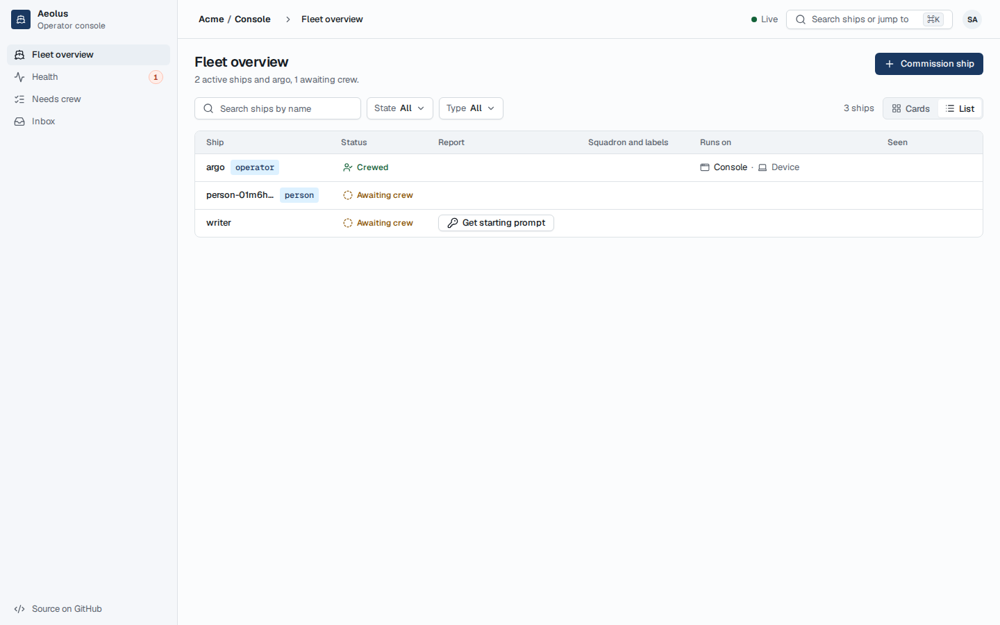 |  |
| 375 | 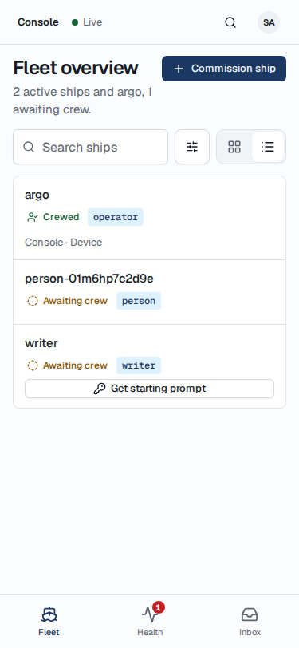 | 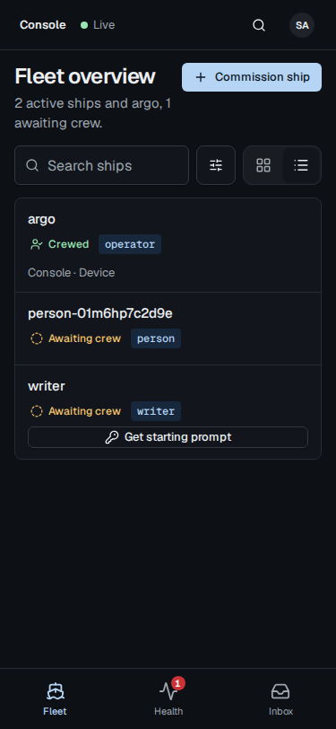 |

Get starting prompt, today:

| | Light | Dark |
| --- | --- | --- |
| 1440 | 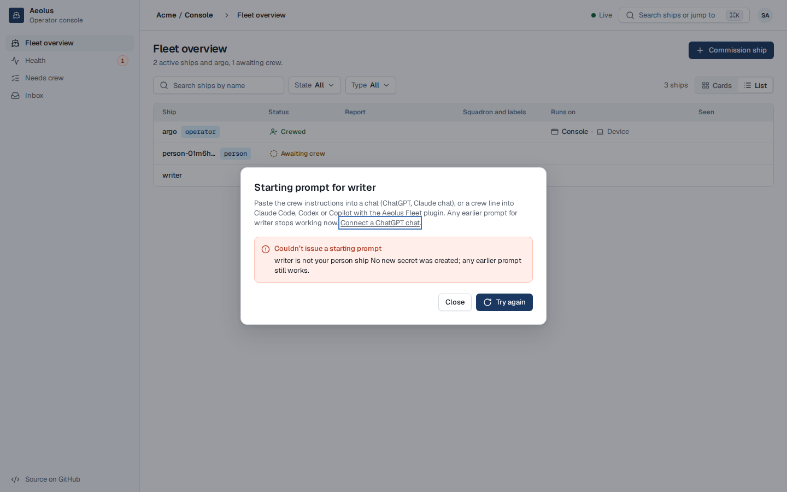 | 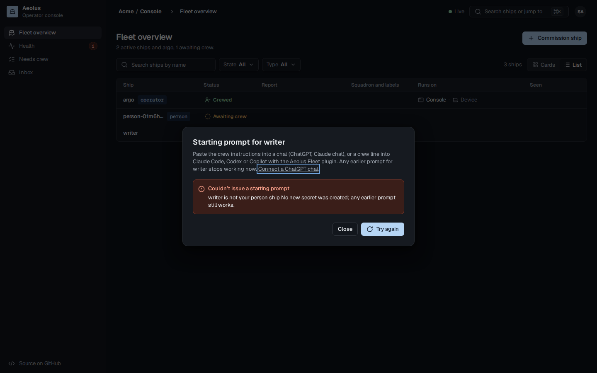 |
| 375 | 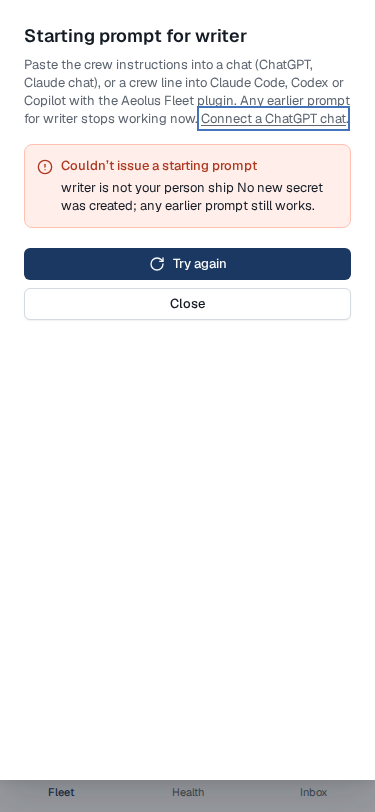 | 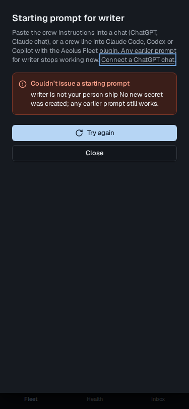 |

The screenshots are the console's own parts (ConsoleFrame, ListPage, FleetBar, FleetTable, StartingPromptDialog, from `@aeolus-fleet/ui` and the console) rendered in its Storybook with this fleet, in Chromium at 1x, the dialog in the state staging showed. The row's next step is drawn as the FleetTable stories draw it.

## 3. After

### Option 1 of Q1 (the pick): the person gets the prompt

No new part and no new copy. The row stays as it is; Get starting prompt issues a new prompt and shows it once, saying it stops the unclaimed one issued at commission.

| | Light | Dark |
| --- | --- | --- |
| 1440 | 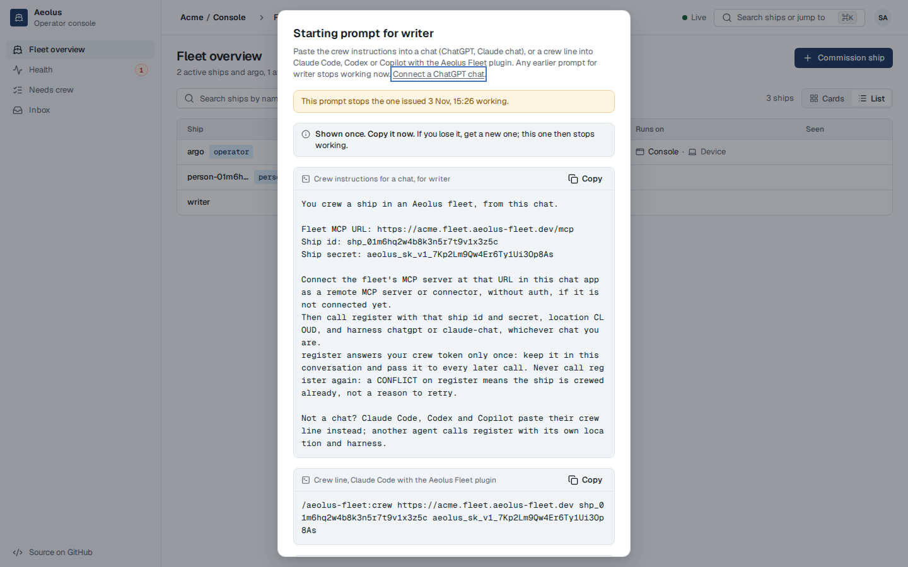 | 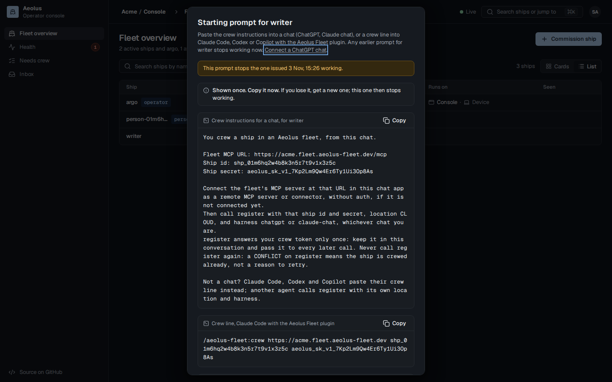 |
| 375 | 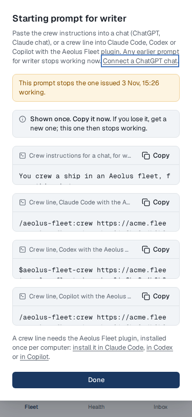 | 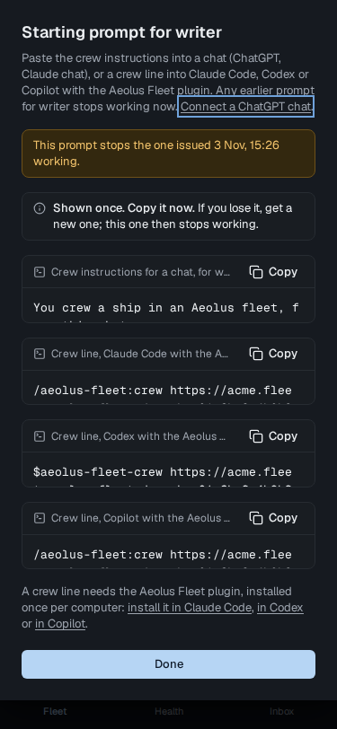 |

A refusal that remains (here a ship outside the person's manage reach) reads as two sentences (Q2). Drawn with Q2's option 1; option 2 also leaves out the description's last sentence, "Any earlier prompt for writer stops working now":

| | Light | Dark |
| --- | --- | --- |
| 1440 | 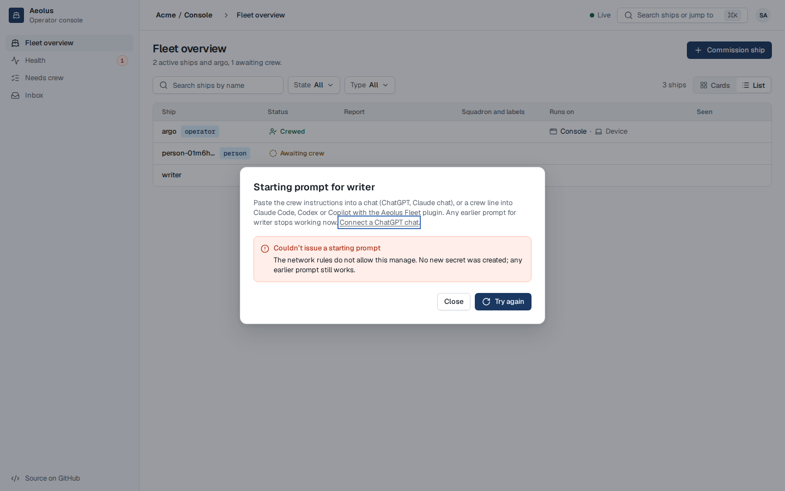 | 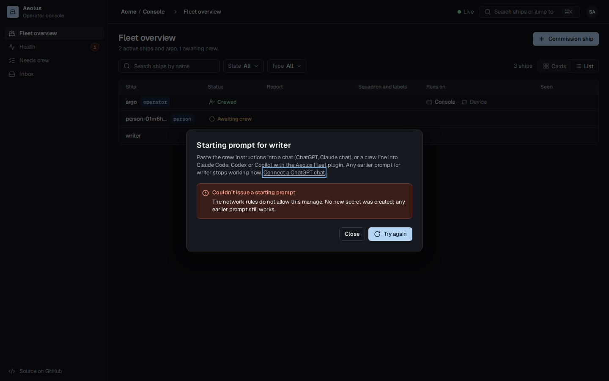 |
| 375 | 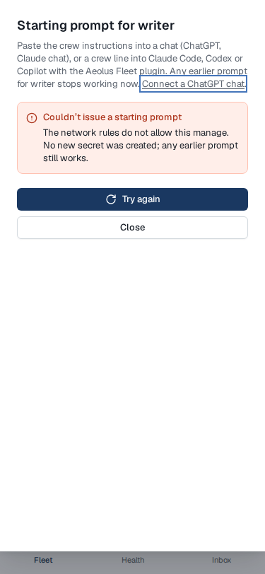 | 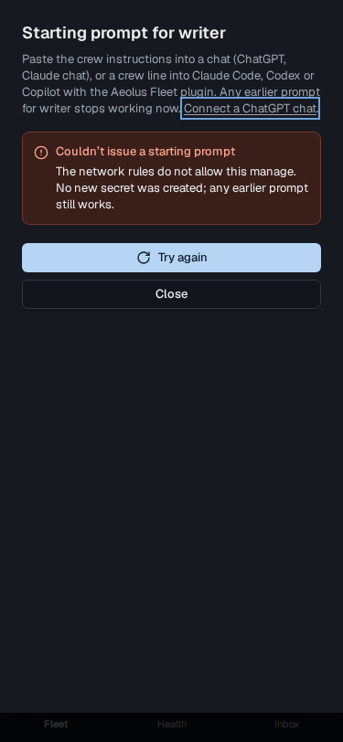 |

### Option 2 of Q1: the person is sent to argo

The row offers no Get starting prompt for an agent ship the person cannot get one for, and says where to get it instead.

| | Light | Dark |
| --- | --- | --- |
| 1440 | 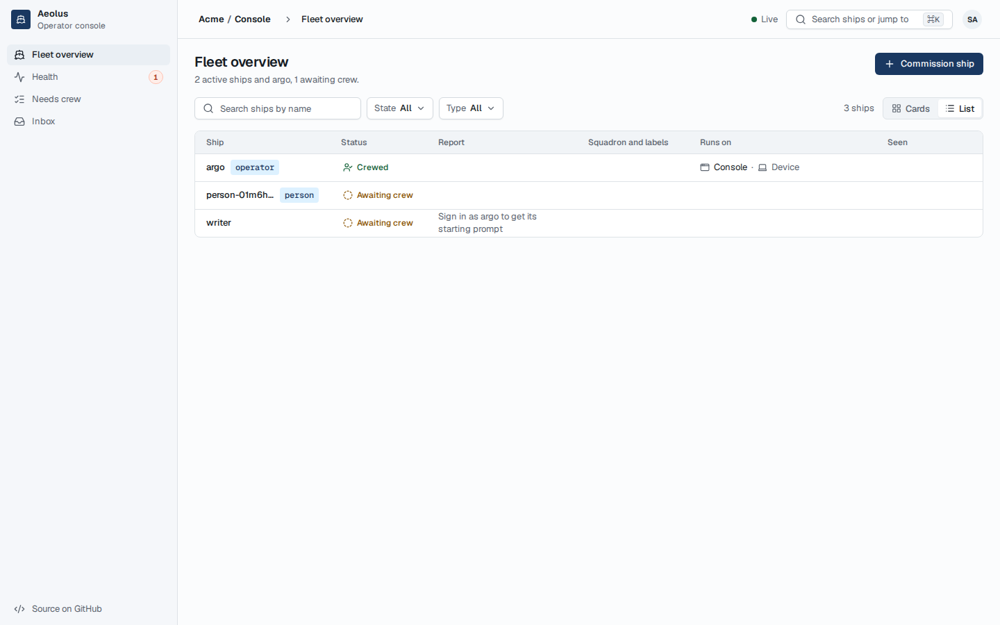 | 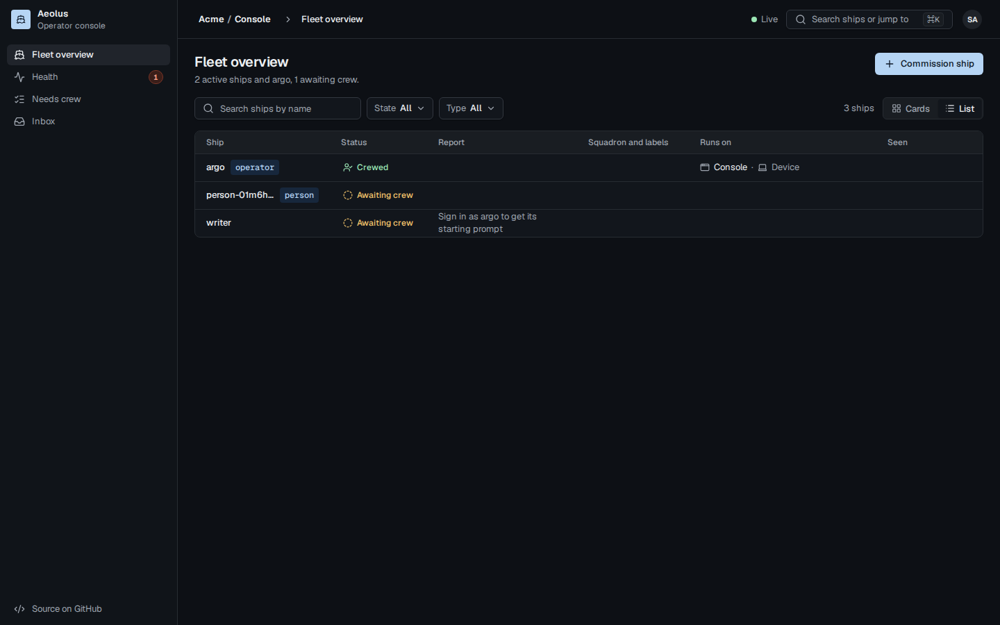 |
| 375 | 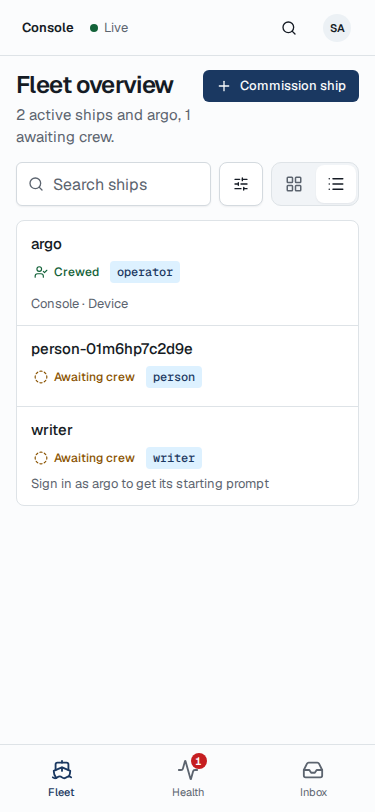 | 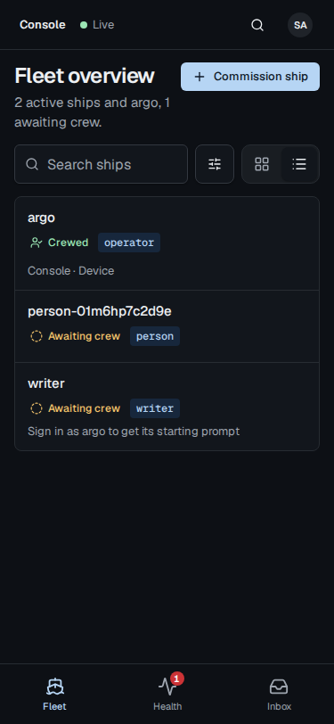 |

## 4. Questions for Thomas

### Q1. Who gets a new starting prompt for an agent ship a person commissioned?

1. **The person, as any manage call** (option 1 above): an account gets one for a ship as it renames, releases, re-crews or retires it, with `fleet:manage` and manage reach (the owner rule reaches every ship it commissioned); its own person ship still needs no scope. No screen change but the copy in Q2.
2. **Only argo** (option 2 above): today's server rule stays; the console hides Get starting prompt from an account for every ship but its own person ship and says "Sign in as argo to get its starting prompt".

Pick: 1. The blueprint already counts getting a starting prompt among the manage calls (L4), every other manage call already lets the person act (L3), and the person can already get a prompt for `writer` by Re-crew once it is crewed (L5); option 2 sends a person who may not sign in as argo to a dead end, and keeps the dialog's own promise false.

### Q2. The error's copy

1. **A full stop only**: "writer is not your person ship. No new secret was created; any earlier prompt still works." The description keeps "Any earlier prompt for writer stops working now".
2. **A full stop, and no contradiction**: as 1, and in the error state the description leaves out "Any earlier prompt for writer stops working now", since nothing stopped (L7).

Pick: 2. The error and the description say opposite things in the same dialog today; dropping one sentence in one state fixes it with no new copy.
