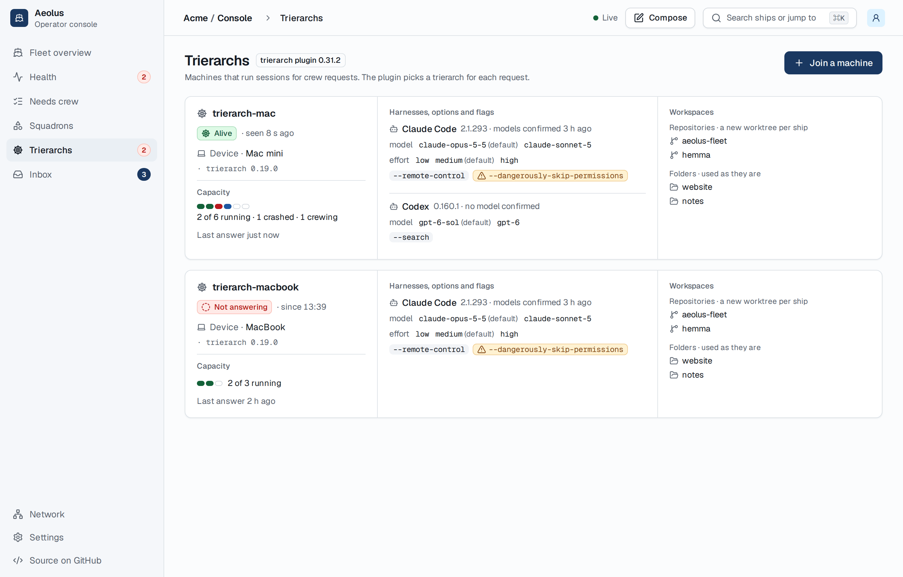
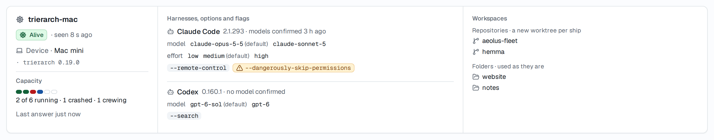
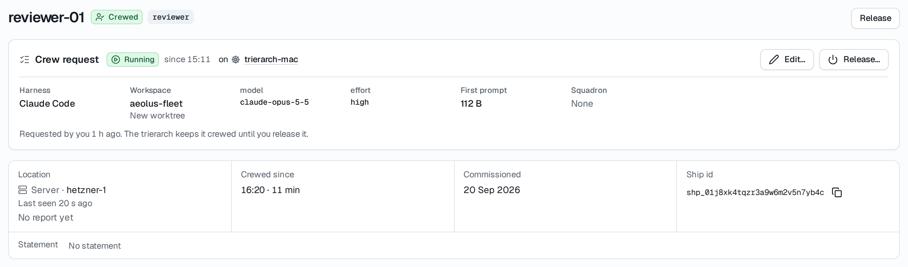

# Usage over time: tokens across the fleet and its setup

Design for usage history, with [#1309](https://github.com/ThomasHendrickx/aeolus-fleet/issues/1309) as a related need. Docs only; nothing is built from it before Thomas approves it. [Mockup of the Usage page](https://claude.ai/artifact/CY96ysddDnxHK2bPw2bsDJ).

## 1. Purpose

In Thomas's words: "I want token usage across my fleet and setup in time."

So: one place that shows how many tokens the fleet's ships used, over time, broken down by the setup that used them: the machine (the computer a trierarch runs on), the harness, the ship, the model, and the login (the subscription or an API key). Beside it, how full each harness's subscription windows were over time.

For whom: whoever answers for what the fleet's sessions use, first Thomas as the fleet's operator.

A good outcome:
1. A question such as "which machine, harness or model used most tokens last week" is answered by looking, without opening ships or report details.
2. Usage stays after a ship is released or retired, so a period can be added up later (#1309: cost per acceptance criterion per release).
3. Nothing changes for a fleet without the trierarch plugin: no trierarch, no usage read.

Not the purpose: the bill (the vendors' consoles stay the bill); limits, budgets or alerts on usage (running out is #1284 and #1286); usage of sessions a trierarch does not crew (a hand-crewed session reads no tokens); placement by usage; tying usage to a release, issue or PR (#1309 adds a release up by its time span and ships).

## 2. Lessons to check against

| # | Lesson | Source |
| --- | --- | --- |
| L1 | Each trierarch reports `usage` in its report details: per harness its subscription windows (`windowMinutes`, `usedPercent`, `resetsAt`, `readAt`), and per ship it crews the tokens per model (input, output, cache read, cache write) with `estimatedCostUsd` at its price table, null for a model it does not price. | `packages/common/src/trierarch/report-details.ts` `harnessUsageSchema`; aeolus-fleet-trierarch `docs/trierarch.md`, "What a trierarch reports"; #353 |
| L2 | A ship's tokens are read from the harness's transcripts every 5 minutes, each Claude Code message and each Codex turn once, and count since the ship's folder was made on that machine: a running total that starts again from zero on another machine or a fresh folder. Each transcript entry carries its own time. | aeolus-fleet-trierarch `docs/timings-and-limits.md` `TOKENS_READ_INTERVAL_MS`; `docs/trierarch.md` |
| L3 | Subscription windows are read when the trierarch starts and again only after 30 minutes with work since. A harness that cannot say is left out. | aeolus-fleet-trierarch `docs/timings-and-limits.md` `SUBSCRIPTION_READ_INTERVAL_MS` |
| L4 | Report details are status, not storage: at most 16 KB, the latest only, and `ShipReported` carries the details version, never the details. | [0028](../../decisions/0028-report-details.md) |
| L5 | A ship leaves the report when it is released; tokens used after the last 5 minute read are never reported. | #1309; `docs/trierarch.md` |
| L6 | The report names no login per ship yet: subscription or API key comes with trierarch draft PR #35. A subscription reading names no account, so two machines on one login report the same windows twice. | ThomasHendrickx/aeolus-fleet-trierarch#35 |
| L7 | On a subscription, `estimatedCostUsd` is what the tokens would cost at list prices, not what is paid. The price table changes with the trierarch's version and its configuration's `prices`. | `docs/trierarch.md`; #353 |
| L8 | Core's promises are the fleet snapshot and guaranteed communication; usage is neither. A delivery is handed again until acknowledged, so a receiver treats the delivery id as an idempotency key. | CLAUDE.md, "What Aeolus is"; [blueprint](../../blueprint.md) "Guaranteed communication", Delivery |
| L9 | The trierarch plugin reads every trierarch's report each assignment pass (10 s) and takes what waits for its ship every second. A trierarch knows the plugin's ship from its setup line and takes the trusted repositories from it alone. | [0030](https://github.com/ThomasHendrickx/aeolus-fleet-trierarch-plugin/blob/main/docs/decisions/0030-trierarch-plugin.md); aeolus-fleet-trierarch `docs/trierarch.md`, "Trusted repositories" |
| L10 | Retention is per fleet, read with `fleet.limits` (`fleet:read`), unset kept for good; core's hourly pass prunes core's tables only. | [0066](../../decisions/0066-retention.md) |
| L11 | Every table has fleet_id, every query is scoped by it, every call is authorised by scopes and reach read from the server. | CLAUDE.md; [0057](../../decisions/0057-actors.md) |
| L12 | Before 1.0.0: minimal designs, no backfill or compatibility work. | [0013](../../decisions/0013-breaking-changes-before-1-0.md) |
| L13 | Every message counts against the fleet's daily message limit. | [0020](../../decisions/0020-installation.md); blueprint, "Set limits" |
| L14 | Reads at scale: 3,000 ships per fleet, p95 under 100 ms; a rollup instead of recomputing from history; pages of 20 with a cursor. | `performance` skill |

## 3. What is settled

Thomas answered the first eleven questions, each with the pick.

| # | Rule |
| --- | --- |
| U1 | Everyone who reads the fleet (`fleet:read`) sees usage, as the Trierarchs page. |
| U2 | The history lives in the trierarch plugin's database, amending [0030](https://github.com/ThomasHendrickx/aeolus-fleet-trierarch-plugin/blob/main/docs/decisions/0030-trierarch-plugin.md). Thomas: "Would not make sense anywhere else". |
| U3 | Kept: tokens per ship, machine, harness, model and login, with the estimated cost as the trierarch reported it at the time; and each harness's subscription windows per machine. The login is kept from the day the trierarch reports it (#35); before that it reads "not reported". |
| U4 | Tokens are kept per hour. |
| U5 | Kept for the fleet's retention (0066), for good when unset. |
| U6 | One chart of tokens over time for the whole fleet, split by one of machine, harness, model, ship or login, with a filter per breakdown. The subscription windows in a chart of their own. |
| U7 | A switch between tokens and estimated cost, opening on tokens. On a subscription the dollars are list prices, which the page says once. |
| U8 | A Usage page of its own in the navigation, shown only with the trierarch plugin; the ship page and the machine card link to it filtered to them. |
| U9 | The trierarch reads a ship's tokens once more when the ship is released, before it removes its folder, and sends them. |
| U10 | #1309's attribution to a release is out: hourly history per ship adds a release up by its time span. |
| U11 | No backfill: history starts when this ships. |

## 4. Design

### What the trierarch sends, and when

The trierarch sends its usage to the trierarch plugin's ship as a message, so it is stored before the send returns OK and waits for the plugin when the plugin is down (L8). Report details keep the latest reading for the machine card, as today (L4).

- **Content type** `application/vnd.aeolus.trierarch.usage+json`, its schema in common beside the report details.
- **Payload**: the hours that changed since its last send that returned OK, each whole, and the subscription readings since then.
  ```json
  {
    "hours": [
      { "hour": "2026-10-28T09:00:00Z",
        "ships": [
          { "shipId": "shp_…", "harness": "claude-code", "folderMadeAt": "2026-10-27T14:02:11Z", "login": null,
            "models": [ { "model": "claude-opus-5-5", "tokens": { "input": 0, "output": 0, "cacheRead": 0, "cacheWrite": 0 }, "estimatedCostUsd": 0 } ] } ] } ],
    "subscriptions": [
      { "harness": "claude-code", "readAt": "2026-10-28T09:31:02Z", "windows": [ { "windowMinutes": 300, "usedPercent": 0, "resetsAt": "2026-10-28T12:00:00Z" } ] } ],
    "readAt": "2026-10-28T10:00:40Z"
  }
  ```
- **Hours by the transcript's own time**: each Claude Code message and each Codex turn counts in the UTC hour it happened, not the hour it was read (L2). An hour's tokens are its total so far, set, never added: sending an hour again changes nothing.
- **folderMadeAt** tells two folders of one ship on one machine apart, so a fresh folder in the same hour never overwrites the old folder's tokens.
- **login**: as #35 names it, null until the trierarch reports one.
- **When**: once an hour, at the first token read after the hour turns (question N2), and once more when a ship is released (U9): it reads the ship's transcripts, sends, and removes the folder only after that send returned OK. Each send carries every hour whose totals changed since the last OK send, so an hour a late transcript entry changes is sent again.
- **Idempotency key** `usage:<trierarch ship id>:<readAt>`. A send that fails (fleet unreachable, the daily message limit) changes nothing in the trierarch: the next send carries those hours too. A payload over 64 KB is split into several messages of whole hours.
- **What the trierarch keeps**: per folder, the totals it last sent per hour, in its state. Lost state only means it sends every hour its transcripts hold again, which changes nothing.

### What the trierarch plugin stores

Three tables in its own database (amending 0030), each with fleet_id first in its key:

| Table | Key | Columns | Written |
| --- | --- | --- | --- |
| `usage_hours` | `fleet_id`, `hour`, `machine_ship_id`, `ship_id`, `folder_made_at`, `model` | `harness`, `login` (null: not reported), `input`, `output`, `cache_read`, `cache_write` (bigint), `estimated_cost_usd` (numeric, null: not priced), `read_at` | Upsert per row, kept only when its `read_at` is newer than the stored one, so a late or repeated message changes nothing |
| `usage_days` | `fleet_id`, `day` (UTC), `machine_ship_id`, `ship_id`, `model`, `harness`, `login` | the same token and cost columns, plus `unpriced_tokens` | In the same transaction as `usage_hours`, adding the difference between the new and the stored hour row: a rollup for ranges over 7 days (L14) |
| `subscription_readings` | `fleet_id`, `machine_ship_id`, `harness`, `window_minutes`, `read_at` | `used_percent`, `resets_at` | Insert, a repeat changes nothing |

Index for the read: `usage_hours (fleet_id, hour)` and `usage_days (fleet_id, day)`, both with the token columns included, so a range is one index range scan.

On receipt the plugin checks the sender is one of the fleet's trierarch ships and the payload is common's schema, stores it, then acknowledges. A delivery handed again stores the same rows, which changes nothing (L8). A message from any other ship, or one that does not parse, is acknowledged and logged as not handled, as a trierarch does with a list from another ship.

### The read the console calls

The console reads usage from the trierarch plugin over its tRPC, checked with the console session cookie as `models.list` is, for every signed-in session of the fleet (`fleet:read`, U1):

| Procedure | Input | Answers |
| --- | --- | --- |
| `usage.tokens` | `from`, `to`, `splitBy` (`machine`, `harness`, `model`, `ship`, `login` or none), filters (machine, harness, model, ship and login ids, each a list) | `grain` (hour up to 7 days, else day from `usage_days`); per bucket and series the four token kinds, the estimated cost and the tokens not priced; the series, at most 7 by total in the range and `other` for the rest, each with its name |
| `usage.values` | `from`, `to`, one breakdown, a cursor | that breakdown's values in the range with their totals, 20 per page, for the filter menus |
| `usage.windows` | `from`, `to`, machine and harness filters, a cursor | per machine and harness, 20 per page, each window's readings in the range |

Names of machines and ships come from the plugin's one read of the fleet's ships (retired included), never from the console asking per id. Totals, splitting, `other` and filters run in the query. The Usage page asks `usage.tokens` and `usage.windows` in parallel; the navigation item reads nothing more than the plugin's switch, which the Trierarchs item reads today.

### Scale and retention

- **Size**: per fleet, one `usage_hours` row per ship, machine, folder, model and hour with work. At 40 ships at work with 2 models, about 1,900 rows a day (0.5 MB, 170 MB a year). At the 3,000-ship target with 300 at work, about 11,000 rows a day (1 GB a year). `usage_days` is 1/24 of that; subscription readings at most 2 per hour per window, under 0.2 MB a day for 10 machines.
- **Messages**: 24 a day per machine with work, plus one per release (L13).
- **Reads**: up to 7 days, at most 7 x 24 x 450 = 76,000 hour rows from one index range scan at the target; past 7 days the day rollup. Measured with the staging performance run once built (L14).
- **Retention**: the plugin prunes its three tables once an hour per connected fleet, by the retention `fleet.limits` answers its ship (L10): rows whose hour, day or reading is older than that many days go, in batches; none is kept for good. Deleting the fleet from the plugin forgets them with its connection; switching the plugin off keeps them and stops the pruning, and the messages wait in the fleet until it is on again.

### Flow

```mermaid
sequenceDiagram
  autonumber
  participant T as Trierarch (machine)
  participant F as Fleet (core)
  participant P as Trierarch plugin
  participant C as Console (Usage page)

  Note over T: every 5 min: read transcripts, per ship, folder, model and UTC hour
  T->>F: send usage message to the plugin's ship (hours changed since last OK send)
  F-->>T: OK once stored
  P->>F: receive (every second)
  F-->>P: delivery
  P->>P: check sender is a trierarch ship, parse, upsert hours (newest read_at wins), add to days
  P->>F: ack
  C->>P: usage.tokens / usage.windows (console session, fleet:read)
  P-->>C: buckets, series with names

  alt plugin down
    T->>F: send
    F-->>T: OK, the message waits for the plugin's ship
    Note over P: back up: receives every waiting delivery, stores, acks
    C->>P: usage.tokens
    P--xC: no answer: the page says usage cannot be read now
  else trierarch offline (stopped, machine asleep)
    Note over T: no reads, no sends; transcripts keep their own times
    Note over T: back: the first read finds every hour since its last OK send, sends them in their own hours
  else a send fails (fleet unreachable, daily message limit)
    T-xF: send
    Note over T: nothing marked sent; the next send carries those hours too
  else a reading missed (plugin crashed after storing, before ack)
    F-->>P: the delivery is handed again
    P->>P: same rows, same read_at: nothing changes
  else an older message arrives after a newer one
    P->>P: its read_at is older: kept rows stay
  else ship released
    T->>T: final read of the ship's transcripts
    T->>F: send usage
    F-->>T: OK
    T->>T: remove the folder only now
  else machine gone for good
    Note over P: its hours up to the last OK send stay; at most one hour after it is lost
  end
```

Unhappy paths in words:

| Case | What happens | Lost |
| --- | --- | --- |
| Plugin down | Messages wait in the fleet for its ship; the page cannot read usage and says so. | Nothing |
| Trierarch offline | No sends; on return the first read sends every hour since its last OK send, each in its own hour. | Nothing while the folder and its transcripts stay |
| A send fails | The next send carries the same hours. | Nothing |
| A message handed again, or late | Rows keep the newest `read_at`. | Nothing |
| Ship released while its trierarch is offline | The trierarch releases it when back: final read, send, then remove. | Nothing |
| Machine gone for good, or folder removed by hand | Hours up to the last OK send stay. | At most the hour since |
| A trierarch older than the one that sends usage | Sends nothing; the page names the machine as sending no usage. | Its usage |

### The console

- **Navigation**: Usage, below Trierarchs, shown only with the trierarch plugin.
- **Usage page**: a time range (24 hours, 7 days, 30 days, 90 days), one row of controls (split by, a filter per breakdown, tokens or estimated cost), the totals for the range, one stacked column chart, its legend and a table view; under it the subscription windows, a line chart per machine and harness, percent used over time with one line per window.
- **Links**: the machine card and a ship's Crew request card get a "Usage" link to the page filtered to that machine or ship.
- **States**: loading, empty ("No usage in this range"), cannot read ("Usage cannot be read now: the trierarch plugin does not answer"), and partial (machines sending no usage named under the chart).

## 5. Questions

N1. **How usage reaches the plugin.** Context: the plugin already reads every report each pass (L9), but details hold only running totals, latest only (L2, L4).
   1. The trierarch sends hourly usage as messages to the plugin's ship, hours by the transcript's own time (section 4).
   2. The plugin turns each report's running totals into the tokens since its last reading, in the hour it reads them.

   Pick: 1. A message is stored before OK and waits while the plugin is down; hours by transcript time stay right when the trierarch or the plugin was offline, where 2 puts hours of work into the hour the plugin came back. It costs a trierarch change and 24 messages a day per machine.

N2. **How often the trierarch sends.** Context: the daily message limit (L13), freshness of the chart.
   1. Once an hour, after the hour turns, and at each release: the current hour shows once it ends.
   2. After each 5 minute read with new tokens: the current hour shows within 5 minutes, up to 288 messages a day per machine.

   Pick: 1. The grain is an hour (U4); a partial hour reads as a dip; the machine card keeps the live reading.

N3. **What "tokens" adds up.** Context: on Claude Code the cache reads are usually far more than every other kind together (L1), so a sum of all four is mostly cache reads.
   1. All four kinds summed, each kind in the tooltip and the table.
   2. Input and output only, the cache in the tooltip and the table.
   3. All four summed, and token kind offered as a sixth split.

   Pick: 3. The sum is what a model processed, and splitting by kind shows at once how much was cache; the cost switch weighs them.

N4. **Days past 7 days.** Context: the day rollup is kept in UTC days, so a day bar for someone in Brussels runs from 01:00 or 02:00.
   1. UTC days, the axis saying "days in UTC".
   2. Days in the viewer's time zone, summed from hours at read time, with no day rollup (slower past 7 days).

   Pick: 1. The rollup keeps 90 days within the read budget at fleet scale; ranges up to 7 days are hours in the viewer's own time zone.

## 6. Today

What the console shows of usage now: nothing outside report details, and only the latest reading.

The Trierarchs page and its machine card:





A ship's page, its Crew request card:


