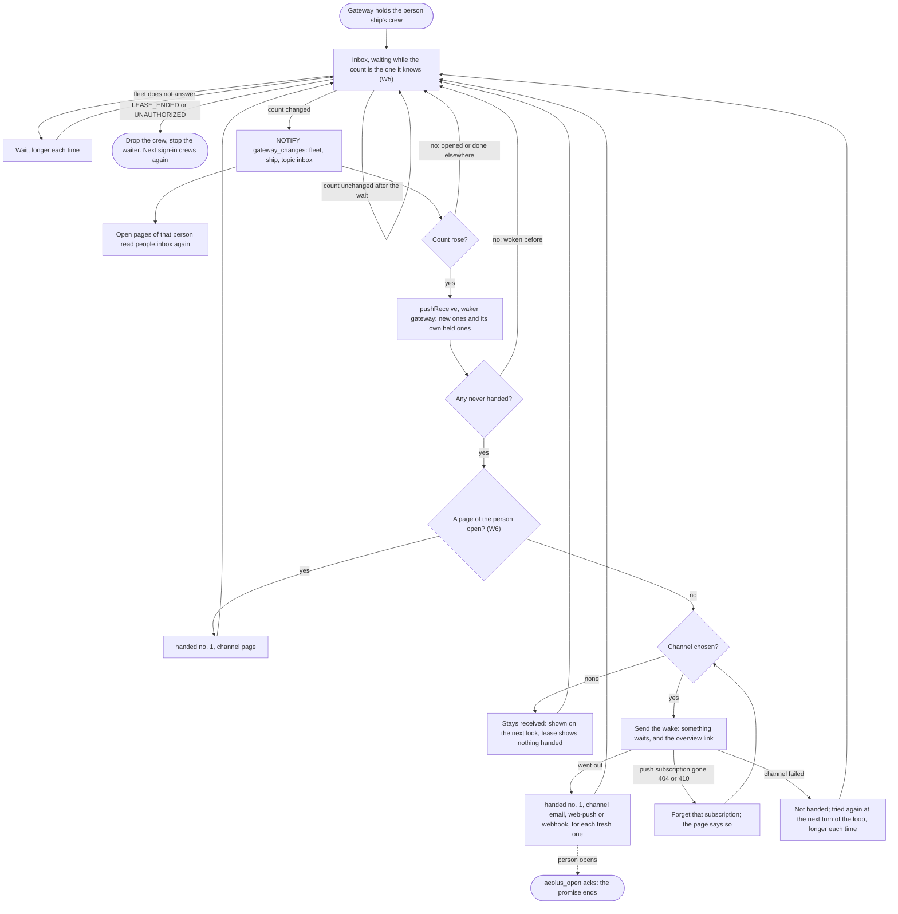

# Wake a person when something waits

Design for [#1020](https://github.com/ThomasHendrickx/aeolus-fleet/issues/1020) (interop I-1, 5.1 (a)) and [#1014](https://github.com/ThomasHendrickx/aeolus-fleet/issues/1014), as one design for Aeolus 0.30.0. Purpose first: nothing past the purpose is decided until Thomas agrees it. Docs only.

## 1. Purpose (to agree)

A person learns that something waits for their person ship when they are not looking, through a channel they chose, and the gateway's pages show their inbox as it changes. Both come from one part: the gateway, as crew of the person ship, hearing the ship's deliveries.

The outcomes:
1. A delivery reaches Mathilde's person ship while she is away. Within a minute their phone or mailbox says that something waits in her fleet, with a link to the gateway's overview. The wake carries no content.
2. With the overview open, Waits on you and their inbox change within seconds when a delivery arrives, and when she opens, answers or marks done one in any client.
3. Every wake is a hand-over on the record (0040, interop 5.1): the lease shows the gateway as its waker, and the delivery shows that it was handed, through which channel and when.
4. Core sends no notification and holds no address. The person ship's crew acts, as the trierarch does for a session.

Not the purpose:
- Waking agent ships, or the proxy ship of an outside MCP client (interop 5.1 names the same pattern for it; a later slice).
- The person's inbox as an MCP resource with subscriptions (I-1 (b)); see W9.
- A person's own app holding the lease (waker `personApp`).
- Reminders, quiet hours or escalation beyond what W3 decides.

## 2. What is true today

- **Core.** `pushReceive` takes a `waker` (`gateway` among the values) at the lease's first push receive (`LeasePushed`), and `handed` takes a `channel`, kept with `DeliveryHanded`. A person ship runs no clocks (0040) and is never stuck (0042). `inbox` waits up to 25 seconds only while nothing waits; it counts the crew's own received and handed deliveries too, so it answers at once while any are held.
- **Gateway** (`aeolus-fleet-gateway`, `src/core/people`):
  - It crews a person ship the first time its person signs in, and keeps the crew token in `person_crews`, shared by all of the person's clients.
  - `people.inbox` (the overview, `aeolus_inbox`) push receives with no `waker`, so a lease the gateway crews states none. `aeolus_open` acks for the person; answer and done report `handled`.
  - The pages' live channel hears only the gateway's own database: a trigger on `pending_requests` sends `NOTIFY gateway_changes` with the fleet and topic `requests`, every instance listens, and a lost connection reads everything anew.
  - It holds no email address and sends no email. pagasae signs every account in by email link (0054) and holds the address.
  - Proxy ships of outside MCP servers poll `pushReceive` while they hold in-flight deliveries (`run-party`), since `inbox` would answer at once.

## 3. Lessons to check against

- **0001, 0040.** The promise ends at the actor's confirmation. For a person that is opening the delivery (the gateway's ack). A wake is a hand-over: it counts an attempt, a repeat with the same number counts none, and the fifth is undeliverable.
- **I-1 (5.1 (a)).** One wake pattern for every kind: the crew's computer side push receives, hands over through its actor's channel and reports `handed` naming it. The fleet never speaks for a ship; (b) core notifying was rejected.
- **#1020.** The wake carries only that something waits and a link, no content.
- **I-8.** One waiting call per ship the gateway crews; a core call waiting on many ships is not built until numbers demand it.
- **0016.** No policy: what a wake carries and how often is the person's or the configuration's, not a rule core applies.
- **0045, 0052.** A person ship owns itself, so its owner configuring the channel is the person.
- **0054, 0058.** Email stays in pagasae; core holds none.
- **0033 and the gateway's pages.** Logic on the server; the browser renders what it is given. Live over a socket, not polling ("websockets over polling", #1014).
- **0013.** No compatibility work; keep it minimal.

## 4. Flow

The backbone: one waiter per person ship the gateway crews.

Unhappy paths the diagram does not show:
- **Crash after the wake, before `handed`.** On restart `pushReceive` returns it again, never handed, so it is woken again: one duplicate wake, nothing lost.
- **Crash after `handed`.** It comes back with its last hand-over number 1: no second wake.
- **The person opens it before the wake goes out.** `handed` answers `acknowledged`; nothing more.
- **Lost `NOTIFY` connection.** The listener reads everything anew, as for `requests` today.
- **Account disabled (0055).** Its person ship is released, the waiter's next call answers `LEASE_ENDED`, and it stops.
- **Two gateway instances.** One waiter per ship across instances; a second only duplicates a wake, never loses one.

## 5. Questions

Each with options and my pick. They follow once the purpose is agreed.

### W1 Which channels in 0.30.0?

1. **Email and web push.**
2. Email, web push and a chat tool's incoming webhook.
3. Web push only.
4. Email only.

**Pick 1.** Email reaches every account with nothing to set up; web push reaches the device at once. A webhook posts into a space others may read and is a secret URL to keep: it waits until a person asks for it.

### W2 Who sends the email?

1. **pagasae, asked by the gateway to send the account a wake.** The address never leaves pagasae.
2. The gateway, with its own mail configuration and the address from pagasae.

**Pick 1.** pagasae already holds the address and sends sign-in links (0054, 0058). Option 2 copies addresses into a second store and a second mail setup.

### W3 When does a wake go out?

1. Once for every delivery.
2. **Once for every delivery never handed, gathered: at most one wake per channel in a window from the gateway's configuration (10 minutes by default); what arrives inside it goes in the next.**
3. Only when the inbox goes from empty to not empty.

**Pick 2.** Every delivery is handed once, so the record is exact, and a burst of ten sends one wake. Option 3 never tells a person with one old unopened delivery about a new go.

### W4 What does the wake say?

1. **Only that something waits in the fleet, by the fleet's name, and the overview link** (#1020).
2. Option 1 and how many wait.
3. The sender and title, the owner's choice (interop 5.1's example).

**Pick 1.** #1020 decided it. A count goes stale as the person deals with deliveries elsewhere.

### W5 How the gateway hears a new delivery while earlier ones wait unopened

`inbox` answers at once while the crew holds received or handed deliveries, so it cannot wait for the next one.

1. **Core: `inbox` takes the count the caller knows, and waits while the count is still that.**
2. The gateway polls `pushReceive` while it holds unopened ones, as `run-party` does.

**Pick 1.** A person may leave deliveries unopened for days; polling then runs for days per person. Option 1 is one input on one call, claims nothing, and the same answer tells the pages that the count went down.

### W6 With a page of the person open

1. **The page is the channel: the overview shows it live and the gateway reports `handed` with channel `page`; no email or push.**
2. Wake through the chosen channel anyway.

**Pick 1.** The person is looking. A page open is known to the gateway by its socket.

### W7 Which person ships does the gateway wait on?

1. **Every person ship it crews.**
2. Only those with a channel chosen or a page open.

**Pick 1.** One loop serves the wake and the live pages, and starts whenever the gateway crews. Per I-8 its cost is looked at when numbers demand it.

### W8 How the person chooses

1. **A section on the gateway's overview: email on or off, and web push on for this browser (one subscription per browser, removable); nothing on by default.** Kept in the gateway's database by fleet and person ship.
2. The same, email on by default.

**Pick 1.** The person turns on what they want to receive; a person who never visits the page is woken by nothing, which their lease shows as waker gateway, nothing handed.

### W9 The inbox as an MCP resource (I-1 (b))

1. **Later: no MCP client wakes a model on a resource update today.** The `inbox` change in W5 is the signal it will use.
2. In 0.30.0.

**Pick 1.** It adds a protocol surface nothing acts on yet.

## 6. What the build needs (once agreed)

- Core: W5's `inbox` input (one slice, with its Testcontainers wait test).
- Gateway: the waiter, the `inbox` topic on `gateway_changes`, the pages re-reading on it; `waker: gateway` on every push receive; the channels and their section on the overview; with W2 (1), a pagasae call to send a wake.
