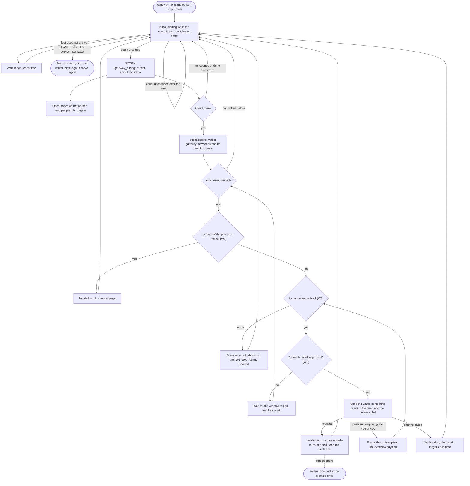

# Wake a person when something waits

Design for [#1020](https://github.com/ThomasHendrickx/aeolus-fleet/issues/1020) (interop I-1, 5.1 (a)) and [#1014](https://github.com/ThomasHendrickx/aeolus-fleet/issues/1014), as one design for Aeolus 0.30.0. Docs only.

## 1. Purpose (agreed by Thomas)

A person learns that something waits for their person ship when they are not looking, through a channel they turned on, and the gateway's pages show their inbox as it changes. Both come from one part: the gateway, as crew of the person ship, hearing the ship's deliveries.

The outcomes:
1. A delivery reaches Mathilde's person ship while they are away. Within a minute their phone or browser says that something waits in their fleet, with a link to the gateway's overview. The wake carries no content.
2. With the overview open, Waits on you and their inbox change within seconds when a delivery arrives, and when they open, answer or mark done one in any client.
3. Every wake is a hand-over on the record (0040, interop 5.1): the lease shows the gateway as its waker, and the delivery shows that it was handed, through which channel and when.
4. Core sends no notification and holds no address. The person ship's crew acts, as the trierarch does for a session.

Not the purpose:
- A person's own app holding the lease (waker `personApp`).
- Reminders, quiet hours or escalation beyond what W3 decides.

## 2. What is true today

- **Core.** `pushReceive` takes a `waker` (`gateway` among the values) at the lease's first push receive (`LeasePushed`), and `handed` takes a `channel`, kept with `DeliveryHanded`. A person ship runs no clocks (0040) and is never stuck (0042). `inbox` waits up to 25 seconds only while nothing waits; it counts the crew's own received and handed deliveries too, so it answers at once while any are held.
- **Gateway** (`aeolus-fleet-gateway`, `src/core/people`):
  - It crews a person ship the first time its person signs in, and keeps the crew token in `person_crews`, shared by all of the person's clients.
  - `people.inbox` (the overview, `aeolus_inbox`) push receives with no `waker`, so a lease the gateway crews states none. `aeolus_open` acks for the person; answer and done report `handled`.
  - The pages' live channel hears only the gateway's own database: a trigger on `pending_requests` sends `NOTIFY gateway_changes` with the fleet and topic `requests`, every instance listens, and a lost connection reads everything anew.
  - It holds no email address and sends no email. pagasae signs every account in by email link (0054) and holds the address.
  - Proxy ships of outside MCP servers poll `pushReceive` while they hold in-flight deliveries (`run-party`), since `inbox` would answer at once.

## 3. Lessons checked against

- **0001, 0040.** The promise ends at the actor's confirmation. For a person that is opening the delivery (the gateway's ack). A wake is a hand-over: it counts an attempt, a repeat with the same number counts none, and the fifth is undeliverable.
- **I-1 (5.1 (a)).** One wake pattern for every kind: the crew's computer side push receives, hands over through its actor's channel and reports `handed` naming it. The fleet never speaks for a ship.
- **#1020.** The wake carries only that something waits and a link, no content.
- **I-8.** One waiting call per ship the gateway crews; a core call waiting on many ships is not built until numbers demand it.
- **0016.** No policy: what a wake carries and how often is the person's or the configuration's, not a rule core applies.
- **0045, 0052.** A person ship owns itself, so its owner configuring the channel is the person.
- **0054, 0058.** Email stays in pagasae; core holds none.
- **0033 and the gateway's pages.** Logic on the server; the browser holds UI interaction and renders what it is given. Live over a socket, not polling (#1014).

## 4. Decisions (Thomas, 21 Oct)

| # | Rule |
| --- | --- |
| W1 | **Channels: web push and email.** No chat webhook |
| W2 | **pagasae sends the email**, asked by the gateway to send an account a wake. The address never leaves pagasae |
| W3 | **Each delivery is woken once, gathered so a person is not spammed.** A wake covers every delivery not yet handed; a channel sends at most one wake per window from the gateway's configuration, and what arrives inside the window goes in the next wake (the window is W10) |
| W4 | **The wake says only that something waits in the fleet, by the fleet's name, with a link to the gateway's overview** |
| W5 | **Core: `inbox` takes the count the caller already knows and waits while the count is still that**, up to its 25 seconds. It claims nothing |
| W6 | **Open is not in focus.** Only a gateway page of the person that is in focus is the channel: the gateway reports `handed` with channel `page` and sends no wake. A page that is open and not in focus changes nothing: the wake goes out. The page tells the gateway over its socket when it gains and loses focus |
| W7 | **The gateway waits on every person ship it crews.** The waiter runs whether or not a channel is turned on; only the wake needs one (W8) |
| W8 | **Consent first.** A section on the gateway's overview where the person turns each channel on and off: email, and web push per browser (one subscription per browser, each removable). Nothing is on by default. Kept in the gateway's database by fleet and person ship |

| W9 | **One waiter per person ship across gateway instances, held by a Postgres advisory lock in the gateway's database.** Another instance takes it over when the holder's connection ends. Thomas: "This is over engineering but here I allow it" |
| W10 | **A window per channel, in the gateway's configuration:** web push 10 minutes, email 60 minutes by default |

A delivery woken through two channels is handed once, naming the first channel that went out; the second is a repeat with the same number, which counts nothing.

## 5. Flow

The backbone: one waiter per person ship the gateway crews.

Unhappy paths the diagram does not show:
- **Crash after the wake, before `handed`.** On restart `pushReceive` returns it again, never handed, so it is woken again: one duplicate wake, nothing lost.
- **Crash after `handed`.** It comes back with its last hand-over number 1: no second wake.
- **The person opens it before the wake goes out.** `handed` answers `acknowledged`; nothing more.
- **The page loses its socket.** It no longer counts as in focus; the next wake goes out through the channels.
- **Lost `NOTIFY` connection.** The listener reads everything anew, as for `requests` today.
- **The person turns every channel off.** Waiting deliveries stay received and show on the pages; nothing is handed.
- **Account disabled (0055).** Its person ship is released, the waiter's next call answers `LEASE_ENDED`, and it stops.
- **Two gateway instances.** One holds a ship's waiter by the advisory lock (W9); if its connection ends, another takes the lock and starts the waiter. A short overlap at the takeover can wake once more, as after a crash.

## 6. Slices for 0.30.0

S1 first; S2 needs its core version; S3 and S4 follow S2 and can run side by side.

### S1 Core: `inbox` waits while the count is the one the caller knows (W5)

- `inbox` takes an optional known count; with it, it waits while the count is still that, up to its wait, and answers the count as soon as it differs. Without it, `inbox` is unchanged.
- It claims nothing and records nothing.
- Testcontainers tests: it waits while the count is unchanged; it answers on a delivery that commits during the wait; it answers when the count goes down (an ack); it answers at once when the count already differs; a delivery that commits between its first look and its watch is counted; a lease that ended is refused.
- The blueprint's `inbox` row and the ship contract (REST, MCP) state the input.

### S2 Gateway: the waiter and the live inbox (W5, W7, #1014)

- A waiter runs for every person ship the gateway crews, from the crew it holds, on S1's `inbox`; it starts when the gateway crews and stops on `LEASE_ENDED` or `UNAUTHORIZED`, dropping the crew.
- The waiter of a ship runs in one instance only, holding a Postgres advisory lock in the gateway's database (W9); an instance whose connection ends loses its locks, and another starts those waiters.
- Every push receive of a person ship states `waker: gateway`, `people.inbox` included.
- A change of the count, and every open, answer and done through the gateway, sends `NOTIFY gateway_changes` with the fleet, the ship and topic `inbox`; the person's open overview and inbox read `people.inbox` again within seconds.
- A lost listener connection reads every open page anew.
- Tests: the waiter stops on a lease ended; a delivery sent to the person ship updates their open overview without a reload; an open in another client does too; a restart starts the waiters of every held crew; two instances give one waiter per ship; the waiter of a stopped instance is taken over by the other.
- docs/compatibility.md states S1's core version as the minimum.

### S3 Gateway: consent, focus and web push (W3, W4, W6, W8)

- The overview's section turns web push on for this browser (asking the browser's permission), lists the browsers turned on, and removes one; nothing is on by default.
- The page reports focus and blur over its socket; while one of the person's pages is in focus, fresh deliveries are handed with channel `page` and no wake goes out.
- Otherwise a fresh delivery wakes through web push: the fleet's name, "something waits", the overview link, nothing else. At most one per window (W3, W10: 10 minutes by default); each delivery it covers is reported `handed` no. 1 with channel `web-push`.
- A subscription answered 404 or 410 is forgotten, and the overview says so. A failed send hands nothing and is tried again.
- The window of each channel comes from the gateway's configuration (W10).
- The push keys come from the gateway's configuration; without them the section does not offer web push.
- Tests: no wake without consent; no wake while a page is in focus, `handed` via `page`; a wake while a page is open and not in focus; ten deliveries in a window give one wake and ten hand-overs; a crash before `handed` wakes again, after `handed` does not; a gone subscription is forgotten.

### S4 pagasae and gateway: email (W2, W3, W4, W8)

- pagasae answers a gateway request to send an account a wake: the fleet's name, "something waits" and the overview link, to the account's address. The gateway never reads the address.
- The overview's section turns email on and off; nothing is on by default.
- A fresh delivery not handed through `page` wakes through email too, at most one per window (W10: 60 minutes by default); each delivery it covers is reported `handed` no. 1 with channel `email` when it is the first channel that went out.
- pagasae not answering hands nothing and is tried again.
- Tests: no email without consent; one email per window; a refusal from pagasae hands nothing.
