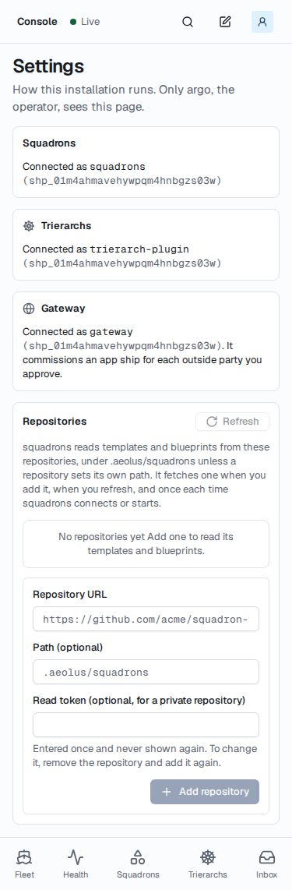
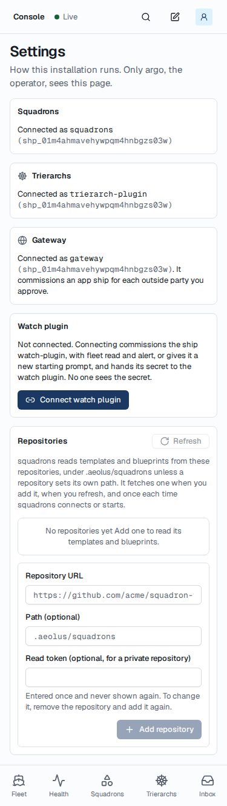
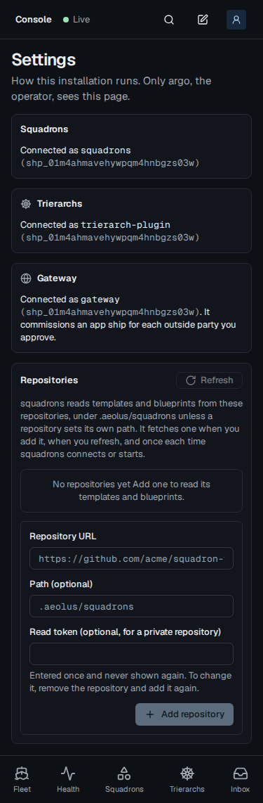
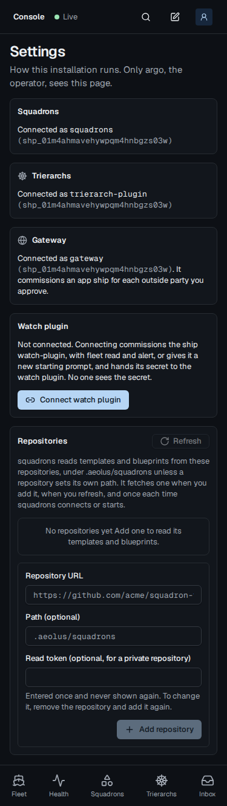
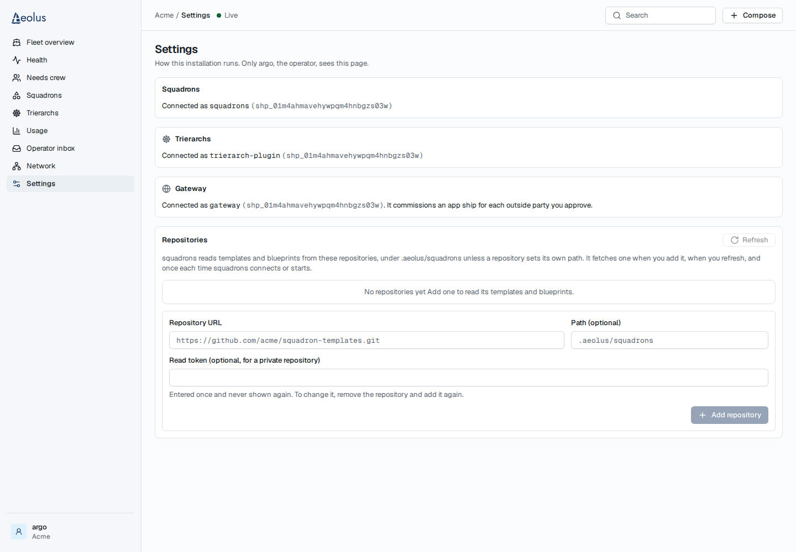
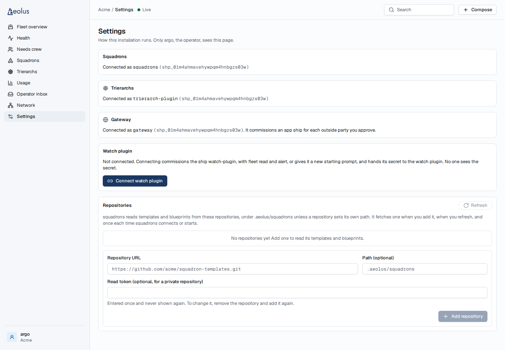
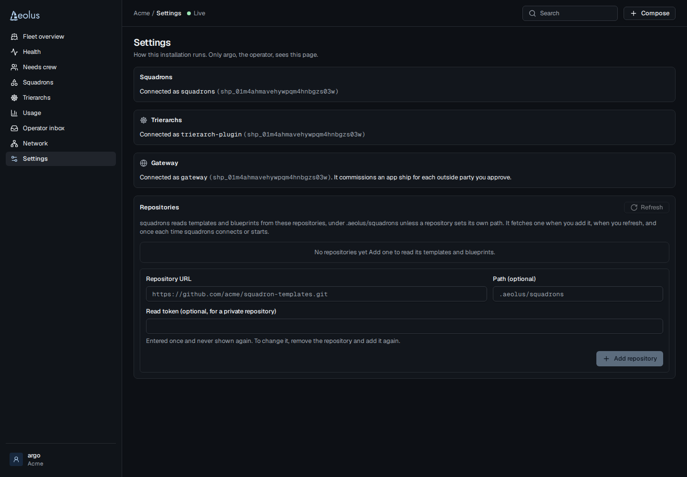
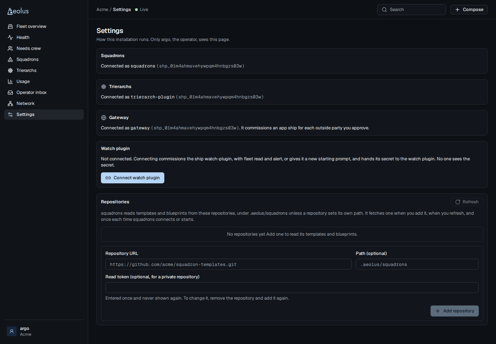

# Connect the watch plugin from Settings

Approved for [#1914](https://github.com/ThomasHendrickx/aeolus-fleet/issues/1914) on 16 Nov, with the picks below: the screenshots are the acceptance criteria.

## Purpose and lessons

Connect the watch plugin from the console’s Settings, as Thomas chose on 16 Nov. Follow the existing plugin connections: the web app’s server commissions the plugin ship, owned by argo, or obtains its new starting prompt, and passes its secret server to server. The browser shows the connection, never the secret.

Sources: [blueprint](../../blueprint.md), decisions [0020](../../decisions/0020-installation.md), [0021](../../decisions/0021-squadrons-installation.md), [0071](../../decisions/0071-monitoring.md), [0033](../../decisions/0033-console-logic-on-the-server.md), [design system](../README.md), its [conventions](../conventions.md) and [console conventions](../console-conventions.md). Current Settings composition: [page](../../../packages/console/app/(console)/settings/page.tsx), [connection flow](../../../packages/console/lib/connect-plugin.ts), [shown connection](../../../packages/console/lib/shown-connection.ts). The watch’s [architecture](https://github.com/ThomasHendrickx/aeolus-fleet-watch-plugin/blob/fc093605ecf17f5d042f39d855c9e9df880c8a1d/docs/watch-plugin.md), [configuration and API](https://github.com/ThomasHendrickx/aeolus-fleet-watch-plugin/blob/fc093605ecf17f5d042f39d855c9e9df880c8a1d/packages/watch-plugin/README.md), [0072](https://github.com/ThomasHendrickx/aeolus-fleet-watch-plugin/blob/fc093605ecf17f5d042f39d855c9e9df880c8a1d/docs/decisions/0072-watch-plugin-package.md) and [router](https://github.com/ThomasHendrickx/aeolus-fleet-watch-plugin/blob/fc093605ecf17f5d042f39d855c9e9df880c8a1d/packages/watch-plugin/src/adapters/trpc/router.ts) define the connection contract.

The watch needs only `fleet:read` and `fleet:alert`. It compares facts, raises and clears alerts and tells the owner. Connecting does not promise that monitoring is healthy. It never retries work, releases or recrews a ship, or escalates a signal. A fleet switched off keeps its connection; only its status can be read. Installation credentials and enabling a hosted fleet belong outside this Settings connection.

## What changes

```diff
 Settings / ListPage inside ConsoleFrame
   SquadronsConnection
   TrierarchPluginConnection
   GatewayConnection
+  Watch plugin
+    Not connected: Connect watch plugin
+    Connected: Connected as <ship name> (<ship id>)
+    Existing loading, InlineError, MissingScopes and FailedScopesRead parts
   TemplateRepositories (while squadrons is connected)
```

Only Settings changes. Its existing desktop Sidebar and phone account menu already lead here. No new destination, setup page, dialog, URL field or monitoring controls. The unchanged header, Sidebar, TabBar, other connections and repository form remain visible for context. A hosted sign-in as argo is used, so Own sign-in is absent in both versions. The example has all three other plugins connected, and no template repositories.

Every board rendered the real `ConsoleFrame`, `ListPage`, three connection parts, `TemplateRepositories`, shared `Button`, `LoadingSkeleton`, `InlineError`, `MissingScopes` and `FailedScopesRead` through the console’s own Storybook theme and fonts. The watch section follows `SquadronsConnection` unchanged in structure, with the plugin’s documented name and scopes in its copy. Handlers are inert. The connected IDs are fixtures. Main baseline: `e3c41a86c2ab7b26c9e18a1b2d438321cc3fc1d0`.

## Settings the console needs

One server environment setting, `AEOLUS_WATCH_PLUGIN_URL`, unset by default, following `AEOLUS_GATEWAY_URL` and `AEOLUS_TRIERARCH_PLUGIN_URL`. It is the plugin’s base URL reachable from the web app’s server, for example `http://watch-plugin.internal:4300`; calls go to `/trpc`. No public address is required. No secret, crew token or installation token setting is needed in the console.

The server forwards the existing console session cookie; the plugin checks it through `console.session` at its configured `FLEET_URL`. `connection.status` returns `enabled`, `state`, `ship` and `lastShipId`. `connection.connect` takes `shipId` and `secret` and requires a session holding `fleet:manage`; it refuses an already connected fleet, another fleet’s ship, or missing scopes. The console’s existing connection flow reads status first and grants missing scopes without calling connect on an already connected plugin.

## Choices

The docs settle the connection API, scopes, ownership and installation switch. Thomas approved the pick of each of these console details; the images show them.

- **Q1. No URL or switched off:** (a) hide the watch section for both, as Gateway and Squadrons do; (b) show “Not set up”, as Trierarchs does. **Pick (a)**: the watch has no setup page and the browser already receives both cases as `none`, without learning the fleet’s switch. The Unavailable board matches Before.
- **Q2. Ship name and type:** (a) `watch-plugin` for both; (b) `watch` for both. **Pick (a)**: follows the package and `trierarch-plugin`. The watch API accepts a qualifying ship and does not prescribe its name. Both options keep kind `plugin`, owner argo and exactly `fleet:read`, `fleet:alert`.
- **Q3. Location and heading:** (a) “Watch plugin” after Gateway, before Repositories; (b) the same section before Squadrons. **Pick (a)**: retains the existing plugin order and uses the docs’ term. No new icon or vocabulary.
- **Q4. Existing ship and scopes:** (a) follow the console’s existing connection flow and scope-repair UI, including reusing its last active ship and obtaining a new starting prompt when disconnected; (b) commission a fresh ship after every lost connection and show only connection state. **Pick (a)**: the requested parity includes partial failures and scopes revoked after connecting. The watch’s API exposes `lastShipId` but does not choose the console’s reuse or scope-repair interaction. Its direct connect still refuses while connected.


## Before and after: Connect watch plugin

| Width and theme | Before | After (Q1 to Q4 picks) |
| --- | --- | --- |
| 375 light |  |  |
| 375 dark |  |  |
| 1440 light |  |  |
| 1440 dark |  |  |

## Every Settings state

Every link is a full Settings screen at the stated width and theme. Error reasons are representative fixtures from the existing connection flow, not new watch API messages. “Connected” is the success outcome in place. “Granted” uses the existing scope-grant success part. Loading and busy states use the existing parts’ labels and spinners.

| State | 375 light | 375 dark | 1440 light | 1440 dark |
| --- | --- | --- | --- | --- |
| Unavailable (Q1) | [Screenshot](mockups/unavailable-375-light.png) | [Screenshot](mockups/unavailable-375-dark.png) | [Screenshot](mockups/unavailable-1440-light.png) | [Screenshot](mockups/unavailable-1440-dark.png) |
| Reading status | [Screenshot](mockups/loading-375-light.png) | [Screenshot](mockups/loading-375-dark.png) | [Screenshot](mockups/loading-1440-light.png) | [Screenshot](mockups/loading-1440-dark.png) |
| Status read failed | [Screenshot](mockups/read-failed-375-light.png) | [Screenshot](mockups/read-failed-375-dark.png) | [Screenshot](mockups/read-failed-1440-light.png) | [Screenshot](mockups/read-failed-1440-dark.png) |
| Not connected | [Screenshot](mockups/not-connected-375-light.png) | [Screenshot](mockups/not-connected-375-dark.png) | [Screenshot](mockups/not-connected-1440-light.png) | [Screenshot](mockups/not-connected-1440-dark.png) |
| Connecting | [Screenshot](mockups/connecting-375-light.png) | [Screenshot](mockups/connecting-375-dark.png) | [Screenshot](mockups/connecting-1440-light.png) | [Screenshot](mockups/connecting-1440-dark.png) |
| Connect failed | [Screenshot](mockups/connect-failed-375-light.png) | [Screenshot](mockups/connect-failed-375-dark.png) | [Screenshot](mockups/connect-failed-1440-light.png) | [Screenshot](mockups/connect-failed-1440-dark.png) |
| Connected | [Screenshot](mockups/connected-375-light.png) | [Screenshot](mockups/connected-375-dark.png) | [Screenshot](mockups/connected-1440-light.png) | [Screenshot](mockups/connected-1440-dark.png) |
| Connected, missing fleet:alert | [Screenshot](mockups/missing-scopes-375-light.png) | [Screenshot](mockups/missing-scopes-375-dark.png) | [Screenshot](mockups/missing-scopes-1440-light.png) | [Screenshot](mockups/missing-scopes-1440-dark.png) |
| Granting missing scopes | [Screenshot](mockups/granting-375-light.png) | [Screenshot](mockups/granting-375-dark.png) | [Screenshot](mockups/granting-1440-light.png) | [Screenshot](mockups/granting-1440-dark.png) |
| Grant failed | [Screenshot](mockups/grant-failed-375-light.png) | [Screenshot](mockups/grant-failed-375-dark.png) | [Screenshot](mockups/grant-failed-1440-light.png) | [Screenshot](mockups/grant-failed-1440-dark.png) |
| Scopes granted | [Screenshot](mockups/granted-375-light.png) | [Screenshot](mockups/granted-375-dark.png) | [Screenshot](mockups/granted-1440-light.png) | [Screenshot](mockups/granted-1440-dark.png) |
| Scopes read failed | [Screenshot](mockups/scopes-failed-375-light.png) | [Screenshot](mockups/scopes-failed-375-dark.png) | [Screenshot](mockups/scopes-failed-1440-light.png) | [Screenshot](mockups/scopes-failed-1440-dark.png) |

## Built

The built Settings, rendered with the same fixtures through the real `WatchPluginConnection`, at 1440 light in every state, and Not connected and Connected at 375, 1440 and 1920, light and dark: [built](built/). Every board above matches its built screen pixel for pixel, except the moving spinner and skeleton of Reading status, Connecting and Granting.
