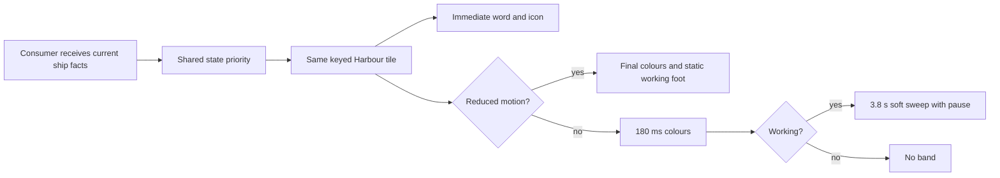

# Shared working band

Design proposal only, for [core #1753](https://github.com/ThomasHendrickx/aeolus-fleet/issues/1753) and adoption in [app #110](https://github.com/ThomasHendrickx/aeolus-app/issues/110). No production code changes. Catalogue app #97 belongs to 0.7.0; this retains the original app 0.6.0 priority.

## Purpose

Keep a fleet with many working ships calm, warm and readable. Motion confirms activity without competing with names, reports, state words or controls. Every app gets the same band from `@aeolus-fleet/ui`.

## Lessons to check against

- Thomas approved option 1 on every motion page on 10 November, recorded in app #110. The pinned acceptance reference is [65b9e8c](https://github.com/ThomasHendrickx/aeolus-app/tree/65b9e8ca70328f9f533eb66538f9d5eda4c2b804/docs/design/motion), specifically `preview.css:134-138` and scene 110 in `preview.tsx`. `Preview` indexes options from zero. The approved first option is `data-option=0`: 3.8 s including 1.4 s pause. The `data-option=1` override is the unselected second option, 4 s.
- Current core baseline: `2e8f61c05d16bf0be5689f10b6f5c95e30e88a00`. `packages/ui/src/theme.css` defines the 2.4 s background-position loop; `HarbourTile` supplies a 2 px band, 40% gradient and .70 opacity. Reduced motion is a static solid band at .35 opacity.
- The approved review uses transform on the band, .45 peak opacity, a transparent pause and 180 ms colour transitions. Its broad descendant selector and wrapper animation override are review scaffolding, not a consumer API.
- `Harbour` owns groups, counts, loading, error, empty and updating presentations. `HarbourTile` accepts ship id/name/state/note/activity, kind, time and optional link. `ShipState` owns icons and words. [State colours](../state-colours/state-colours.md) owns the meanings: Alert, Awaiting crew, Blocked, Working, Idle; Crewed and Retired remain statuses, not Harbour groups.
- Console overview uses shared Harbour with filters and links; app `features/fleet/ui/fleet-panel.tsx` wraps it with Home/Fleet headings, forbidden/loading/error handling, retry and console links. Gateway main at `96a374ae54ac447253d1d7672f830274a8c499b3`, `bridge/fleet/ui/bridge-harbour.tsx`, imports shared Harbour and adds focus-outline/pressed-arrow link fixes. It mounts only ready data, using its own unreadable line. Preserve those link fixes; do not infer deployment from source. App source audited at `35c129f25fb0a876899b48542632e95f6a1b5ab2`.

## Questions before implementation

1. Confirm the shared translation of the approved option: colour-only settling on state changes, no state-induced tile or group movement, with .45 static solid band under reduced motion. Recommendation: approve; it keeps a static foot and follows the approved proposed opacity.
2. Confirm the app FleetPanel wrapper's `aeolus-rise` is removed on mount, refresh and state changes as the approved review shows, while unrelated page motion remains governed by its own approved page. Recommendation: approve this adoption boundary.

The 180 ms settling value agrees across sources. Implementation stays gated on design approval.

## Shared source and adoption boundary

Core owns this cross-repo design. Production source remains `packages/ui/src/theme.css`, `molecules/harbour-tile.tsx` and `atoms/ship-state.tsx`, using shared tokens; this preview is disposable design evidence. App #110 consumes a released UI version and the shared theme through its existing import, removes competing fleet wrapper motion and verifies Home and Fleet. No app-local band, keyframes, state-colour mapping or copy of Harbour. Console and Bridge must verify the same package behavior at their installed version; no release or deployment is authorized here.

| Contract | Owner | Adoption check |
| --- | --- | --- |
| Band, timing, opacity, reduced motion | shared UI | Working only; all consumers agree |
| State priority and data | common/core | No new interpretation in an app |
| Stable id and ordering during updates | consumer feeding Harbour | Same keyed tile keeps its position |
| Navigation, filters, retry, forbidden | each app | Existing behavior and keyboard focus preserved |
| State words, icons, tones | shared ShipState and tokens | No animated label delay |

## Concrete motion

Approved first option: 3.8 s linear infinite loop. Band alone translates from -100% to +100%; opacity 0 at start, .45 at 10%, 0 at 63.1579%, then stays invisible through 100%. Sweep is 2.4 s; pause 1.4 s (the percentage is rounded in the reference). Preserve the 2 px foot and shared Sea colour. Preserve the gradient rather than turning the whole tile into a shimmer. Do not animate tile transform, size, order or counts on a state update.

Approved: background and text colour settle over 180 ms ease-out. Proposed integration detail: border colour also settles over 180 ms, while new icon, state word and report are immediate. Remove the band immediately when Working ends so it never implies work after the fact. On entering Working begin a fresh loop. Rapid changes cancel the old colour interpolation and settle toward the latest state. Normal link hover/focus controls retain their existing contract; state changes never invoke hover movement.

Reduced motion: zero translation, zero fades or interpolation; final colours and labels immediately, Working gets a static .45 solid Sea foot, following the proposed review CSS opacity when animation is disabled (the baseline is .35). Other states have no band. No motion is required to read a state.

## Preview and evidence

Regenerate screenshots and measurements with the [capture command](capture.md).

Open `preview.html` directly in a browser, with no install or server. Query options: `?mode=before|after&theme=light|dark&reduce=1`. Controls compare both versions, toggle reduced motion, and change the first tile through every state. Six working ships expose the aggregate rhythm. Crewed and Retired are shown separately as statuses.

The whole-screen phone and desktop captures in `evidence/` compare light/dark and before/after; reduced-motion captures show the static outcome. `evidence/checks.json` records browser measurements and state transitions.

Simulated: shell, names, notes, time, navigation, groups, counts and events. This is an isolated HTML model of the band and colour behavior, not a mounted production React component. Before reproduces the band contract, not a pixel-exact production screenshot. Production imports, installed consumer versions, live stream updates, retry/forbidden behavior, focus retention, screen reader announcements, physical phone behavior, GPU cost and subjective calm remain unproven. Still images cannot prove sweep or pause; [the recording](evidence/after-motion.webm) shows two cycles, state changes and the reduced-motion ending. Use the runnable preview to compare both versions. No fleet/API traffic occurs in the preview.

| View | Before | Candidate | Reduced motion |
| --- | --- | --- | --- |
| Desktop light | [Before](evidence/desktop-light-before.png) | [After](evidence/desktop-light-after.png) | [Static](evidence/desktop-light-after-reduced.png) |
| Desktop dark | [Before](evidence/desktop-dark-before.png) | [After](evidence/desktop-dark-after.png) | [Static](evidence/desktop-dark-after-reduced.png) |
| Phone light | [Before](evidence/phone-light-before.png) | [After](evidence/phone-light-after.png) | [Static](evidence/phone-light-after-reduced.png) |
| Phone dark | [Before](evidence/phone-dark-before.png) | [After](evidence/phone-dark-after.png) | [Static](evidence/phone-dark-after-reduced.png) |

State captures: [Alert](evidence/state-alert.png), [Awaiting crew](evidence/state-awaitingCrew.png), [Blocked](evidence/state-blocked.png), [Working](evidence/state-working.png), [Idle](evidence/state-idle.png). Static Crewed and Retired status references are visible at the bottom of every screen.
