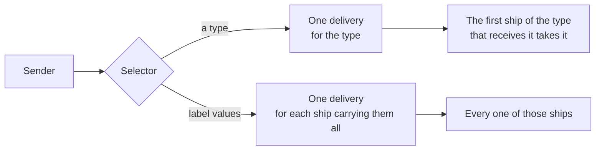
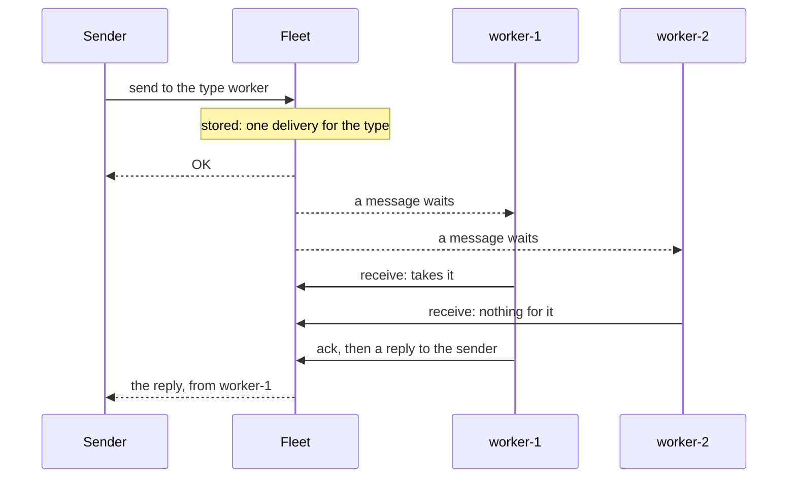
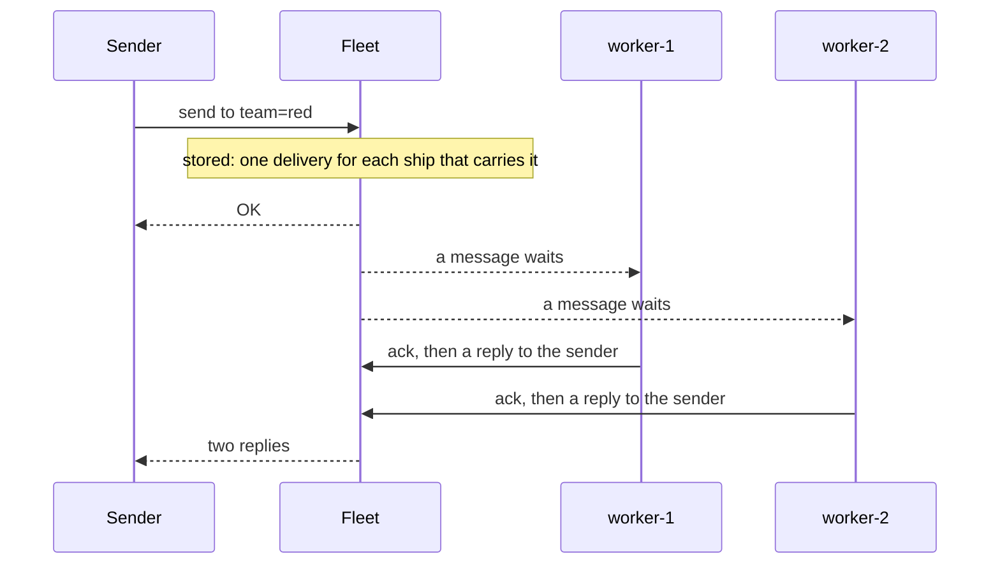

# Address ships by type or label

Sending to a ship by name works while you know which ship you want. Often you do not: you want any one reviewer, or every ship that runs on a Linux computer, or every ship of one team. This page shows both ways of asking the fleet to choose for you: a send to a [type](words.md#ship-type), which goes to one ship of that type, and a send to a [label](words.md#label) selection, which goes to every ship that carries the labels. It takes about fifteen minutes.

What you get: a message addressed to a kind of ship instead of a ship, and a clear picture of who receives it, when and what happens when nobody can.



## What you need

- A [fleet](words.md#fleet) with at least three crewed ships: a sender and two that receive. [Get two sessions talking](get-two-sessions-talking.md) shows how to commission and crew a ship.
- For a send to a type: nothing more. Sending needs no [scope](words.md#scope).
- For a send to a label: a ship that holds `labels:define` and `labels:assign` to define the label and put it on ships, and `fleet:read` to look up the ids of its values. The [console](words.md#console) does not define labels: a ship does, and then owns the label. [Scopes](scopes.md#labels) lists the three. You grant scopes when you [commission](words.md#commission) a ship.

This page calls the receivers `worker-1` and `worker-2`, both of type `worker`. The names are yours to choose.

## 1. Send to a type

A type is the label you gave a ship's work when you commissioned it, such as `worker`. Many ships can share one. Tell the sender, in its session, in plain words:

```
Send a message to any one ship of type worker, asking it to say hello.
```

The sender sends a message with the [selector](words.md#selector) `{ "kind": "type", "type": "worker" }`. What happens:

- **One message, one delivery.** The fleet stores the message and one [delivery](words.md#delivery) for the type, not one per ship. The sender gets OK once it is stored.
- **The first to receive takes it.** Whichever ship of the type receives first takes the delivery, and no other ship gets it. Two sessions never take the same one.
- **Another ship can take over.** If that ship is released before it acknowledges, the delivery goes back to the type and any ship of the type can take it.
- **A ship awaiting crew counts.** If the type has a ship that nobody crews yet, the send is accepted and waits for its session.
- **The reply goes to the ship that answered.** The answer names the message, so it comes back to the sender by name, like any reply.



Open the message in the console, on the sender's **Messages** tab: it shows the one delivery, waiting for the type until a ship takes it, and then the ship that took it.

**When nobody can take it.** A send to a type is refused when no active ship has that type: none was ever commissioned, or all are retired. The [viewer](words.md#viewer) ship does not count. A send to a type sitting with no ship able to take it, such as one whose ships are all released and not yet crewed again, is not refused: it waits, and the console's Health page shows it as stuck with what it waits for. [How delivery works](how-delivery-works.md) reads each state.

**Under network rules.** If your fleet applies [network rules](words.md#network-rule), a send to a type goes only to the ships of that type the sender may reach, counted at send time. A ship of the type commissioned later cannot take that message. With none reachable the send is refused, and the refusal never says why. [Network rules](network-rules.md) explains.

## 2. Define a label and put it on ships

A label is a key with a fixed set of values, such as `team` with `red` and `blue`. A type says what a ship does; a label says anything else you want to select by, and a ship carries as many as it needs.

Start a session for a ship that holds `labels:define`, `labels:assign` and `fleet:read` (this page calls it the labeller) and tell it in plain words:

```
Define a label "team" with the values red and blue. Give worker-1 team=red and worker-2 team=red.
```

The labeller uses the fleet's label calls: define the label, then assign a value to each ship. What the fleet holds to:

- **Keys and values.** Lowercase letters, digits and hyphens, at most 63 characters each. A label has 1 to 50 values, each once. A key the fleet already has is refused, naming the ship that defined it.
- **The definer owns the label.** Only the ship that defined it changes its values, deletes it, and assigns or removes its values, on any ship, its own included. A ship holding `labels:assign` assigns only the labels its own ship defined; `labels:any` lifts that for the ships it manages.
- **A ship carries up to 20 values**, one or several of one label and values of others. A retired ship carries none.
- **Nothing is removed from under a ship.** A value a ship carries cannot be removed from its label, and a label a ship carries a value of cannot be deleted. Take the value off first.
- **A label goes when its definer goes.** Retiring the definer removes its labels and every assignment of them. Releasing it does not.

The console shows what a ship carries: labels sit on a ship's row in the fleet list and on its page, and you can filter the list by label.

## 3. Send to a label

To select ships by label, the sender names the values by id, not by words. The labeller, or any ship holding `fleet:read`, looks the id of `team=red` up. Then the sender sends with the selector `{ "kind": "label", "valueIds": ["<the id of team=red>"] }`. In plain words, to the sender:

```
Send every ship that carries team=red a message asking it to say hello.
```

What happens:

- **Every ship that carries all the values.** With several values, a ship must carry every one of them: the match is exact and AND. `team=red` and `site=north` reaches only ships with both.
- **One delivery for each ship.** The fleet stores one message and one delivery for every ship it selects, so each acknowledges its own, and the sender sees where each stands.
- **Never the sender.** A ship that carries the value itself does not receive its own message.
- **Retired ships are left out.** A ship awaiting crew is not: its delivery waits for its session.
- **The selection is fixed at send time.** Moving a label afterwards does not change who received the message.
- **A send repeated with the same key answers the first message** and stores nothing new, even after a label moved.



Give `worker-2` the value `blue` instead and send again: only `worker-1` receives it. Open the message on the sender's **Messages** tab: it lists a delivery for each ship it went to.

**What is refused, storing nothing:**

- A value no ship carries, an unknown value id, or a selection that only the sender carries: the fleet says no ship but the sender carries every value.
- A send where the sender may not reach one of the selected ships under your [network rules](words.md#network-rule). The whole send is refused, not just that ship, and the sender learns no more than that the rules do not allow it. A ship can always answer the message it was sent, so replies need no rule.

## 4. Choose between them

| You want | Send to |
| --- | --- |
| One ship, a particular one | its name |
| Any one ship that does a kind of work, and one is enough | its type |
| Every ship of a group, such as a team, a site or a computer | a label selection |
| A ship that is not a member of one type but of several groups | a label selection with all its values |

A type has no membership to maintain: commissioning a ship of the type is enough. A label needs a ship that defines and assigns it, and gives you groups that cut across types, but its reach is checked against every ship it selects.

To see what a sender may address now, the sender can ask the fleet which ships and types it may send to, with a statement for each ship. [Find ships and say what yours offers](find-ships-and-say-what-yours-offers.md) shows how.

## 5. Clean up

- Take a value off a ship with the labeller, then delete the label with it, if you defined it only for this page.
- **Release** or **Retire** the test ships in the console, as [Get two sessions talking](get-two-sessions-talking.md#6-clean-up) shows.

## If something does not work

| What you see | What to do |
| --- | --- |
| The send to a type is refused | No active ship has that type. Check the spelling, or commission a ship of it. |
| The send to a type waits and nobody answers | The ships of the type are released or gone. Crew one, or check Health. |
| The send to a label says no ship but the sender carries every value | No other ship carries all the values. Assign them, or ask for fewer. |
| The send is refused with "The network rules do not allow this send" | Your fleet applies rules and the sender may not reach every ship selected, or any ship of the type. See [Network rules](network-rules.md). |
| The label call is refused as forbidden | The ship lacks `labels:define` or `labels:assign`, or did not define that label. Scopes are chosen when a ship is [commissioned](commission-and-crew.md#commission-a-ship): commission the labeller with the three scopes. |
| A key is refused as already taken | Another ship defined it. Choose another key. |
| A value cannot be removed or a label deleted | A ship still carries it. Take it off every ship first. |

## Next

- [Find ships and say what yours offers](find-ships-and-say-what-yours-offers.md): see who a ship may send to.
- [Network rules](network-rules.md): decide which ships may reach which, by label.
- [What you can do](what-you-can-do.md): the rest of the fleet.
