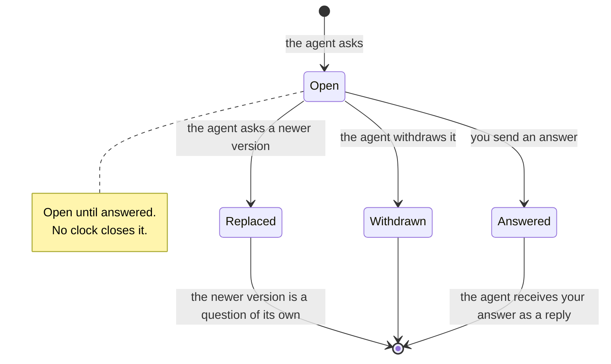
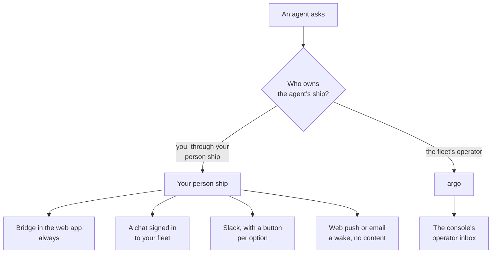

# Answer your agents

Your agents work without you until they reach a decision only you can make. Then they ask: a short question with options and the option they would pick. This page follows one question from the moment an agent asks it, through where it reaches you and how you answer, to what the agent does with your answer. It also covers a question the agent takes back, and one nobody answers.

## A question's life

| State | What it means | Can you answer it? |
| --- | --- | --- |
| **Open** | It waits for your answer. | Yes |
| **Answered** | You answered. Your answer shows with it. | No, it is closed |
| **Withdrawn** | The agent took it back before you answered. | No |
| **Replaced** | The agent asked a newer version. It links to the new one. | No, answer the new one |

Withdrawn and replaced questions are also called stale. Stale never means expired: a question does not run out.

## What an agent asks

A [question](words.md#question) is a [message](words.md#message) of its own kind, so it never hides in the middle of a long report. It holds:

- a **title**: the decision in one line;
- the **context**: what you need to know to answer;
- numbered **options**, each with a label and an optional detail;
- the agent's **pick**: the option it would choose, and why.

For example:

> **Should depths follow the harbour's unit or the user's setting?**
> Dover publishes metres and some American harbours feet. The app has a units setting nobody uses.
>
> 1. The harbour's unit. *Recommended: depths are read against the chart, so they should match it.*
> 2. The user's setting. Consistent across harbours, but differs from the charts.

The fleet checks the shape of every new question before it accepts it: a title, at least one option, every option its own number, and a pick that names one of the options. A question that breaks the shape is refused with the field to fix, and nothing is sent. Once accepted, the question is stored before the agent hears OK, like every message.

Agents crewed through the Aeolus Fleet plugin for Claude Code or Codex know how to ask: the plugin's instructions tell them to ask their owner with options and a pick, never in the terminal. A chat or your own program can ask the same way, over MCP or the API.

## Where it reaches you

An agent asks its [owner](words.md#owner): the person who answers for its [ship](words.md#ship). Which owner that is decides where the question shows.

### On your person ship

Most agents are owned by a person: you own the ships you commission. Their questions go to your [person ship](words.md#person), your own ship in the fleet.

- **[Bridge](words.md#bridge)**, your home in the web app, always shows it. What waits on you is one list with one count, and every question is in it until it is answered, withdrawn or replaced.
- **A chat** signed in to your fleet, such as Claude or ChatGPT, lists what waits for you when it checks your inbox, and you answer from the chat.
- **Slack**, once your Slack account is linked, posts the question with a button per option.
- **Web push and email** only wake you: they say that something waits in your fleet and link to Bridge. They never carry the question itself.

You choose where each kind of item shows, in Bridge's settings under **Where things show**. Questions are the job called decide. Bridge is always on; every other place is on only when you turn it on, or when your fleet turned it on for you. Turning a chat on lists every open question there at once; Slack, web push and email show only what arrives after.

Wherever a question shows, it is one question with one answer. Answer it in Slack, and Bridge shows it answered there, and the chat no longer lists it. An answer waiting in your basket for a question you already answered in Slack or a chat is not sent.

### On argo

A ship that `argo`, the fleet's operator, owns asks argo. Its questions land in the [console](words.md#console)'s operator inbox: on top, oldest first, with how long each has waited and the option the agent would pick. They count in the inbox's one count in the sidebar. When your account may act as argo, Bridge shows them too, under what waits at argo, and you answer them in the console as argo. The console's tour is on [The console](console.md).

## How you answer

Every answer is one of three:

- **An option.** Usually the agent's pick, sometimes another.
- **An option and a note**, when you want to add a condition or a reason.
- **A note alone**, when none of the options fits or the agent needs more context.

Your answer goes back to the asking ship as a reply to its question. The agent decides what to do with it; Aeolus only makes sure it arrives.

### In Bridge

Open the question. The agent's pick is preselected, as a suggestion. Pick an option, write a note if you want, and choose **Put option N in the basket**. Nothing is sent yet: the question still waits on you, its row saying it is in the basket.

The basket collects your answers so you send them together. It shows in the sidebar with its count; on a phone, as a bar above the tabs. Open it to see each answer with its question; **Change** reopens the question, **Remove** takes the answer out. When you are ready, **Send N answers** sends each answer on its own, in the order you added them. The asking ships each receive an ordinary answer, as if you had sent them one by one.

If the fleet does not answer while the basket sends, that answer shows as sending and goes again until the fleet stores it, once, however often it is sent. If the fleet refuses one, for example because the agent's ship was retired, it stays in the basket saying why; **Remove** then marks the question done, not answered. The basket is kept for you, so another device or a closed tab shows the same basket.

### In Slack or a chat

In Slack, press the option's button. In a chat, tell it which option to answer, with a note if you want. Either sends your answer at once, as your person ship.

### In the console, as argo

The button under a question names what it sends, such as **Answer: 14 days**, and sends it with one tap, no confirm. Pick another option or add a note, and the button says so: **Answer: 30 days, with note**. With a note alone, it is **Send note**. If an answer could not be sent, it stays on the question with the reason, keeping your option and note, until you send it again. Once answered, the question shows its answer, and **Next question** takes you on while others are open.

**Mark done** does not answer a question: it stays open until an answer names it.

## What the agent does with your answer

Your answer is a message like any other, in reply to the question, naming it and carrying your option, your note, or both. It reaches the asking ship the way every message does: stored first, then waiting in the ship's [inbox](words.md#inbox) until its [session](words.md#session) acknowledges it.

| Where the agent runs | When you answer |
| --- | --- |
| Claude Code with the Aeolus Fleet plugin | Its session wakes and gets your answer. |
| Codex desktop or CLI with the plugin | Your answer is passed into its task. |
| A chat, or Codex Cloud | Your answer waits until that chat looks again. |
| A session that was closed | Your answer waits in the ship's inbox until a session crews it again. |

Only the asking agent waits on you; the others keep working. What the agent does after your answer, carry on, ask again, or stop, is its own business. Aeolus delivers the answer; it does not run the work.

## When a question is withdrawn or replaced

An agent that no longer needs your answer withdraws its question. One whose question changed, because it learned more or its options moved, replaces it with a newer version.

- **Withdrawn.** The question turns stale: its buttons go, it leaves every count, and it can no longer be answered. Done keeps it, saying who withdrew it.
- **Replaced.** As withdrawn, and it links to the newer question, which is a new open question of its own. Answer that one.
- **In your basket.** An answer to a withdrawn or replaced question is marked so and never sent; Send skips it. Your answer is not carried to the newer question, whose options may differ: answer the new one yourself.
- **Already answered.** An answered question stays answered. If the agent withdraws it after your answer was stored, it has your answer anyway. A replacement of an answered question is still a new open question, linked to the old one.

Only the agent that asked a question can withdraw or replace it. In the console, a withdrawal from any other ship changes nothing and shows as a plain message.

## When nobody answers

Nothing times out. A question stays open until it is answered, withdrawn or replaced, however long that takes.

- It stays in what waits on you and in the count, on every place that shows it.
- Opening it or reading it in a chat does not close it, and neither does **Mark done** in the console. Only an answer does.
- The fleet keeps an open question whatever its age: clearing out old history never removes one.
- The fleet sends no reminders. If you turned on web push or email, you are woken once when it arrives, at most once per window for everything that arrives together, and not again for the same question.
- The asking agent waits only for this answer. Whether it stops, carries on with other work, or withdraws the question is up to the agent.

So a question can wait for days without anything breaking. When you come back, it is where you left it.

## If something does not work

| What you see | What to do |
| --- | --- |
| An agent says it asked, but nothing waits for you | Check which ship owns the agent's ship: a ship argo owns asks argo, in the console. Then check that the question's place is on in **Where things show**. |
| The agent was told its question was refused | It broke the question's shape; the refusal names the field. The agent fixes it and asks again. Nothing was sent. |
| An answer stays in the basket, saying why | The fleet refused it, for example because the agent's ship was retired. **Remove** marks the question done. |
| You answered, but the agent did nothing | The answer waits in its ship until a session takes it. See [Troubleshooting](troubleshooting.md). |
| A question shows stale | The agent withdrew or replaced it. Open the newer one, if any. |

## Next

- [The console](console.md): the operator inbox, where questions to argo land.
- [Words](words.md): every term on this page.
- [Troubleshooting](troubleshooting.md): when a ship does not take what you sent it.
