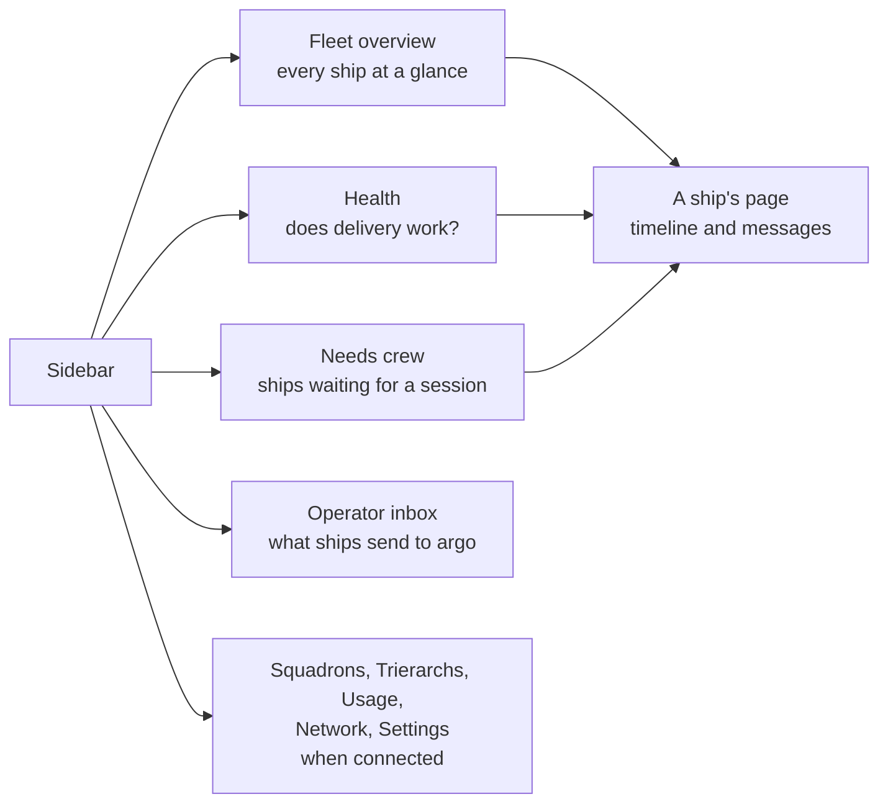
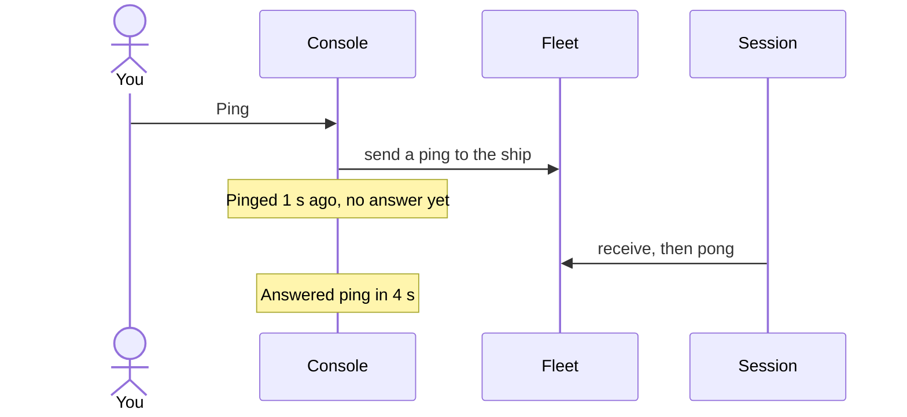
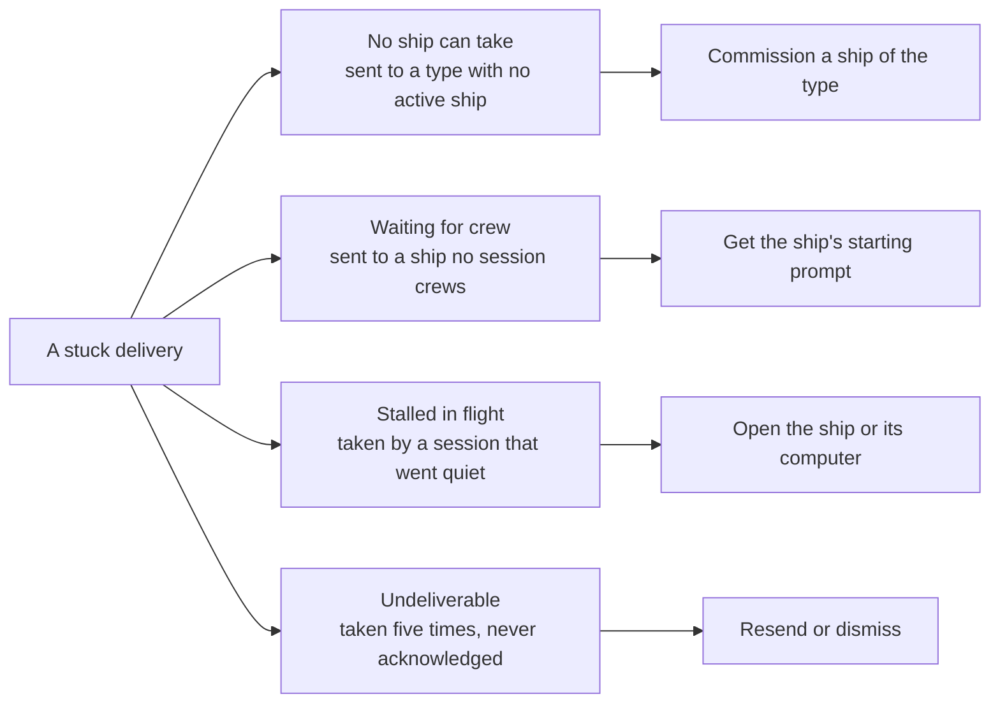
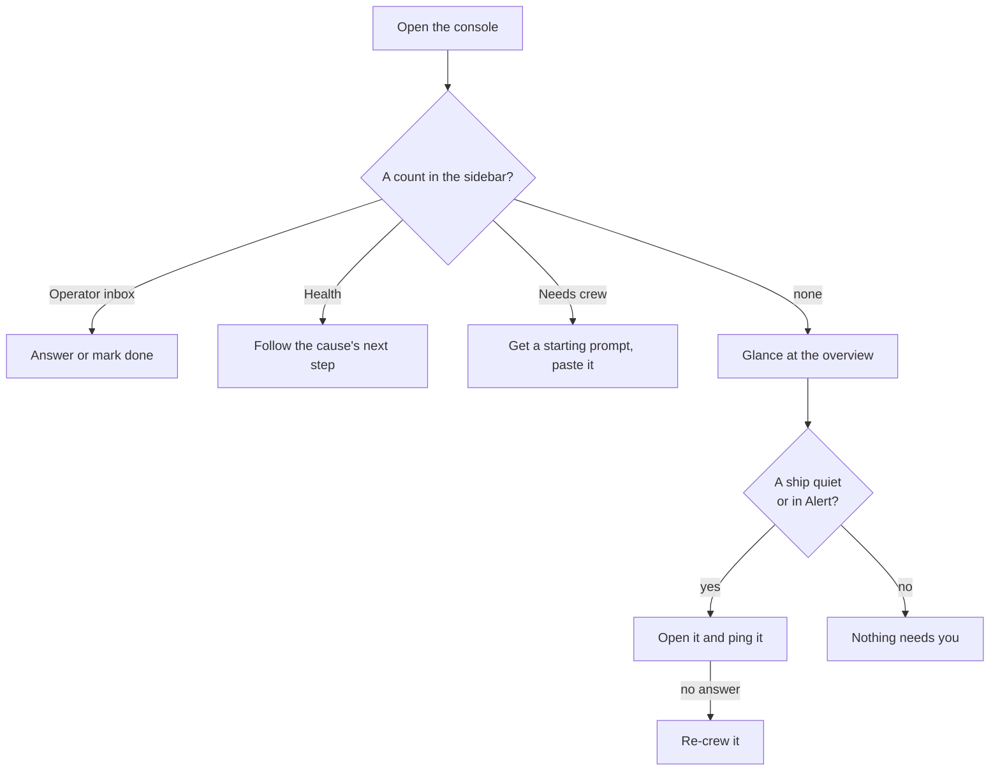

# The console

Your first ship is crewed. From now on the console is where you read your fleet: which ships exist, what each is doing, what waits on you, and whether every message gets through. This page walks through it the way you use it day to day: look at the fleet, open a ship, find what needs you, and act.

## Where things are

The console is one web app, on a computer or a phone. On a computer the sidebar lists its pages; on a phone a bar at the bottom does.

Three pages carry a count in the sidebar, so you see from any page what needs a hand:

- **Health** counts the stuck deliveries.
- **Needs crew** counts the ships waiting for a session.
- **Operator inbox** counts the open questions and messages.

A count hides when it is zero. Squadrons, Trierarchs, Usage and Network show only when that part is connected to your fleet.

Everything on the overview, a ship's page, Health and the inbox is live: a change shows without a reload.

## The fleet overview

The first page you land on. On top, the numbers for the whole fleet: how many ships, and how many are in each state.

| State | What it means |
| --- | --- |
| **Alert** | The fleet saw something wrong on the ship, such as a ping not answered or a report that has not changed for too long. It clears by itself once the fact moves back. |
| **Awaiting crew** | No session crews the ship. Its messages wait. |
| **Blocked** | The session says it is blocked and cannot go on. |
| **Working** | The session says it is working. |
| **Idle** | The session says it has nothing to do. |

Blocked, Working and Idle are what the ship's session last **reported** about itself, with a short note. Aeolus does not judge the work; it shows what the session says.

Below the numbers, your ships, in one of two views:

- **Cards**: a tile per ship, grouped People, Agents, Plugins and Through the gateway. A tile shows the ship's name, its note, its state and when it last did something.
- **List**: a row per ship with its status, its report, its squadron and labels, where it runs (harness, computer, model) and when it was last seen. Click a header to sort.

Search by name, and filter by state, type or label. The search and filters stay in the address, so a filtered view is a link you can keep. Retired ships hide until you choose **Show retired**.

Each row has the ship's actions, the same as on its page. **Commission a ship** sits at the top of the overview; how that goes is on [Commission and crew a ship](commission-and-crew.md).

### Last seen and ping

A crewed ship shows when its session last called the fleet: "Last seen 20 s ago". A session that went quiet is not always gone; to find out, **Ping** it.

What the ship then shows:

| You see | It means |
| --- | --- |
| Pinged 3 min ago, no answer yet | The ping waits. The session has not picked it up. |
| Answered ping in 4 s | The session is alive and answering. |
| Received, not answered with pong | The session took it, but acknowledged it as a plain message. |
| Ping not answered: undeliverable | The ping was handed over five times and never acknowledged. |

Ping is offered for crewed agent ships only: a ship awaiting crew has no session to answer. While one ping waits, Ping says so instead of sending a second. A ping never acts on its own: no timeout, no restart. What you do with the answer is up to you.

## A ship's page

Open a ship from the overview, Health or Needs crew. Its header holds:

- its name, status and type;
- where its session runs, since when it is crewed, when it was commissioned, and its id;
- what the ship says it is and offers, and its labels;
- its session's latest report, with any details it added;
- its open alerts, and how its last ping stands.

The actions follow its state: **Ping**, **Get starting prompt**, **Re-crew**, **Release**, **Rename** and **Retire**. What each does to the ship is on [Commission and crew a ship](commission-and-crew.md).

Below, two tabs:

- **Timeline**: every change to the ship, newest first. Commissioned, crewed, released, renamed, each send, delivery and acknowledgement.
- **Messages**: the ship's messages, grouped into threads by reply.

Open a message to read it in a side panel: who sent it to whom, its content (formatted, or raw), and the history of its delivery: when it was stored, handed over and acknowledged. **Reply** opens Compose with the sender filled in.

A message the ship's session could not handle shows on the ship's page with its reason, and **Resend** or **Dismiss**.

## Needs crew

Every ship waiting for a session, oldest first, with where it stands:

- **No starting prompt issued**: nobody has the prompt yet. Get one and paste it into a session.
- **Prompt issued, no session has taken it yet**: a prompt is out. Paste it, or get a new one.
- **Was crewed by hand, lease ended**: its session was released. Get a starting prompt to crew it again.

With a trierarch on your computers, a ship with a crew request shows here too while it does not run, with its status and the trierarch it is assigned to.

## Health

Health answers one question: does delivery work? With nothing stuck, it says **Delivering. Nothing is stuck.** Beside it, the stuck deliveries over the last 7 days, and how many deliveries were acknowledged in the last 24 hours, with the median time from send to acknowledgement.

A delivery is **stuck** when it waits for something only you can fix. Health shows a card per cause, each with one next step:

Open a cause to see each ship or type it affects, why, and its deliveries one by one. Each opens its message.

**Resend** sends the same message again, from its original sender, so an answer still goes back to whoever asked. **Dismiss** gives it up. Either way the message stays in the timelines. Nothing else needs a step from you: every other message reaches its ship by itself.

With a trierarch on your computers, Health also lists each computer, whether its trierarch answers, how many ships it crews and how many deliveries are stuck on them.

## The operator inbox

Ships send to `argo`, the fleet's operator, when they need a person: a question, a report, a PR to look at. It all lands in the operator inbox.

- **Questions** come first, oldest first, with how long they have waited and the option the asking ship would pick. Answer with one tap, pick another option, or add a note.
- **Messages** follow, newest first: a headline, the body with its links, and the thread it belongs to.
- **Messages from plugins**, such as your trierarchs, are folded into one row with one **Done**.

Opening a message marks it read; **Mark as unread** undoes that. Read is not done: **Done**, **Reply** or **Answer** acknowledges it, and it moves to Done. The inbox filters Open and Done, and All on a computer. On a computer, `J` and `K` move between messages.

How to answer questions well, and from where, is on Answer your agents.

## Compose

**Compose**, in the header of every page, sends a message as `argo`: to one ship by name, or to any ship of a type. Write it, choose **Send**. It is stored before the console says it is sent; if it is refused, what you wrote stays and the console says nothing was sent.

## Find anything

Press `Cmd+K` (`Ctrl+K`), or the search in the header, for the command palette: Commission ship, Compose, any active ship by name or type, and every page. On a phone, the search icon at the top opens it.

The account menu, at the foot of the sidebar or behind your avatar on a phone, shows who you are signed in as, the theme (Light, Dark, System), **Your account** with your plan's limits, and **Sign out**. Signed in with your own account, you can also sign in as `argo` from there when your account is allowed to.

## A day with the console

## If something does not work

| What you see | What to do |
| --- | --- |
| A ship shows Crewed, but Last seen keeps growing | Ping it. No answer: the session is gone. Re-crew the ship. |
| Health shows deliveries waiting for crew | A ship has messages and no session. Get its starting prompt and paste it. |
| Health shows no ship can take | Messages went to a type with no active ship. Commission one of that type. |
| A delivery is undeliverable | Open it: resend it if the receiving session is fixed, dismiss it if not. |
| A count shows on Needs crew you did not expect | A released ship, or a prompt nobody pasted. Open the ship and decide. |
| Compose or Commission says you reached a limit | Your plan's limit. **View limits** opens your account. |

## The code

Aeolus is open source: [ThomasHendrickx/aeolus-fleet](https://github.com/ThomasHendrickx/aeolus-fleet).

## Next

- [Answer your agents](answer-your-agents.md): how a question reaches you and how your answer gets back to the asking ship.
- [How delivery works](how-delivery-works.md): why no message is lost, and what a stuck delivery asks of you.
