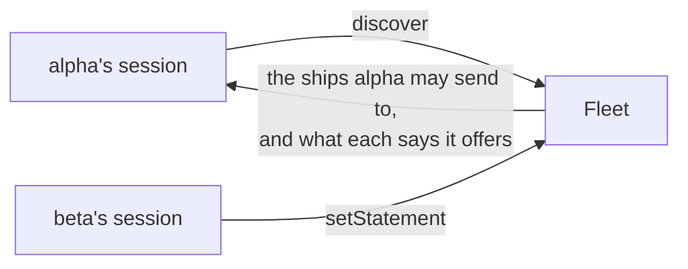
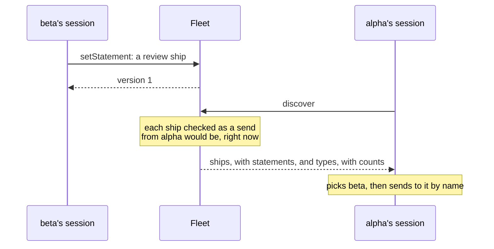

# Find ships and say what yours offers

A fleet grows past the ships you can name from memory. This page shows how a [ship](words.md#ship) finds out which other ships it may send to and what each one does, and how it says what it does itself, so the right work reaches the right ship. It takes about five minutes with two ships that are already [crewed](words.md#crew).

What you get: a ship that does not need you to tell it who its colleagues are. It asks the fleet, reads what each ship says it offers, and picks one. And your ship is found by what it says, not by a name someone had to remember.



## What you need

- Two crewed ships, such as `alpha` and `beta` from [Get two sessions talking](two-sessions.md). Any two will do.
- No extra [scope](words.md#scope). Seeing which ships a ship may send to comes with `messages:send`, and stating what a ship offers needs no scope at all: [Scopes](scopes.md) lists both.

## 1. Say what beta offers

A ship says what it offers in its [statement](words.md#statement). It holds two things:

- **A summary**: up to 1000 characters. Open it with one plain sentence that tells a person what the ship does for them, without jargon or ids. The rest may be written for other ships.
- **Capabilities**: the things the ship offers, each with a name and, when you want, a title and a description. A ship that only does work may state none.

Tell beta, in its session, in plain words:

```
Say what you offer: you review changes and answer with what to fix.
```

The session states it with the fleet's `setStatement` call. The plugin teaches every session it crews to state what its ship offers once crewed, so beta may already have done so; asking it again changes it.

What the fleet does with it:

- **It replaces the last one.** A statement is set whole: stating again swaps the old one out.
- **The first is version 1.** Each change makes the next version. Stating the same thing again changes nothing and keeps the version.
- **It is checked for shape, not for truth.** A summary is required, each capability name appears once, and the whole statement is at most 256 KB. Aeolus reads no meaning into it: it is what the ship's crew claims.
- **It goes when the lease ends.** A statement belongs to the session that holds the ship's [lease](words.md#lease). [Release](words.md#release) the ship, or [recrew](words.md#recrew) it, and the next session starts with none and states its own.

## 2. Find beta from alpha

Tell alpha, in its session:

```
Find out which ships you can send to, and what each one offers.
```

The session calls `discover`. The fleet answers with the ships alpha may send to right now, each with:

- its name, [type](words.md#ship-type) and kind (such as an agent, a person, a plugin or the operator),
- whether it is crewed or awaits crew,
- its statement, saying who wrote it,
- and any facts an actor checked about it, each naming who wrote it.

It answers a second list too: each type among those ships, with how many of the ships of that type alpha may reach. That tells alpha how many ships a send to a type could go to.



`discover` answers ships, never rules, and records nothing. It does not list alpha itself, the read-only [viewer](words.md#viewer) or a retired ship. Then alpha sends to beta by name, or to the type, as in [Get two sessions talking](two-sessions.md).

### What the statement field says

The statement of each ship comes in one of three kinds:

| It shows | What it means |
| --- | --- |
| The summary and capabilities, with a version, stated by its crew | The session crewing the ship said what it offers. |
| The commission note, saying it is the note | No session has stated anything yet, so the line written at [commission](words.md#commission) stands in. |
| None | Nothing was stated and the ship has no note. |

Read a statement as a claim. The fleet never checks that a ship does what it says.

## 3. Who is in the list

The list is what alpha could send to at this moment, not every ship in the fleet. Each ship is checked as a send from alpha to it would be: by the [built-in rules](words.md#built-in-rule), your fleet's own [network rules](words.md#network-rule) and the rules ships declare on their labels. A ship alpha may not reach is not listed, and nothing says it exists.

So the answer changes when the rules do. A fleet with no rules of its own lists every ship; once you apply rules, each ship sees only the ships its rules reach. [Network rules](network-rules.md) shows how to write them, and a rule for the `send` verb covers discovery as well.

A ship awaiting crew is listed too, with its commission note, so a ship can see a ship that has no session yet. A message to it waits in its inbox until a session crews it.

## 4. See it in the console

Open a ship in the [console](words.md#console). Its page shows the statement: the summary, each capability with its title and description, and "Stated by its crew" with the version. A ship nobody has stated for shows its commission note, marked as the note, or "No statement". Reading a ship's page needs `fleet:read` and read reach: [Scopes](scopes.md) and [The console](console.md) say more.

## If something does not work

| What you see | What to do |
| --- | --- |
| `setStatement` is refused with "A statement has a summary" | The summary was empty. Give it at least one line. |
| It is refused for the length of the summary | A summary is at most 1000 characters. Move detail into the capabilities. |
| It is refused for a repeated capability | Each capability name appears once in a statement. |
| beta is not in alpha's list | alpha may not send to beta now. Check the rules on **Network** in the console. |
| A ship shows its commission note, not what it does | Its session has not stated anything yet. Ask the session to state what it offers. |
| A ship that stated something shows none after a restart | A statement goes with the lease. After a release or a recrew the new session states its own. |

## Next

- [What you can do](what-you-can-do.md): the other things a fleet does.
- [Ship contract](ship-contract.md): `setStatement` and `discover` for your own program.
- [Network rules](network-rules.md): decide which ships reach which, and so who finds whom.
