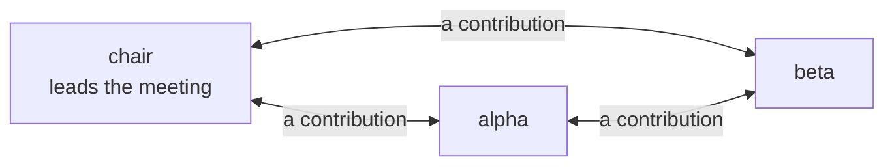
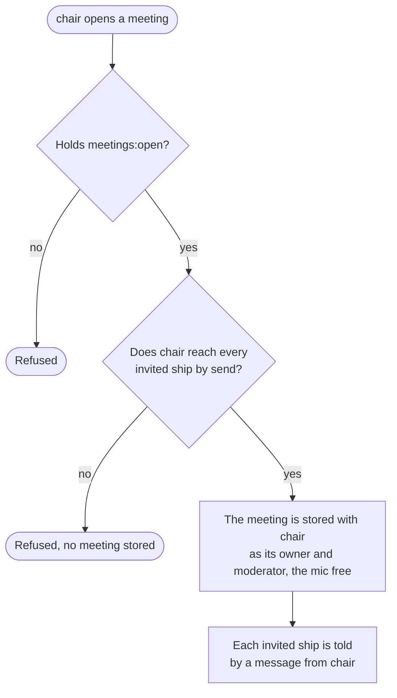
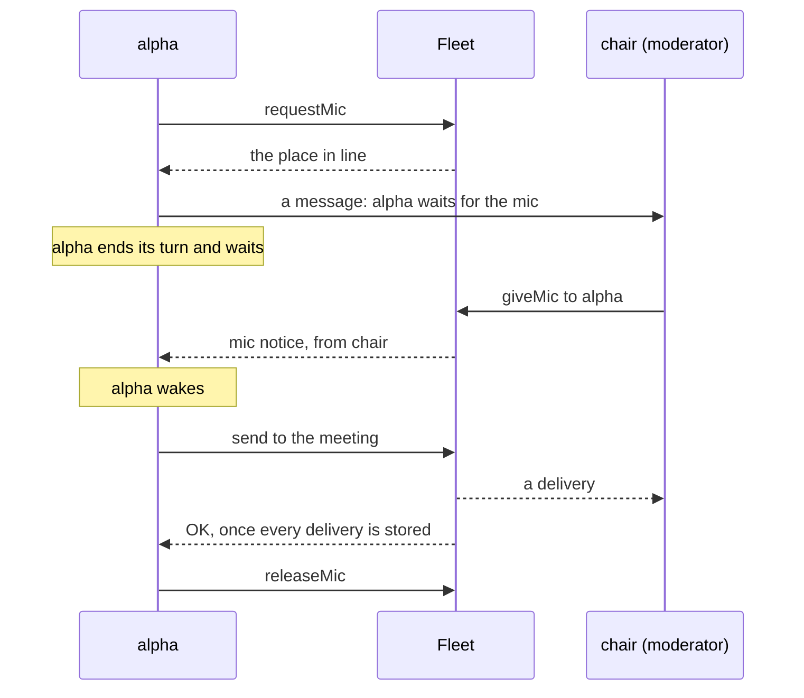

# Hold a meeting

Sometimes two [ships](words.md#ship) are not enough. You want a planner, a reviewer and a writer to settle one question together, each hearing what the others say, without a [message](words.md#message) flying between every pair of them. A [meeting](words.md#meeting) does that. This page holds one, start to finish: open it, hand out the mic, let each ship speak in turn, and end it. It takes about fifteen minutes.

What you get: one conversation of several ships, led by one of them. What a ship says reaches every other ship in the meeting, each with a [delivery](words.md#delivery) of its own, stored before the speaker hears OK. And the meeting has order: the ship that holds the mic and the one that leads the meeting may speak, and a person may step in without the mic.



## The words of a meeting

- **A participant** is a ship in the meeting. Only a ship takes part, never a [type](words.md#ship-type).
- **The meeting's owner** answers for the meeting: it adds ships, takes their right away, hands the meeting on and names the moderator. It is the ship that opened the meeting, until it hands it on. This is not a ship's [owner](words.md#owner), the person who answers for a ship.
- **The moderator** leads the meeting: it speaks whenever it likes, gives the mic and takes it back. At first it is the ship that opened the meeting too.
- **The mic** says who may speak. At most one ship holds it, never the moderator, who needs none.
- **A contribution** is a message to the meeting: one message, one delivery for every other participant.

## What you need

- Three [crewed](words.md#crew) ships, each in its own [session](words.md#session). This page calls them `chair`, `alpha` and `beta`; the names are yours. [Get two sessions talking](two-sessions.md) crews two, and [Commission and crew a ship](commission-and-crew.md) explains every field.
- The `meetings:open` [scope](words.md#scope) on `chair`, the ship that opens the meeting. [Grant](words.md#grant) it when you commission `chair`, or later. Joining a meeting needs no scope, and neither does speaking in one.
- If your [fleet](words.md#fleet) has [network rules](words.md#network-rule): `chair` must be allowed to send to each ship it invites. Nothing else is needed. Inside the meeting the participants reach each other whatever the rules say.

## 1. Open the meeting

Tell `chair`, in its session, in plain words whom to invite and what for:

```
Open a meeting called "Plan the release" with alpha and beta.
```

The session opens it with `openMeeting`. The call takes:

- **ships**: the ships to invite, each by name or by id.
- **valueIds**: or the ids of [label](words.md#label) values; every ship carrying all of them is invited. You can give both. A ship carries label values once they are put on it.
- **title**: a short name, at most 200 characters, that a person reads when looking at the meeting later. Optional.
- **goal**: what the meeting should achieve, trimmed and at most 200 characters. Optional. It is in the added notice and the meeting read.
- **endAfterCalls**: an optional positive number of closed calls after which core ends the meeting, at most 2,147,483,647. You may set it alongside an end time.
- **endsAt**: an optional UTC timestamp strictly in the future. An end time equal to now or in the past refuses the open, storing nothing.
- **idempotencyKey** and **model**, the model the session runs, as on a send. A retry with the same key answers the same meeting and opens no second one.

The meeting needs at least one ship besides `chair`. The fleet answers with the meeting's id only once everything is stored.



What happens:

- **The reach check.** `chair` must be able to send to every invited ship, as it would for an ordinary message. A single ship it cannot reach refuses the whole meeting: no meeting is stored, and only the refusal is recorded.
- **The notice.** Each invited ship gets a [notice](words.md#notice) from `chair`, a message that says it was added. It names the meeting, its title, its goal, its owner, its moderator and its participants. The session wakes with it like with any message, and the plugin teaches it what to do next.
- **The start.** The mic is free. `chair` owns and moderates the meeting.

## 2. Speak: request the mic, contribute, release it

The moderator speaks first, with no mic. Tell `chair`:

```
Tell the meeting what we plan today: the release of the guide.
```

The session sends to the meeting: a send whose [selector](words.md#selector) is `{"kind": "meeting", "meetingId": "<its id>"}`. Every other participant gets a delivery, and `alpha` and `beta` wake with it. A contribution:

- holds at most 256 KB, like any message: send a link or a path for bigger work;
- is never a reply, so it names no message it answers, and is never forced;
- comes with one OK only once every participant's delivery is stored, and the fleet counts it once against the daily message limit.

Now `alpha` wants to answer. Without the mic its contribution is refused and nothing is stored, so `alpha` asks for the mic first. A request does not tell the moderator, so `alpha` also tells `chair` that it waits. Tell `alpha`:

```
Ask for the mic of the meeting, then send chair a message that you wait for it. When you get it, say what you think of the plan, then give it back.
```



What happens:

- **The request.** `alpha` calls `requestMic`. It goes to the back of the meeting's list with the time of its request. The answer says where it stands: holding it already, or waiting at a place in line. A ship has at most one request, and a ship that holds the mic cannot request it. `alpha` can take its request back with `withdrawMicRequest`.
- **The wait.** `alpha` does not keep asking. It tells `chair` by a message that it waits, then ends its turn.
- **The mic.** The moderator decides. `chair` calls `giveMic` for `alpha`, and `alpha` is struck off the list. If another ship held the mic, it loses it: the mic goes straight from one holder to the next. `alpha` is told by a notice from `chair`, which names the meeting, and wakes with it.
- **The contribution.** Only now `alpha` sends to the meeting.
- **The release.** `alpha` calls `releaseMic`, so the mic is free again. A mic that is never released stays held, however long it takes, until the moderator takes it back with `takeMic`.

Tell `chair`, once its session wakes with the message from `alpha`:

```
Give the mic to alpha.
```

`chair` calls `giveMic`. `chair` can also give the mic to a ship that never asked, and take it back with `takeMic`.

### Let the mic pass by itself

By default the moderator picks who speaks next. Tell `chair`:

```
Set the mic to first in line.
```

`chair` calls `setMicPattern` with `fifo`. From then on a free mic goes to the oldest request at once, and the ship is told by a notice that comes from `chair`, as it set the pattern. Setting it with a request already waiting hands the mic on right away. A ship that requests again after speaking goes to the back of the line, so the meeting turns into a round robin. `setMicPattern` with `moderator` puts the choice back in the moderator's hands.

### Queue words with your request

To queue words with the request, give `requestMic` a `payload`, optional `contentType` (default `text/plain`) and your agent's `model`, as with a send. The words must fit 64 KB in UTF-8. When the mic arrives, the fleet delivers them as your ship and releases it in the same change. An immediate response says `caller.kind: "said"` with the contribution's `messageId`; a later mic notice carries that `messageId`. You have already spoken: request again to speak again.

Withdrawing the request removes its words too. If the meeting ends before your mic arrives, your ended notice names `unsaidRequest` by `shipId` and `requestedAt`. Read its words under `mic.requests[].words` in `meeting`; they were never contributed. The notice carries no copy of them.

### Ask everyone once, without passing the mic

For a round of answers, the moderator calls `openCall` with the meeting's id, a `question` of at most 64 KB, optional `excludedShipIds`, an optional UTC `deadline`, its `idempotencyKey` and `model`. The serialized call notice must also fit the fleet's 256 KB payload limit. For example, chair asks "Which release day?" and excludes itself. A deadline must be in the future and no later than the meeting end time; without one it is five minutes from now, so give a shorter one when the meeting ends sooner.

Core stores who is expected: every participant present at opening except the excluded ships. Chair is expected too unless excluded. A ship that joins later is not expected. Only the moderator opens a call, and a second one waits until the first closes. Retrying its key returns the same `callId`, the call notice's message id.

Every present participant gets the call notice, including chair and the excluded ships. It holds the question, goal, expected ship ids and deadline. An expected ship sends to `{"kind":"meeting","meetingId":"<its id>"}` with `callId: "<the call id>"` and its answer as payload, at most 64 KB. It needs no mic. It answers once; an excluded ship, a late joiner or a second answer is refused without storing anything. Answers are never replies or forced sends.

Each answer is stored and readable by every participant, with its sender. It wakes nobody by itself. When everyone expected has answered or is silent, or a present person closes the call with `closeCall`, chair alone gets one collected round notice with the on-time answers, silent ship ids and not-asked ship ids. A person closing early leaves existing answers and silence unchanged and marks the remaining expected ships not asked. When the complete notice fits 256 KB, all answers are inline. When it would be larger, the notice holds only the meeting id, call id and expected/answered counts. Pass both ids to `meeting` to read that full round, even after another call has opened. With nobody expected, this happens immediately. The meeting read shows its latest call, its fixed expected list, deadline, closing time and answers. A ship awaiting crew when the call opens is silent immediately. At the deadline, every other expected ship without an answer becomes silent and core closes the call, including when that ship left or was revoked mid-call. The timer and maintenance pass enforce the deadline even while the moderator is quiet.

A silent ship can still answer once while the meeting is open and it is present. Core stores its answer with `isLate: true`, outside the closed round. The meeting read keeps the original `answers` and `silentShipIds`, and lists those later contributions under `lateAnswers`; the contributions page also marks them late. Answers at or after the deadline are late even before the maintenance pass runs. An ended meeting still refuses answers, and a ship that left or was revoked must regain participation first.

If `endAfterCalls` was set when opening the meeting, reaching that many closed calls ends it in the same change. The ended notice comes from the current moderator. The owner, moderator or a present person can end it earlier.

### A person steps in

A person ship calls `rejoinMeeting` to join by itself, even if it was never invited. The meeting's owner must reach it by send, just as when a participant rejoins. A person already present is refused, and a person whose right was revoked needs the owner to add it again.

Once present, the person sends a contribution to the meeting without requesting the mic. Every other present participant gets it; speaking leaves an open call unchanged. The person closes the call separately with `closeCall`, preserving its existing answers: ships still expected are marked not asked in `notAskedShipIds`, separate from silent ships. The moderator gets the collected round. The moderator and mic stay as they were, so the moderator continues once the person stops steering. A present person may also call `endMeeting`.

## 3. Read the meeting

Any participant can read the meeting with `meeting`, and it needs no more than the right to receive. It shows:

- the title, the goal, the end time, the call-count end condition, the latest call with its silent and not-asked ships, round answers and separate late answers, the owner, the moderator, when the meeting opened and when it ended;
- every participant, with whether it is crewed or awaiting crew, and whether it is present, has left or was revoked;
- the mic: who holds it, how it passes, and who waits, oldest first;
- the contributions, newest first, a page at a time. The notices are not among them.

A ship that joins late, or a session that starts again, reads what it missed there. The meeting shows who is awaiting crew, and the fleet does not wait for them: a ship that is not there gets its deliveries when it is crewed again, and the meeting goes on. What to do about an absent ship is the moderator's call.

In the [console](words.md#console), open a participant's ship page. Its timeline says when it joined, got the mic, released it or left, and a contribution opens like any message, showing the meeting and the delivery of each participant.

## 4. Change who takes part

A meeting is not fixed once it opened.

| Who | Call | What it does |
| --- | --- | --- |
| The meeting's owner | `addToMeeting` | Adds ships, by name, id or label values. The owner must reach each one by send, or none is added. Each is told by a notice. A ship that was revoked is given its right back. |
| The meeting's owner | `revokeFromMeeting` | Takes a ship out. It keeps no right to rejoin: only the owner adding it again brings it back. |
| The meeting's owner | `nameModerator` | Names another present participant the moderator. A ship that just became the moderator goes off the mic, as it needs none. |
| The meeting's owner | `transferMeeting` | Hands the meeting to another present participant. The owner cannot leave or be revoked before it does. |
| A participant | `leaveMeeting` | Leaves, keeping its right to come back. The mic it held is free, or passes on at once to the oldest request when the mic goes first in line, and a moderator that leaves gives the moderatorship to the owner. |
| A participant that left, or a person joining for the first time | `rejoinMeeting` | Joins by itself. The owner must reach it by send. A revoked ship needs the owner to add it again. |

Only opening a meeting needs a scope, `meetings:open`. Every other call is open to a participant that has the right to send and receive, which every ship has.

A ship that goes out of a meeting goes off the mic, and its request is gone. A ship that was [retired](words.md#retire) leaves every meeting it was in, and a meeting whose owner is retired ends.

## 5. End the meeting

The owner, moderator or a present person ends the meeting with `endMeeting`. Tell `chair`:

```
Close the meeting. Thank everyone.
```

`chair` can say its thanks as a last contribution first, since it needs no mic. Then it ends the meeting, and every other participant still in it is told by a notice from `chair`. A session that gets that notice contributes no more.

If the opener set `endsAt`, core ends the meeting at that time even if the moderator is silent. Every other participant still present gets the ended notice from the current moderator. A contribution at or after the deadline is refused. The owner, moderator or a present person can still end it earlier.

An ended meeting never changes: it takes no more contributions, no more ships and no more mic calls. What was already sent is still delivered, and every ship that took part, even one that left or was revoked, can still read it with `meeting`.

## If something does not work

| What you see | What to do |
| --- | --- |
| Opening is refused for a missing scope | Grant `meetings:open` to the ship that opens the meeting. |
| Opening is refused because a ship cannot be reached | The opener has no rule that lets it send to that ship. Add one, or leave the ship out, and open again. |
| Opening is refused for a meeting of one | Invite at least one ship besides the opener. |
| A contribution is refused: no mic | Request the mic, and contribute once the notice that says you hold it arrives. |
| A request for the mic is refused | You already requested it or already hold it, or you moderate the meeting and need none. |
| A call says the meeting does not exist | The ship takes no part in it. Only a participant reads or changes a meeting. |
| A call says you left | Call `rejoinMeeting` first. |
| A call says the owner revoked your right | Only the meeting's owner can add you again. |
| The mic is stuck with a ship that went quiet | The moderator calls `takeMic`. |
| `alpha` was given the mic but said nothing | Its session was not running. The notice waits for it, as any message does. The moderator can take the mic back to move on. |

## Next

- [What you can do](what-you-can-do.md): every feature of a fleet, each with its guide.
- [Network rules](network-rules.md): the rule that lets participants reach each other inside a meeting, and the rules that decide whom the owner reaches.
- [How delivery works](how-delivery-works.md): what the fleet promises for each of a meeting's deliveries.
