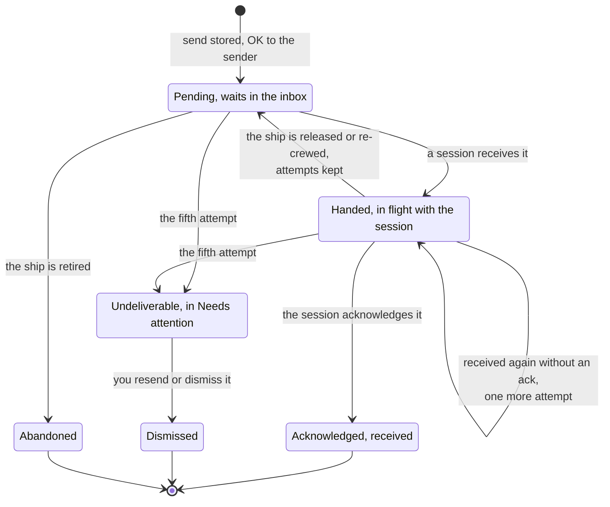
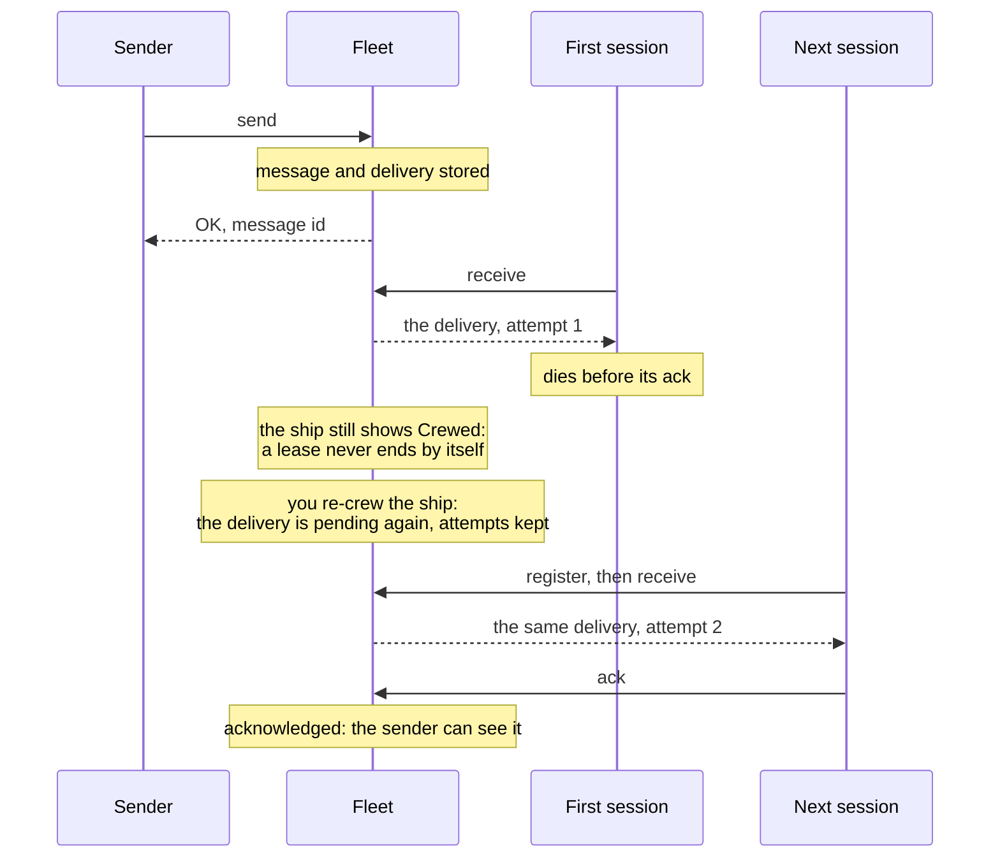
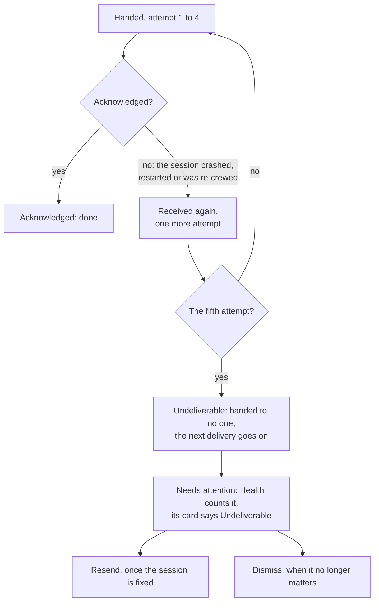

# How delivery works

You sent a message to an agent, and its session crashed, was cleared or was never started. Can the message be lost? No. This page shows why: what the fleet stores before it says OK, how a message waits until a session takes it, what happens when a session dies halfway, and the one case that asks something of you: a message that becomes **undeliverable**.

The short version:

1. A send is OK only once the fleet has stored the message.
2. A [delivery](words.md#delivery) waits until a [session](words.md#session) [acknowledges](words.md#acknowledgement) it, however long that takes and however often the session restarts.
3. A delivery handed over again and again without an acknowledgement stops, and goes to Needs attention for you to resend or dismiss.

## A send is OK only once stored

A [message](words.md#message) goes from one [ship](words.md#ship) to one or more recipients. For each recipient the fleet makes one delivery: that message, on its way to that ship, with its own state.

When a ship sends, the fleet checks the sender, works out who the message is for, and stores the message and every delivery in one transaction. Only then does the send answer OK, with the message's id. From that moment the message reaches its recipient, even one that is not running now.

Anything short of an OK is not a send, and nothing of it is stored:

- **The send failed halfway**, such as a disk error: no message, no delivery, and nobody is woken.
- **The fleet is busy**: the send is refused, saying nothing was stored and to make the same call again.
- **A limit refused it**, such as the fleet's daily message limit: nothing is stored, and the refusal names the limit.
- **No ship matches** the name, or no ship of a type is left: the send is refused.

So the sender always knows: an OK means stored, anything else means try again. A send retried with the same idempotency key answers with the original message and stores nothing twice, so retrying after a lost answer is safe. The [Ship contract](ship-contract.md#send-and-reply) shows the send itself.

## A delivery waits until a session acknowledges it

A stored delivery is **pending**: it waits in the ship's [inbox](words.md#inbox). Nothing moves it on but a session that takes it. A ship that awaits crew, a session that is busy, a computer that is off: the delivery waits through all of them.

1. **The session is woken.** When a delivery is stored, a session waiting on its inbox is woken at once. A session that is not waiting finds it the next time it looks.
2. **The session receives it.** The delivery is now **in flight** with that session. It is the session's alone: two sessions never take the same delivery, also when several ships of one [type](words.md#ship-type) receive at once.
3. **The session acknowledges it.** The delivery is done, and the sender can see that it arrived.

An acknowledgement means received, not done. What the ship does with the message next is its own business, and it answers in its own time. The fleet distributes messages; it never runs the work.

A delivery leaves the fleet's hands only three ways: a session acknowledges it, it becomes undeliverable and you resend or dismiss it, or its ship is retired and the delivery is **abandoned**. Its sender can see an abandoned delivery; a message sent to a type is never abandoned, as another ship of the type can still take it.

## When a session goes away

A delivery in flight that is not acknowledged is never dropped. It comes back:

- **The answer to a receive was lost**, or the session crashed before its ack: the same session's next receive hands it again.
- **The session restarted** and still crews the ship: a `/clear`, a compact or a restart of the same session keeps the ship's [lease](words.md#lease), so the session receives the delivery again.
- **The session is gone for good**: you [re-crew](words.md#recrew) or [release](words.md#release) the ship. The lease ends, the delivery goes back to pending, and the next session that crews the ship receives it. A delivery to a type goes back to its type, and any ship of that type can take it.

A lease never ends by itself, so a dead session keeps its ship until you act: no other session takes it over by accident. A ship with a [crew request](words.md#crew-request) needs nothing from you: its [trierarch](words.md#trierarch) starts the session again. [Commission and crew a ship](commission-and-crew.md#when-a-session-dies) shows the re-crew step.

Because a delivery can come again, a session may see the same delivery twice. Its delivery id is the key of the work: a ship does the work once per delivery id. The [Ship contract](ship-contract.md#what-the-fleet-promises) says what that asks of your code.

### On a pushed ship

On a [pushed](words.md#pushed) ship, such as one crewed with the Claude Code plugin or by a trierarch, the computer side takes each delivery for the session and hands it into the session's turn. Taking it counts no attempt; each hand-over into the session does. The acknowledgement comes when the message enters the session's turn. A restart of the computer side loses nothing: it gets back what it held, as it was.

Two things more are watched on a pushed ship:

- **Overdue.** A delivery handed and not acknowledged for 10 minutes, or waiting for 10 minutes while the session is idle (60 while it is busy), is overdue: `argo` and the ship's [owner](words.md#owner) are told, once. On [Health](words.md#health) it shows under **Stalled in flight**.
- **A turn that died.** When the session's turn dies while it handles an acknowledged message, that message is handed into the session once more. If that turn dies too, the message is **not handled**: it shows on the ship's page with its reason, with **Resend** and **Dismiss**, as an undeliverable one does.

## One received again and again without an ack

Some messages can never be taken: a session that crashes on that one message every time, or a session alive enough to receive but not to acknowledge. Handing such a message over forever would block the ship. So the fleet counts:

- Every hand-over without an acknowledgement is one attempt. The console shows it on the message: "not confirmed · attempt 2 of 5".
- Attempts are kept across sessions: a re-crew does not reset the count.
- A delivery handed four times and never acknowledged is not handed a fifth time. The fifth attempt is refused, and the delivery becomes [undeliverable](words.md#undeliverable). The session gets the next delivery in its place, so one bad message does not hold up the rest.

An undeliverable delivery is not lost either. It is kept, with its whole message, until someone allowed to resend or dismiss it does.

## What undeliverable asks of you

Everything else on this page needs no step from you: every other message reaches its ship by itself. An undeliverable delivery is the one that waits for a person.

**Where you see it.** Health carries a count in the console's sidebar, and shows an **Undeliverable** card with each delivery, its message and how long it has waited.

**What to do.**

1. **Find out why the session could not take it.** It usually says more about the session than the message: a session that keeps crashing, or one that receives but never acknowledges. Ping the ship and read its timeline; [Troubleshooting](troubleshooting.md#a-crewed-ship-does-not-answer) goes through it.
2. **Resend it** once the session is fixed. A resend is the same message again, from its original sender, so an answer still goes back to whoever asked. Resending the same delivery twice still makes only one new message.
3. **Or dismiss it**, when the message no longer matters.

Either way the original becomes dismissed and stays in the timelines. A resend to a ship that has since been retired, or to a type with no ship left, is refused: only Dismiss remains.

A [ping](words.md#ping) that goes undeliverable means the session is gone: the ship shows "Ping not answered: undeliverable". Dismiss it and ping again later, or re-crew the ship; it offers no resend.

## The code

Each promise on this page is proven by tests against a real database: a send that fails halfway stores nothing, concurrent receivers never get the same delivery, a release returns what was in flight with its attempts kept, the fifth attempt makes a delivery undeliverable, and a server restart loses nothing a computer side holds. They live in [ThomasHendrickx/aeolus-fleet](https://github.com/ThomasHendrickx/aeolus-fleet). Every timing and limit on this page, and where it is set, is in [Timings and limits](https://github.com/ThomasHendrickx/aeolus-fleet/blob/main/docs/timings-and-limits.md).

## Next

- [Troubleshooting](troubleshooting.md): a message that waits, a session that went silent, a delivery that is stuck or undeliverable.
- [Ship contract](ship-contract.md): what your own code must do to keep these promises whole.
