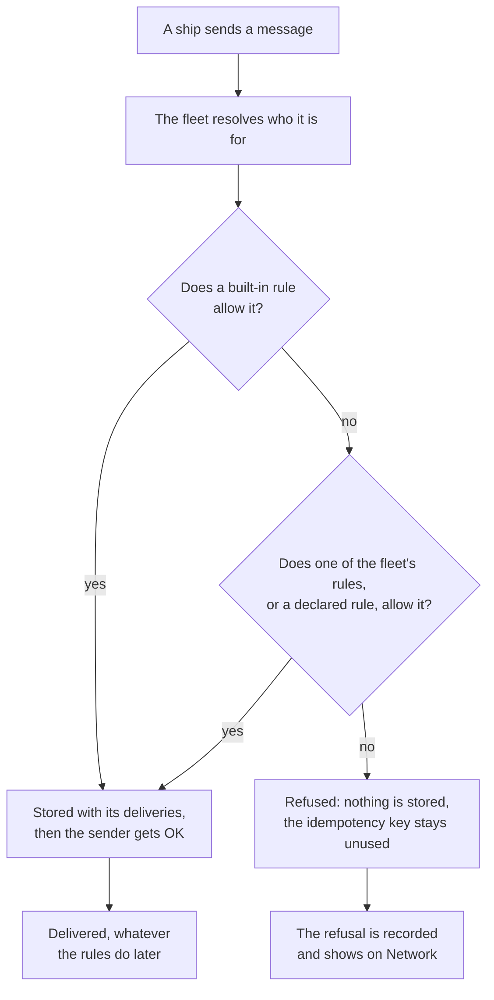
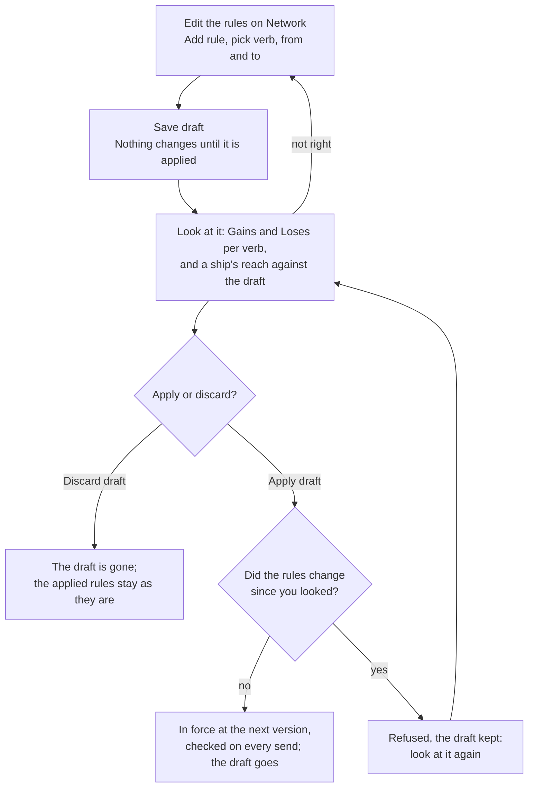

# Network rules

Out of the box, every ship in your fleet can message every other ship. That is the right start, until it is not: a tool that only two people may use, an agent that should talk to its owner and nobody else, an outside server you are about to let in. [Network rules](words.md#network-rule) say which ships may reach which. This page shows how the fleet checks them, how to write one, and how to put it in force knowing what it changes.

Everything here happens on **Network** in the [console](words.md#console). It shows only to a session holding the `fleet:network` [scope](words.md#scope); any other session sees "Only a session holding fleet:network sees the network rules".

## Scope says what, a rule says where

Two questions decide whether a [ship](words.md#ship) may do something to another, and a call needs a yes to both:

- **May it do this at all?** Its scopes answer. A ship without `messages:send` sends to nobody, whatever the rules say.
- **May it do it to that ship?** Its [reach](words.md#reach) answers, and network rules set the reach.

Each rule names one verb:

| Verb | What it covers |
| --- | --- |
| `send` | Sending a message, and with it a forced send and discovering who the ship can send to. |
| `read` | What a ship sees with `fleet:read`. A ship outside its read reach shows only its name, type and status. Resending a stuck message needs read reach too. |
| `manage` | Renaming, releasing, recrewing, retiring and pinging a ship, getting its starting prompt, requesting its crew, clearing its worktree, and listing, pausing and cancelling its schedules. |

## How a send is checked

The fleet checks every send at the moment it is sent, against both ships' labels and owners as they are then. Rules only allow: there are no deny rules and no order between rules. When no rule matches, the send is refused.

What follows from it:

- **A stored message is delivered.** Changing the rules later never takes back a message the fleet already accepted.
- **A send to a type** goes only to the ships of that type its sender may reach. With none of them reachable, the send is refused.
- **A refusal tells the sender nothing more.** The sender gets `FORBIDDEN` with one fixed message, "The network rules do not allow this send". It never names a rule or a reason, so a refusal cannot be used to map your rules.
- **You see every refusal.** Network lists the refused sends, newest first: who tried to reach whom, with the labels each ship carried then and the rules version that refused it. With none, it says "No send has been refused."

## The built-in rules

Every fleet starts with rules of its own, listed first on Network and marked built-in. They hold before any rule you write. All but two are never off, so a bad rule set can never lock [argo](words.md#argo) out, and a ship always gets its answer.

| Built-in rule | What it allows | Turned |
| --- | --- | --- |
| **argo** | argo sends to, reads and manages every ship, and every ship reaches argo. | Never off |
| **Owner** | A ship's [owner](words.md#owner) sends to, reads and manages the ships it owns. | Never off |
| **Answer** | A ship may always answer the sender of a message it received. | Never off |
| **Connected plugins read** | A [plugin](words.md#plugin) argo connected reads every ship, whatever the rules. | Never off |
| **Ships send to plugins** | Every ship may send to a plugin argo connected, whatever the rules. | Never off |
| **Plugins send** | A plugin argo connected may send to every ship, whatever the rules. | Never off |
| **Meeting** | The participants of a meeting reach each other in it, whatever the rules. | Never off |
| **Viewer reads** | The [viewer](words.md#viewer) reads every ship. | You turn it on or off. |
| **Installation manages** | The installation manages person ships and the ships they own, so a leaver is always released. | Never off |
| **Open** | Every ship may send to, read and manage every ship. | Applying rules turns it off; applying none turns it on again. |

**Open** is why a new fleet is all-to-all. It is on exactly while the fleet has no rules of its own applied. The moment you apply your first rule, open goes off and only the built-in rules and the rules you see on Network decide. This is the one step that changes the most: read what your draft loses before you apply it (see [Draft, then apply](#draft-then-apply)).

## What a rule says

A rule has three parts: a verb, the ships it is **from**, and the ships it is **to**. It says that the ships matching **from** may do the verb to the ships matching **to**.

Each side is a selector: a list of terms that must all hold. A side with no terms matches every ship; the editor shows it as **Every ship**. A term picks ships by a [label](words.md#label) or by their owner, never by their type. An account is matched by the `group` values in its account token.

The editor shows each term as a chip. In the console's words, "All must hold. * is any value, # the same as the other side."

| Term, as the editor shows it | Matches a ship that |
| --- | --- |
| `crm=user` | carries the value `user` of the label `crm` |
| `crm=*` | carries the label `crm`, with any value |
| `crm=#` | carries the same value of `crm` as the ship on the other side |
| `owner=<name>` | is owned by that ship: argo or a person's ship |
| `owner=*` | has any owner |
| `owner=#` | has the same owner as the ship on the other side |

A `#` binds the same label, or the owner, on both sides of the rule, so it must appear on both: a `#` on one side only is refused when you save. A label or owner that is no longer in the fleet matches no ship, and the editor marks it: "this side matches no ship until you remove it".

Some rules, in words:

- **Users reach the CRM:** `send`, from `crm=user`, to `crm=app`.
- **Ships talk within their team:** `send`, from `team=#`, to `team=#`. A ship labelled `team=red` reaches every `team=red` ship, and no `team=blue` ship.
- **Ships with one owner see each other:** `read`, from `owner=#`, to `owner=#`.

### The same rules from code

The rules are the same over the fleet's API, for an actor holding `fleet:network`. A rule is `{ "verb": ..., "from": [...], "to": [...] }`, the verb one of `"send"`, `"read"` or `"manage"`, and each side a list of terms written by id:

| Term | Written as |
| --- | --- |
| An exact label value | its label value id, as a string: `"lbv_..."` |
| Any value of a label | `{ "labelId": "lbl_...", "value": "*" }` |
| The same value as the other side | `{ "labelId": "lbl_...", "value": "#" }` |
| An owner | `{ "owner": "shp_..." }`, `{ "owner": "*" }` or `{ "owner": "#" }` |

The calls follow the draft below: `fleet.networkRules` reads the applied rules with their version and the draft, `fleet.saveNetworkRulesDraft` saves the whole list (or `null` for all-to-all), `fleet.networkRulesDraftChanges` answers what the draft gains and loses, `fleet.applyNetworkRules` applies it naming the version you looked at, and `fleet.discardNetworkRulesDraft` drops it.

## Draft, then apply

You never edit the rules in force. You edit the fleet's one draft, look at what it would change, and then apply it whole. Nothing is ever checked against the draft, so working on the rules breaks nothing until you choose to apply.

1. **Write it.** Under the fleet's own rules, choose **Add rule**, pick the verb, then the terms **From ships with** and **To ships with**. Choose **Save draft**: "Draft saved. Nothing changes until it is applied."
2. **Look at what it changes.** For each verb, Network lists the pairs of ships the draft **Gains** and **Loses**, each with the rule that allows it. Pick a ship in the fleet graph to see which ships it reaches, against the applied rules or against the draft. Do this before your first apply in particular: everything open allowed and no rule of yours covers shows under Loses.
3. **Apply it.** Choose **Apply draft**. The console asks: "Every send, read and manage is checked against the draft from now on, and the rules before it are gone." Confirm, and the draft is in force at the next version. Or choose **Discard draft**: "The draft is gone; the applied rules stay as they are."

The apply names the version of the rules you looked at. If someone applied other rules, or a plugin declared rules, after you looked, the apply is refused and your draft is kept, so what goes in force is always what you looked at. Look at the draft again, and apply.

To apply none, all-to-all again, save a draft of no rules and apply it: open comes back on.

### Export and import

**Export** writes the applied rules, never the draft, and the labels they use into one file, by name. A rule naming a label or ship the fleet no longer has matches no ship, so it is left out, and the export says which and why. **Import** reads such a file back into this fleet or another: it checks the file, shows how it differs from the fleet and the ways to resolve each difference, defines the missing labels and fills the draft. You then look at it and apply it as any draft. Import also needs `labels:define`.

## Rules your plugins declare

Some plugins, such as squadrons or the trierarch plugin, label the ships they look after and declare the rules those ships need, so you do not keep a rule per squadron or per computer. A declared rule uses only labels its declarer owns, so it reaches no ship the declarer did not label.

Network shows declared rules apart from the fleet's own, read-only, with who declared each; only the declarer changes them. They are checked beside your rules at every send. While your fleet has no rules applied, open already allows everything, so declared rules add nothing until you apply rules of your own. A plugin switched off withdraws its declared rules, and retiring its ship removes them.

## The rule an outside party needs

An [outside party](words.md#outside-party), such as an outside MCP server or client, acts in your fleet as its [proxy ship](words.md#proxy-ship), of kind app, with a person ship as its owner. It is a ship like any other, so network rules give it its reach.

Outside parties are a switch per fleet, off by default, turned by an actor holding `fleet:network`. Turning it on while your fleet has no rules applied warns you, and you must confirm: with open on, every ship reaches every ship, the outside party included. With rules applied, it turns on at once.

So write its rule first:

1. Put a label on the proxy ship, such as `tools=crm-server`, and on the ships that should use it, such as `tools=user`.
2. Draft a `send` rule from `tools=user` to `tools=crm-server`. Its answers come back by the **Answer** built-in rule, and its owner reaches it by **Owner**, with no rule of yours.
3. An outside client that sends into the fleet needs a rule from its proxy ship too: a `send` rule from its label to the ships it may reach.
4. Look at what the draft gains and loses, and apply it. Then turn outside parties on.

## When the fleet refuses

| What you see | Where | What it means | What to do |
| --- | --- | --- | --- |
| `FORBIDDEN`, "The network rules do not allow this send" | A ship's send | No rule lets the sender reach that ship. | Read the refusal on Network, then draft a rule if the send should pass. |
| "The network rules do not allow this read" or "this manage" | A read or a manage call | The caller lacks read or manage reach on that ship. | The same: draft a rule of that verb. |
| `CONFLICT`, "The network settings are at version ... now, not ...: look at the draft again before applying it" | Apply draft | The rules changed after you looked at the draft. The draft is kept. | Look at the draft again, then apply. |
| `NOT_FOUND`, "The fleet has no draft of its network rules" | Apply, or what the draft changes | There is no draft. | Save a draft first. |
| `BAD_REQUEST`, "A term of the same value binds its label on both sides: ...=# is on one side only" | Save draft | A `#` term is on one side of a rule only. | Put the same `#` term on the other side, or remove it. |
| `BAD_REQUEST`, "A fleet holds at most 200 network rules of its own, beside the ones its ships declared" | Save draft | Your list is over the limit. | Combine rules with `*` or `#` terms. |

## Limits

- At most **200** rules of the fleet's own. Declared rules do not count toward them.
- At most **20** declared rules per declaring ship.

## Next

- [Words](words.md#who-may-do-what): scope, reach, network rule and built-in rule, one line each.
- [Ship contract](ship-contract.md): what a refused call returns to the ship that made it.
