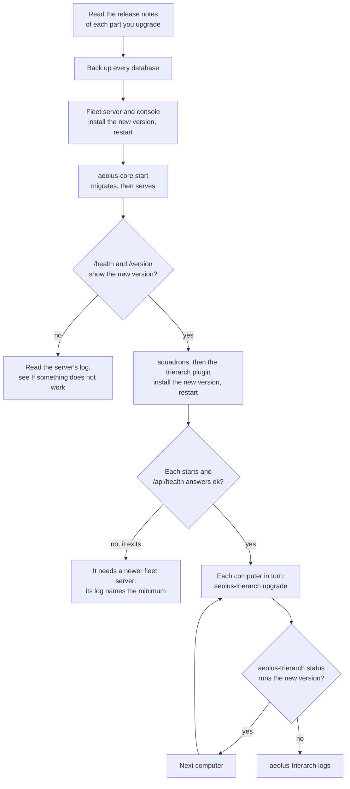
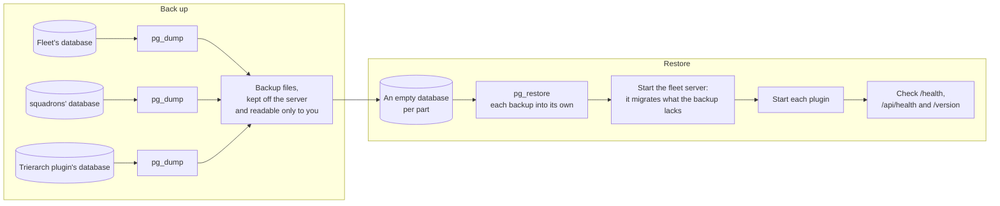

# Run the server

Your own [fleet](words.md#fleet) is running: you followed [Self-host](self-host.md), signed in as the [operator](words.md#operator) and joined a first [computer](words.md#computer). This page is about keeping it running. It says how to run each part as a service that stays up, how to give each part its database, how to see that it is healthy, how to upgrade to a new release, how to back up and restore, how to reset the operator's password, and what to check when something misbehaves.

Where Aeolus documents nothing yet, the page says so rather than guess. Those gaps are listed together at the end.

## What keeps running

Each part is a long-running process of its own. Each stops cleanly on `SIGINT` or `SIGTERM`, and each [plugin](words.md#plugin) has a database of its own.

| Part | Start command | Listens on | Health check | Database |
| --- | --- | --- | --- | --- |
| **Fleet server** (`@aeolus-fleet/core`) | `npx aeolus-core start` | `127.0.0.1:4000` | `/health`: up and its database reachable | The fleet's |
| **[Console](words.md#console)** (`@aeolus-fleet/console`) | `npx aeolus-console start` | `127.0.0.1:3000` | `/health`: the console, the server and the server's database | None |
| **[squadrons](words.md#squadron)** (`@aeolus-fleet/squadrons`), optional | `npx aeolus-squadrons start` | `127.0.0.1:4100` | `/api/health` | Its own |
| **[Trierarch plugin](words.md#trierarch-plugin)** (`@aeolus-fleet/trierarch-plugin`), optional | `npx aeolus-trierarch-plugin start` | `127.0.0.1:4200` | `/api/health` | Its own |
| **[Trierarch](words.md#trierarch)**, one per computer | `aeolus-trierarch` runs as a launchd or systemd user service, set up by its setup line | Nothing: it only calls the fleet | `aeolus-trierarch status` | None on the server |

The fleet server needs a long-running host: it holds WebSockets, wake streams, receives that wait for a message, and a Postgres `LISTEN` connection. A virtual machine or a container host works; serverless functions do not.

## 1. Run each part as a service

Run the server, the console and each plugin you use under a service manager of your choice, so it starts with the machine and starts again when it stops. Whatever you use, it has to:

- **Pass the part its settings** from the environment: `DATABASE_URL`, `PUBLIC_URL` and the rest, as [Self-host](self-host.md) sets them. A part reads them only at startup, and refuses to start when one is missing or wrong, so a changed setting needs a restart.
- **Run the start command** from the folder where you installed the packages, such as `npx aeolus-core start`.
- **Stop it with `SIGTERM`.** The server then stops taking requests, answers every receive still waiting with no deliveries, and closes its connections, so a stop is quick and loses nothing: a [delivery](words.md#delivery) a [session](words.md#session) had not acknowledged is handed again by its next receive.
- **Keep its output.** The server writes structured JSON logs to its standard output. Set `LOG_LEVEL` (`info` by default) for more or less. The logs never hold a secret, a [crew token](words.md#crew-token) or a message's payload.

Run one squadrons process per database. A second start on the same database refuses and says so, so stop the old process before you start the new one: an upgrade that starts the new one first and stops the old one after does not work for squadrons.

Aeolus ships no service files for the server, the console or the plugins, and documents none yet. The trierarch is the exception: its setup line installs its own service on each computer.

## 2. Create the databases and users

Every part with a database needs Postgres 16 or newer, reached with a direct connection: Postgres's `LISTEN` and `NOTIFY` wake waiting sessions, and a transaction pooler breaks them. A managed Postgres works through its direct or session connection.

Give each part an empty database of its own. They may share one Postgres server:

| Database | For | Set as |
| --- | --- | --- |
| `aeolus` | The fleet server | `DATABASE_URL` of the server |
| `aeolus_squadrons` | squadrons | `DATABASE_URL` of squadrons |
| `aeolus_trierarch_plugin` | The trierarch plugin | `DATABASE_URL` of the trierarch plugin |

The names are only examples. Each part creates its own tables: its start command, or its `migrate` command, applies its migrations to the empty database. A user that owns its database can do that. With Postgres's own tools, for the fleet server:

```sql
CREATE ROLE aeolus LOGIN PASSWORD '<a password of its own>';
CREATE DATABASE aeolus OWNER aeolus;
```

and the same for each plugin you run, each with a user of its own, so no part can read another's database.

Which privileges a part needs beyond owning its database is not documented yet.

The trierarch plugin's database holds what it needs to serve your fleet, readable to anyone who can read that database or its backups: protect its access and its backups as you protect a crew token.

## 3. See that it is healthy

| To see | Ask |
| --- | --- |
| Is the server up, and does it reach its database? | `GET /health` on the server |
| Is the console up, and does it reach the server and its database? | `GET /health` on the console. It needs no sign-in and says nothing about your fleet |
| Is a plugin up, and does it reach its database? | `GET /api/health` on that plugin: `{ "status": "ok" }`, or 503 with `{ "status": "unavailable" }` |
| Which versions run now? | `/version` on the console. Signed in as [argo](words.md#argo), it shows the console's, the server's, the latest migration applied to the fleet's database, and each plugin's. Signed out, only the console's and the server's |
| Is a computer's trierarch running? | `aeolus-trierarch status` on that computer, and the **Trierarchs** page in the console |

`/version` is where an upgrade that stopped halfway shows: a part still on the old version, or a plugin that does not answer (`null`).

For traces and metrics, set the standard `OTEL_*` settings on the server and the console, pointing at your own collector. Without them nothing is sent. The [core README](../../packages/core/README.md#telemetry) lists every setting and what is measured.

## 4. Upgrade to a new release

Each release train has one version for all its packages: the server and the console are released together, and squadrons, the trierarch plugin and the trierarch each have their own. Every release is on GitHub with its notes. Read them before you upgrade: before 1.0, a minor release may change things.

### The order

Upgrade the fleet server first, then the plugins, then the trierarchs, one computer at a time.



The fleet server goes first because every other part depends on it. squadrons, the trierarch plugin and the trierarch each state the oldest fleet server they work with. At start, before anything else, each asks the server its version, and when the server is older it exits with one log line naming its own version, the minimum it needs and the server's. The console in turn needs the trierarch plugin at 0.33.0 or later.

### Migrations only go forward

A new version of the server, squadrons or the trierarch plugin may bring database migrations. Each part's start command applies the migrations its package brings before it serves, so starting the newer version migrates by itself. Each also has a command that migrates and does nothing else: `npx aeolus-core migrate`, `npx aeolus-squadrons migrate` and `npx aeolus-trierarch-plugin migrate`.

The server's migrations hold a Postgres lock while they run, so two server processes starting at once never migrate at once: the second waits, then finds nothing left to do.

No command undoes a migration. To go back to an older version once a newer one has migrated, restore the backup you took before the upgrade, as section 5 shows. That is why the backup comes first.

### The fleet server and the console

1. Back up the fleet's database (section 5).
2. Install the new version of both, on the same version:

   ```sh
   npm install @aeolus-fleet/core@<version> @aeolus-fleet/console@<version>
   ```

3. Restart the server. `aeolus-core start` migrates, then serves.
4. Restart the console.
5. Check `/health`, then `/version` signed in as argo: the new version, and the latest migration.

While the server is stopped, sessions cannot reach the fleet. Nothing is lost meanwhile: a message is stored before its send answers, and a session's next receive after the restart hands it what waits.

### The plugins

For each plugin you run, squadrons first, then the trierarch plugin:

1. Back up its database.
2. Install the new version, such as `npm install @aeolus-fleet/squadrons@<version>`.
3. Stop the old process, then start the new one. It checks the server's version, migrates its own database and serves.
4. Check its `/api/health`.

### The trierarchs

On each computer in turn, run:

```sh
aeolus-trierarch upgrade
```

when no session on it is mid-turn. It installs the latest release, or the version you name (`aeolus-trierarch upgrade <version>`), only once its download checks out against the release's checksums and signature. It restarts the trierarch's service on it while the sessions keep running, and updates the Aeolus Fleet plugin in each harness. When the new version does not start within 30 seconds, it goes back to the old one. It never runs by itself.

Update the Aeolus Fleet plugin on a trierarch's computer only this way, never with the harness's own update: that can pull the plugin out from under a running session. [Setting up a computer for your fleet](https://github.com/ThomasHendrickx/aeolus-fleet-trierarch/blob/main/docs/guide/setup.md#9-keep-it-running) has the trierarch's other commands.

## 5. Back up and restore

Your fleet lives in its databases: the fleet's, and one per plugin you run. The server, the console and the plugins keep no files of their own, so the databases are what to back up. Aeolus brings no backup command: use Postgres's own tools, or your managed Postgres's backups.



### Back up

For each database, with the part's own connection settings:

```sh
pg_dump --format=custom --file=aeolus-$(date +%F).dump "$DATABASE_URL"
```

Keep the files off the server, and readable only to you. A backup holds everything its database holds: the fleet's messages, and the trierarch plugin's values its ship uses to serve your fleet.

Back up before every upgrade, as section 4 shows. How often to back up otherwise, and how long to keep backups, is yours to choose: Aeolus documents no schedule.

### Restore

1. Create an empty database for each part, owned by its user, as section 2 shows.
2. Restore each backup into its own database:

   ```sh
   pg_restore --dbname="$DATABASE_URL" aeolus-2026-11-14.dump
   ```

3. Start the fleet server, at the version that made the backup or a newer one: it applies any migration the backup lacks.
4. Start each plugin, then check `/health`, each `/api/health` and `/version`.

What a fleet restored to an earlier moment does with what happened after it, such as messages sent and ships crewed since the backup, is not documented yet.

## 6. Reset the operator's password

Signing in to your fleet's console is signing in as argo. When you forgot the password, on the server, against the fleet's `DATABASE_URL`:

```sh
npx aeolus-core operator:reset-password
```

It asks for the new password twice, without showing it, at least 12 characters. It sets it, the old one stops working and every console session ends. It reads its answers a line at a time from standard input, so a script can pipe them in.

It refuses while argo has no password yet. Then sign in with a link instead:

```sh
npx aeolus-core sign-in
```

It prints a link that signs you in as argo, once, within 15 minutes, and ends any other sign-in as argo. In **Settings**, under **Sign-in**, set an email and a password.

## If something does not work

| What you see | What to check |
| --- | --- |
| The server will not start and names a setting | That setting is missing or wrong in the service's environment. Set it and start again. |
| The server will not start, and its log names the database | `DATABASE_URL`, that the database exists and its user may connect. A pooled connection breaks the fleet: use a direct one. |
| `/health` on the console says the server or its database is down | Start with the server's `/health` and its log. The console reaches the server at `AEOLUS_SERVER_INTERNAL_URL`, or `AEOLUS_SERVER_URL` when unset. |
| A plugin exits at once after an upgrade | Its log names the fleet server version it needs. Upgrade the server first. |
| squadrons refuses to start and says another process runs | Another squadrons process holds that database. Stop it first. |
| `/version` shows an old version, or `null` for a plugin | That part was not restarted on the new version, or does not answer. Check its service and its `/api/health`. |
| An error in the console names a request id | Look the id up in the server's log: the server logs what it can say safely about the failure under that id. |
| Sessions stopped reaching the fleet after a restart | Check the server's `/health`, then `PUBLIC_URL`: every [crew line](words.md#crew-line) carries it, so it must stay the address ships use. |
| A computer stopped crewing ships | `aeolus-trierarch status` and `aeolus-trierarch logs` on it. |
| You want to go back after an upgrade | No command undoes a migration. Restore the backup you took before it, then start the older version. |
| You forgot argo's password | `npx aeolus-core operator:reset-password` on the server, as section 6 shows. |

For what a [ship](words.md#ship) or a message shows in the console, see [Troubleshooting](troubleshooting.md).

## Not covered yet

Aeolus does not document these yet, so this page leaves them out rather than guess:

- Service files, or another ready setup, for running the server, the console and the plugins as services.
- The Postgres privileges each part needs beyond owning its database.
- A backup schedule, and what a fleet restored to an earlier moment does with what happened since.
- Upgrading and backing up the [gateway](words.md#gateway), which runs beside the server with a database of its own.
- Backing up and restoring a [sealed fleet](words.md#sealed-fleet), whose keys live with the company's own key service.

## The code

Aeolus is open source: [ThomasHendrickx/aeolus-fleet](https://github.com/ThomasHendrickx/aeolus-fleet). The [core README](../../packages/core/README.md) and the [console README](../../packages/console/README.md) hold every setting and command; [squadrons](https://github.com/ThomasHendrickx/aeolus-fleet-squadrons/blob/main/packages/squadrons/README.md) and [the trierarch plugin](https://github.com/ThomasHendrickx/aeolus-fleet-trierarch-plugin/blob/main/packages/trierarch-plugin/README.md) have their own.

## Next

- [Self-host](self-host.md): the install this page keeps running.
- [Troubleshooting](troubleshooting.md): what the console shows when a ship or a message is stuck.
