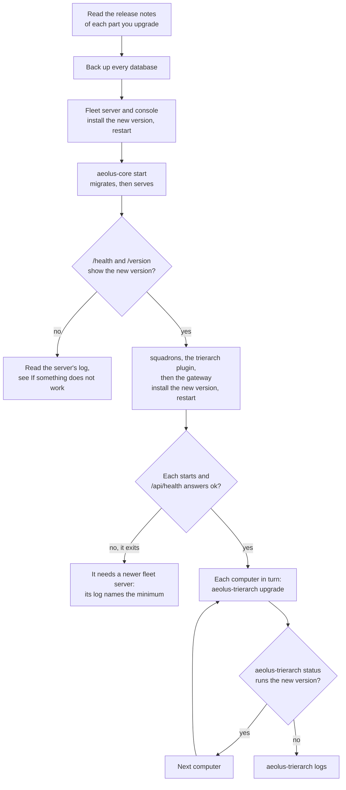
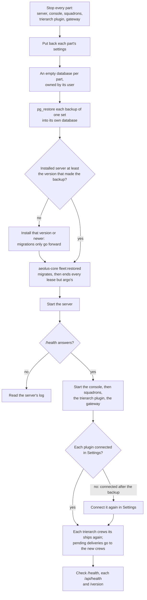

# Run the server

Your own [fleet](words.md#fleet) is running: you followed [Self-host](self-host.md), signed in as the [operator](words.md#operator) and joined a first [computer](words.md#computer). This page is about keeping it running. It says how to run each part as a service that stays up, how to give each part its database, how to see that it is healthy, how to upgrade to a new release, how to back up and restore, how to reset the operator's password, and what to check when something misbehaves.

## What keeps running

Each part is a long-running process of its own. Each stops cleanly on `SIGINT` or `SIGTERM`, and each [plugin](words.md#plugin) has a database of its own.

| Part | Start command | Listens on | Health check | Database |
| --- | --- | --- | --- | --- |
| **Fleet server** (`@aeolus-fleet/core`) | `npx aeolus-core start` | `127.0.0.1:4000` | `/health`: up and its database reachable | The fleet's |
| **[Console](words.md#console)** (`@aeolus-fleet/console`) | `npx aeolus-console start` | `127.0.0.1:3000` | `/health`: the console, the server and the server's database | None |
| **[squadrons](words.md#squadron)** (`@aeolus-fleet/squadrons`), optional | `npx aeolus-squadrons start` | `127.0.0.1:4100` | `/api/health` | Its own |
| **[Trierarch plugin](words.md#trierarch-plugin)** (`@aeolus-fleet/trierarch-plugin`), optional | `npx aeolus-trierarch-plugin start` | `127.0.0.1:4200` | `/api/health` | Its own |
| **[Gateway](words.md#gateway)** (`@aeolus-fleet/gateway`), optional | `npx aeolus-gateway start` | `127.0.0.1:4300` | `/api/health`; `/api/version` answers its version | Its own |
| **[Trierarch](words.md#trierarch)**, one per computer | `aeolus-trierarch` runs as a launchd or systemd user service, set up by its setup line | Nothing: it only calls the fleet | `aeolus-trierarch status` | None on the server |

The gateway listens on port 4300 from the release after 0.38.11. An older gateway listens on 4200 by default, the trierarch plugin's port: give it `PORT=4300` so the two never clash.

The fleet server needs a long-running host: it holds WebSockets, wake streams, receives that wait for a message, and a Postgres `LISTEN` connection. A virtual machine or a container host works; serverless functions do not.

## 1. Run each part as a service

The supported [Compose setup](https://github.com/ThomasHendrickx/aeolus-fleet-selfhost) runs the server and console, with profiles for the plugins and Postgres. Its [README](https://github.com/ThomasHendrickx/aeolus-fleet-selfhost/blob/main/README.md) is the starting point.

For a manual install, run the server, the console and each plugin you use under a service manager of your choice, so it starts with the machine and starts again when it stops. Whatever you use, it has to:

- **Pass the part its settings** from the environment: `DATABASE_URL`, `PUBLIC_URL` and the rest, as [Self-host](self-host.md) sets them. A part reads them only at startup, and refuses to start when one is missing or wrong, so a changed setting needs a restart.
- **Run the start command** from the folder where you installed the packages, such as `npx aeolus-core start`.
- **Stop it with `SIGTERM`.** The server then stops taking requests, answers every receive still waiting with no deliveries, and closes its connections, so a stop is quick and loses nothing: a [delivery](words.md#delivery) a [session](words.md#session) had not acknowledged is handed again by its next receive.
- **Keep its output.** The server writes structured JSON logs to its standard output. Set `LOG_LEVEL` (`info` by default) for more or less. The logs never hold a secret, a [crew token](words.md#crew-token) or a message's payload.

### One process per database

| Plugin | Processes on one database |
| --- | --- |
| squadrons | **Exactly one.** A second start on the same database refuses and says so |
| Trierarch plugin | **Exactly one.** Nothing stops a second start, so make sure your service manager runs only one |
| Gateway | One or more |

For squadrons and the trierarch plugin, stop the old process before you start the new one: an upgrade that starts the new one first and stops the old one after does not work for them.

The trierarch runs on each computer: its setup line installs its own service.

## 2. Create the databases and users

Every part with a database needs Postgres 16 or newer, reached with a direct or session connection, every part and not only the server: Postgres's `LISTEN` and `NOTIFY` wake waiting sessions, and squadrons and the gateway hold Postgres locks for as long as a connection lives. A transaction pooler breaks them. A managed Postgres works through its direct or session connection.

Give each part an empty database of its own. They may share one Postgres server:

| Database | For | Set as |
| --- | --- | --- |
| `aeolus` | The fleet server | `DATABASE_URL` of the server |
| `aeolus_squadrons` | squadrons | `DATABASE_URL` of squadrons |
| `aeolus_trierarch_plugin` | The trierarch plugin | `DATABASE_URL` of the trierarch plugin |
| `aeolus_gateway` | The gateway | `DATABASE_URL` of the gateway |

The names are only examples. Each part creates its own tables: its start command, or its `migrate` command, applies its migrations to the empty database. A user that owns its database can do that. With Postgres's own tools, for the fleet server:

```sql
CREATE ROLE aeolus LOGIN PASSWORD '<a password of its own>';
CREATE DATABASE aeolus OWNER aeolus;
```

and the same for each plugin you run.

### The privileges each part needs

Owning its database is all any part needs. Give each part:

- **A user of its own** with `LOGIN`, that owns the part's database. Never share a user between parts.
- **No other attribute**: no `SUPERUSER`, `CREATEDB`, `CREATEROLE`, `REPLICATION` or `BYPASSRLS`.
- **No extension.** No part creates one.

From Postgres 15 on, only a database's owner may create tables in its `public` schema, and every database has PL/pgSQL. So the owner applies every migration a part brings: its tables, indexes, types, and the functions and triggers the server and the gateway use. At runtime each part uses only what an owner may: `LISTEN` and `NOTIFY`, advisory locks, and settings of its own session.

The same user takes its database's backups and restores them (section 5), so you need no separate backup user.

One user per part matters because squadrons, the trierarch plugin and the gateway keep [crew tokens](words.md#crew-token), and the gateway also the credentials of outside servers and Slack, readable to anyone who can read their database or its backups. A user that could read another part's database could read them. Protect each database's access and its backups as you protect a crew token.

## 3. See that it is healthy

| To see | Ask |
| --- | --- |
| Is the server up, and does it reach its database? | `GET /health` on the server |
| Is the console up, and does it reach the server and its database? | `GET /health` on the console. It needs no sign-in and says nothing about your fleet |
| Is a plugin up, and does it reach its database? | `GET /api/health` on that plugin: `{ "status": "ok" }`, or 503 with `{ "status": "unavailable" }` |
| Which versions run now? | `/version` on the console. Signed in as [argo](words.md#argo), it shows the console's, the server's, the latest migration applied to the fleet's database, and each plugin's. Signed out, only the console's and the server's |
| Is a computer's trierarch running? | `aeolus-trierarch status` on that computer, and the **Trierarchs** page in the console |

`/version` is where an upgrade that stopped halfway shows: a part still on the old version, or a plugin that does not answer (`null`).

For traces and metrics, set the standard `OTEL_*` settings on the server and the console, pointing at your own collector. Without them nothing is sent. The [core README](../../packages/core/README.md#telemetry) lists every setting and what is measured.

## 4. Upgrade to a new release

Each release train has one version for all its packages: the server and the console are released together, and squadrons, the trierarch plugin, the gateway and the trierarch each have their own. Every release is on GitHub with its notes. Read them before you upgrade: before 1.0, a minor release may change things.

### The order

Upgrade the fleet server first, then the plugins, then the trierarchs, one computer at a time.



The fleet server goes first because every other part depends on it. squadrons, the trierarch plugin, the gateway and the trierarch each state the oldest fleet server they work with. At start, before anything else, each asks the server its version, and when the server is older it exits with one log line naming its own version, the minimum it needs and the server's. The console in turn needs the trierarch plugin at 0.33.0 or later.

### Migrations only go forward

A new version of the server, squadrons, the trierarch plugin or the gateway may bring database migrations. Each part's start command applies the migrations its package brings before it serves, so starting the newer version migrates by itself. Each also has a command that migrates and does nothing else: `npx aeolus-core migrate`, `npx aeolus-squadrons migrate`, `npx aeolus-trierarch-plugin migrate` and `npx aeolus-gateway migrate`.

The server's migrations hold a Postgres lock while they run, so two server processes starting at once never migrate at once: the second waits, then finds nothing left to do.

No command undoes a migration. To go back to an older version once a newer one has migrated, restore the backup you took before the upgrade, as section 5 shows. That is why the backup comes first.

### Upgrades with Compose

In the [Compose repository](https://github.com/ThomasHendrickx/aeolus-fleet-selfhost), bump the version pin in `.env.example`, use the updated pin in your `.env`, and rebuild the affected image. Follow the order and backup steps above, then check each part after it starts.

### The fleet server and the console

1. Back up every database (section 5).
2. Install the new version of both, on the same version:

   ```sh
   npm install @aeolus-fleet/core@<version> @aeolus-fleet/console@<version>
   ```

3. Restart the server. `aeolus-core start` migrates, then serves.
4. Restart the console.
5. Check `/health`, then `/version` signed in as argo: the new version, and the latest migration.

While the server is stopped, sessions cannot reach the fleet. Nothing is lost meanwhile: a message is stored before its send answers, and a session's next receive after the restart hands it what waits.

### The plugins

For each plugin you run, squadrons first, then the trierarch plugin, then the gateway:

1. Back up every database (section 5).
2. Install the new version, such as `npm install @aeolus-fleet/squadrons@<version>`.
3. Stop the old process, then start the new one. It checks the server's version, migrates its own database and serves.
4. Check its `/api/health`.

The gateway may run more than one process on its database, so it needs no stop: start the new version beside the old one, check its `/api/health` and `/api/version`, then stop the old one.

### The trierarchs

On each computer in turn, run:

```sh
aeolus-trierarch upgrade
```

when no session on it is mid-turn. It installs the latest release, or the version you name (`aeolus-trierarch upgrade <version>`), only once its download checks out against the release's checksums and signature. It restarts the trierarch's service on it while the sessions keep running, and updates the Aeolus Fleet plugin in each harness. When the new version does not start within 30 seconds, it goes back to the old one. It never runs by itself.

Update the Aeolus Fleet plugin on a trierarch's computer only this way, never with the harness's own update: that can pull the plugin out from under a running session. [Setting up a computer for your fleet](https://github.com/ThomasHendrickx/aeolus-fleet-trierarch/blob/main/docs/guide/setup.md#9-keep-it-running) has the trierarch's other commands.

## 5. Back up and restore

Your fleet lives in its databases: the fleet's, and one per plugin you run. The server, the console and the plugins keep no files of their own. What the databases do not hold is in each part's settings. Aeolus brings no backup command: use Postgres's own tools, or your managed Postgres's backups.

### What to back up

| What | Where it lives | Why |
| --- | --- | --- |
| Every database: the fleet's, squadrons', the trierarch plugin's, the gateway's | Postgres | The fleet itself: its ships, messages and deliveries, and each plugin's own state |
| The server's settings: `INSTALLATION_TOKEN` and, for a [sealed fleet](words.md#sealed-fleet), its KMS settings | The server's environment | Not in any database |
| Each plugin's installation token | That plugin's environment | Not in any database |
| The gateway's `GATEWAY_SECRET` and its Web push keys | The gateway's environment | Not in any database. Keep `GATEWAY_SECRET` for good: a new one is not a rotation but a break. Every ship alias outside clients use changes, and sign-ins in progress fail |

A backup holds everything its database holds: the fleet's messages, and the crew tokens and outside credentials the plugins keep as they are. Every backup is as secret as a crew token: encrypt it, keep it off the server, and readable only to you. A backup also keeps what the fleet's own retention already removed, for as long as you keep the backup.

### The schedule

- **Every night, every database at one moment.** Dump them in the same run, one right after another, so the set holds one moment of your fleet.
- **Before each upgrade**, the same set, as section 4 shows.
- **Keep each set 14 days.**
- **Point-in-time recovery where your Postgres offers it**: continuous WAL archiving with base backups, which most managed Postgres services have. It shrinks what a restore loses from up to a day to minutes, and brings every database on one Postgres server back to the same moment.

Aeolus does not run the nightly backup for you: a cron line or a timer does.

### Back up

For each database, with that part's own connection settings:

```sh
pg_dump --format=custom --file=aeolus-$(date +%F).dump "$DATABASE_URL"
```

A nightly run with one line per database, each with its own part's user, then encrypting the files and copying them off the server, is all the schedule needs. Delete sets older than 14 days.

### What a restore brings back, and what it loses

A restore takes your fleet back to the moment of the backup. What happened after it is undone, and each part sees the difference:

| What happened after the backup | In the restored fleet | What it means |
| --- | --- | --- |
| A message was sent, and its send answered OK | **Gone**, with its deliveries | Its sender believes it sent; its receiver never gets it, and nothing tells either. This is the one thing a restore loses. Point-in-time recovery keeps it to minutes |
| A delivery was acknowledged | Pending again | It is handed again, under the same delivery id: a duplicate, which every receiver already ignores |
| A session crewed a ship | Every lease but argo's is ended by `fleet:restored`, with the reason "the fleet was restored from a backup" on the ship's timeline | A session still holding a crew token is answered `LEASE_ENDED` and forgets the ship. A session that crewed after the backup holds a token the fleet never knew, and is answered `UNKNOWN_CREW_TOKEN`: a trierarch released after 0.39.1, and the Aeolus Fleet plugin with it, treats it as `LEASE_ENDED`. Each trierarch crews its ships again from their crew requests; a ship crewed by hand needs a new starting prompt |
| A delivery was in flight to a session | Pending again | The ship's next crew takes it |
| A ship was commissioned or retired | Gone, or active again | Commission it again, or retire it again |
| A plugin was connected | Its token is unknown to the fleet | The plugin drops the token: connect it again in **Settings** |
| A schedule's send times passed | Due again | Each is sent if it is still within its grace, 5 minutes by default, else recorded missed. A long gap brings no flood of sends |
| Pruning removed messages and events | Back | The next hourly pass removes them again |
| Someone signed in to the console, or argo's password changed | Gone; the old password works again | People sign in again. An open console tab goes on from the restored fleet's last event |
| A person signed in to an outside server through the gateway, or Slack's tokens rotated | The gateway holds tokens the outside server already used up | Those people sign in to that server again; a Slack workspace is connected again |

That is why every database goes back to the same moment, never one alone: the fleet and each plugin hold each other's ids, crew tokens and messages, and a part restored on its own disagrees with the rest.

### Restore



1. **Stop every part**: the server, the console, squadrons, the trierarch plugin and the gateway.
2. **Put back each part's settings**, as you kept them.
3. **Create an empty database for each part**, owned by its user, as section 2 shows.
4. **Restore each backup of one set into its own database**, as its own user:

   ```sh
   pg_restore --dbname="$DATABASE_URL" aeolus-2026-11-14.dump
   ```

   A part with no backup in the set starts with an empty database, and you connect it again in **Settings**.
5. **Install the server at the version that made the backup, or a newer one**, and for `fleet:restored` a release after 0.39.0, the first that has it (not released yet). Migrations only go forward, so an older version cannot start on it.
6. **Settle the restored fleet**, once, against the fleet's `DATABASE_URL`:

   ```sh
   npx aeolus-core fleet:restored
   ```

   It first applies the migrations the backup lacks, as `start` does, so a backup made by an older server restores on a newer one. Then, in every fleet, it ends every open [lease](words.md#lease) but argo's, with the reason "restored" on each ship's timeline, and puts every delivery in flight back to pending. It changes nothing else. It refuses while a server process is connected to the database, and changes nothing: stop it first.
7. **Start the server.** Check `/health`.
8. **Start the console, then each plugin**: squadrons, the trierarch plugin, the gateway. A plugin whose token the restored fleet does not know drops it: connect it again in **Settings**.
9. **Check** `/health`, each `/api/health`, and `/version` signed in as argo.

The trierarchs need nothing from you: each crews its ships again from their crew requests, and the pending deliveries go to the new crews. For a ship crewed by hand, get a new starting prompt.

### A sealed fleet

A sealed fleet's backup holds its payloads sealed and its data keys wrapped by the company's key, and nothing that opens them. No key is on the server, so there is nothing more to back up from it: keep the server's KMS settings with the other settings. What a restored sealed fleet needs besides its databases lives with the company.

| A restored sealed fleet | Reads its payloads when |
| --- | --- |
| On the same server | The company's key still exists, is enabled, and still grants the server for this fleet |
| On a new server, or under another AWS identity | As above, and the server's KMS settings name a region and credentials the company's key grants for this fleet. The company grants the new server before the restored fleet starts, or its deliveries wait pending until it does |
| From a backup older than a change of company key | The old company key still exists and grants, or the company recovers with the recovery key the backup's data keys are wrapped to |
| From a backup older than a change of recovery key | The company still holds that older recovery key, if it needs to recover |
| After the company destroyed its key, with no recovery key | Never. Its backups are shredded with it; its deliveries wait pending |
| From a backup taken before sealing was turned on | It is not sealed: the backup holds plain payloads. Turn sealing on again |

So the company keeps its key, and every key it replaced, enabled and granted for as long as you keep a backup made before the change, and the same for each recovery key. Scheduling a key's deletion shreds the fleet and every backup of it once the KMS's waiting period ends.

After the restore, **Health** and the fleet's sealing status say whether the key is reachable, why not and since when. While it is not, sends are refused, storing nothing, and deliveries wait pending: nothing is lost. When the company key the backup was wrapped by is gone, the company runs `aeolus-core fleet:recover-keys` on its own computer with the recovery key, as the [core README](../../packages/core/README.md) shows.

## 6. Reset the operator's password

Signing in to your fleet's console is signing in as argo. When you forgot the password, on the server, against the fleet's `DATABASE_URL`:

```sh
npx aeolus-core operator:reset-password
```

It asks for the new password twice, without showing it, at least 12 characters. It sets it, the old one stops working and every console session ends. It reads its answers a line at a time from standard input, so a script can pipe them in.

It refuses while argo has no password yet. Then sign in with a link instead:

```sh
npx aeolus-core sign-in
```

It prints a link that signs you in as argo, once, within 15 minutes, and ends any other sign-in as argo. In **Settings**, under **Sign-in**, set an email and a password.

## If something does not work

| What you see | What to check |
| --- | --- |
| The server will not start and names a setting | That setting is missing or wrong in the service's environment. Set it and start again. |
| The server will not start, and its log names the database | `DATABASE_URL`, that the database exists and its user may connect. A pooled connection breaks the fleet: use a direct one. |
| `/health` on the console says the server or its database is down | Start with the server's `/health` and its log. The console reaches the server at `AEOLUS_SERVER_INTERNAL_URL`, or `AEOLUS_SERVER_URL` when unset. |
| A plugin exits at once after an upgrade | Its log names the fleet server version it needs. Upgrade the server first. |
| squadrons refuses to start and says another process runs | Another squadrons process holds that database. Stop it first. |
| The gateway or the trierarch plugin will not start because its port is in use | Both listen on 4200 in a gateway older than the release after 0.38.11. Set the gateway's `PORT` to 4300. |
| After a restore, a plugin is no longer connected | It was connected after the backup. Connect it again in **Settings**, as section 5 shows. |
| `/version` shows an old version, or `null` for a plugin | That part was not restarted on the new version, or does not answer. Check its service and its `/api/health`. |
| An error in the console names a request id | Look the id up in the server's log: the server logs what it can say safely about the failure under that id. |
| Sessions stopped reaching the fleet after a restart | Check the server's `/health`, then `PUBLIC_URL`: every [crew line](words.md#crew-line) carries it, so it must stay the address ships use. |
| A computer stopped crewing ships | `aeolus-trierarch status` and `aeolus-trierarch logs` on it. |
| You want to go back after an upgrade | No command undoes a migration. Restore the set you took before it, as section 5 shows, then start the older version. |
| You forgot argo's password | `npx aeolus-core operator:reset-password` on the server, as section 6 shows. |

For what a [ship](words.md#ship) or a message shows in the console, see [Troubleshooting](troubleshooting.md).

## The code

Aeolus is open source: [ThomasHendrickx/aeolus-fleet](https://github.com/ThomasHendrickx/aeolus-fleet). The [core README](../../packages/core/README.md) and the [console README](../../packages/console/README.md) hold every setting and command; [squadrons](https://github.com/ThomasHendrickx/aeolus-fleet-squadrons/blob/main/packages/squadrons/README.md) and [the trierarch plugin](https://github.com/ThomasHendrickx/aeolus-fleet-trierarch-plugin/blob/main/packages/trierarch-plugin/README.md) and [the gateway](https://github.com/ThomasHendrickx/aeolus-fleet-gateway/blob/main/README.md) have their own.

## Next

- [Self-host](self-host.md): the install this page keeps running.
- [Troubleshooting](troubleshooting.md): what the console shows when a ship or a message is stuck.
