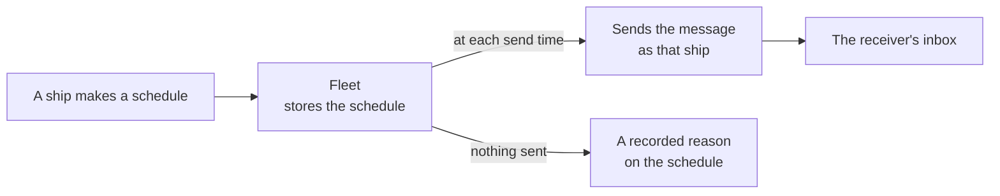
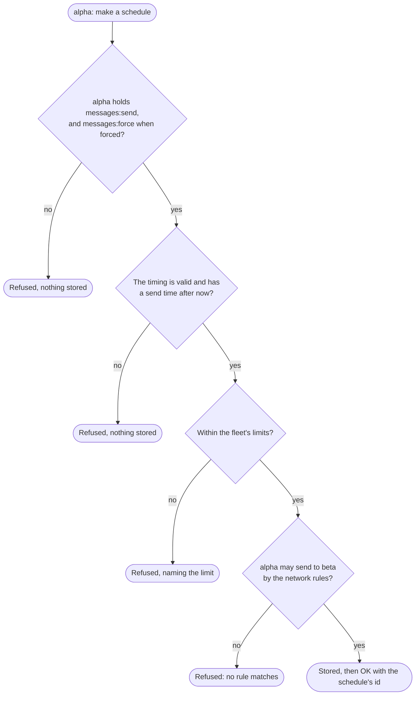
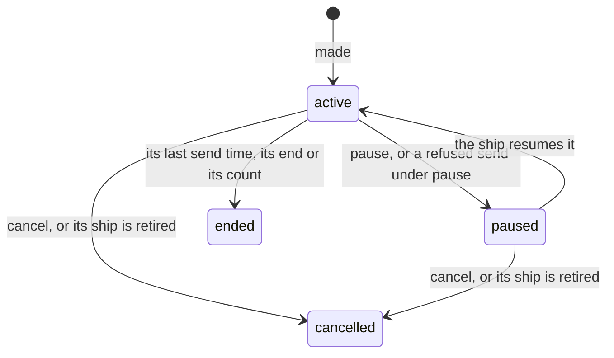

# Schedule a message

You want a [session](words.md#session) to send a [message](words.md#message) later: a reminder to itself tomorrow at nine, a check-in to another [ship](words.md#ship) every six hours, a weekday nudge. You do not want to keep a session open and counting. This page does it start to finish: a [schedule](words.md#schedule) that sends once, one that repeats every interval, one that follows a cron in a time zone, what the [fleet](words.md#fleet) does when a send time is refused or missed, and how you pause and cancel a schedule.

What you get: a message the fleet stores and sends for the ship at its time, as that ship, whether or not its session is running. The schedule belongs to the ship that made it and shows in that ship's page in the [console](words.md#console).



## What you need

- Two crewed ships, as in [Get two sessions talking](two-sessions.md). This page calls them `alpha`, which makes the schedule, and `beta`, which receives it. A ship may also schedule a message to itself.
- The [scope](words.md#scope) `messages:send` on `alpha`. A schedule is checked as a send is, so a [forced](words.md#forced) one also needs `messages:force`. Grant scopes when you [commission](words.md#commission) a ship or later: [Scopes](scopes.md).
- A session of `alpha` that can call the fleet's `schedule`, `schedules`, `pauseSchedule`, `resumeSchedule` and `cancelSchedule` calls. They are ship calls like `send`, reached over the fleet's MCP door or its REST door: [Ship contract](ship-contract.md).
- If your fleet has [network rules](words.md#network-rule), a rule that lets `alpha` send to `beta`.

## 1. Make a schedule that sends once

Tell `alpha`'s session in plain words what to schedule:

```
Schedule a message to beta for tomorrow at 09:00 UTC asking it to review the open pull requests.
```

The session makes a schedule with the `schedule` call. It holds a whole send input and its timing:

| Field | What it is |
| --- | --- |
| [`selector`](words.md#selector) | Whom to send to: a ship by name, any one ship of a [ship type](words.md#ship-type), or the ships carrying a set of [labels](words.md#label). The fleet works out who that is when the schedule is made, to check it, and again at each send time. |
| `payload` | The message, at most 64 KB. |
| `contentType` | The kind of payload. `text/plain` when left out. |
| `inReplyTo` | The message this one answers. Optional. |
| `isForced` | A forced send. Optional, and it needs `messages:force`. |
| `timing` | When it sends, as the next steps show. |
| `idempotencyKey` | Your key for this schedule. Making the same schedule again with the same key answers the schedule you already have. The same key for a different schedule is refused. |

A once schedule names an instant with its offset, such as `2026-11-18T09:00:00Z`. It must lie in the future.

The fleet checks the schedule when it is made, as a send:



Only after the OK is there a schedule. Like a message, it is stored before the session hears OK.

At the send time the fleet sends the message as `alpha`. `beta` receives it in its [inbox](words.md#inbox) like any message. The message names its schedule and its send time beside the content type, so `beta` can tell a scheduled message from a live one.

Each send time gives at most one message, or a recorded refusal or miss, across restarts of the fleet and when several fleet servers run: one server claims the send time, and the message and the schedule's next send time are stored together or not at all. Each server's timer wakes it at the next send time, and a pass every 30 seconds picks up whatever is due if a timer was lost. A send can still come later than its send time, and one that comes too late is a miss: see section 5.

After its one send a once schedule has **ended** and sends nothing more.

## 2. Repeat it

A repeating schedule takes one of two timings, and for both an optional `start`, an optional `end` and an optional `count`. Either `end` or `count` ends the schedule, whichever comes first.

- **`every`**: an [ISO 8601](https://en.wikipedia.org/wiki/ISO_8601#Durations) duration of a fixed length: `PT30M` for every half hour, `PT6H` for every six hours, `P1D` for every day. It counts weeks, days, hours, minutes and seconds, never months or years.
- **`cron`**: a cron of five fields (minute, hour, day of the month, month, day of the week) and an IANA time zone such as `Europe/Brussels`. Without a zone it is UTC. `0 9 * * 1-5` with `Europe/Brussels` sends at nine o'clock Brussels time on weekdays.

Try it. Tell `alpha`:

```
Every 6 hours, send beta a message asking for a short status. Stop after 4 sends.
```

That is `every` with `PT6H` and a `count` of 4. After the fourth send the schedule ends.

A cron is read in its zone, so it follows summer time. A wall time the clocks skip in spring sends at the first valid minute after it. A wall time they repeat in autumn sends once, the first time. A once and an every are instants, so summer time does not touch them.

Two limits of the fleet can refuse a schedule when it is made. Both are set by your [installation](words.md#installation) and none by default: how many schedules a ship may hold, active or paused, and the shortest gap between two sends of a repeating schedule. Every scheduled message counts toward the fleet's messages per day, like any message: see [Timings and limits](timings-and-limits.md#scheduled-messages).

## 3. Read how it is doing

Tell `alpha` to list its schedules, or open `alpha` in the console and choose its **Schedules** tab. The tab shows to people who may manage the ship. Each schedule shows:

- **Whom it sends to**: "To beta", "To any ship of type reviewer", or the labels it selects.
- **When**: "Once, 18 Nov, 09:00", "Every 6 h, at most 4 sends", or "Cron 0 9 * * 1-5, Europe/Brussels".
- **Its state**: active, paused, ended or cancelled.
- **Its next send time**, until it ended or was cancelled.
- **Its last outcome**: "Sent 2 minutes ago", which opens the message; "Refused 1 minute ago" with the code; or "Missed the send time" with its time. "Nothing sent yet" before the first send time.

Every send, refusal, miss, pause, resume and cancel also writes an event to the ship's history, on its **Timeline** tab.

## 4. When a send time is refused

The send at each send time is checked again as a send by `alpha`, at that time: its scopes, whether it may still reach the receiver, the fleet's messages per day, and whether the receiver is still a ship. A change since you made the schedule can refuse a send: a scope taken away, a network rule applied, a retired receiver, a full day.

A refusal stores no message. It is recorded on the schedule with its code and time, and the schedule's **refusal strategy** decides what happens next. You pick it when you make the schedule.

| Strategy | What happens |
| --- | --- |
| `skip` | The refusal is recorded and the schedule goes on to its next send time. A once schedule ends. This is the default. |
| `retry` | The send time is tried again, about every 30 seconds, until it is stored or its **retry window** has passed, 1 hour unless the schedule says. Then it is skipped as above. |
| `pause` | The refusal is recorded and the schedule pauses until its ship resumes it. |

The fleet sends nothing for a refused send time on its own, and tells no one: you see it on the schedule and in the ship's history.

## 5. When a send time is missed

A send time is **missed** when the fleet reaches it later than the schedule's **grace**, 5 minutes unless the schedule says. That happens when the fleet was down, or was too busy to send in time. A send time reached within its grace is sent as normal.

The schedule's **missed strategy** decides what the fleet does with the send times it missed, oldest first.

| Strategy | What happens |
| --- | --- |
| `each` | Every missed send time is sent, at most 100 in one pass and the rest on the next. This is the default. |
| `once` | Only the latest missed send time is sent. The others are recorded as missed. |
| `skip` | None is sent. Each is recorded as missed, and the schedule waits for its next send time. |

Pick `once` or `skip` for a schedule that repeats often, such as every minute: a day without the fleet would otherwise send up to 1,440 messages at once. A session that was away reads each scheduled message with its send time and decides for itself what to do with it. A recorded miss shows on the schedule as "Missed the send time".

A ship that is released or awaits crew keeps its schedules going. Their messages wait for the receiver like any message.

## 6. Pause, resume and cancel



- **Pause.** A paused schedule sends nothing. The ship pauses its own schedule with `pauseSchedule`. In the console, choose **Pause** on an active schedule.
- **Resume.** The ship resumes it with `resumeSchedule`. It goes on at its first send time after now: the send times that passed while it was paused are skipped, not sent. If none is left, it ends. Only its own ship resumes a schedule, so the console has no Resume.
- **Cancel.** A cancelled schedule never sends again. The ship cancels its own schedule with `cancelSchedule`. In the console, choose **Cancel** on an active or paused schedule, and confirm. A person with `fleet:manage` over the ship may also pause and cancel its schedules, so you can always stop a schedule of a ship that misbehaves.
- **No edit.** A schedule never changes. To change one, cancel it and make a new one.
- **Retire.** [Retiring](words.md#retire) a ship cancels its schedules.

The console lists schedules in every state. The `schedules` call lists active and paused ones unless you ask for the states `ended` or `cancelled` too.

## If something does not work

| What you see | What to do |
| --- | --- |
| The schedule is refused with `INVALID_TIMING` | A once must lie in the future; a repeat must send at least once before its end; a cron needs a time zone the fleet knows. |
| It is refused with `SCHEDULE_INTERVAL_TOO_SHORT` | Your fleet sets a shortest gap between two sends of a repeating schedule. Make the repeat longer. |
| It is refused with `SCHEDULE_LIMIT_REACHED` | The ship holds the most schedules its fleet allows, active or paused. Cancel one. |
| It is refused with `IDEMPOTENCY_KEY_REUSED` | That key made another schedule. Use a new key for a new schedule. |
| It is refused because no rule matches | Your fleet has network rules. Add one that lets `alpha` send to `beta`. |
| The schedule is active, but nothing arrived | Read its last outcome in the console. A refusal shows its code; a miss shows the send time. A sent message opens on `beta`'s **Messages** tab. |
| A paused schedule never sends | Only its own ship resumes it. Ask `alpha`'s session to resume it. |

## Next

- [What you can do](what-you-can-do.md): everything else a fleet does.
- [Timings and limits](timings-and-limits.md#scheduled-messages): the values behind a schedule.
- [How delivery works](how-delivery-works.md): what the fleet guarantees for each message once it is sent.
