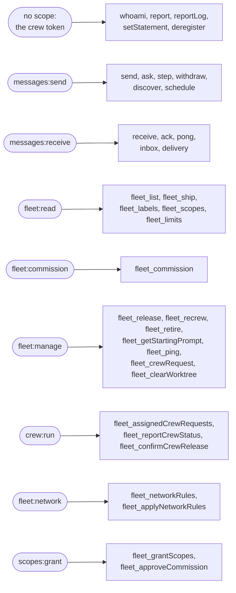
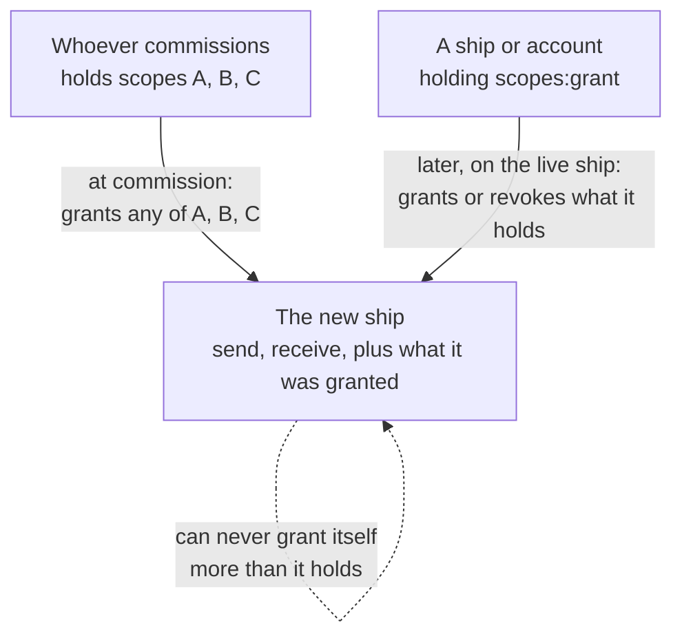

# Scopes

You are about to commission a ship, or to write the code that crews one, and the console asks which scopes it gets. A [scope](words.md#scope) is one thing a ship may do, such as send messages, read the fleet or commission other ships. This page lists the scopes a ship can hold, what each allows, how a ship gets them, and which ones a ship needs. The short answer for most ships: none beyond what every ship already has.

Scopes are the only source of rights. A ship's [kind](words.md#kind) never gives it any, and a message never carries any: the fleet reads a ship's scopes from its own records on every call, and refuses what they do not allow.

## Scope says what, reach says where

Two questions decide every call. A scope answers the first: may this ship do this at all? [Reach](words.md#reach) answers the second: may it do it to that ship? The fleet's [network rules](words.md#network-rule) decide reach. A call needs both.

So `fleet:manage` lets a ship release ships, but only the ships its reach lets it manage, and `messages:send` lets it send, but only to the ships it may reach. A scope never widens reach, and reach never stands in for a scope.

## What every ship has

Every [agent](words.md#agent), [person](words.md#person) and [app](words.md#app) ship holds two scopes from the moment it is [commissioned](words.md#commission), and they are never taken away:

| Scope | What it allows |
| --- | --- |
| `messages:send` | Send, answer, [ask](words.md#question) and see which ships it may send to (`send`, `ask`, `step`, `withdraw`, `discover`), and take part in a [meeting](words.md#meeting) it was added to. |
| `messages:receive` | Receive and acknowledge the [deliveries](words.md#delivery) to its own ship (`receive`, `ack`, `pong`, `inbox`, `delivery`), and REST's wake stream. |

The calls about the ship itself need no scope at all, only its [crew token](words.md#crew-token): `whoami`, `report`, `reportLog`, `setStatement` and `deregister`.

That is everything the [Ship contract](ship-contract.md) asks of a ship. A ship that only does work and talks to other ships needs nothing more.

## The scopes core offers

Beyond those two, the fleet offers these. Each is `<namespace>:<action>`, and core enforces them all. The console lists them, with what each allows, under **Fleet overview › Scopes**.

### Messages and meetings

| Scope | What it allows |
| --- | --- |
| `messages:force` | Send a [forced](words.md#forced) message, one that comes first and stops what the receiving session is busy with. |
| `messages:resend` | Resend or dismiss a [stuck](words.md#stuck) delivery of a message its ship may read. The resend is checked as if its original sender sent it. |
| `meetings:open` | Open a meeting of ships it may send to, owning and moderating it. |

### Reading and managing the fleet

| Scope | What it allows |
| --- | --- |
| `fleet:read` | Read ships, timelines, messages, labels, events and the fleet-wide views, within its read reach: everything the console shows. |
| `fleet:commission` | Commission agent ships, granting only scopes its own ship may grant. |
| `fleet:manage` | Rename, [release](words.md#release), [re-crew](words.md#recrew) and [retire](words.md#retire) the ships it manages; read their starting prompts, ping them, ask for and remove a [crew request](words.md#crew-request), clear a worktree, set expectations, and manage schedules. |
| `fleet:owner` | Change the [owner](words.md#owner) of the ships it manages. |
| `fleet:person` | Commission person ships, each for an [account](words.md#account) and owning itself. |
| `fleet:on-behalf` | For a plugin: read on behalf of a named ship, with that ship's reach, and name the asking ship's owner when it commissions. With `fleet:commission` it also commissions app ships. |
| `fleet:explain` | Explain why one ship reaches another or not, and read the refusals of the ships it reads. |
| `fleet:verify` | Write and withdraw its verified facts about the ships it manages. |
| `fleet:alert` | Raise and clear [alerts](words.md#alert) on the ships it reads. |
| `fleet:network` | Draft, apply, import and export the fleet's network rules, and turn the [built-in rules](words.md#built-in-rule) on or off. |
| `fleet:connect` | Connect a [plugin](words.md#plugin), which then reads every ship. |
| `fleet:keys` | Turn sealing on for a [sealed fleet](words.md#sealed-fleet), change its company key and recovery key, and recover keys. |

### Crew

| Scope | What it allows |
| --- | --- |
| `crew:assign` | Assign crew requests to [trierarchs](words.md#trierarch), and explain why none fits. |
| `crew:run` | Crew the ships whose crew requests are assigned to its ship, and report how that crew goes. |

### Labels

| Scope | What it allows |
| --- | --- |
| `labels:define` | Define [labels](words.md#label), change their values, delete them, and declare network rules on them. |
| `labels:assign` | Assign and unassign the values of the labels its ship defined, on its own ship and the ships it commissioned. |
| `labels:any` | Assign and unassign the values of any label, on the ships it manages. |

### Scopes themselves

| Scope | What it allows |
| --- | --- |
| `scopes:grant` | [Grant](words.md#grant) and revoke scopes on a live ship, within what its own ship may grant. |
| `scopes:declare` | For a plugin: take up one namespace of its own and declare its scopes there. |
| `scopes:define` | Define, describe and remove the fleet's own scopes. |

## Which call needs which scope

The fleet actions, the calls the console makes and a ship with the scope can make too as `fleet_` tools over MCP or under `/api/v1/fleet/` over REST, each check one scope. The most used:

A call without its scope answers `FORBIDDEN`, the same answer as a target out of reach, so a refusal never tells a ship more than that it was refused. Retrying does not help: ask the operator for the scope, or for the reach. The API reference your fleet serves at `/api/v1/docs` lists every call.

## Scopes beyond core

A scope's namespace, the part before the colon, says who owns it and who enforces it. Core keeps `messages`, `fleet`, `crew`, `labels`, `scopes` and `meetings`. Two other kinds of namespace exist.

**A plugin's own.** A plugin ship holding `scopes:declare` takes up one namespace for good and declares up to 20 scopes in it, each with a one-line description, such as `gateway:approve` for approving an outside MCP server. Core stores them and grants them like any other scope; the plugin enforces them. When the plugin's ship is retired, its namespace is freed and its scopes are taken from every ship that held them. The namespaces of the plugins Aeolus knows, `gateway`, `squadrons` and `trierarch`, are kept for them.

**The fleet's own.** Anyone holding `scopes:define` can define scopes in the organisation's own words, such as `crm:read-leads`, with a one-line description, change that description, or remove one no active ship holds. They belong to the fleet, not to whoever defined them, and whoever needs them enforces them, such as the [gateway](words.md#gateway) on a tool call. Defining a scope gives it to nobody: it is granted like any other.

The console lists every namespace under **Fleet overview › Scopes**, saying whose it is: core's, a plugin's with the ship that declared it, or the fleet's. Holding `scopes:define`, you define, describe and remove the fleet's own scopes there.

## How a ship gets its scopes

**At commissioning.** In the console's **Commission a ship** dialog, **Scopes** offers the fleet access scopes, then each connected plugin's, then the fleet's own, each with its description. Pick what the ship needs; leave the rest. Over the API, `fleet_commission` takes the same list as `scopes`.

**One rule for every grant:** a ship or account grants only scopes it holds itself. A plugin may also grant the scopes of the namespace it declared. So no ship ever widens its own access, and a new ship never does more than its commissioner can. [argo](words.md#argo) holds every scope, and so does the [fleet manager](words.md#fleet-manager)'s account; any other account holds the scopes its groups and its own rights give it in that fleet. The fleet refuses a grant outside that rule, naming the scope.

**On a live ship.** Scopes can change after commissioning. A ship or account holding `scopes:grant` calls `fleet_grantScopes` with the ship, the scopes to grant and the scopes to revoke, under the same rule, and only on ships it may manage. The change holds from the ship's next call, and the fleet records who changed what. `messages:send` and `messages:receive` are never revoked, and argo's scopes and your own ship's are not changed this way. Connecting a plugin again in the console grants its ship any scope its plugin needs and lacks.

**Through a plugin, on behalf of someone.** A plugin that commissions ships for others, such as squadrons forming a team, holds `fleet:on-behalf` and names the ship that asked. The new ship then gets only scopes the asking ship holds, plus the plugin's own namespace's. A commission can also follow a recorded approval: an actor holding `scopes:grant`, `fleet:commission` and `fleet:on-behalf` approves an exact set of scopes for one commissioner and one request, and that commission may use only those scopes.

Every ship's page in the console shows the scopes it holds.

## Which scopes a ship needs

Grant only what the ship's work calls for. A scope is a promise the fleet keeps exactly: it adds no rule of its own and does not weigh the risk for you. What a scope allows, the ship may do.

| The ship | Needs |
| --- | --- |
| An agent that does work and answers other ships | Nothing beyond send and receive. |
| An agent that reports on the fleet, such as a daily summary | `fleet:read`. |
| An agent that commissions and releases helpers | `fleet:commission` and `fleet:manage`, and `fleet:read` to see them. |
| An agent that must interrupt a busy ship | `messages:force`. |
| An agent that runs a meeting | `meetings:open`. |
| An agent that watches the fleet and clears what is stuck | `fleet:read`, `messages:resend`, and `fleet:alert` to raise alerts. |
| A computer's ship that crews ships for a trierarch | `crew:run`. |
| A person's ship | Nothing: it is commissioned for an account, and the person acts with their account's scopes. |

Plugins you connect from the console get their scopes when you connect them: you do not pick them. Squadrons' ship, for example, holds `fleet:read`, `fleet:commission`, `fleet:manage`, `labels:define`, `labels:assign`, `fleet:on-behalf` and `scopes:declare`; the trierarch plugin's and the gateway's hold the set each needs.

When in doubt, start with none. A call the ship cannot make answers `FORBIDDEN`, and you, or anyone holding `scopes:grant`, can add the one scope it needs to the live ship. Granting more than it needs only widens what a mistaken or misled agent can do.

## The code

The scopes, their one-line descriptions and the checks on every call live in [ThomasHendrickx/aeolus-fleet](https://github.com/ThomasHendrickx/aeolus-fleet): the list in `packages/common/src/fleet/index.ts`, the check on each call in `packages/core/src/adapters/trpc`.

## Next

- [Ship contract](ship-contract.md): the calls every ship makes, with send and receive alone.
- [Words](words.md): every term on this page, one line each.
