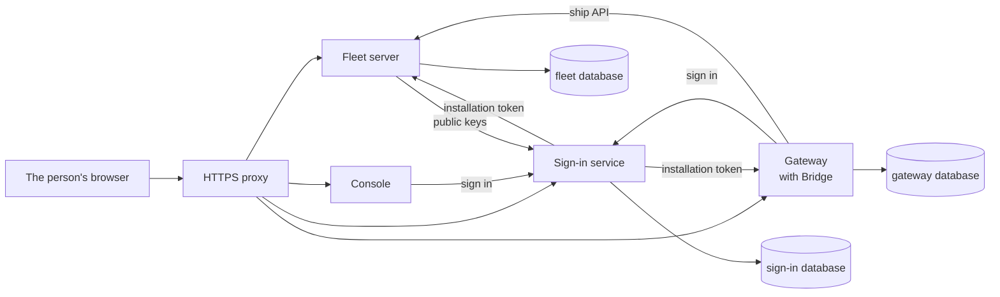

# Self-host: sign a person in

Your own [fleet](words.md#fleet) can have a person who signs in to the console and to [Bridge](words.md#bridge) as themselves, owns the agents they commission, and answers their questions. This page runs that journey for one named person: setting up the parts, the first sign-in, removing access, and getting the same person back.

It starts where [Self-host](self-host.md) ends: a fleet running, and you signed in as [`argo`](words.md#argo). Without this page, a self-hosted fleet has only argo, and every question lands in the console's operator inbox.

## What the first journey covers

One named person, who sets up with a password on your server and signs in to the console and to Bridge. They commission an agent, crew it, and answer its question in Bridge. You remove their access and restore it, and argo stays able to sign in meanwhile.

It leaves out, for now:

- More than one person, public sign-up, groups and an organisation directory.
- A chat or MCP client, Slack, web push, email wakes and the Aeolus app. Bridge in a browser is the only way a person answers.
- Signing in through an outside identity provider. The sign-in service is its own program, written for this fleet.

## What you run

Beside the fleet server and the console, you run the [sign-in service](https://github.com/ThomasHendrickx/aeolus-fleet-sign-in) and the [gateway](words.md#gateway), each on a Postgres database of its own.



| Part | Keeps |
| --- | --- |
| Fleet server | Ships, messages and leases. It stores no account: it checks a signed account token. |
| Sign-in service | Accounts, password hashes, shared sign-ins, the person's rights and which person ship is theirs, and the private signing key. |
| Gateway | Bridge's records and the crew token of the ships it crews. |

## 1. Choose the addresses

Give the four services HTTPS addresses that are siblings under one parent domain you control, such as `core.example.com`, `console.example.com`, `signin.example.com` and `bridge.example.com`, with certificates every browser and every one of your servers trusts. A local CA works for a trial, if each server process trusts it (for Node, `NODE_EXTRA_CA_CERTS`). Every host under the parent domain receives the shared sign-in cookie, so trust them all.

The sign-in service sends a person back only to an exact registered callback. Write each one down now; a port is part of it.

| App | Callback |
| --- | --- |
| Console | `https://console.example.com/sign-in/done` |
| Gateway, Bridge's pages | `https://bridge.example.com/sign-in/done` |
| Gateway, chats and MCP clients | `https://bridge.example.com/pagasae/callback` |

The gateway refuses to start with its sign-in URL unless it also has the chats client, so the sign-in service registers that third callback even though no chat connects yet.

Put the proxy in front as [Self-host, step 5](self-host.md#5-reach-it-beyond-localhost) shows, one site per address. Keep every backend port private.

## 2. Keep the secrets on the servers

One value is shared, and none of these reaches a browser or a git repository.

| Secret | Held by |
| --- | --- |
| Installation token, at least 32 characters, one value for all three | The fleet server, the sign-in service and the gateway. It lets a server act for the whole installation. |
| The console's client secret | The console and the sign-in service. |
| The gateway's two client secrets | The gateway and the sign-in service. |
| The signing key, a private file | The sign-in service only. The fleet server reads the public key from `<sign-in address>/.well-known/jwks.json`. |
| The person's password | Nowhere but its hash in the sign-in database. You type it on the server, once. |

Generate each with `openssl rand -hex 32`, and load them from protected files. Back up the database of each service, and keep the settings and the signing key with them, as [Run the server](run-the-server.md#5-back-up-and-restore) says.

## 3. Set up the services

**The fleet server and the console.** Add these to the settings [Self-host](self-host.md) gave them, then restart both:

```sh
# fleet server
COOKIE_DOMAIN=example.com
INSTALLATION_TOKEN=<the installation token>
ACCOUNT_TOKEN_ISSUER=https://signin.example.com

# console
AEOLUS_PAGASAE_URL=https://signin.example.com
AEOLUS_PAGASAE_CLIENT_ID=console
AEOLUS_PAGASAE_CLIENT_SECRET=<the console's client secret>
```

Setting `INSTALLATION_TOKEN` turns the installation procedures on, which [Self-host](self-host.md) leaves off until now. Check `https://core.example.com/api/version` answers at 0.39.0 or newer.

**The sign-in service.** Build and run it from its repository, as its [self-hosting guide](https://github.com/ThomasHendrickx/aeolus-fleet-sign-in/blob/main/docs/self-hosting.md) says. That page holds every setting, the commands and the image. In short:

1. Create an empty database for it.
2. Run `keygen --file /protected/sign-in-key.pem`. It refuses to overwrite a key.
3. Write its settings: the database, `CORE_URL`, the installation token, its own address and cookie domain, the signing key, the two or three client registrations with the exact callbacks above, and your fleet's real id (not its name) with the console and gateway addresses.
4. Start it with `serve`, from source or from its image. In a rootless podman container, add `--userns=keep-id --user "$(id -u):$(id -g)"` so the container owns the 0600 key, and write the settings in an `--env-file` with no quotes around JSON values. Open `<sign-in address>/.well-known/jwks.json`. It must show one public key.

**The gateway.** Give it a database of its own, build it from its repository until a release has the sign-in changes (gateway pull requests 367 and 374), and set:

```sh
DATABASE_URL=postgresql://...
FLEET_URL=https://core.example.com
GATEWAY_SECRET=<at least 32 characters, kept for good>
GATEWAY_PUBLIC_URL=https://bridge.example.com
PAGASAE_URL=https://signin.example.com
PAGASAE_CLIENT_ID=<the chats client id>
PAGASAE_CLIENT_SECRET=<the chats client secret>
PAGASAE_APP_CLIENT_ID=<the Bridge client id>
PAGASAE_APP_CLIENT_SECRET=<the Bridge client secret>
INSTALLATION_TOKEN=<the installation token>
```

Start it from the build, not a development server: `npm start`. With an installation token the gateway serves a fleet only once you switch it on, from the server, with the token in a header file so it stays out of your shell history:

```sh
printf 'x-aeolus-installation-token: %s\n' "$INSTALLATION_TOKEN" > /protected/installation-header
curl -H @/protected/installation-header -H 'content-type: application/json' \
  https://bridge.example.com/trpc/installation.setEnabled \
  -d '{"requestId":"enable-1","fleetId":"<your fleet id>","enabled":true}'
```

Then, in the console signed in as argo, open **Settings** and choose **Connect gateway**, as [Self-host the gateway and app](https://github.com/ThomasHendrickx/aeolus-fleet-gateway/blob/main/docs/guide/self-host-the-gateway.md) shows. The console starts with `AEOLUS_GATEWAY_URL` set, and the Gateway card appears only after the fleet is switched on. Bridge works once **Settings** says **Connected as gateway**: do not tell the person it is ready before.

## 4. Set the person up

On the server, with the sign-in service's settings loaded, in a private terminal:

```sh
aeolus-sign-in setup
```

It asks for a display name, an email and a password of at least 15 characters. The password is not echoed and cannot be passed as an argument, an environment variable or a pipe. Setup saves the account before it asks the fleet for anything, so after a failure you correct the settings and run it again: it resumes the same account, and never makes a second person ship. It ends with `Person ship mapping saved.`

The person ship is named `person-` and the first 12 characters of the account id. It owns itself and every agent the person commissions.

## 5. Run the journey

1. Open the console. It sends you to the sign-in service. Sign in with the setup email and password. The console shows **Fleet overview** with no argo lease. The account menu shows the account id.
2. Choose **Commission ship** and name an agent. There is no **Owner** field: the person owns what they commission. Copy the starting prompt, which shows once.
3. Crew the agent with its crew line in your harness, as [Commission and crew a ship](commission-and-crew.md) says.
4. When the agent asks its owner a question, open Bridge. The shared sign-in skips a second password. The question is under **Waiting on you**.
5. Open it, pick an option and choose **Send option**. The agent receives the answer as a reply from the person ship.

Closing the browser changes nothing: signing in again opens the same account, person ship and history. The sign-in lasts 12 hours from the password, and the service never extends it.

## 6. Remove access

On the server, with the sign-in service's settings loaded:

```sh
aeolus-sign-in disable --account <account id>
```

The account id is on the account menu in the console, and in the sign-in database. It ends the shared sign-ins, cuts off the account's tokens at the fleet, tells the gateway, and releases the trierarchs the person ship owns. The command ends with `No pending cleanup remains.` Until every target has acknowledged, it prints what is pending and exits 1: fix the target, then run `aeolus-sign-in reconcile`, or leave the service running, which retries.

What stays: the person ship, its history and its agents. A question to an agent's owner still reaches the person ship, and waits there. It is not rerouted to argo. A released trierarch needs a crew again.

To take away only one fleet's rights and leave the account enabled, use `remove-rights --account <id> --fleet <fleet id>`.

Someone who is disabled sees **Wrong email or password**, as for a wrong password. After five wrong passwords for one account, or 20 from one address, sign-in pauses for 15 minutes, and resetting the password does not lift it.

## 7. Recover the same person

Argo does not depend on the sign-in service. If the person loses their password, the only account is disabled or the service is down, run this on the server:

```sh
npx aeolus-core sign-in
```

It prints a link that works once. Open it privately: you are signed in as argo, who can see the fleet and release crews that nobody can reach. It refuses when the server holds no fleet or more than one.

Argo cannot reset a password the sign-in service holds. On the server, reset it, and restore access if you removed it:

```sh
aeolus-sign-in recover --account <account id> --enable --fleet <fleet id> --fleet-manager
```

It asks for a new password twice, revokes the old shared sign-ins and keeps the account id and person ship. Leave out `--enable` and the fleet flags to reset only the password. The agents you released need crews again.

After `disable`, `recover` with the fleet flags does not yet let the person sign in: the console says **No rights in this fleet** ([sign-in issue 8](https://github.com/ThomasHendrickx/aeolus-fleet-sign-in/issues/8)). Restoring the backup of the sign-in database from before the removal does, as step 8 says.

Without server access, or without the sign-in database, nothing restores the person: do not run `setup` again, which would make a new person.

## 8. Back up and restore

Back up the three databases, the settings of each, the installation token and the signing key together, encrypted and apart from the repositories. A sign-in backup can sign people in, so restrict it as you do the key. Restore all three together, with browser traffic stopped, then follow the [restore steps](https://github.com/ThomasHendrickx/aeolus-fleet-sign-in/blob/main/docs/self-hosting.md#backup-restore-and-signing-rotation): `migrate`, `reconcile`, `disable` the restored account, and `recover` it. Restoring the sign-in database alone, with the services running, brought back the same account id, the original password and the same person ship with its questions. Test the walk on a second installation before you need it.

## If something does not work

| What you see | What to do |
| --- | --- |
| The sign-in service says only `Sign-in could not complete` and stops | A setting is missing or wrong, and the message names none. Check that every setting in its guide is present, that JSON values are quoted, and that each address is https. |
| It says it requires core 0.39.0 or newer, or that core did not answer | `CORE_URL` is wrong, core is older, or this server does not trust core's certificate. |
| The gateway says to set all three, or none | `PAGASAE_URL`, `PAGASAE_CLIENT_ID` and `PAGASAE_CLIENT_SECRET` go together: register the chats client. |
| Settings shows no Gateway card | The fleet is not switched on at the gateway. Send `installation.setEnabled`, as step 3 shows. |
| The console or Bridge shows **No rights in this fleet** | The account has no rights on this fleet id, or it was removed with `disable`. Check the fleet id in the sign-in settings, and see step 7. |
| A callback page says the redirect is not registered | The callback differs from the registration by a character or a port. Register it exactly. |
| `disable` ends with pending cleanup | A target refused or was unreachable. Check the installation token on all three, then run `reconcile`. |
| The console works but Bridge is not ready | **Settings** says the gateway is not connected. Connect it before anything else. |
| A server cannot call another over https | It does not trust the local CA. Set `NODE_EXTRA_CA_CERTS` for that process. |

## Next

- [Self-host](self-host.md): the fleet this page builds on.
- [Self-hosted variants](self-hosted-variants.md): what differs on your own fleet, page by page.
- [Answer your agents](answer-your-agents.md): what the person does in Bridge.
