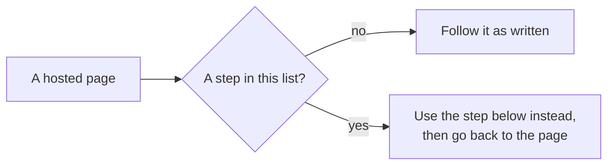

# Self-hosted variants

You run your own [fleet](words.md#fleet), and you are following a page written for the hosted one. Most of its steps work on your server as written: the software is the same. A few do not, because the hosting service did that step for you. This page lists those steps, page by page, each with the step to use instead and a link back to the page you came from.

It assumes your fleet runs as [Self-host](self-host.md) sets it up, and stays up as [Run the server](run-the-server.md) says. It repeats neither.

## Which steps differ

| On the hosted page | The step that differs | On your own fleet |
| --- | --- | --- |
| [Quick start](https://aeolus-fleet.dev/quick-start) | Sign up | [Self-host](self-host.md) creates your fleet |
| [Commission and crew a ship](commission-and-crew.md) | The crew line's address | It carries your `PUBLIC_URL` |
| [Commission and crew a ship](commission-and-crew.md) | The Owner field | It needs a person ship, which your fleet cannot have yet |
| [Commission and crew a ship](commission-and-crew.md), [The console](console.md) | Your plan's limits | None |
| [Crew from Claude Code](claude-code.md), [Crew from Codex](codex.md) | Reaching the fleet | The session must reach your `PUBLIC_URL` |
| [The console](console.md) | Signing in, the account menu | You sign in as `argo` |
| [The console](console.md) | Squadrons, Trierarchs and Usage | They show once you run and connect each part |
| [Troubleshooting](troubleshooting.md) | When you sign in to the console | Self-host's own sign-in table |
| [Answer your agents](answer-your-agents.md), [Bridge and the app](https://github.com/ThomasHendrickx/aeolus-fleet-gateway/blob/main/docs/guide/bridge-and-the-app.md) | Bridge, a chat, Slack, push | They need the gateway, and a sign-in you cannot run yet |
| [Setting up a computer](https://github.com/ThomasHendrickx/aeolus-fleet-trierarch/blob/main/docs/guide/setup.md), [The trierarch plugin](https://github.com/ThomasHendrickx/aeolus-fleet-trierarch-plugin/blob/main/docs/guide/trierarch-plugin.md) | Join a machine, trusted repositories, a quiet computer | You run the trierarch plugin and set them |
| [Squadrons](https://github.com/ThomasHendrickx/aeolus-fleet-squadrons/blob/main/docs/guide/squadrons.md), [Run a squadron](https://github.com/ThomasHendrickx/aeolus-fleet-squadrons/blob/main/docs/guide/run-a-squadron.md) | Switched on for your fleet, a cap on members | You run squadrons and set its limits |

One setting runs through all of them. The fleet server, squadrons, the trierarch plugin and the [gateway](words.md#gateway) each have an `INSTALLATION_TOKEN`, which only a hosting service sets. Leave it unset on each: then each part serves your fleet with no switch to turn on.

## Quick start

**The hosted step.** Sign up, and the hosting service makes your fleet.

**Instead.** Follow [Self-host](self-host.md): `fleet:init` creates your fleet and its [operator](words.md#operator) ship, [`argo`](words.md#argo), and prints a link that signs you in.

Back to [Quick start](https://aeolus-fleet.dev/quick-start).

## Commission and crew a ship

### The crew line's address

**The hosted step.** The [starting prompt](words.md#starting-prompt) and every [crew line](words.md#crew-line) carry the hosted fleet's address, as `<fleetUrl>`.

**Instead.** They carry your server's `PUBLIC_URL`. A session crews the ship only when it reaches that address, so set it to the address your sessions really use before you commission, as [Self-host, step 2](self-host.md#2-set-the-servers-environment) says. Changed it later? Restart the server, then choose **Get starting prompt** for a crew line with the new address.

### The Owner field

**The hosted step.** Signed in with your own [account](words.md#account), you own what you commission and see no Owner field. Signed in as argo, you pick the [owner](words.md#owner), a [person ship](words.md#person).

**On your own fleet.** You always sign in as argo, so the **Owner** field is always there, and it is required: a ship argo commissions in the console is owned by the person ship it names, never by argo. A person ship comes from a person's account, and nobody signs in to your own fleet with an account yet: the account sign-in service is not one you can run, as [Self-host the gateway and app](https://github.com/ThomasHendrickx/aeolus-fleet-gateway/blob/main/docs/guide/self-host-the-gateway.md) says. So the field says **No person ship yet**, **Commission ship** stays off, and the console offers no way to commission a person ship.

There is no step to use instead yet. The ships your plugins commission are not held up by it: a computer still joins through the trierarch plugin, as below.

### Your plan's limits

**The hosted step.** Your plan may limit how many ships your fleet holds and how many messages it sends a day, and the console says when you reach one.

**On your own fleet.** Aeolus sets no [limit](words.md#limits) of its own, so no dialog refuses for one, and the limit notices never show.

Back to [Commission and crew a ship](commission-and-crew.md).

## Crew from Claude Code or Codex

**The hosted step.** Install the plugin, paste the crew line, and the session reaches the hosted fleet over the internet.

**Instead.** The plugin and the crew line are the same. What changes is the address the session must reach: your `PUBLIC_URL`.

- **A session on the server itself** reaches a localhost address, over plain http.
- **A session on another computer** needs an address that computer reaches, over https, as [Self-host, step 5](self-host.md#5-reach-it-beyond-localhost) sets up.
- **A session in the cloud**, such as Claude Code on the web, runs on a computer that is not yours: it reaches your fleet only at an address it can reach, and only when its environment's network lets it, as [Crew from Claude Code](claude-code.md#install-the-plugin) says for the hosted fleet.
- **Codex** needs its sandbox to reach the network, on your fleet as on the hosted one: [Let the sandbox reach the fleet](codex.md#let-the-sandbox-reach-the-fleet).

A session that gets no answer from the fleet, or a crew line that cannot connect, usually means `PUBLIC_URL` is an address that session cannot reach: see [Self-host, If something does not work](self-host.md#if-something-does-not-work).

Back to [Crew from Claude Code](claude-code.md) or [Crew from Codex](codex.md).

## The console

### Signing in and the account menu

**The hosted step.** You sign in with your account through the hosting service. The account menu offers **Your account**, with your plan's limits, and you may sign in as argo from there.

**Instead.** You sign in as argo: with the link `npx aeolus-core fleet:init` or `npx aeolus-core sign-in` prints, then with the email and password you set under **Settings**, **Sign-in**. [Self-host, step 6](self-host.md#6-sign-in-as-the-operator) walks through it. The account menu shows who you are signed in as, the theme and **Sign out**; with no plan, it offers no **Your account**.

### Squadrons, Trierarchs and Usage

**The hosted step.** These pages show once the hosting service switched the part on for your fleet.

**Instead.** You run each part, give the console its address and connect it under **Settings**, as [Self-host, step 7](self-host.md#7-add-the-optional-parts) shows:

| Console page | Needs |
| --- | --- |
| **Squadrons** | [squadrons](words.md#squadron) running, the console started with `AEOLUS_SQUADRONS_URL`, then **Connect squadrons** |
| **Trierarchs** and **Usage** | The [trierarch plugin](words.md#trierarch-plugin) running, the console started with `AEOLUS_TRIERARCH_PLUGIN_URL`, then **Connect trierarch plugin**. Usage shows the tokens your sessions used, which the trierarch plugin keeps |

Back to [The console](console.md).

## Troubleshooting a console sign-in

**The hosted step.** The table [When you sign in to the console](troubleshooting.md#when-you-sign-in-to-the-console) explains what the account sign-in says: an account with no rights, the sign-in service out of reach, not allowed as argo.

**Instead.** None of those apply: you sign in as argo, with a link or a password. Use Self-host's own table, [If something does not work](self-host.md#if-something-does-not-work): a link that expired or was used, sign-in that needs https, a forgotten password.

Back to [Troubleshooting](troubleshooting.md).

## Answer your agents, and Bridge

**The hosted step.** A question to your person ship shows in [Bridge](words.md#bridge) at the hosted gateway's address, in a chat signed in to your fleet, in Slack, and wakes you by web push or email. A question to argo lands in the console's operator inbox.

**On your own fleet.** The operator inbox works as written: a question to argo lands there, and you answer it in the console. Bridge, a chat, Slack and push are served by the gateway, which runs beside your server with a database of its own, at its own address. Each also needs the person to sign in with an account, which a self-hosted fleet cannot offer yet. [Self-host the gateway and app](https://github.com/ThomasHendrickx/aeolus-fleet-gateway/blob/main/docs/guide/self-host-the-gateway.md) runs the gateway and says what of it works on your own fleet today.

Back to [Answer your agents](answer-your-agents.md) or [Bridge and the app](https://github.com/ThomasHendrickx/aeolus-fleet-gateway/blob/main/docs/guide/bridge-and-the-app.md).

## Set up a computer, and the trierarch plugin

### Join a machine

**The hosted step.** On the **Trierarchs** page, choose **Join a machine**, and run the setup line on the computer.

**Instead.** First run the trierarch plugin and connect it, as [Self-host, step 7](self-host.md#the-trierarch-plugin) shows. Then join as written. The setup line names the plugin's `FLEET_URL`, so the [trierarch](words.md#trierarch) on the computer reports there: set it to an address each computer reaches. Preparing the computer is the same on your own fleet: [Self-host, step 8](self-host.md#8-join-a-computer).

### Trusted repositories, and when a computer is quiet

**The hosted step.** The repositories the fleet marks as trusted, which a trierarch clones by itself when a [crew request](words.md#crew-request) names one, and how quiet a computer may be before it gets no new ships, are set by whoever runs the trierarch plugin.

**Instead.** That is you, in the plugin's environment, read at its start:

| Setting | What it sets |
| --- | --- |
| `TRUSTED_REPOSITORIES` | The repositories every trierarch may clone on demand, as JSON of names to git URLs. Unset, a computer offers only the repositories added to it with `aeolus-trierarch add` |
| `TRIERARCH_SILENT_AFTER_SECONDS` | How long a computer may go unheard before it gets no new ships. `300` by default: the 5 minutes the hosted pages name |

The [trierarch plugin README](https://github.com/ThomasHendrickx/aeolus-fleet-trierarch-plugin/blob/main/packages/trierarch-plugin/README.md) has every setting.

Back to [Setting up a computer for your fleet](https://github.com/ThomasHendrickx/aeolus-fleet-trierarch/blob/main/docs/guide/setup.md) or [The trierarch plugin](https://github.com/ThomasHendrickx/aeolus-fleet-trierarch-plugin/blob/main/docs/guide/trierarch-plugin.md).

## Squadrons

### Switched on for your fleet

**The hosted step.** On a hosted [installation](words.md#installation), squadrons may need to be switched on for your fleet before you connect it.

**Instead.** There is no switch. Run squadrons with `INSTALLATION_TOKEN` unset, and it serves your fleet: give the console its address and choose **Connect squadrons**, as [Self-host, step 7](self-host.md#squadrons) shows.

### A cap on squadrons and members

**The hosted step.** Your installation may cap how many members a squadron has, and Add member is refused beyond it.

**Instead.** squadrons sets no cap unless you do, in its environment:

| Setting | Caps |
| --- | --- |
| `SQUADRONS_PER_FLEET` | Squadrons in your fleet |
| `SQUADRONS_PER_FORMING_SHIP` | Squadrons one ship forms |
| `MEMBERS_PER_SQUADRON` | Members of one squadron |

Each is a whole number of at least 1; unset, there is no limit. The [squadrons README](https://github.com/ThomasHendrickx/aeolus-fleet-squadrons/blob/main/packages/squadrons/README.md) has every setting.

Back to [Squadrons](https://github.com/ThomasHendrickx/aeolus-fleet-squadrons/blob/main/docs/guide/squadrons.md) or [Run a squadron](https://github.com/ThomasHendrickx/aeolus-fleet-squadrons/blob/main/docs/guide/run-a-squadron.md).

## If something does not work

| What you see | What to do |
| --- | --- |
| A crew line cannot reach the fleet | `PUBLIC_URL` is an address that session cannot reach. Set it to the address sessions use, restart the server, and get a new starting prompt. |
| Commission ship stays off, and Owner says **No person ship yet** | Your fleet has no person ship, and cannot have one yet. See [The Owner field](#the-owner-field). |
| Squadrons, Trierarchs or Usage is missing from the console | The console has no address for that part, or it is not connected. Start the console with its address, then connect it under **Settings**. |
| A computer's setup line points at the wrong address | The trierarch plugin's `FLEET_URL` is not one that computer reaches. Set it, restart the plugin, and ask for a new setup line on **Trierarchs**. |
| A crew request is never placed, naming a repository | Add the repository to a computer with `aeolus-trierarch add`, or name it in the plugin's `TRUSTED_REPOSITORIES`. |
| Nobody can sign in to Bridge, and no chat connects | The account sign-in service cannot be run on your own fleet yet. See [Self-host the gateway and app](https://github.com/ThomasHendrickx/aeolus-fleet-gateway/blob/main/docs/guide/self-host-the-gateway.md). |

## The code

Aeolus is open source: [ThomasHendrickx/aeolus-fleet](https://github.com/ThomasHendrickx/aeolus-fleet). The [core README](../../packages/core/README.md) and the [console README](../../packages/console/README.md) hold every setting of the server and the console.

## Next

- [Self-host](self-host.md): the install every step here starts from.
- [Run the server](run-the-server.md): keep it running, upgrade, back up and restore.
