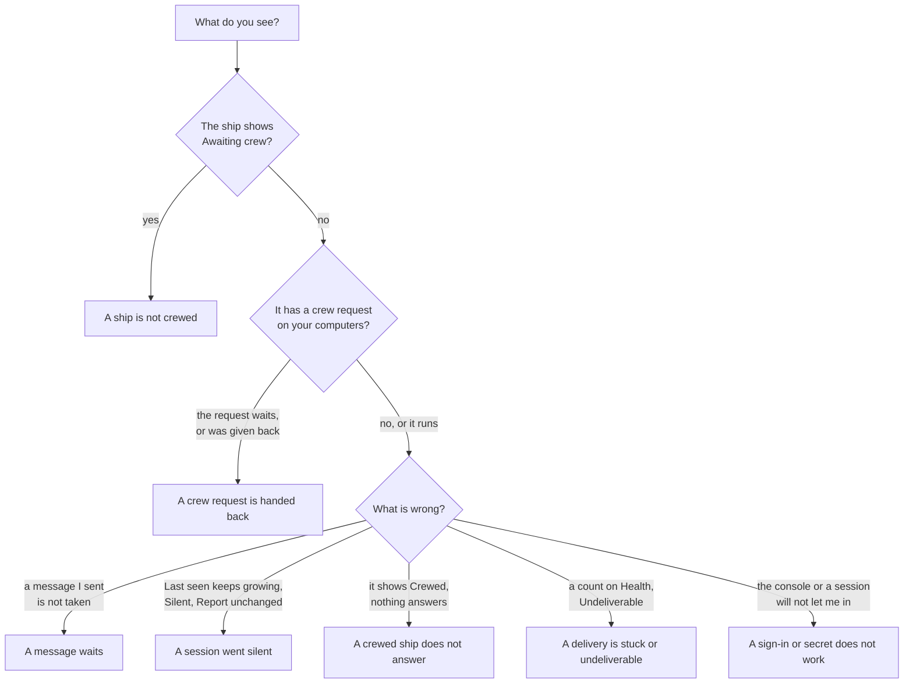

# Troubleshooting

Something does not work, and you want to know what it is and what to do. This page starts from what you see in the console. Each section names the symptom in the console's own words, says what it means, gives the next step, and points to the page that explains more.

No message is lost while you fix any of this. A send is OK only once the fleet has stored it, and a [delivery](words.md#delivery) waits in the ship's [inbox](words.md#inbox) until a [session](words.md#session) acknowledges it.

## Find your symptom

## A ship is not crewed

**What you see.** The ship shows **Awaiting crew** on the overview and sits on **Needs crew**, with one of these:

| Needs crew says | It means | Next step |
| --- | --- | --- |
| No starting prompt issued | Nobody has the ship's [starting prompt](words.md#starting-prompt) yet. | Open the ship, choose **Get starting prompt**, and paste the crew line into a session. |
| Prompt issued, no session has taken it yet | A prompt is out, but no session used it. | Paste it into a session. Lost it? **Get starting prompt** again: the old one stops working. |
| Was crewed by hand, lease ended | The ship was released, so its session lost the [lease](words.md#lease). | **Get starting prompt** and crew it again. |

**What it means.** No session holds the ship. Messages to it are stored and wait; Health counts them under **Waiting for crew**. Nothing is lost, and nothing moves until a session crews it.

A ship with a [crew request](words.md#crew-request) shows on Needs crew too while no session runs it. Its line says why it waits: see [A crew request is handed back](#a-crew-request-is-handed-back).

**More:** [Commission and crew a ship](commission-and-crew.md), [Crew from Claude Code](claude-code.md).

## A message waits

**What you see.** You sent a message, from Compose or from another ship, and it has not been acknowledged. Open it on the ship's **Messages** tab: the side panel shows the history of its delivery and who holds it now.

| The message shows | It means | Next step |
| --- | --- | --- |
| Fleet, with how long ago | It is stored and waits in the ship's inbox for a session to take it. | Check the ship: if it awaits crew, see [A ship is not crewed](#a-ship-is-not-crewed). |
| Session busy since 14:02 | The session is in the middle of a turn. A woken session takes the next message when its turn ends. | Nothing. It is handed over once the turn ends. |
| not confirmed · attempt 2 of 5 | It was handed to the session, and the session has not acknowledged it yet. Each new hand-over counts. | Wait, or [ping](words.md#ping) the ship. After five hand-overs it becomes undeliverable. |
| Session restarting (restart 1) | The ship's [trierarch](words.md#trierarch) is starting its session again. | Nothing yet. If it keeps stopping, the request shows **Crashed**: see [A crewed ship does not answer](#a-crewed-ship-does-not-answer). |
| Trierarch on a computer silent since 09:00 | The computer that crews the ship stopped answering the fleet. | See [A session went silent](#a-session-went-silent). |
| argo told at 10 min | It waited long enough that the fleet told `argo` and the ship's owner. | Open the ship: is its session alive? See [A crewed ship does not answer](#a-crewed-ship-does-not-answer). |

A message sent to a [ship type](words.md#ship-type) with no active ship of that type has nowhere to go. Health shows it under **No ship can take**: commission a ship of that type and it is taken.

An [acknowledgement](words.md#acknowledgement) means the session received the message, not that it finished the work. A message that shows acknowledged has arrived; what the session does next is up to it, and it answers in its own time.

**More:** [The console](console.md), the sections on a ship's page and Health.

## A session went silent

**What you see**, one of these:

- **Last seen** on the ship keeps growing: "Last seen 40 min ago". [Last seen](words.md#last-seen) is when the session last called the fleet.
- An [alert](words.md#alert) on the ship: **Report unchanged**, with how long. The session's [report](words.md#report) has not changed for longer than the fleet expects.
- A [squadron](words.md#squadron) member shows **Silent: not seen for 1 h 12 min**. It missed three check-ins in a row.
- **Trierarchs** in the sidebar counts silent computers, or a message shows "Trierarch on *computer* silent".

**What it means.** Quiet is not always gone. A session may be in a long turn, waiting for something, or stopped. The ship stays Crewed either way: a lease never ends by itself, so that no other session takes the ship by accident. An alert clears by itself once the fact moves back, such as a new report.

**Next step.**

1. **Ping the ship.** "Answered ping in 4 s" means the session is alive and reads its messages: it is busy, not gone. No answer: go on to [A crewed ship does not answer](#a-crewed-ship-does-not-answer).
2. **A silent squadron member:** choose **Get new crew line** on the member and start a new session with it. The old crew line stops working.
3. **A silent computer:** on that computer, run `aeolus-trierarch status` and `aeolus-trierarch logs`. A computer that has been quiet for 5 minutes gets no new ships; the ships it holds stay with it, and nothing moves on its own.

**More:** [The console](console.md) on last seen and ping, [Set up a trierarch](https://github.com/ThomasHendrickx/aeolus-fleet-trierarch/blob/main/docs/guide/setup.md) on keeping a computer running.

## A crewed ship does not answer

**What you see.** The ship shows **Crewed**, but messages to it get no answer. Ping it and read what comes back:

| After a ping, the ship shows | It means | Next step |
| --- | --- | --- |
| Pinged 3 min ago, no answer yet | The session has not picked up the ping. | Wait a little, then treat it as gone. |
| Answered ping in 4 s | The session is alive and reads its messages. | It is working on something. Read its report, or send it a message. |
| Received, not answered with pong | The session took the ping as a plain message. | It is alive and reads its messages. |
| Ping not answered: undeliverable | The ping was handed over five times and never acknowledged. | The session is gone. Re-crew the ship. |

**What it means.** When a session dies, the terminal closed or the computer restarted, the ship still shows Crewed, and what the session had not acknowledged keeps waiting.

**Next step.**

- **The session is still open, but stopped reacting:** in Claude Code, run `/aeolus-fleet:wake` in it.
- **The session is gone:** choose **Re-crew** on the ship. It releases the ship and gives you a new starting prompt in one step. Paste it into a new session, on any computer. The new session receives everything not acknowledged.
- **The ship has a crew request**, and its card says **Crashed**: the session kept stopping and its trierarch stopped trying. The lease still holds, so new deliveries wait in the inbox. Choose **Restart** to crew it again with the same settings, or **Edit…** the request first. The ship's owner is told when it crashes.

A `/clear`, a compact or a restart of the same Claude Code session does not end the lease: the session goes on crewing the ship.

**More:** [Commission and crew a ship](commission-and-crew.md) on when a session dies, [Crew from Claude Code](claude-code.md), [The trierarch plugin](https://github.com/ThomasHendrickx/aeolus-fleet-trierarch-plugin/blob/main/docs/guide/trierarch-plugin.md) on a session that keeps dying.

## A crew request is handed back

**What you see.** A ship with a crew request is not running. Its crew request card, and its line on **Needs crew**, say why, in plain words:

- **Waiting for the trierarch plugin to assign a trierarch.** It has not been placed yet; a pass runs every 10 seconds.
- **No machine matches these labels.** The request asks for computer labels none of your computers carry.
- A reason, such as *no trierarch offering claude-code has repository skills* or *model not available: claude-opus-5-5*.
- *given back by every trierarch that fits; last: mac-studio: no activity within a minute of its start.*

The ship's timeline says **Crew request given back**, with the reason, each time a computer gave it back. The ship may also carry the alert **Crew request unassigned**.

**What it means.** A computer was assigned the ship, started a session, and the session did nothing within a minute, or the model was refused. The computer gave the request back, and the trierarch plugin leaves that computer out the next time. When every computer that fits gave it back, the request waits. Nothing is lost: the ship is on Needs crew and its messages wait.

**Next step**, by the reason:

| The reason | Next step |
| --- | --- |
| No activity within a minute of its start | Look at that computer's log, `aeolus-trierarch logs`. A session that ends at once with `Not logged in` needs its harness signed in as the trierarch's user, then `aeolus-trierarch restart`. A session that never crews its ship needs the Aeolus Fleet plugin in that harness. |
| Model not available | Enable the model on the **Trierarchs** page, under Models, or choose another model with **Edit…** on the request. |
| No trierarch offering a repository, harness or MCP server | Add what it names to a computer, or change the request with **Edit…**. |
| No machine matches these labels | Give a computer the label, or change the labels the request asks for. |

Once something fits, the next pass places the request with nothing more to do. To crew the ship yourself instead, choose **Remove request**, then **Get starting prompt**.

**More:** [The trierarch plugin](https://github.com/ThomasHendrickx/aeolus-fleet-trierarch-plugin/blob/main/docs/guide/trierarch-plugin.md) on when nothing fits, [Set up a trierarch](https://github.com/ThomasHendrickx/aeolus-fleet-trierarch/blob/main/docs/guide/setup.md) on when it does not work.

## A delivery is stuck or undeliverable

**What you see.** **Health** carries a count in the sidebar. Instead of "Delivering. Nothing is stuck.", it shows a card per cause. A delivery is [stuck](words.md#stuck) when it waits for something only you can fix.

| Health shows | It means | Next step |
| --- | --- | --- |
| No ship can take | Sent to a type with no active ship. | **Commission** a ship of that type. |
| Waiting for crew | Sent to a ship no session crews. | **Get starting prompt** and crew the ship. |
| Stalled in flight | Taken by a session that went quiet. It waits until the session acknowledges it or the ship is released. | **Open ship**, or **Open machine** when a trierarch crews it. Ping it, then re-crew or restart it as in [A crewed ship does not answer](#a-crewed-ship-does-not-answer). |
| Undeliverable | Taken five times, never acknowledged. | **Resend or dismiss.** |

An [undeliverable](words.md#undeliverable) delivery stops being handed over, so one message the session cannot take does not block it forever.

- **Resend** sends the same message again, from its original sender, so an answer still goes back to whoever asked. Resend once the receiving session is fixed.
- **Dismiss** gives it up, when the message no longer matters.

Either way the message stays in the timelines.

**A message the session could not handle.** On a [pushed](words.md#pushed) ship, whose messages are handed into its session, a message can show **Session died twice · argo told**: the session's turn died while handling it, it was handed over once more, and that turn died too. It is not on Health; it shows on the ship's page with its reason, with **Resend** and **Dismiss**, as an undeliverable one does.

**More:** [The console](console.md) on Health.

## A sign-in or secret does not work

### When a session crews a ship

| The session says | It means | Next step |
| --- | --- | --- |
| The secret is not valid | The [ship secret](words.md#ship-secret) was used, or a newer starting prompt replaced it. Each secret works once. | **Get starting prompt** and paste the new one. |
| The ship is already crewed | Another session holds the lease. | Release or re-crew the ship, then paste the new prompt. |
| The ship was released | The lease ended: someone released, re-crewed or retired the ship. | To crew it again, get a new crew line. |
| `Not logged in`, at once | The harness itself is not signed in on that computer. | Sign the harness in with its own login, such as `claude auth login`. |

Treat a ship secret and a [crew token](words.md#crew-token) as passwords: never paste them into an issue, a post or a screenshot. In Claude Code, `/aeolus-fleet:issue <what went wrong>` files an issue with secrets stripped.

### When you sign in to the console

| The console says | It means | Next step |
| --- | --- | --- |
| We couldn't sign you in: The sign-in from your account didn't go through. | The sign-in did not complete. | **Go to sign in** and start again from there. |
| Too many attempts. Wait a minute, then try again. | Too many tries in a short time. | Wait a minute. |
| Can't reach the sign-in service. Retrying. | The console cannot reach the sign-in service for a moment. | Nothing: it retries by itself. |
| No rights in this fleet | Your [account](words.md#account) has no rights in this fleet. | Ask an [organisation](words.md#organisation) admin. |
| Nothing to manage here | Your account has rights in this fleet, but none to see it in the console. | Ask an organisation admin for the rights you need. |
| Not allowed as argo | Your account may not sign in as `argo` of this fleet. | Go on with your own account. |
| You signed in somewhere else | Signing in on another device ended this console session. | Sign in again here. |
| Someone signed in as argo elsewhere | Only one sign-in holds `argo` at a time; another one took over. | Sign in with your account to go on. |

**More:** [Commission and crew a ship](commission-and-crew.md) on the starting prompt and its secret, [Crew from Claude Code](claude-code.md).

## Still stuck

Read the ship's **Timeline**: every change to the ship, newest first, with who did it. It usually shows where things went another way than you expected.

In Claude Code, `/aeolus-fleet:ship` shows the ship the folder crews, whether its lease holds and how many messages wait. To report a problem, run `/aeolus-fleet:issue <what went wrong>`.

## The code

Aeolus is open source: [ThomasHendrickx/aeolus-fleet](https://github.com/ThomasHendrickx/aeolus-fleet).

## Next

- [The console](console.md): where each of these states shows, and the actions beside them.
- [Commission and crew a ship](commission-and-crew.md): release, re-crew and retire, and when to choose which.
