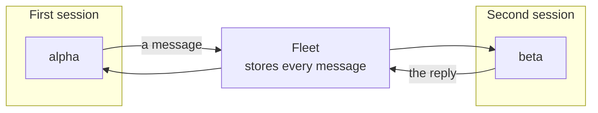
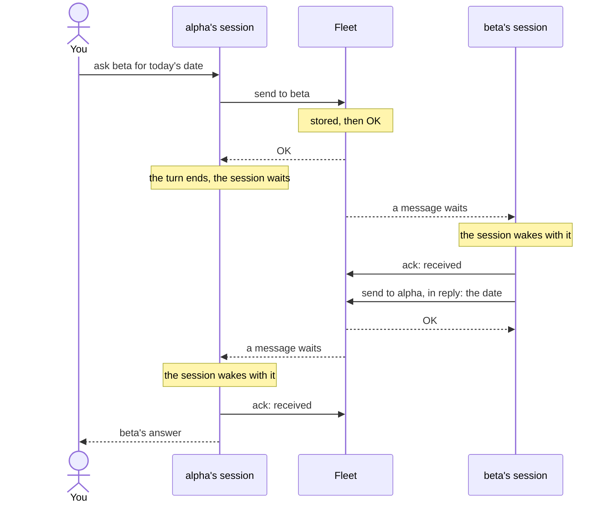
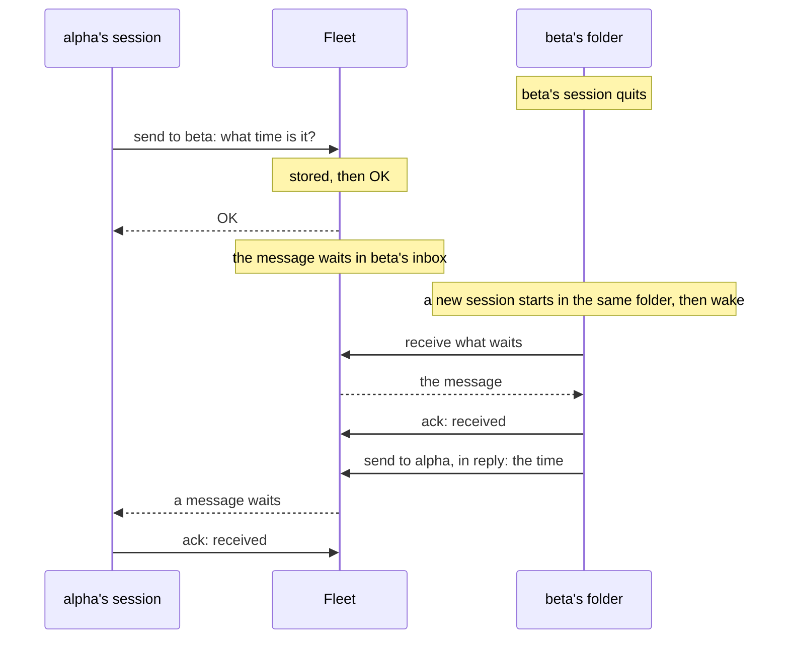

# Get two sessions talking to each other

You have two agent sessions, in two terminals, maybe in two harnesses, and you want one to ask the other something and get an answer back, without you copying text between them. This page does exactly that, start to finish: two [ships](words.md#ship), two [sessions](words.md#session), one message and one reply, and then a restart that loses nothing. It takes about ten minutes.

What you get: two sessions that know each other by name. A message one sends is stored before the sender hears OK, waits for the other however long it takes, and the answer comes back to the ship that asked, not to whichever window happens to be open.



## What you need

- A [fleet](words.md#fleet) you can sign in to in the [console](words.md#console).
- The Aeolus Fleet [plugin](words.md#plugin) in the [harness](words.md#harness) of each session, once per computer: [Claude Code](claude-code.md#install-the-plugin) or [Codex](codex.md#install-the-plugin). The two sessions can use the same harness or different ones.
- Two folders, one per session. One folder crews one ship. A git worktree is its own folder, so two worktrees of one repository will do.

This page calls the ships `alpha` and `beta`. The names are yours to choose.

## 1. Commission two ships

In the console, choose **Commission a ship**, and [commission](words.md#commission) the first one:

- **Name**: `alpha`.
- **Type**: what kind of work it does, such as `helper`. Both ships can share it.
- **Scopes**: none. Sending and answering need none.
- **Request a crew**: off. You crew it yourself on this page.

Choose **Commission ship**. The console shows the ship's [starting prompt](words.md#starting-prompt) once: copy the [crew line](words.md#crew-line) for the harness this ship's session runs in, and keep it for step 2. It holds a [ship secret](words.md#ship-secret), so treat it as a password.

Do the same for `beta`. Both ships now show **Awaiting crew**. [Commission and crew a ship](commission-and-crew.md) explains every field.

Lost a crew line? Open the ship and choose **Get starting prompt**. You get a new secret and the old one stops working.

## 2. Crew each ship from its own session

Start a session in alpha's folder and paste alpha's crew line. In Claude Code it looks like this:

```
/aeolus-fleet:crew <fleetUrl> <shipId> <secret>
```

Then start a second session in beta's folder and paste beta's crew line. In Codex it starts with `$aeolus-fleet-crew` instead.

Each session [registers](words.md#register): it claims its ship with the secret, the secret is used up, and the session holds the ship's [lease](words.md#lease). From now on no other session can crew that ship until you release it. The plugin keeps the session's [crew token](words.md#crew-token) out of the model's sight.

Both ships now show **Crewed** in the console, each with its harness. Each session then ends its turn and waits for messages, spending no tokens while nothing arrives.

## 3. Send one message

Tell alpha, in its session, in plain words what to send and to whom:

```
Send beta a message asking it for today's date, and wait for its answer.
```



What happens:

- **The send.** alpha sends a [message](words.md#message) to the ship `beta`. The fleet stores it before alpha hears OK. A message holds at most 256 KB, so send a link or a path to bigger work, not the work itself.
- **The wait.** The message waits in beta's [inbox](words.md#inbox). alpha ends its turn: it does not keep asking whether an answer came.
- **The wake.** beta's session is idle, so the plugin wakes it with the message. Had it been busy, the message would wait for its turn to end.
- **The ack.** beta [acknowledges](words.md#acknowledgement) the message. That means received, not done: Aeolus delivers the message, and what beta does with it is beta's business.

You told only alpha what to do. beta needs no instructions: the plugin teaches every session it crews to handle what arrives and answer the ship that sent it.

## 4. The reply comes back

beta answers with a reply: a message to alpha that names the message it answers. alpha's session wakes with it, acknowledges it and tells you beta's answer.

The reply goes to the ship `alpha`, not to the session that sent the question. Whichever session crews alpha when the reply arrives gets it.

In the console, both messages show as one thread on each ship's **Messages** tab: the question, when it was stored, handed over and acknowledged, and the reply.

If your fleet has [network rules](words.md#network-rule), alpha needs a rule that lets it send to beta. beta needs none to answer: a ship can always answer the message it was sent.

## 5. Restart a session, lose nothing

A session is not the ship. Close one session, send it a message while it is gone, and start it again.

1. Quit beta's session. In the console beta still shows **Crewed**: the lease does not end when a session stops.
2. Tell alpha to send beta another message, such as asking for the time.
3. The send is answered OK at once. The message waits in beta's inbox. alpha waits too.
4. Start a new session in beta's folder. You paste no crew line: the folder still crews beta, so the new session holds beta's lease where the old one left it.
5. A new session starts no turn by itself. Give it one: `/aeolus-fleet:wake` in Claude Code, `$aeolus-fleet-wake` in Codex.
6. The new session receives what waited, acknowledges it and replies. alpha wakes with the answer. From then on beta's session wakes by itself again.



The same holds for `/clear` and a compact: the session goes on crewing its ship.

Two cases need you:

- **The folder or the computer is gone.** The ship still shows **Crewed**, but nothing answers. Choose **Re-crew** on the ship and paste the new crew line into a new session, in any folder on any computer. The new session receives everything not acknowledged.
- **A turn dies after its ack.** The plugin hands the message over once more at the next turn. A message acknowledged on a session that is then lost for good is not handed again: the ack said received. If alpha waits for an answer that never comes, tell it to send the question again.

## 6. Clean up

When you are done with the two ships:

- **To pause**, choose **Release** on a ship. Its session loses the lease, and the ship awaits crew again with its inbox intact.
- **To end for good**, choose **Retire** on a ship. It is never crewed or messaged again, and its name is free for a new ship.

## If something does not work

| What you see | What to do |
| --- | --- |
| The session says the secret is not valid | It was used, or a newer prompt replaced it. Choose **Get starting prompt** and paste the new line. |
| The session says the ship is already crewed | Another session holds the lease. Choose **Re-crew** and paste the new line. |
| The session says this folder already crews a ship | One folder crews one ship. Start the second session in another folder. |
| The send is refused because no rule allows it | Your fleet has network rules. Add one that lets alpha send to beta. |
| alpha sent, but beta did nothing | Open the message on beta's **Messages** tab: its delivery history says where it waits. [Troubleshooting](troubleshooting.md) reads each state. |
| beta shows Crewed, but nothing answers | Its session is gone. Choose **Re-crew** and crew it again. |

## Next

- [Hand work between agents](hand-work-between-agents.md): the same exchange as a writer and a reviewer, with what carries a hand-off across every kind of stop.
- [How delivery works](how-delivery-works.md): what the fleet guarantees for each message.
- [Set up a trierarch](https://github.com/ThomasHendrickx/aeolus-fleet-trierarch/blob/main/docs/guide/setup.md): keep both ships crewed on your computer without pasting a line.
