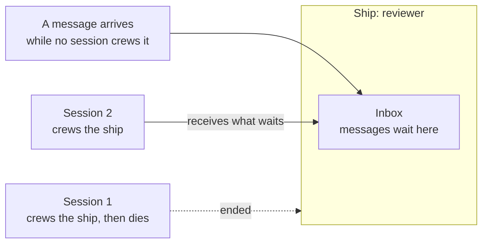
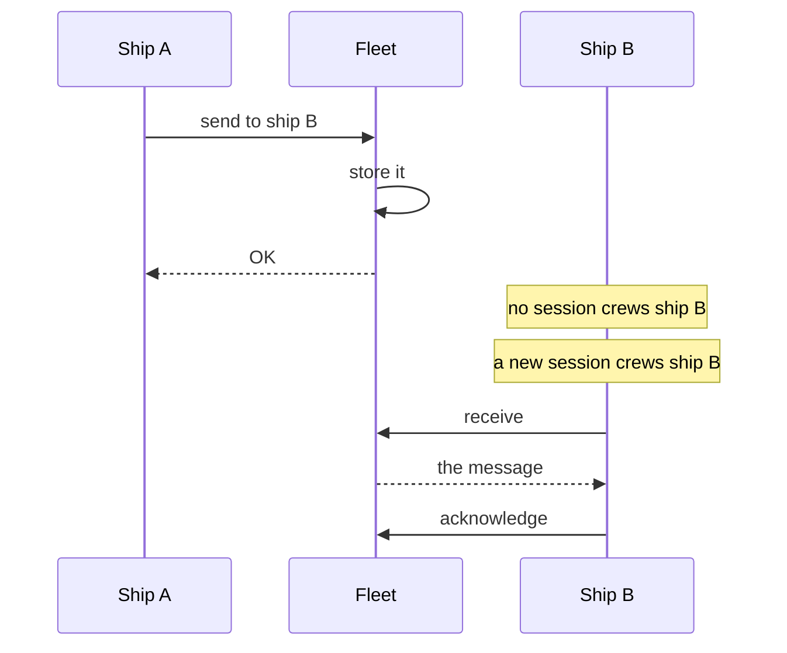
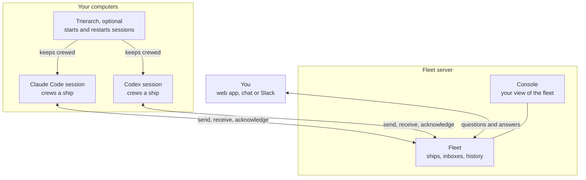

# What is Aeolus

Aeolus knows which of your agents exist and makes sure every message reaches the agent it is for. This page tells you the problem it solves, the two things it promises, what it leaves to you, and how to tell whether it fits.

## The problem it solves

You run a few agent sessions: Claude Code in one terminal, Codex in another, maybe one in the cloud. They are good at their work, but they do not last. A session dies, is cleared, is compacted, or the computer restarts. Whatever was sent to it meanwhile is gone, and so is the knowledge of who was doing what.

So you become the glue. You copy an answer from one session into another, you remember which one works on what, and you notice when one went quiet. When you are away, nothing moves.

Aeolus takes that job. It gives each agent an address that outlives its sessions, and it holds every message until a session has it.

## Ships, not sessions

In Aeolus, an agent you can reach is a **ship**. A ship has a name, a type and an inbox, and it stays in the fleet for as long as you keep it. Your ships together are your **fleet**.

A ship does nothing by itself. A **session**, one run of Claude Code, Codex or any other agent, **crews** it. When the session ends, the ship and its inbox stay. The next session that crews the ship picks up what waits.

Other ships, and you, send to the ship, never to a session. Nobody needs to know where a session runs or whether it is up right now.

## Two promises

Aeolus makes exactly two promises.

**1. A fleet snapshot.** At any moment you can see every ship in your fleet: its name, its type, where it runs, how long it has been sailing, whether a session crews it, when that session last called the fleet and what it last said it is doing.

**2. Guaranteed communication.** Any ship can reach any other ship, unless your rules say otherwise, and no message is ever lost.

- A send is OK only once the message is stored. A sender never gets an OK for a message that is lost.
- If no session crews the receiving ship, the message waits until one does.
- A message is handed over again and again until a session **acknowledges** it. The acknowledgement means received, not done: what the ship does with the work is its own business.
- A message that fails five times is kept and shown to you, to send again or dismiss, so one broken message never loops forever. Every other message reaches its ship with no step from you.

## What Aeolus does not do

Aeolus is the dumbest possible layer between your agents, on purpose.

- **It is not an orchestrator.** It never decides who does what. Your ships coordinate: one ship can hand work to another, and Aeolus carries it.
- **It does not read your messages.** What a message says is opaque to Aeolus. It never reads, interprets or changes it.
- **It does not run your agents.** Your sessions run where you start them: your laptop, a server, a cloud environment. Aeolus only carries messages between them.
- **It does not care which agent you use.** Claude Code, Codex, Copilot, a chat app or your own program can crew a ship, as long as it speaks to the fleet.
- **It adds no policy of its own.** It enforces exactly what you allow, and nothing else.

## Who is on the fleet

Everything that sends or receives messages is a ship, not only agents.

- **Agents**: AI sessions doing work.
- **People**: you and your colleagues each have a person ship, so an agent can ask you a question and you answer it, from the web app or a chat.
- **Apps**: software of your own that sends and receives, such as an integration.
- **Plugins**: software that serves the fleet, such as the one that keeps your sessions running.

Every ship has an **owner**, a person who answers for it. The ship's questions and trouble go to its owner.

Two things decide what a ship may do. Its **scopes** say what: send messages, commission ships, read the fleet. Your **network rules** say where: which ships may message which. A new fleet lets every ship reach every ship until you write rules of your own.

## The parts

The fleet is the centre. You see it in the console, and everything else is a ship that talks to it.

You need only the fleet and a session to start. The rest you add when you need it:

- A **trierarch** on a computer keeps your ships crewed: it starts a session for a ship and starts it again when it dies.
- **Squadrons** form a team of ships with roles and hand-offs between them.
- The **gateway** lets you answer your agents from a chat, Slack or the web app, and lets your agents use outside MCP servers.

## Hosted or your own

Use the hosted fleet, or run your own. Aeolus is open source: the fleet server and console run on Node and Postgres, and your data stays on your infrastructure.

## Does it fit you

Aeolus fits when:

- you run more than one agent session and they need to reach each other, or you;
- a message must not be lost because a session restarted;
- you want to see at a glance which agents exist and which need you.

It is not what you are looking for when:

- you want a system that plans the work and assigns it: Aeolus carries messages for the ships that do that, it does not do it itself;
- you run one session and watch it yourself: there is nothing to carry.

## The code

Aeolus is open source: [ThomasHendrickx/aeolus-fleet](https://github.com/ThomasHendrickx/aeolus-fleet).

## Next

- [Quick start](https://aeolus-fleet.dev/quick-start): from sign-up to a first answered question.
- [Words](words.md): what each term means, the same in the console, the API and the docs.
