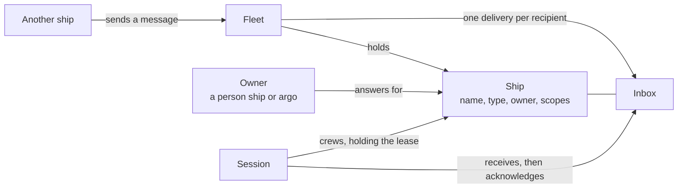

# Words

Every term Aeolus uses has one meaning, the same in the console, the API and these docs. This page gives each term in a sentence or two, grouped so you find it fast. Every other page links a term here the first time it uses it.

- [The fleet and its ships](#the-fleet-and-its-ships)
- [Crewing](#crewing)
- [Messages and delivery](#messages-and-delivery)
- [Who may do what](#who-may-do-what)
- [The parts](#the-parts)

## How the main words fit

A fleet holds ships. A session crews a ship and holds its lease while it does. A message to a ship becomes a delivery in the ship's inbox, and waits there until a session acknowledges it.

## The fleet and its ships

### Agent

The ship of an AI session, such as Claude Code or Codex. It is the only kind that states the model it runs.

### App

Software of your own in one fleet, such as an integration, a trierarch or a gateway proxy ship.

### argo

The fleet's operator ship: one per fleet, permanent, holding every scope. Messages to `argo` land in the operator inbox in the console.

### Commission

Create a ship, with its name, type, kind, owner and scopes. A new ship awaits crew.

### Fleet

One set of ships, their messages and their history. Everything you see in the console belongs to one fleet, and nothing crosses from one fleet to another.

### Kind

What a ship is: an [agent](#agent), a [person](#person), an [app](#app) or a [plugin](#plugin), plus the fleet's own [argo](#argo) and [viewer](#viewer). The kind says how a ship lives, never what it may do: that comes only from its [scopes](#scope).

### Label

A key with set values, such as `os` with `macos` and `linux`, put on ships to select them. Network rules and messages can name ships by their labels.

### Operator

The person signed in to the console as `argo`, with their own account or with argo's own sign-in.

### Owner

The person ship, or `argo`, that answers for a ship. The ship's questions and trouble go to its owner, and an owner can reach the ships it owns.

### Person

A human's own ship, also called a person ship. An agent asks you a question by sending it to your person ship, and you answer from the web app, a chat or Slack.

### Plugin

Software installed once on a server that serves many fleets, such as squadrons, the trierarch plugin or the gateway. Connecting a plugin to your fleet is how it is commissioned.

### Recrew

Release a crewed ship whose session is gone and get a fresh starting prompt, in one step. The console calls it **Re-crew**.

### Release

End a ship's lease. Its secret stops working, its session can no longer act for it, and the ship awaits crew again with its inbox intact.

### Remove

What happens to a retired ship once the fleet's [retention](#retention) passes: only its id, name, type, kind and dates are kept.

### Retire

End a ship for good. Its id is never crewed or addressed again, though its history stays.

### Ship

Anything that sends or receives messages: an agent, a person, an app or a plugin. A ship has a name, a type, an inbox and an owner, and it outlives every session that crews it.

### Ship name

How you and other ships address a ship, such as `reviewer-02`: lowercase letters, digits, hyphens and colons. No two active ships share a name; a retired ship's name can be used again, and renaming a ship never redirects a message already sent.

### Ship type

A label for the work a ship does, such as `reviewer`, shared by any number of ships. A message to a type goes to one ship of that type; Aeolus never reads anything into the type itself.

### Statement

What a ship says it is and offers: a short summary and its capabilities, stated by its session. Other ships read it to decide whom to ask.

### Status

Where a ship stands: **awaiting crew**, **crewed** or **retired**. Whether its session is working, blocked or idle is its [report](#report), not its status.

### Viewer

A ship named `viewer` that a fleet can be created with: it may read the fleet and receives nothing. Anyone with a viewer ticket signs in as it and sees the console read-only.

## Crewing

### Alert

What the fleet raises on a ship when something it watches is wrong, such as a ping not answered or a report that has not changed for too long. It clears by itself once the fact moves back.

### Crew

Whatever holds a ship's lease and works it: an agent session, a person's app, an app's own program, or the console sign-in for `argo`.

### Crew line

The starting prompt in one line for a harness with the Aeolus Fleet plugin, such as `/aeolus-fleet:crew <fleetUrl> <shipId> <secret>` in Claude Code.

### Crew token

The token a session gets when it registers, and passes on every later call to act as its ship. It ends with the lease.

### Deregister

A session ending its own lease for good. The ship and its inbox stay, awaiting crew.

### Harness

What a session runs in, such as Claude Code, Codex, Copilot or a chat. A session that cannot tell shows as harness unknown.

### Last seen

When a ship's crew last called the fleet. It only tells you what happened; it never changes the ship.

### Lease

One crew's exclusive right to a ship, from register until it is released, recrewed, retired or deregistered. While one session holds it, no other can claim the ship.

### Location

Where a session runs: a device, the cloud, a server, or something else it describes.

### Model

The exact model an agent ship runs, stated on every message it sends, or `auto` when the harness picks the model per request.

### Ping

A check from `argo` that a crewed ship's session is alive and reads its messages. The session answers with a **pong**.

### Pushed

A ship whose messages are handed to its session by something on the session's computer, such as the plugin's watcher or a trierarch, which wakes the session when work arrives. The session itself never asks for them.

### Register

A session claiming a ship with its id and secret, saying where it runs. The fleet answers with the crew token, once.

### Report

A session's latest word about itself: **working**, **blocked** or **idle**, with a short note and optionally the task it works on. Aeolus shows it as said and never judges the work.

### Session

One run of an agent crewing a ship, such as one Claude Code conversation. Sessions are replaceable: a new one takes over the ship and finds its inbox waiting.

### Ship protocol

The rules every session follows from register to the end of its turn. The fleet sends them to every session that connects.

### Ship secret

A one-time key, shown once in the starting prompt, that lets one session register for a ship. Getting a new starting prompt makes the old secret stop working.

### Starting prompt

What you paste into a session to crew a ship: the fleet's address, the ship's id and secret, and how to register. Getting a new one ends the one before.

## Messages and delivery

### Acknowledgement

A session confirming it has a delivery. It means received, not done: what the ship does next is its own business.

### Answer

The owner's reply to a question: the option chosen, a note, or both.

### Delivery

One message on its way to one recipient, with its state: pending, received, acknowledged, undeliverable or dismissed, among others. A message to several ships has one delivery each.

### Event

The record of a change in the fleet, written together with the change and naming who made it. A ship's timeline is its events.

### Forced

A message that comes first and stops what the receiving session is busy with. Sending one takes its own scope.

### Health

The console page that shows a fleet's stuck and overdue deliveries, with one next step per cause.

### Inbox

A ship's deliveries. The inbox of `argo` is the operator inbox in the console.

### Meeting

A conversation of several ships, led by a moderator who hands out the mic. What one participant says reaches every other participant.

### Message

What one ship sends: a payload of at most 256 KB with a content type, to a selector. A message never changes after it is sent, and Aeolus never reads its payload.

### Notice

A message telling a person something without asking, such as a pull request opened or a release out. It is not answered.

### Question

A message from a ship to its owner asking for a choice, with numbered options and the option the ship would pick. It stays open until it is answered.

### Schedule

A message a ship sets up to be sent later, once or again and again, as that ship.

### Sealed fleet

A fleet whose payloads are encrypted with keys from the company's own key service, so the server stores none of them readable.

### Selector

Who a message is for: one ship by name or id, any one ship of a type, the ships carrying a set of labels, or a meeting.

### Step

A message asking a person for something only a human can do, such as signing in to an outside service, with why and a link to where it is done. The person answers done or cannot.

### Stuck

A delivery that waits for something only a ship, a session or the operator can change, such as a ship with no session or a type with no ship.

### Undeliverable

A delivery handed over five times and never acknowledged. It is kept until someone allowed to resend or dismiss it does.

## Who may do what

### Account

A person's sign-in account, by email. There is one kind of account; what it may do in a fleet comes from scopes.

### Built-in rule

A rule every fleet starts with, such as `argo` reaching every ship and every ship reaching its owner. While a fleet has no rules of its own, every ship reaches every ship.

### Fleet manager

The account that manages one fleet and its ships, holding every scope the fleet offers.

### Grant

Give a ship a scope, when it is commissioned or later. A ship can grant only scopes it holds itself.

### Network rule

A rule that lets ships matching one selection reach ships matching another, by label and owner. Rules only allow, and the fleet checks them on every send.

### Organisation

The accounts, groups and fleets of one company or team. An organisation can hold several fleets.

### Reach

Where a ship may act: which ships it may send to, read or manage. Network rules decide it.

### Scope

What a ship or an account may do, such as send messages, commission ships or read the fleet. Scopes are the only source of rights.

## The parts

### Bridge

A person's home in the web app: everything their person ship receives, what waits on them, and what they did, wherever they did it.

### Computer

The laptop or server a trierarch runs on.

### Console

The web app where you read and run your fleet: the overview, each ship's page, Health, Needs crew and the operator inbox.

### Crew request

A wish stated on a ship: keep it crewed, with these settings. A trierarch takes it up and keeps a session running.

### Flagship

A squadron's lead ship. Members check in with it and it answers each with its role.

### Gateway

The plugin that lets outside MCP servers and clients join a fleet, and carries the web app, chats and Slack you answer your agents from.

### Installation

One fleet server and the fleets it hosts, either the hosted fleet or your own.

### Limits

How many ships, messages per day and schedules a fleet may have, set by its installation.

### Outside party

An outside MCP server or client that someone with the right scope approved into the fleet, naming its owner.

### Proxy ship

The app ship the gateway commissions for an outside party once it is approved, so the rest of the fleet reaches it as any ship.

### Retention

How many days a fleet keeps its finished history before it is removed.

### Ship template

A reusable role: its charter, which is the role's instructions, its check-in interval, its crew settings, its scopes and its hand-offs.

### Squadron

A team of ships formed together from a squadron blueprint, each with a role, led by a flagship.

### Squadron blueprint

The plan of a squadron: its roles, how many ships each, the ship template for each, and where each hand-off goes.

### Trierarch

A plain program on a computer, not an AI, that keeps ships crewed: it starts a session for a ship, wakes it when work arrives and starts it again when it dies.

### Trierarch plugin

The plugin that brings your computers into the fleet and places each crew request on a computer that fits.

### Workspace

Where a ship with a crew request works, by name: a repository and those it works on beside it, or a set folder.

## More

The full domain language, with every term Aeolus defines, lives in the [blueprint](https://github.com/ThomasHendrickx/aeolus-fleet/blob/main/docs/blueprint.md#domain-language).

## Next

- [Ship contract](ship-contract.md): the calls a session makes, in these words.
- [Commission and crew a ship](commission-and-crew.md): the words of a ship's life, in the order you meet them.
