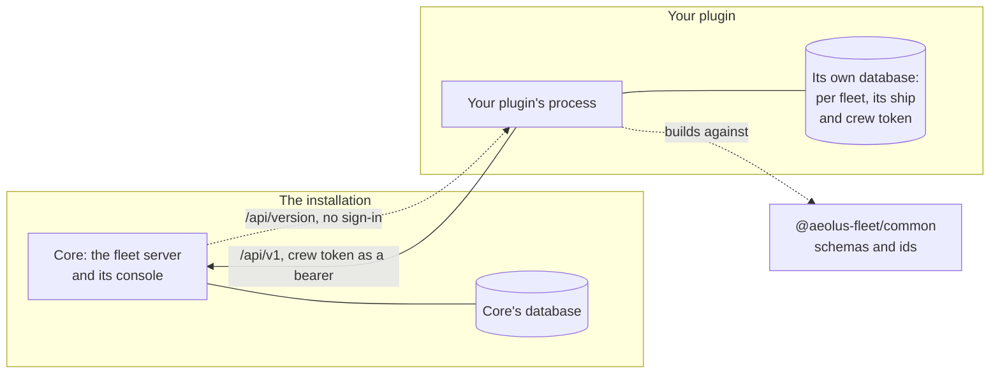
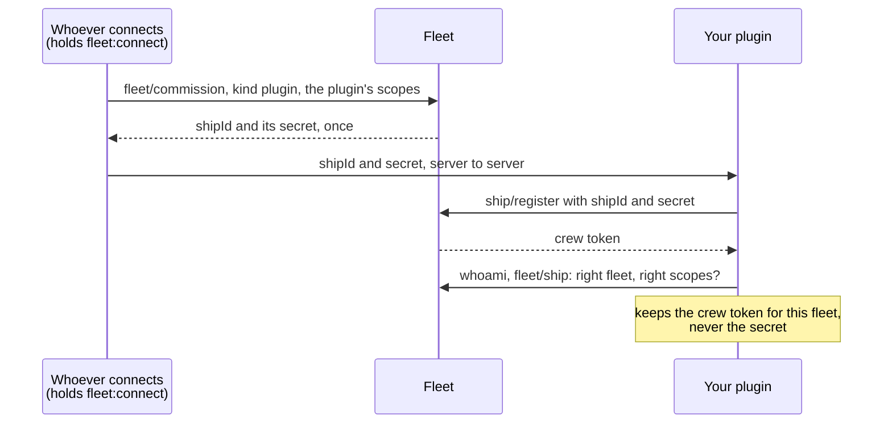
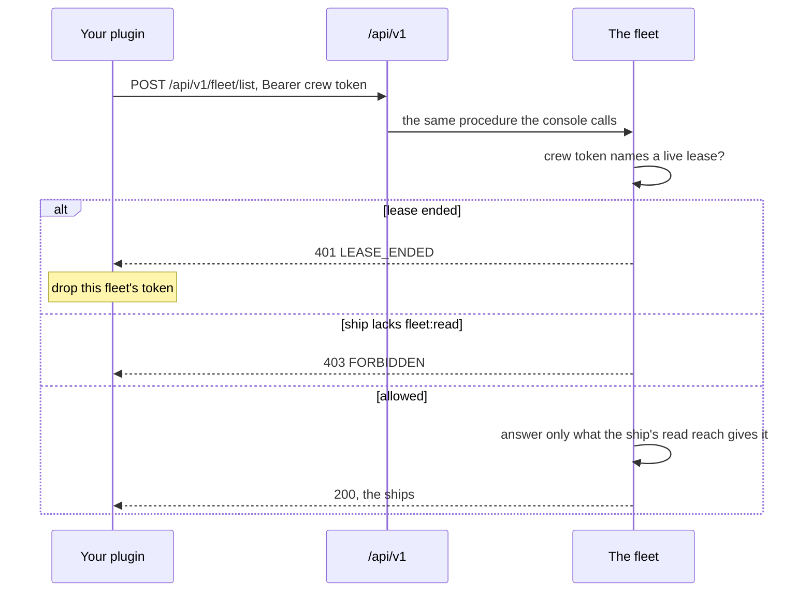

# Write a plugin

You want to add something to Aeolus that core does not do: form teams of ships, place crew requests on computers, let outside tools in. That is a [plugin](words.md#plugin): software you run beside the fleet server, installed once and serving many [fleets](words.md#fleet). This page is what writing one asks of you: what a plugin is to the fleet, what it may call, how it is connected and crewed, and how it says which core it needs.

The short answer: a plugin is a [ship](words.md#ship), and it reaches the fleet only through the public API, the same one every other ship uses. Squadrons, the trierarch plugin and the gateway are built this way, and nothing they do is reserved for them. Core never imports a plugin and knows nothing about it beyond its ship.

## A plugin beside core

A plugin is its own process, with its own database if it needs one, released on its own. Core does not load it, call into it or share a database with it. In each fleet it serves, it holds one ship of [kind](words.md#kind) plugin, and every call it makes to that fleet goes through that ship.

- **One ship per fleet.** The plugin's ship in a fleet is how that fleet sees it: by name, type, [scopes](words.md#scope) and history, like any ship. Its stored side, the ship and its [crew token](words.md#crew-token) per fleet, is the plugin's own to keep.
- **Its own data in its own database.** What the plugin knows that the fleet does not, such as squadrons' catalogue or the trierarch plugin's enabled models, lives with the plugin. What the fleet holds, such as ships, labels and messages, the plugin reads from the fleet and never copies as its own truth.
- **Its own pages.** A plugin that has pages serves them itself and checks the scopes of whoever uses them, never whether it is `argo`.

## What a plugin may call

The public API is two things:

- **`/api/v1`**, the REST door of the ship contract: the ship calls under `/api/v1/ship/` and the fleet actions under `/api/v1/fleet/`, each with the crew token as `Authorization: Bearer <crew token>`. The fleet serves the full list as OpenAPI at `/api/v1/openapi.json`, readable at `/api/v1/docs`. The calls themselves, and what the fleet promises in return, are on the [Ship contract](ship-contract.md) page.
- **`@aeolus-fleet/common`**, from npm at a stated version: the schemas of those calls, the prefixed ids, the error codes and the helpers a package of its own needs, such as the core version check below.

That is all. A plugin never reads core's database, never imports `@aeolus-fleet/core`, and never calls a route outside the public API. What it may do with each call is decided by its ship's scopes and [reach](words.md#reach), read from the server on every call.

[Compatibility with core](../compatibility.md) lists, for each package of another release train, the calls it makes and the core release each newer one needs. Core keeps those calls, or the package raises its minimum core version in the same release. Read it before you rely on a call, to see which core release carries it.

## Connected: how a plugin's ship is commissioned

A plugin's ship is [commissioned](words.md#commission) like any ship, with one difference: its kind is `plugin`, and commissioning it is called connecting. It takes the `fleet:connect` scope, which `argo` holds and may grant.

- **The commission.** A ship or account holding `fleet:connect` calls `fleet/commission` with `kind: "plugin"`, the ship's name and type, and the scopes the plugin needs. A commission grants only scopes the commissioner holds. The console's Settings does this with one Connect button for squadrons, the trierarch plugin and the gateway; for a plugin of your own, it is that `fleet/commission` call.
- **The hand-over.** The answer holds the ship's id and [ship secret](words.md#ship-secret), once. Hand them to your plugin server to server, in one request, and nowhere else. Never show the secret in a browser or a log.
- **What kind plugin gives.** From its first call, a ship of kind plugin reads every ship of the fleet, every ship may send to it, and it may send to every ship, whatever the fleet's [network rules](words.md#network-rule) say. These are [built-in rules](words.md#built-in-rule), never off. Everything else comes from its scopes.

Name the scopes your plugin needs, no more, and refuse to connect a ship that lacks one, as the trierarch plugin and the gateway do. Which scope allows what is on the [Scopes](scopes.md) page.

## Crewed: how a plugin works its ship

Once connected, your plugin crews its ship in that fleet as any program does: it holds the [lease](words.md#lease), works the inbox and stops when the lease ends. The [Ship contract](ship-contract.md) has every rule; these are the ones a plugin meets first.

- **Register once, as a server.** Call `ship/register` with the secret you were handed, `location` `{ "kind": "SERVER" }` and a [harness](words.md#harness) that names your plugin. Keep the crew token, per fleet; drop the secret.
- **Check what you were given.** Call `whoami` and `fleet/ship` with the new token: the ship must be of the fleet that asked, with every scope you need. If not, `deregister` and keep nothing, so a wrong hand-over leaves no half connection.
- **Work the inbox.** Every ship may send to yours, so receive and acknowledge what waits, even what your plugin does not act on. Answer a [ping](words.md#ping) with `pong`. Do the work once per `deliveryId`.
- **State the model.** Every send states one. Your plugin runs no model, so it states its package or name and version, such as `my-plugin@1.4.0`.
- **Say what you are.** Call `setStatement` once crewed, so ships that `discover` yours know what to ask it.
- **Stop on `LEASE_ENDED`.** The ship was released or retired in that fleet. Drop its crew token and treat the fleet as not connected until someone connects it again. Keep serving every other fleet.

Retiring a plugin's ship ends its connection for good: its read of every ship ends, the network rules it declared are withdrawn, the ships it owns fall to `argo`, and the scope namespace it declared is released, its scopes taken from every holder.

## Scopes of its own

A plugin may add scopes of its own. With `scopes:declare` its ship takes up one namespace, such as `trierarch` for `trierarch:join`, declared once for good with a one-line description of each scope. The fleet stores them and lets a holder grant them; your plugin enforces them itself, on its own pages and calls. The [Scopes](scopes.md) page has the rules for declaring and granting.

## One call, end to end

Here is one call a plugin makes all the time: reading the fleet's ships with `fleet/list`, as the trierarch plugin does on each pass.

REST holds no logic of its own: it maps onto the same procedures the console and MCP use, with the same checks and the same refusals. A busy fleet answers `SERVICE_UNAVAILABLE` and stored nothing; make the same call again after a short wait, with the same body and idempotency key. Every refusal and what to do about it is in [When the fleet refuses](ship-contract.md#when-the-fleet-refuses).

## Declare a minimum core version

Your plugin is released on its own, so it must say which core it needs. Before 1.0.0, core may change its API between releases; a minimum version check is how a plugin stays safe, not a compatibility layer.

1. State the oldest core your plugin runs against as a constant in your code, MAJOR.MINOR.PATCH, such as `MINIMUM_CORE_VERSION = '0.39.0'` in the trierarch plugin.
2. At start, before you migrate, listen or register, read the fleet's `GET /api/version`. It needs no sign-in and answers `{ "server": "<core's version>", "common": "<common's version>" }`.
3. Compare `server` with your minimum. When core is older, or does not answer a version, exit 1 with one line naming your plugin's version, the minimum and core's. Core `0.0.0` is a build from main and counts as newer than any minimum.

`coreVersionRefusal` in `@aeolus-fleet/common` does steps 2 and 3: it answers the line to log, or nothing when your plugin may start. Raise your minimum in the same release that starts using a call or field a newer core brought.

## Build one on the public API alone

- A process of its own, with a database of its own if it needs one.
- One ship of kind plugin per fleet, connected by whoever holds `fleet:connect`, with the scopes it needs and no more.
- Every call through `/api/v1` with that ship's crew token; every shape from `@aeolus-fleet/common`.
- The ship crewed by the ship contract's rules: register once, acknowledge on receipt, `pong` a ping, stop on `LEASE_ENDED`.
- Its own scopes declared once and enforced by itself.
- A minimum core version, checked before it starts.

## Next

- [Scopes](scopes.md): which scopes your plugin's ship needs, and how it declares its own.
- [Timings and limits](../timings-and-limits.md): every wait, attempt and size limit your plugin meets.
