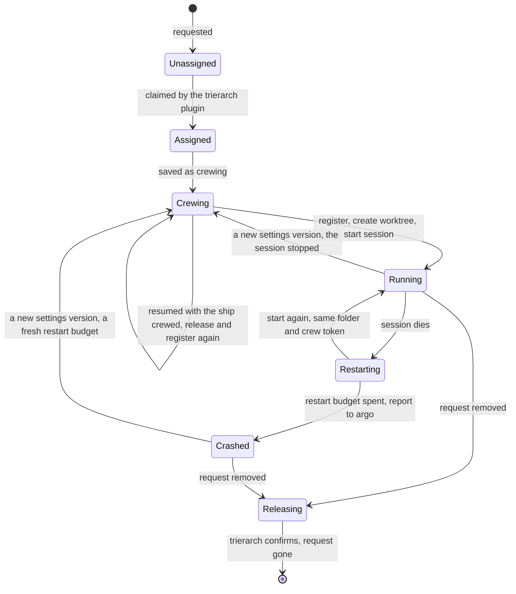

# Trierarch: crewing ships on machines

Model and decisions: 0026 (the trierarch on a machine), 0027 (crew settings), 0029 (the crew request and its scopes), 0030 (the trierarch plugin) and 0039 (sessions in containers). The fleet holds the crew request; everything else here is read only by the trierarch plugin, the trierarchs it manages and the console. `@aeolus-fleet/trierarch-plugin` and `@aeolus-fleet/trierarch` are one implementation, optional, like squadrons; their build is in [architecture.md](architecture.md#the-trierarch). Anyone may write another: this file is what it must do.

Two parts, each its own process and package:

- **The trierarch plugin** (`@aeolus-fleet/trierarch-plugin`), the plugin on the server side, one per installation, beside squadrons: a ship of each fleet it serves. It brings machines into the fleet and picks which machine crews each crew request.
- **A trierarch**, one per machine: a plain process, not an AI, crewing its own ship of type `trierarch`. It crews the ships whose requests are assigned to it, and starts, restarts, wakes and stops their sessions. It never commissions, retires or picks.

A trierarch is the main driver of a session, and the [aeolus plugin](../plugins/aeolus/README.md) the fallback for a session crewed by hand: a trierarch is deterministic, the aeolus plugin installs in one step, so a ship crewed by hand behaves as close to one a trierarch crews as it can. The trierarch owns the process (it starts, restarts, wakes and stops the session); the aeolus plugin owns the conversation (the folder's identity, the fleet calls and the turn).

Plugins never know each other: a requester (the console, squadrons, an orchestrator ship) only touches ships and their crew requests. Without the trierarch plugin a crew request is the operator's to-do list, crewed by hand.

## The crew request

Declared state on the ship, in the fleet core (decision 0029): "keep this ship crewed, with these settings". At most one per ship, standing (level, not edge). Its parts, each with one writer:

| Part | Holds | Written by | Scope |
| --- | --- | --- | --- |
| Request | The settings (below) | A requester | `fleet:manage` |
| Assignment | The trierarch ship that crews it; set only while unassigned | The trierarch plugin | `crew:assign` |
| Reason | Why no trierarch can take it, while unassigned; shown in the operator's needs-crew to-do | The trierarch plugin | `crew:assign` |
| Status | crewing, running, restarting, crashed, releasing, with the restart attempt (0 on the first start) and when the session started; and who crewed it, the trierarch or argo | The assigned trierarch | `crew:run` |
| Give-back | The trierarchs that gave it back before their crew was final, each with the settings version it tried, the reason and when; cleared on every new settings version | The assigned trierarch | `crew:run` |

The server refuses settings over their size, settings that are not crew settings and a machine label that is no label value of the fleet, with the reason, and never acts on them; what fits a trierarch (harness, workspace, options) stays placement's to explain. The settings have a fixed core (decision 0027), whose schema lives in `common`:

- optionally the harness. Without one, the trierarch it goes to crews it with its default harness: the first in its configuration, which is also the first in its report;
- the workspace: a new git worktree of a repository (`{ kind: worktree, repository, ref? }`) or a folder (`{ kind: folder, name }`), each named in the trierarch's local configuration;
- optionally the squadron the ship is a member of, so it checks in at its flagship as a crew line's squadron id does. With a squadron, the session starts with that squadron's crew line and template, as squadrons crews a new member, instead of a plain first prompt;
- an optional first prompt, at most 8 KB and never starting with `-` (it would read as a flag), given on the first start of each settings version and on the start after a release elsewhere (row 11) only;
- options, checked against the JSON Schema the trierarch reports for that harness, or for its default harness when the settings name none. Only the options that schema declares (its `properties`) are checked; an option it does not declare is ignored: no flag, no refusal. A declared option with a value the harness does not offer does not fit;
- optional machine labels: label value ids of the fleet, any owner's, that the machine's trierarch ship must carry, every one (exact matches, AND; see Machine labels below).

Settings never carry paths or command-line flags: a workspace names a repository or folder, and options pick named settings.

```json crew request settings
{
  "harness": "claude-code",
  "workspace": { "kind": "worktree", "repository": "aeolus-fleet", "ref": "main" },
  "squadron": "hemma-feature-a1b2c3",
  "firstPrompt": "Review the open pull requests.",
  "options": { "model": "claude-opus-5-5", "effort": "high" }
}
```

A trierarch's ships are a query, the requests assigned to it, never a list kept on its ship.

A crew is final once the session shows activity: its trierarch's first `running`, `restarting` or `crashed` (decision 0029). Until then the assigned trierarch may give the request back with a reason (`fleet.giveBackCrewRequest`, for the settings version it tried): the request is unassigned and its status cleared, the ship's lease ends and its secret stops working, and the trierarch is recorded. Placement then leaves out every trierarch that gave it back (decision 0030).

The request is the desired state. A ship released elsewhere while its request stands is crewed again by its trierarch. Retiring the ship removes its request (decision 0029).

## Following the fleet

The trierarch plugin follows the fleet's changes: new, changed and removed requests, and reports. Every check-in, of the trierarch plugin and of each trierarch, returns the latest full state (for a trierarch, the requests assigned to it), so a missed event never leaves either stale. The trierarch plugin keeps a small database of its own, the same shape as squadrons': per fleet only the connection (its ship and kept crew token) and the switch, set through installation procedures as squadrons' are (decision 0021). Everything else (requests, statuses, machines) lives in the fleet.

## A machine joins

A trierarch never registers or labels itself.

1. The operator asks the trierarch plugin for a new machine, naming it. The trierarch plugin commissions a ship of that name, of type `trierarch` with `crew:run` beside the send and receive every agent has, nothing more, and answers its starting prompt (decision 0019) and one setup line for the machine, built from the fleet's URL, the ship's id and its secret: `npx @aeolus-fleet/trierarch init --fleet-url <url> --ship-id <id> --secret <secret>`. Both are shown once; the trierarch plugin never logs the secret.
2. On the machine, the setup line runs `aeolus-trierarch init`, which takes the fleet URL, ship id and secret as flags (it never parses a prompt), registers, writes the configuration, makes each harness ready to run unattended (see Unattended below) and installs the service.
3. The trierarch reports what it can do in its report's details (below).
4. The trierarch plugin labels the machine from that report (Machine labels, below).

A trierarch's ship stays a normal ship: it receives messages, such as pings, and sends its crash reports to argo. Releasing it is the kill switch for that machine.

The trierarch's log is where its service writes it: on macOS the launchd agent writes `~/.aeolus/trierarch/logs/trierarch.log`, which `aeolus-trierarch logs` reads, capped by the rule the aeolus plugin's log follows (plugins/aeolus/README.md, "The log"): once it reaches 1 MiB, the trierarch moves it aside as `trierarch.log.1`, replacing an older one, and the next record starts a new log; on Linux the systemd user unit writes to the journal, which `aeolus-trierarch logs` reads through `journalctl --user --unit aeolus-trierarch.service`, and `~/.aeolus/trierarch/logs` stays empty.

Stopping or restarting the service (upgrade, restart, add) ends the trierarch only, never the sessions in the tmux server it started: launchd leaves them running, and the systemd user unit stops its main process only (`KillMode=process`, #479). `aeolus-trierarch init` rewrites an installed service's file as this version writes it, and reloads systemd on Linux, without restarting the trierarch. `aeolus-trierarch upgrade` has the version it installs rewrite it the same way (its `install --no-load`), and reloads systemd, before it stops the old process (#485, #492).

On a trierarch machine the aeolus plugin is updated through `aeolus-trierarch upgrade` only (#581). Upgrade updates it for each harness the configuration offers, with the harness's own command (`claude plugin marketplace update aeolus-fleet`, then `claude plugin update aeolus@aeolus-fleet`; `codex plugin marketplace upgrade aeolus-fleet`), also when the trierarch is on its version already, and before it restarts the service, so the new process starts with the new plugin. After an install, the running upgrade is still the code of the version it replaces, so it hands the plugin step to the version it installed: that version runs `aeolus-trierarch upgrade <version> --json`, which, on its version already, runs its own plugin step, and upgrade says what that run said (#725). One upgrade run so ends with the plugin step of the version it upgrades to. It installs the plugin of the version it upgrades to (#652): it first points each harness's aeolus-fleet marketplace at the release tag `v<version>`, which holds that plugin (decision 0011). For a release up to 0.22.0, whose tag holds no plugin of its version, it points it at main and says so. Neither harness adds a second source for a marketplace: Codex's is removed (which keeps the plugin, its cache and its data) and added again with `--ref`, but only once upgrade has proven, with the Codex on the machine in a throwaway CODEX_HOME, that removing the marketplace keeps the plugin's data, its log and the crew identities not yet moved to `~/.aeolus/crews` (#660): when it would not, or the proof cannot run, upgrade changes nothing for Codex and says why; Claude Code's is never removed, since that uninstalls the plugin and deletes its data, so the aeolus-fleet entry in `extraKnownMarketplaces` of its user settings is dropped, and adding the marketplace from `ThomasHendrickx/aeolus-fleet#v<version>` declares it again. A Codex downgrade keeps the newer version folder for the sessions running on it, and Codex starts new sessions on its newest folder, so they keep starting on the newer plugin: upgrade says so. Codex's own upgrade deletes every other version folder of the plugin, and a running Codex session still uses the one it started with: upgrade keeps the version folders that were there and puts them back beside the new one, also when Codex's upgrade fails, so running Codex sessions keep working and new ones start on the newest. After an upgrade that succeeded it removes the version folders no running session can use (#653): a session uses the newest version there was when it started, so a version folder goes once its next version came, counted from when upgrade installed it, at least a minute before every running Codex process, and the running trierarch, started. It then trusts the plugin's new or changed Codex hooks, as init does, so a new Codex session starts without a prompt. A plugin that could not be updated, or hooks that could not be trusted, are said, and upgrade exits 1; the trierarch's own upgrade goes on. Running Codex's own plugin upgrade, or Claude Code's, on a trierarch machine is not supported. Where npm's global folder is not the user's to write, upgrade installs nothing, so it updates no plugin either: the commands it says to run instead put `aeolus-trierarch upgrade <version>` after the sudo install and before `aeolus-trierarch install`, and that run, on the version already, updates the plugin before install restarts the service (#718). On its version already, upgrade restarts the service when the service runs another version, as after such an install by hand (#829); the plugin step an upgrade hands to the version it installed (#725) leaves the restart to that upgrade, so the service restarts once. A trierarch up to 0.22.0 has no plugin step: upgrading from it, the first run installs the new version and leaves the plugin as it is, so run `aeolus-trierarch upgrade <version>` once more and the new version updates the plugin.

### Detected options

A trierarch detects what each harness it offers can do (#365), so a machine needs no hand-made options after `init`, and stays right after a harness updates. Each harness adapter has a detection; it runs at `init`, at each start for a harness whose version differs from the one detected, and by hand with `aeolus-trierarch detect`, never more often:

- **Claude Code** lists no models, but its `--help` names the aliases `--model` takes (an option's description may wrap over several lines), each the latest of a family (`fable`, `opus`, `sonnet`). Each alias is probed once with a short print-mode turn (`claude -p --model <alias> --max-turns 1 --output-format json`), from a new empty folder and never as a ship, a minute at most, and the exact id it resolves to is read from the answer's `modelUsage`. Those exact ids are declared, so they follow the installed CLI with no list to keep. An alias the CLI refuses as unrecognized is left out. One whose probe neither confirms nor refuses it (offline, not logged in) keeps the id it resolved to before at the same version. When `--help` names no alias, no model is declared and argo is told once per version. The effort levels come from `--help`. Neither option has a default: the CLI keeps its own. Values map to `--model <id>` and `--effort <level>`. The permission modes `--permission-mode` lists in `--help` are kept too, not as an option but for the plan override (see the README's harnesses): it names `manual` where they list it, else `default` (#517).
- **Codex** lists its models: the catalog it runs with now (`codex debug models`), else the bundled one, offline (`--bundled`). The catalog says what Codex knows, not what this login may use (#392): a ChatGPT login may be refused a model the catalog shows and allowed one it hides. So each of the catalog's models, hidden ones included, is probed once with a short non-interactive turn (`codex exec --skip-git-repo-check -m <slug>`), from a new empty folder and never as a ship, a minute at most. Only the models it confirms are declared, with `-m <slug>`; one it refuses for the login is left out, and one whose probe neither confirms nor refuses it (offline, timed out) keeps what was confirmed before at the same version. The default is the `model` of the top level of Codex's `config.toml` (in `CODEX_HOME` when set, else `~/.codex`) when it is confirmed, else the first confirmed model the catalog shows; there is none without one. When no model is confirmed, none is declared and argo is told once per version. Codex has no effort flag, so no effort is declared.

What it finds is kept in `~/.aeolus/trierarch/detected.json`, apart from the operator's configuration, which the trierarch never writes: per harness its version, when it was detected, when its models were last confirmed, its options, and for Claude Code its permission modes. An option the operator writes in the configuration replaces the detected option of that name whole, values and default, so a hand edit is never overwritten. The model is the exception (#382): model ids come from detection only. A `model` option in the configuration is ignored, with a warning when the trierarch starts, and `config check` refuses it. An id a session on the machine refused is kept in `detected.json` as refused for that version, and offered no more: the default moves to the first id left, and with none left the harness offers no model. A new version of the harness, or `aeolus-trierarch detect` by hand, clears the refused ids. A harness that does not say its version, or gives nothing to detect, keeps what was detected before, and the trierarch starts all the same.

### What a trierarch reports

Its report, sent on start and again whenever it changes: its state (`working` while a session runs, `idle` with none), a one-line note such as "4 of 6 running, 1 crashed" (the sessions that run of `caps.ships`, and the crashed ones when there are any), and `details`, read from its local configuration and what runs. Each harness's `flags` are the flags its configuration gives it, and its `riskyFlags` those of them its adapter calls risky, so a reader needs no harness knowledge: `--dangerously-skip-permissions` for Claude Code and `--dangerously-bypass-approvals-and-sandbox` for Codex. The console marks them:

```json trierarch report details
{
  "harnesses": [
    {
      "harness": "claude-code",
      "options": { "type": "object", "properties": { "model": { "enum": ["claude-opus-5-5", "claude-sonnet-5-5"] }, "effort": { "enum": ["low", "medium", "high"] } }, "additionalProperties": false },
      "flags": ["--remote-control", "--dangerously-skip-permissions"],
      "riskyFlags": ["--dangerously-skip-permissions"],
      "version": "2.1.293",
      "modelsConfirmedAt": "2026-10-08T15:00:00.000Z"
    }
  ],
  "workspaces": { "repositories": ["aeolus-fleet"], "folders": ["notes"] },
  "caps": { "ships": 8, "running": 4 },
  "kept": [{ "shipId": "shp_01m473j7hp3x6gha0gzs1mnf88", "repository": "aeolus-fleet" }],
  "orphans": [{ "repository": "aeolus-fleet", "name": "lookout" }],
  "machine": { "os": "macos", "arch": "arm64" },
  "runtime": "host",
  "version": "0.25.0"
}
```

`workspaces` offers only the repositories and folders every configured harness trusts (see Trust below), so the trierarch plugin never assigns a request to a place a harness would stop at. Each harness gives the `version` the trierarch detected and when it last confirmed its models (`modelsConfirmedAt`, null while none is; see Detected options); the console's machine card shows both. Its shape lives in `common`, as the type `trierarch`'s report details. Paths stay on the machine (decision 0032): a kept worktree is named by the ship it belonged to and its repository, an orphan by its repository and its folder's name under the worktree root (`<root>/<repository>/<name>`). It holds no entry per ship: each request carries its own status. `machine` is read from the trierarch's process: `os` is `macos`, `linux` or `windows`, and `arch` is `arm64` or `amd64`; a platform outside these is left out. `runtime` is where the machine runs its sessions, `host` or `container`, as its configuration picks it (see Session runtime below): a fact, never a label, and placement never reads it.

### Machine labels

Labels (decision 0031) select machines. Each pass, before assignment, the trierarch plugin:

1. defines the labels `os` (`macos`, `linux`, `windows`), `arch` (`arm64`, `amd64`) and `trierarch` (`machine`, `plugin`), which its ship then owns. A key another ship owns already is left alone: the trierarch plugin neither defines nor assigns it;
2. labels each trierarch ship with the `os` and `arch` its last report names: the value it reports now goes on first, then any other value of that label comes off. A trierarch whose report names neither carries neither;
3. labels each trierarch ship `trierarch=machine`, whatever it reports, and its own ship `trierarch=plugin` (decision 0031);
4. declares `trierarch=*` to `trierarch=*` (decision 0037), so every trierarch ship and its own ship may reach each other once a networking plugin supplies the rules. It declares once per process and ship, as each declaration makes the networking plugin supply the fleet again.

Switched off for a fleet, the trierarch plugin withdraws its declared rules at once; while the fleet does not answer, the switch holds and its next pass withdraws them. A fleet deleted from it has them withdrawn first, and the delete is refused while the fleet does not answer. The labels it assigned stay.

Only `os` and `arch` come from the report. A site, a room or anything else the machine cannot tell is left to the operator, as labels of their own on the trierarch ships.

Its ship needs `labels:define` and `labels:assign`, which connecting gives it. Scopes never change after commissioning, so a ship connected before it had them labels nothing: the trierarch plugin logs why, once, and goes on assigning. Retiring that ship and connecting again gives a ship with them.

## Assignment

The trierarch plugin serves unassigned requests oldest first and assigns each to one trierarch:

1. It considers trierarchs that fit: their ship carries every machine label of the request, their report offers the request's repository (or folder), harness and model (its options schema for that harness takes the request's options it declares, ignoring the rest; without a harness, any trierarch offers one, and its default harness's schema must take them), and they have room (`caps.ships` above the number of requests assigned to it).
2. Of those, it picks the one with the most room as a percentage of its `caps.ships`, then the oldest: the first commissioned. A trierarch that has not reported details yet takes nothing.
3. It assigns by optimistic claim: the fleet sets the assignment only if the request is still unassigned. A lost claim is no error; the trierarch plugin reads again.
4. It never assigns a request whose ship is crewed already: crewing by hand fulfils a request.
5. It leaves out every trierarch that gave the request back (#382). When every trierarch that fits gave it back, the request waits with the reason "given back by every trierarch that fits; last: " and the last give-back's reason.
6. When no trierarch can take a request (no machine matches its labels, none offers its harness, workspace or options, or none has room), the trierarch plugin writes the reason on the request. It shows in the operator's needs-crew to-do.

Machine labels are checked only at placement, as the trierarch plugin never moves an assignment itself (decision 0030). A request already assigned stays on its trierarch when that trierarch's labels change, and when the request's own machine labels are edited: the new labels apply at its next placement.

Strategies to change this order come later. The operator does not pick the machine.

A machine is silent when its trierarch's last seen is older than a threshold: 5 minutes, which the trierarch plugin's configuration may change. A trierarch no session crews has no last seen and is never silent. A silent trierarch gets no new requests; the ones it holds stay assigned to it, nothing moves. The flag shows on the machines page and on Health.

## Crewing a ship

A trierarch reconciles from the requests assigned to it. Its loop crews each one:

1. It saves the entry as crewing and writes status `crewing`.
2. Once its harness can start a session (its aeolus plugin's scripts are there, #827), it makes the workspace, then gets a starting prompt with `crew:run` and registers with the secret, so the session never sees the secret.
3. It keeps the crew token in its own state, opens the ship's socket, `~/.aeolus/trierarch/sockets/<shipId>/fleet.sock` in a folder only its owner opens, and writes the folder's identity through the aeolus plugin, with the squadron when the settings name one, saying the trierarch wakes it and naming the socket, never the crew token (decision 0026). The socket forwards the session's ship calls and the ship protocol with the crew token, refuses `register`, `deregister` and any other path (403) and a body over 128 KB (413), and logs one line per call without the body. Every pass opens again the socket of each ship it crews, as after the trierarch started again, and the socket goes with the identity.
4. It starts the harness in the folder, with `/aeolus:wake` (Codex: `$aeolus-wake`) as the first prompt. Claude Code's onboarding is completed first, every launch (see Unattended below). Every prompt it gives a session, its first prompt and every wake, carries one fixed line (#585): no human reads the terminal, so the session never asks there but over the fleet, and a question only the operator can answer goes to argo (`NO_TERMINAL_QUESTIONS` in `packages/common/src/fleet/no-terminal-questions.ts`; the fleet's ship protocol and the aeolus plugin's crew skills say the same, and `config check` shows it in the commands it prints). A wake command takes the line as its argument; a first prompt from the settings ends with it on a line of its own.
5. For one minute after the session starts (its launch window, #382), it reads the session's launch marker each pass (#490). Each start, a restart too, clears the folder's marker first and gives the session a fresh launch id (`AEOLUS_LAUNCH`); the aeolus plugin's hooks mark that launch, beside the turn marker: started with the transcript the harness keeps, active at the first tool call, and for Claude Code the model refused (plugins/aeolus/README.md). Codex has no hook for a failed turn, so its refusal is read from its own session log, the rollout file its session start named as the transcript: a turn that completed with its invalid request error naming a model it does not support. Codex documents no format for that log, so the reader is tested on logs captured from real sessions, and a recapture on a changed format fails there. What the hooks marked for another launch id counts for nothing. Activity, a tool call the first prompt made, makes the crew final: it writes status `running`, with when the session started. A refusal of the model it launched with (any model when it launched with none, the harness's own default), or no activity within the minute, as when the session is stuck at a prompt, stops the session and gives the request back with the reason, such as `mac-studio: claude-code 2.1.295 refused claude-opus-5-5` or `mac-studio: no activity within a minute of its start`. Claude Code's refusal of its own default names the id its message names, or `its default model` when it names none. The screen is read only for what no hook sees. While the marker says the session has not started, the screen names one of the harness's own screens that stops a session before its hooks run, and the reason names it (#403), such as `mac-studio: no activity within a minute of its start, stopped at claude-code's bypass permissions warning`; Claude Code's known screens are its theme picker, login method question, security notes, folder trust question, bypass permissions warning and fullscreen renderer offer; Codex's are its folder trust question and hooks review (#602). A model the settings picked that the session refused is kept refused for that harness version (see Detected options), so the machine offers it no more from the next pass and its next report; argo is told once per harness, version and model; and the harness is detected again in the background, keeping the id refused. A refused default of the harness drops nothing. Each harness adapter matches its own screen texts in one place, tested on screens captured from real sessions.

Each action of a pass fails alone (#827): a failure is logged with its ship and what happens next, and the pass goes on with the next action. A crew that fails 3 times in a row for its settings version, the count of the restart budget, is given back with its last failure as the reason, such as `mac-studio: crew failed 3 times: the aeolus plugin's scripts are not at <path>`, so another trierarch that fits can crew it; when the fleet refuses, as for a final crew, argo is told instead, once per settings version. A new settings version counts afresh.

From the session's start, its launch window included (#473), the trierarch watches the ship's inbox while the session runs, whatever the crew's status. Each pass, while the session's turn marker says idle and deliveries wait or its store holds a message to hand, it hands one message over through the aeolus plugin's `aeolus-push.sh hand` and types the line that prints into the session, with the line that no human reads its terminal (#756, decision 0040). The plugin keeps the store and does the fleet calls: a push receive, which makes the lease pushed, and handed with its hand-over number; the trierarch never writes the store. The prompt the line starts confirms the message (the hook acknowledges it, then puts it into the turn); a line that lands mid-turn is confirmed by the turn's first tool call or its Stop hook. The hand-over marks the turn busy, so the next message waits until the session is idle again. A message a died turn left confirmed is handed once more the same way: the prompt the line starts reports it handed once more, with its next number, so one part owns the number. A pushed session receives and acks nothing itself. The trierarch restarts a session that dies, and before it starts one again (a restart, or after the machine restarted) it tells the store the session died (`aeolus-push.sh died`): a message the session never took is reported handed again with its next number, for the first prompt of the session started now to confirm; a confirmed one is handed once more; one handed once more already is reported not handled. It marks the turn busy too, since the session starts with a prompt: no pass hands a message into that turn before its Stop hook marks it idle (#890). After its own restart it reads the store as the hooks left it: what they confirmed is not handed again. A session started again after its crew is final (the restart policy, the machine restarting, or the ship crewed again after a release elsewhere, #469) gets the same minute (#397), and it only observes: the session runs, is watched and woken from its start, never held back. A refusal of the model it launched with, or no activity within the minute, stops the session and counts as a failed start against the restart budget, as an exit does; a model the settings picked is kept refused and argo told, as above. Nothing is given back.

Before it crews, the trierarch checks the settings again against its own configuration (decision 0027): the harness, the repository or folder, that the harness trusts it (see Trust below), and the value of each option the harness declares. An option the harness does not declare is ignored: it crews without it. Settings it cannot crew are not crewed and get no status. While the crew is not final, it gives the request back (#382) with its machine's name (its own ship's name) and the field at fault as the reason, one line of at most 200 characters, such as `mac-studio: workspace.repository: This trierarch offers no repository hemma`. A ship it was crewing ends first: its session stops, its identity goes, and its worktree too when clean. It reads whether the crew is final from the fleet (`isFinal` on `fleet.assignedCrewRequests`, #477), never from the status: a new settings version clears it, so a new version of a running ship that it cannot crew is given back as any other. Once the crew is final, as after a release elsewhere, or when the fleet refuses the give-back, it tells argo once per settings version instead, as plain text naming the ship and the field at fault, and the request stays.

### Trust

A trierarch never lets a harness start a session in a repository or folder it does not trust, no matter what (#381): the session would stop at the harness's trust question with no one to answer it. Adding a place is what trusts it: `aeolus-trierarch init` and `aeolus-trierarch add repository|folder <name> <path>` write it to the configuration and trust it for every configured harness that asks (Claude Code in `~/.claude.json`, Codex in its `config.toml`; for a worktree, both ask about the repository's own checkout). A place written into `config.json` by hand is not trusted: it is never offered and never crewed until it is added with one of them. Before every launch, a restart too, the trierarch reads what the harness trusts now: settings in a place it does not trust are not crewed, and are handled as other settings it cannot crew, the reason saying the place needs adding with `aeolus-trierarch init`. A repository or folder is offered in the report only while every configured harness trusts it.

### Unattended

Nobody watches a session the trierarch starts, so a harness must ask nothing before its first prompt runs (#403). On a machine where Claude Code never ran by hand, it shows its onboarding (the theme, the login, the security notes) and later offers its fullscreen renderer, and a session started with `--dangerously-skip-permissions` stops at its bypass permissions warning until that is accepted once per user. Its onboarding is no consent: `aeolus-trierarch init` completes it without asking when the configuration offers Claude Code (otherwise init leaves Claude Code's files alone), and the Claude Code adapter completes it again before every launch, so an upgrade that asks again is answered too (`hasCompletedOnboarding`, and the fullscreen renderer offer counted as seen as often as Claude Code shows it, in `~/.claude.json`). Bypass permissions mode is the operator's consent: only init accepts it, when the operator agrees (`skipDangerousModePermissionPrompt` in `~/.claude/settings.json`). Before every launch, a restart too, the trierarch reads whether Claude Code still asks: settings that would launch with a flag whose question is not accepted are not crewed, and are handled as other settings it cannot crew, the reason saying to accept it with `aeolus-trierarch init`. Logging Claude Code in stays the operator's: a session that is not logged in stops at its login method question, which the launch window names. Codex asks to review hooks that are new or changed, and a plugin update can change the aeolus plugin's: `aeolus-trierarch init` and `aeolus-trierarch upgrade` trust them, and the Codex adapter trusts them again before every launch, a restart too, through `codex app-server` as init does, so a session after a plugin update stops at no hooks review (#581). When they cannot be trusted, no session starts. A harness whose aeolus plugin is older than the launch marker (its `aeolus-identity.sh launch` answers with its usage) would show the launch window nothing: before every launch, a restart too, settings for it are not crewed, and are handled as other settings it cannot crew, the reason saying to run `aeolus-trierarch upgrade`, which updates the plugin (#490).

The trierarch plugin compares each crewed ship's stated model with the model its crew request's options name. When they differ, it tells argo once per ship, settings version and stated model, as plain text naming the ship and both models; it observes only and changes nothing. A model stated before the running session started may be a former crew's, so it is not compared.

A ship crewed by hand before its trierarch crews it counts as crewed: the trierarch leaves it, writes no status, and the status shows it was crewed by argo. Once the ship awaits crew again, the trierarch crews it.

The trierarch's own ship takes no work by message: a ping gets pong, and any other delivery is acknowledged and logged as not handled. Only the crew requests assigned to it start or stop a session on the machine.

### Crashed and Restart

A session that dies is restarted by the trierarch on its own. When its restart budget is spent, the trierarch writes status `crashed` and sends argo a plain-text report naming the ship, how often its session crashed and, when its last start failed (#397), why: a human decides. The operator's Restart writes the request again as an exact copy, and Edit writes it with new settings: either is a new settings version. The trierarch treats a new version of its crew record as the signal: it stops the running session and crews the ship again with that version, in the same worktree, as a first start: a fresh session with that version's first prompt, never the old conversation continued (#443). A crashed request starts again with a fresh restart budget. It is no release: the worktree stays.

## Lifecycles

The ship, its crew request, its session and its worktree live and end together:

| # | Event | Ship (fleet) | Crew request | Session | Worktree |
| --- | --- | --- | --- | --- | --- |
| 1 | requested | must exist and await crew | unassigned | none yet | none yet |
| 2 | assigned | awaiting crew | assigned to a trierarch | none yet | none yet |
| 3 | first crew | crewed (the trierarch registers) | crewing, then running once the session shows activity, else given back (step 5) | started | created, identity written |
| 4 | session dies | crewed, lease held | restarting | started again in the same folder, same crew token | kept |
| 5 | restart budget spent | crewed, lease held | crashed, a report sent to argo | stopped | kept |
| 6 | the machine restarts | crewed, lease held | unchanged | started again by the loop | kept |
| 7 | request removed | awaiting crew, lease ended | releasing, then gone once the trierarch confirms | stopped | removed, with changes too: argo is told what it discards |
| 8 | the trierarch stops mid-crew (a lost `register` reply among them) | perhaps crewed, by its own lost token | crewing, saved locally before it registered | none, or a stray | perhaps half made |
| 9 | the trierarch is uninstalled | crewed | still assigned to it | stopped first | uninstall lists kept worktrees and deletes nothing |
| 10 | the machine goes silent | as it was | still assigned to it, the machine flagged | unknown | unknown |
| 11 | released elsewhere | awaiting crew, then crewed again by the trierarch | unchanged, crewing, then running | stopped, then started as a first start: its first prompt, never continuing the old conversation | removed before it is crewed again, with changes too: argo is told what it discards; then created fresh |
| 12 | Restart or Edit: the request written again, a new settings version | crewed, released and crewed again by the trierarch | the new version: crewing, then running | stopped, then started with a fresh restart budget | kept |

The rules that close the gaps:

1. The trierarch removes only what it made: worktrees under its own worktree root, never a configured folder. A release removes the ship's worktree whatever it holds (#450), and so does a ship released elsewhere before the trierarch crews it again (row 11, #475), so the next crew starts from a fresh worktree of the requested ref: when the worktree holds work no branch, tag or remote keeps (changes not committed, commits not pushed), the trierarch first tells argo, once per release, in the shape of a message to argo (blueprint, Operator inbox): a headline naming the ship, then the ship, its repository, how many of each kind it discards and the first 5 by name, then how many more; its log holds every one. A crew given back before it is final (step 5, and settings it cannot crew) removes its worktree only when clean, and keeps one with changes. A kept worktree is reported in its details until a human clears it: a clear request (decision 0032) names it by its ship and repository, and on its next pass the trierarch removes it, drops it and confirms `removed`, or, keeping none by that name, confirms `not-kept`. In the console, Delete on a kept worktree of a machine's page (`fleet:manage`, after a confirm) sends the clear request, and the worktree shows Clearing until its trierarch confirms. One already gone from disk is dropped on the next pass, and so is one a ship is crewed in again: it is that ship's worktree now, so a clear removes nothing in use.
2. Every pass of the loop also looks for strays. A session of the trierarch with no assigned request is stopped. A worktree under its root with no assigned request is reported as an orphan, never deleted. A request that is no longer assigned to it without being removed (its ship retired) has its session stopped and its identity removed; its worktree is then an orphan.
3. After a stop mid-crew, the loop resumes from its assigned requests and its saved state. An entry still crewing whose ship is crewed was lost between register and its reply: the trierarch releases the ship (`crew:run`) and crews it again. A half-made worktree of an assigned ship is used; one of a ship no longer assigned is an orphan (rule 2).
4. A worktree with changes never holds up releasing the ship: the lease ends before the worktree goes, so the ship can be crewed elsewhere.
5. The trierarch watches a ship's inbox only while its session runs, so "last seen" still means the session is alive. It reports on the ship's behalf when its session crashes or restarts ("blocked: session crashed, restarting"). A ship running, restarting or crashed whose folder holds no identity, as after its harness's plugin was uninstalled, cannot be watched, woken or reported on: the trierarch logs it, and any blocked report it cannot send, and tells argo once, as plain text naming the machine and the ship, until the identity is back (#659, #664); Restart in the console crews it again.



## Release

Removing a crew request is the one way to stop a ship's crew through a trierarch. The request is marked releasing; the assigned trierarch stops the session, ends the lease, removes the worktree (telling argo what it discards, gap rule 1), and confirms; only then does the request disappear (a finalizer). A restart of the machine is no release. Retire stays separate, for whoever holds `fleet:manage`.

Stopping a session must stop its work, or a release and a restarted crash would leave work running with no one watching it. So a harness adapter starts each session as a process that owns its work. Codex by default runs a session's turns in its shared app-server daemon, which keeps a turn running after the session's pane is gone: the codex adapter always adds `--no-daemon`, as mechanism, the way the Claude Code adapter adds `--continue` on a restart. Neither is the operator's flag.

## Session runtime

A trierarch runs its sessions on the host, each in a tmux session of its own tmux server, or each in a container of its own (decision 0039). The machine's configuration picks the runtime, host by default, for every session on the machine: a crew request never names it, no label carries it and placement never reads it. The trierarch states it in its report's details as a fact, which the console's machine card shows.

The configuration picks the container runtime with its binary and the caps of each session; left out, or `{ "kind": "host" }`, the sessions run on the host:

```json
{ "runtime": { "kind": "container", "binary": "podman", "memory": "4g", "cpus": 2 } }
```

`config check` says where the sessions run, and with the container runtime refuses, giving every reason at once: a runtime that runs rootful or does not answer (`<binary> info`), a user in the `docker` group, `--remote-control` in a harness's flags or an option value's, a harness other than Claude Code, and a model token file that is missing or empty. The trierarch refuses to start on such a configuration too, so no session runs in a container that would not hold it to its ship. Each container runs the image of the trierarch's own version, `ghcr.io/thomashendrickx/aeolus-session:<version>`. Its folder is the clone's real path, links resolved, mounted at that path, which is how the aeolus plugin keys a folder on the host and in the container alike.

Everything above holds in both: crewing, the launch window, the inbox watch and hand-overs, restarts and the restart budget, give-backs, release and clear requests. Only where a session runs and what it can reach differ.

In a container:

- **One container per ship**, named after its ship id, with tmux inside. Starting, typing into and reading the screen of a session go through the runtime into its container, so the launch window and hand-overs read and type into the same screen as on the host. The trierarch starts a dead container again itself, as it restarts a session, and counts it against the restart budget; the runtime's own restart policy is never used. A trierarch upgrade or restart ends no container: they live outside the service's control group, as the tmux server does (#479).
- **Rootless runtimes only**: Podman on Linux, Colima on macOS, one adapter for both, the binary named in the configuration. A user in the docker group is never used, and the runtime's socket is never mounted into a container.
- **Hard caps**: each container gets the memory and CPU caps the configuration gives the sessions, and a fixed cap on its processes (docs/timings-and-limits.md).
- **What it sees**: its workspace, its own home (the harness's config folder, the aeolus plugin, its ship's identity file), its ship's socket folder, mounted at the same path, the model login and the key of its repository. Nothing else of the host: no other ship's identity, workspace or key, and no crew token: not the trierarch's own, nor its ship's, which the trierarch keeps and adds on the ship's socket. That home is a folder of the ship's own on the host, `~/.aeolus/trierarch/homes/<shipId>`, only its owner reads, mounted as the container's home: the ship's identity in its crews folder, Claude Code's files (`.claude.json`, its settings) and its conversations, so a restart continues the conversation its home keeps. Before every launch, a restart too, the trierarch prepares that home from the host as it prepares the host's harness today (see Trust and Unattended above): the identity, trust for the workspace at its path, which the container mounts at the same path, and the completed onboarding; bypass permissions mode is accepted in it only where the operator accepted it on the host. The image keeps its aeolus plugin outside the home and links it into the home at every start, so a container runs its image's plugin. The home goes with the ship's identity: on a release, and when its request is given back or no longer assigned here.
- **The workspace** is a per-ship clone in place of a worktree, at the same path under the worktree root (`<root>/<repository>/<ship>`): `git clone --reference <the configured repository> --dissociate`, from the repository's checkout, then the requested ref, as a worktree resolves it. `--dissociate` gives the clone its own objects, so a gc of the host's repository never breaks it, and it holds no hook or git data of the host or another ship. A release removes the clone whatever it holds, as it removes a worktree (gap rule 1, argo told what it discards); a kept clone is reported and cleared by a clear request (decision 0032) by its ship and repository, as a kept worktree is.
- **The model login** is one long-lived token per machine (`claude setup-token`), kept on the host in `~/.aeolus/trierarch/model-token`, readable by its owner only and never in `config.json`, which the trierarch reads at every start of a container and hands to it through an env file, never a command line (#445). A container session has no Remote Control: `config check` refuses `--remote-control` in a harness's flags with the container runtime. The session reaches the fleet through the aeolus plugin over REST, never a claude.ai connector. Container mode offers Claude Code only; Codex follows once it is proven in a container.
- **Keys per repository**: the configuration may give a repository a key (a deploy key, a GitHub token). Every ship crewed on that repository gets that key in its container, and no other ship does. Crew settings never carry a key or a path (decision 0027).
- **The image** is published by `release.yml` with the release's version (decision 0011): Ubuntu, Node, the harness, the aeolus plugin, Playwright's browser dependencies and Podman, so a session runs its repository's tests, Testcontainers included, through a rootless Podman inside its container. The trierarch starts each container from the image of its own version; a running container keeps its image until its next start, as a running session keeps its plugin. The configuration may name another image for a repository, built on the published one.
